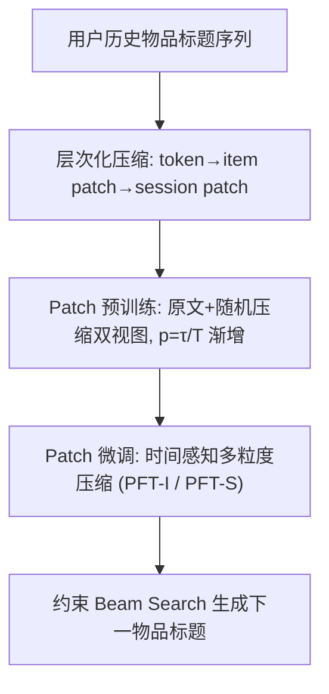
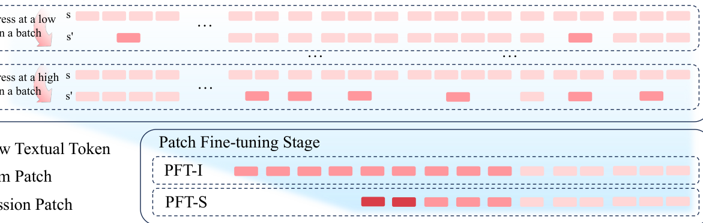

# Multi-Grained Patch Training for Efficient LLM-based Recommendation (面向高效 LLM 推荐的多粒度 Patch 训练)

- **会议/期刊**: SIGIR 2025
- **作者与机构**: Jiayi Liao, Sihang Li, Xiang Wang, Xiangnan He (USTC) ; Ruobing Xie, Xingwu Sun, Zhanhui Kang (腾讯机器学习平台部)
- **推荐链路定位**: 端到端生成式（LLM 序列推荐）
- **研究方向**: 大语言模型推荐 / 序列与会话推荐
- **论文原文**: [论文原文链接](https://arxiv.org/abs/2501.15087v2)
- **开源代码**: [开源代码仓库链接](https://github.com/ljy0ustc/PatchRec)

## TL;DR (1分钟核心速览)

LLM4Rec 受上下文窗口与 $O(n^2)$注意力开销限制，只能截断保留最近$K$ 条交互，长程兴趣被丢弃。PatchRec 在 LLM 嵌入空间做层次化压缩：物品标题 token 均值池化为 item patch，相邻 item patch 再池化为 session patch，并用「Patch 预训练 + 时间感知 Patch 微调」两阶段让 LLM 读懂自定义压缩表征。在 MovieLens-1M/Goodreads/MovieLens-100K 的 Full-Ranking 协议下，同 100 条历史时仅用 TALLRec 7.34% 输入 token，Goodreads HR@20 相对提升 26.75%；同 token 预算下最多建模 3.44 倍行为，HR@20 最高提升 72%。

## Background & Motivation (背景与核心矛盾)

- **主流范式**: TALLRec 类工作把用户历史物品标题拼成 prompt，SFT 让 LLM 自回归生成下一个物品标题，并用候选标题前缀树做约束 beam search。
- **前人局限**: 其一，受上下文长度与推理成本约束必须截断到最近 $K$（常见 5/10/20）条，长程兴趣丢失；其二，每个物品由多个文本 token 表示，自注意力$O(n^2)$ 使长历史不可承受。
- **核心洞察 (Key Insight)**: 作者把 $K$ 从 10 扩到 140 做初步实验（图 3），HR@20 从 0.1363 单调升至 0.1503——**历史越长收益越大**，瓶颈纯粹是 token 成本而非信息无用；同时发现「纯压缩」方案（Pure-Item/Pure-Session）虽省 token 却落在性能-效率帕累托前沿之下。
- **本文切入点**: 用「越久远越粗粒度」的层次化嵌入压缩替代文本截断，并显式训练 LLM 理解这种压缩空间。

## Method (核心方法设计)

### 1. 整体框架 (Overall Architecture)

输入为按时间排序的物品标题序列，先做两级池化压缩：token→item patch→session patch；再经两阶段训练——Patch 预训练阶段在同一 batch 内同时喂入原始序列 $s$与随机压缩序列$s'$，以压缩概率调度$p=\tau/T$ 从 0 渐增到 1，建立 patch 与文本 token 的对应关系；Patch 微调阶段按时间衰减施加多粒度压缩（近期保留文本、中期 item patch、远期 session patch），最后在候选标题前缀树上做约束 beam search 生成下一物品。

<figure class="paper-figure" markdown="span">
  <figcaption>图5：PatchRec的两阶段训练框架。在patch预训练阶段，我们为每个未压缩序列𝑠增强一个压缩版本𝑠′，其中每个物品被独立且随机地从原始文本token压缩为物品patch，以建立物品patch与文本物品标题之间的联系。在训练过程中，压缩程度从0逐渐增加到1。在patch微调阶段，我们使用时间感知的压缩序列微调LLM，使LLM熟悉各种压缩粒度的混合空间。</figcaption>
</figure>

### 2. 关键设计拆解 (Key Designs)

1. **层次化 Patch 构建（把多 token 物品压成单 token）**：痛点是一物品多 token 导致序列爆炸。做法极简——item patch 为标题 token 嵌入均值 $\boldsymbol{z}^i_j=\frac{1}{|\mathcal{T}_j|}\sum_{t\in\mathcal{T}_j}\boldsymbol{x}_t$，session patch 为窗口内$L$个 item patch 的均值$\boldsymbol{z}^s_j=\frac{1}{|\mathcal{S}_j|}\sum_{t\in\mathcal{S}_j}\boldsymbol{z}^i_t$，维度仍为$d$，可直接塞进 LLM 输入。直觉：标题 token 本身语义内聚，均值池化在保留核心语义的同时把长度压到 1，且不引入额外参数。

2. **Patch 预训练（让 LLM 认识自定义嵌入）**：痛点是 LLM 从未见过均值池化向量，直接替换会语义失配。做法是在每个 batch 内对每条序列独立以概率 $p$将物品压成 patch，目标仍为下一物品的似然$P(Y\mid \boldsymbol{x}_1,\dots,\boldsymbol{x}_{k-1},\boldsymbol{z}^i_j,\boldsymbol{x}_{k+n+1},\dots,\boldsymbol{x}_N;\Theta)$，$p=\tau/T$ 线性升温。直觉：同一 batch 内原文与压缩视图并存，等价于构造「token↔patch」的平行语料，让模型在压缩率渐变中平滑迁移到 patch 空间。

3. **时间感知微调与训练目标**：PFT-I 保留最近 $M$ 条为文本、更早的压为 item patch（中等压缩比）；PFT-S 进一步把最新组保留文本、次新组压为 item patch、更早组压为 session patch（高压缩比）。总损失即标准自回归负对数似然，**无需负采样**（全库候选由前缀树约束解码隐式完成排序）；推理开销随输入 token 线性下降，压缩比 CR 定义为压缩前后历史 token 数之比。

## Experimental Setup & Evaluation Protocol (实验设置与评估协议)

- **数据集与预处理**: MovieLens 按评分 ≥3 过滤、Goodreads 按评分 =5 过滤并剔除交互 <50 的用户与 <10 的物品、MovieLens-100K 保留交互 >20 的用户。

| 数据集 | #Users | #Items | #Interactions | 平均序列长 | 平均标题 token |
| :--- | :---: | :---: | :---: | :---: | :---: |
| MovieLens-1M | 6,037 | 3,883 | 575,281 | 95.28 | 3.94 |
| Goodreads | 2,090 | 8,793 | 162,539 | 77.77 | 9.82 |
| MovieLens-100K | 682 | 1,682 | 51,824 | 75.99 | 3.86 |

- **数据划分与防穿越**: 按全局时间戳做 `48:1:1` 比例划分（train/valid/test），严格防穿越。
- **排名评测协议**: 无偏 `Full-Ranking`（全库未交互物品排序），通过候选标题前缀树约束 beam search 保证生成合法物品；指标 HR@10/20、NDCG@10/20，另设压缩比 CR 度量效率。
- **对比基线与超参**: 传统序列模型 GRU4Rec/Caser/SASRec、高效长序列模型 LinRec/Mamba4Rec、LLM 类 MoRec/TALLRec；骨干为 Llama-3.2-1B-Instruct 全参微调，每阶段 1 epoch，学习率 8e-6/5e-5/1e-5，batch 64（Goodreads 32），显著性 $p\ll 0.05$。

## Key Experimental Results (实验关键数据)

### 1. 主实验对比 (Main Results)

统一截断 100 条历史（PatchRec-I 保留最近 $M=5$条文本，PatchRec-S 组大小$L=5$/$20$）：

| 模型 | ML-1M HR@20 | ML-1M N@20 | Goodreads HR@20 | Goodreads N@20 | ML-100K HR@20 | CR (1M/GR/100K) |
| :--- | :---: | :---: | :---: | :---: | :---: | :---: |
| SASRec | 0.1035 | 0.0397 | 0.0569 | 0.0271 | 0.1069 | - |
| Mamba4Rec | 0.1116 | 0.0421 | 0.0450 | 0.0188 | 0.1086 | - |
| MoRec | 0.0616 | 0.0233 | 0.0236 | 0.0089 | 0.0762 | - |
| TALLRec | 0.1482 | 0.0491 | 0.0770 | 0.0249 | 0.1680 | 1.00 |
| **PatchRec-I** | **0.1616** | **0.0525** | 0.0976 | 0.0293 | **0.1738** | 3.44 / 6.81 / 3.38 |
| **PatchRec-S** | 0.1526 | 0.0496 | **0.1013** | **0.0301** | 0.1680 | 9.23 / 13.62 / 3.85 |
| Improv. (vs TALLRec) | +9.04% | +6.92% | +31.56% | +20.9% | +3.45% | 最高 13.62× |

### 2. 消融实验 (Ablation Study)

| 配置 (MovieLens-1M) | HR@10 | N@10 | HR@20 | N@20 |
| :--- | :---: | :---: | :---: | :---: |
| PatchRec-I w/o Patch 预训练 | 0.1014 | 0.0439 | 0.1550 | 0.0504 |
| **PatchRec-I w/ Patch 预训练** | **0.1058** | **0.0455** | **0.1616** | **0.0525** |
| PatchRec-S w/o Patch 预训练 | 0.0920 | 0.0386 | 0.1436 | 0.0463 |
| **PatchRec-S w/ Patch 预训练** | **0.0967** | **0.0408** | **0.1526** | **0.0496** |
| TALLRec（无压缩） | 0.0933 | 0.0396 | 0.1482 | 0.0491 |
| Dropout 数据增广 | 0.0936 | 0.0402 | 0.1480 | 0.0492 |
| Patch 预训练（仅该阶段） | 0.1026 | 0.0431 | 0.1610 | 0.0532 |

### 3. 关键实验发现 (Key Findings)

1. **压缩不是「丢信息」而是「提密度」**：同 100 条历史下 PatchRec-I 在 ML-1M/Goodreads 上 HR@20 反超 TALLRec 9.04%/26.75%，说明均值池化抑制了早期噪声交互；而 Dropout 增广（0.1480）几乎与 TALLRec 持平，证明增益并非来自随机丢弃物品。
2. **预训练阶段是压缩空间可用的前提**：去掉 Patch 预训练后 PatchRec-I 的 HR@20 从 0.1616 掉到 0.1550（-4.1%），PatchRec-S 从 0.1526 掉到 0.1436（-5.9%），说明 LLM 必须先在混合视图中建立 token↔patch 映射。
3. **长历史用户收益最大**：在 ML-1M 交互 ≥500 的用户群上，PatchRec-I 以 12.99% 推理时间取得 HR@20 +25.11%，PatchRec-S 推理时间降至 1/13.09 仍 +20.31%，且 PatchRec-S 可在 40GB A100 内一次容纳全部 1435 条历史。

## Highlights & Limitations (亮点、对比与审稿批判)

- **与代表作对比 (vs. Prior Work)**: 相比 TALLRec 的「文本截断」，本文用嵌入压缩把截断变成有损但可控的降采样；相比 MemoryBank/PURE/ReLLA 依赖外部记忆摘要或语义检索，PatchRec 让 LLM 直接内化压缩历史，无需额外模块；相比 Pure-Item/Pure-Session 的朴素替换，两阶段训练补齐了「时间显著性」与「压缩可理解性」两块短板。
- **可迁移亮点**: ①「同 batch 双视图 + 压缩率线性升温」是让任意自定义嵌入被 LLM 接受的通用配方；②「越久远越粗粒度」的层级压缩可直接迁移到长行为序列的生成式召回与用户画像压缩。
- **审稿级局限批判**: ①仍依赖 1B 级 LLM 全参微调与自回归解码，实时性距工业召回/精排要求尚远，作者亦承认需蒸馏/量化；②压缩粒度（$M$、$L$、session 划分）为固定超参，未做自适应策略，且均值池化对长标题（Goodreads 平均 9.82 token）信息损失缺乏理论刻画。

## Rating (四维评分)

- **方法创新性 (Novelty)**: ⭐⭐⭐⭐ （层次化 patch + 两阶段压缩空间对齐思路简洁新颖，但池化算子本身朴素，理论支撑偏经验）
- **评估协议与实验扎实度 (Protocol & Experiments)**: ⭐⭐⭐⭐ （三数据集 Full-Ranking + 时间切分 + 显著性检验，RQ1/RQ2 双视角与长历史分桶实验完整，缺少线上验证）
- **写作与数学规范度 (Clarity & Rigor)**: ⭐⭐⭐⭐ （公式精简、压缩比定义清晰、图示直观，但缺少复杂度与信息损失的定量分析）
- **工业落地与复现价值 (Industrial & Practical Value)**: ⭐⭐⭐⭐ （代码开源、压缩比可调可适配算力预算，但 LLM 推理延迟仍是落地主要障碍）

