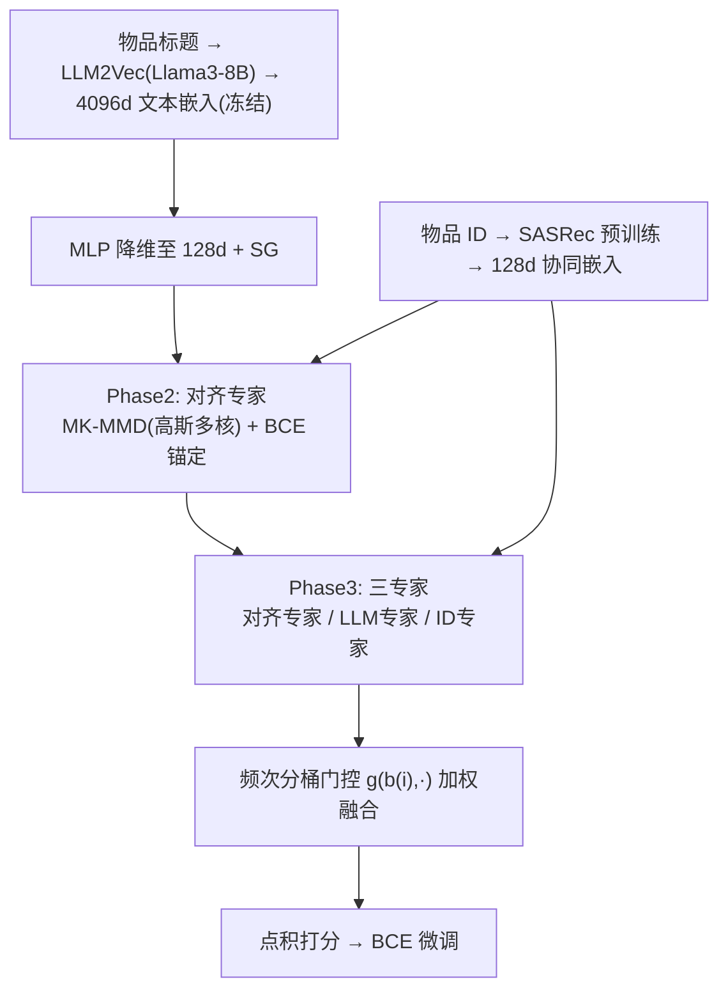
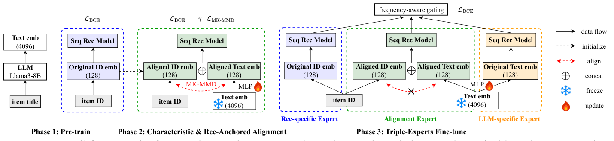

# Pre-train, Align, and Disentangle: Empowering Sequential Recommendation with Large Language Models (预训练、对齐与解耦：用大语言模型增强序列推荐)

- **会议/期刊**: SIGIR 2025
- **作者与机构**: Yuhao Wang, Pengyue Jia, Wanyu Wang, Maolin Wang, Xiangyu Zhao (香港城市大学)；Junwei Pan, Zhixiang Feng, Xiaotian Li, Jie Jiang (腾讯)
- **推荐链路定位**: 精排（序列推荐打分）
- **研究方向**: 大语言模型推荐 / 序列推荐
- **论文原文**: [https://arxiv.org/abs/2412.04107v2](https://arxiv.org/abs/2412.04107v2)
- **开源代码**: [https://github.com/Applied-Machine-Learning-Lab/PAD](https://github.com/Applied-Machine-Learning-Lab/PAD)

## TL;DR (1分钟核心速览)

现有 LLM4Rec 要么把 LLM 直接当推荐器（推理延迟高不可用），要么用 InfoNCE/余弦等**非特征核**把文本嵌入对齐到协同空间（无法刻画分布全部统计量，且对齐会灾难性遗忘协同嵌入）。PAD 提出三阶段范式：先用 LLM2Vec 与 SASRec 各自预训练，再用**高斯多核 MK-MMD + 推荐 BCE 锚定**做对齐，最后用**对齐专家 + ID 专家 + LLM 专家**的三专家架构按目标物品频次门控融合。在 MIND/Electronics/Prime Pantry 上采用全库 Full-Ranking 评测，nDCG@10 相对 SASRec 提升 12.15%/93.67%/47.80%，冷物品 HR@10 提升达 462.61%。

## Background & Motivation (背景与核心矛盾)

- **主流范式**: 一条路是 TALLRec/LC-Rec 类指令微调让 LLM 直接生成下一物品标题；另一条是 LLaRA/CoLLM 把 token 嵌入与协同嵌入拼接；CTRL/Flip 则用对比学习把 LLM 嵌入对齐进协同空间。
- **前人局限一（核选择错误）**: CTRL/Flip 采用余弦/线性等**非特征核 (non-characteristic kernel)**，RKHS 理论表明其核均值映射非单射，无法保留分布的全部统计信息，对齐目标本身就有偏。
- **前人局限二（灾难性遗忘）**: 对齐损失常是唯一优化目标，协同嵌入在向文本空间靠拢时被破坏；作者用 Kendall's tau 实测发现单嵌入表下 bucket 1–9 的偏序一致性跌破 0.5，即超过一半的距离偏序被打乱，且后续 SFT 无法恢复。
- **核心洞察 (Key Insight)**: 文本信息应作为**辅助**而非替代——对齐后的空间必须"锚定"在推荐语义上；同时原始协同嵌入的分布信息（行为-目标距离的排序）本身携带不可替代的信号，必须用独立专家保留。
- **本文切入点**: 用特征核 MK-MMD 保证对齐的统计完备性，用 BCE 锚定防止遗忘，再用双嵌入表的三专家结构把"对齐信息"与"原始模态信息"物理隔离。

## Method (核心方法设计)

### 1. 整体框架 (Overall Architecture)

PAD 分三阶段闭环。**Phase 1**：用 LLM2Vec（Llama3-8B + 无监督 LoRA）对物品标题编码得到 4096 维文本嵌入并冻结；同时用 SASRec 仅在 ID 上预训练得到 128 维协同嵌入。**Phase 2**：构建对齐专家，文本嵌入经可学习 MLP 降维至 128 维（带 stop-gradient），与协同嵌入共同输入 SASRec，用 MK-MMD 拉近两个分布、同时用推荐 BCE 锚定协同语义。**Phase 3**：复制出三套专家（对齐专家、仅吃文本的 LLM 专家、仅吃 ID 的推荐专家），按目标物品频次分桶学习门控权重融合三路 logit，端到端用 BCE 微调。推理时只走轻量 SASRec 结构，不调用 LLM 前向。

<figure class="paper-figure" markdown="span">
  <figcaption>图1：PAD的整体框架。括号中的数字（128和4096）表示嵌入维度。预测logit通过将序列嵌入（推荐模型的输出）与目标物品嵌入相乘计算得到。为简洁起见，省略了乘法操作。</figcaption>
</figure>

### 2. 关键设计拆解 (Key Designs)

1. **特征核 MK-MMD + 推荐锚定的对齐损失**：痛点是非特征核的核均值非单射、且纯对齐会摧毁协同嵌入。做法是把对齐损失换成高斯多核 MMD 并叠加 BCE：

$$\mathcal{L}=\mathcal{L}_{\text{REC}}+\gamma\cdot\mathcal{L}_{\text{MK-MMD}},\quad \mathcal{L}_{\text{MK-MMD}}=D_k^2\big(\{h_i^s\}_a,\{h_i^c\}_a\big)$$

其中 $k=\sum_{u=1}^{m}\beta_u k_u$，$k_u(x,x')=\exp(-\lVert x-x'\rVert^2/2\sigma^2)$，取$m=5$、$\sigma\in\{-3,-2,-1,0,1\}$（对数尺度），$\gamma=0.2$。直觉：特征核保证分布映射单射，从而"对齐"是在完整统计意义下进行的；BCE 项则把协同嵌入钉在推荐目标上，使其在对齐中不被拉走。注意协同嵌入在此阶段**不冻结**（冻结反而损害文本对齐，见实验）。

2. **三专家架构与频次感知门控**：痛点是对齐不可避免地损失协同信息，单嵌入表无法兼顾。做法是为每个模态准备两张嵌入表，三路输出为

$$o_{\text{id}}=f_{\text{id}}(\{h_i^c\}),\quad o_{\text{align}}=f_{\text{align}}(\text{MLP}(\text{SG}(\{h_i^s\}_a)),\{h_i^c\}_a),\quad o_{\text{LLM}}=f_{\text{LLM}}(\text{MLP}(\text{SG}(\{h_i^s\}))),$$

最终 logit 为 $\Phi=\sum_{e\in\{\text{id},\text{align},\text{LLM}\}} g_e(b(i),\cdot)\cdot o_e$，门控以目标物品频次桶$b(i)$ 为条件。直觉：冷物品的 ID 嵌入不可信，门控应自动偏向 LLM/对齐专家；热物品则回归协同信号，实现"按可信度分配模态权重"。

3. **训练目标、负采样与推理效率**：三阶段均用 BCE（每样本一个正样本 + 一个负样本的点击/评分二分类形式），无额外负采样工程；Phase 3 仅保留 $\mathcal{L}_{\text{REC}}$，移除 MMD 项。推理阶段完全脱离 LLM，仅执行 SASRec 前向 + 三专家点积，延迟与原生 SASRec 同量级，这是相对指令微调式 LLM4Rec 的核心工程优势。

## Experimental Setup & Evaluation Protocol (实验设置与评估协议)

- **数据集与预处理**: 用户保留交互数 $\geq 5$，取最近 23 个交互，用第$(l-2)$、$(l-1)$、$l$ 个物品分别构造训练/验证/测试目标。

| 数据集 | #Users | #Items | #Interactions | 稀疏度/密度 | 特征/场景说明 |
| :--- | :---: | :---: | :---: | :---: | :--- |
| MIND | 630,235 | 79,707 | 9,667,540 | 密度约 0.019% | 新闻点击，含标题/摘要/正文 |
| Electronics | 598,307 | 423,191 | 5,137,265 | 密度约 0.002% | 亚马逊电商，评分 >3 为正 |
| Prime Pantry | 12,871 | 8,347 | 115,004 | 密度约 0.107% | 亚马逊杂货，极稀疏小数据集 |

- **数据划分与防穿越 (Splitting Strategy)**: 采用 `Leave-One-Out` 式序列切分（按时间戳升序，最后三个位置分别作 train/valid/test 目标），严格保证行为序列只含目标之前的历史。
- **排名评测协议 (Ranking Protocol)**: 无偏 `Full-Ranking`，在整个物品全集上排序，指标为 HR@10 与 nDCG@10，按用户平均；结果取 3 次运行均值，并用 $t$-test 标注$p<0.05$ 显著性。
- **对比基线与超参设置**: 基线含 SASRec、Hybrid (CoLLM/LLaRA 式拼接)、MoRec、CTRL、MAKE、DisCo，以及作者自建的 SMEM（共享+模态专属嵌入，对标 STEM）。嵌入维度 $d=128$，文本侧 4096 维经 MLP 降维；AdamW、batch size 16、dropout 0.1、$L_2$ 权重 0.1、早停 10 epoch。

## Key Experimental Results (实验关键数据)

### 1. 主实验对比 (Main Results)

| 数据集 | 指标 | SASRec | Hybrid | CTRL | MAKE | DisCo | SMEM | **PAD** | Improv. |
| :--- | :--- | :---: | :---: | :---: | :---: | :---: | :---: | :---: | :---: |
| MIND | HR@10 | 16.8437 | 17.3385 | 18.1318 | 16.4317 | 17.3367 | 18.4319 | **18.6703** | +10.84% |
| MIND | nDCG@10 | 9.0520 | 9.3321 | 9.7996 | 8.9684 | 9.4131 | 10.0003 | **10.1515** | +12.15% |
| Electronics | HR@10 | 1.6754 | 1.5673 | 1.9468 | 0.9495 | 1.8148 | 2.3492 | **2.4804** | +48.05% |
| Electronics | nDCG@10 | 0.7938 | 0.8385 | 0.9370 | 0.4611 | 0.9025 | 1.4287 | **1.5373** | +93.67% |
| Prime Pantry | HR@10 | 2.6338 | 3.1000 | 2.8048 | 3.3408 | 2.8358 | 3.4341 | **3.8303** | +45.43% |
| Prime Pantry | nDCG@10 | 1.2926 | 1.5606 | 1.3700 | 1.6379 | 1.3451 | 1.7440 | **1.9104** | +47.80% |

相对最强基线 SMEM，PAD 在 nDCG@10 上分别再提升 1.51%/7.60%/9.54%。兼容性实验（表 3）显示 PAD 可挂载 GRU4Rec（MIND HR@10 +23.73%）与 Caser（Prime Pantry HR@10 +115.49%），验证模型无关性。

### 2. 消融实验 (Ablation Study)

| 变体 (MIND, SASRec backbone) | 结果表现 |
| :--- | :--- |
| Full model | 最优（HR@10 = 18.6703） |
| w/o Align Expert | 下降 |
| w/o LLM Expert | 下降 |
| w/o Rec (ID) Expert | **下降最大** |
| w/o frequency-aware gating | HR@10 下降 3.06% |
| Rec Expert only | 显著劣于 Full |
| Align Expert only | 三单专家中最佳 |
| LLM Expert only | 最弱 |

对齐损失对比（图 5a）：高斯/拉普拉斯（特征核）> Info_NCE > 余弦/线性（非特征核）。锚定对比（图 4）：Rec-Anchored > Rec-Anchored+Frozen > Non-Anchored，且 Non-Anchored 有时甚至劣于完全不对齐的 SMEM。

### 3. 关键实验发现 (Key Findings)

1. **冷启收益远大于热物品**：Electronics 上 PAD 相对 SASRec 在 warm/median/cold 三档的 nDCG@10 提升分别为 63.36%/202.02%/462.61%，冷物品提升是热物品的 7.3 倍；图 3 的距离分布进一步显示只有 PAD 能让"协同距离大"的物品对在文本空间中也保持大距离，说明对齐真正注入了语义可分性。
2. **锚定是必需品而非锦上添花**：非锚定对齐在部分数据集上不如不对齐，说明纯 MMD 对齐会破坏协同嵌入；而冻结协同嵌入虽彻底防遗忘，却因阻断文本向协同空间靠拢而次优，只有"可更新 + BCE 锚定"取得最优。
3. **ID 专家不可省，门控不可省**：移除 ID 专家造成最大跌幅，证明即便有锚定损失，对齐仍会丢失协同信息；移除频次门控使 HR@10 掉 3.06%，说明按物品频次动态调配模态可信度是有效增益来源。此外 LLM2Vec(Llama3-8B) 优于 BERT-Base（HR@10 18.6703 vs 18.3989），印证大模型编码能力优势。

## Highlights & Limitations (亮点、对比与审稿批判)

- **与代表作对比 (vs. Prior Work)**: 相比 CTRL/Flip 的 InfoNCE 对齐，PAD 换用特征核 MK-MMD 并加 BCE 锚定，从"对比式拉近"升级为"分布级统计对齐 + 语义保真"；相比 CoLLM/LLaRA 的简单拼接，PAD 用三专家把对齐信息与原始模态信息解耦，避免单嵌入表被对齐污染；相比 MAKE 的双专家，PAD 多出对齐专家且引入频次门控，冷热物品差异化融合。
- **可迁移亮点**: (1) 用 Kendall's tau 度量"对齐前后嵌入距离分布的偏序一致性"来量化灾难性遗忘，是一个与维度无关、可跨模态复用的诊断工具；(2) 以目标物品频次分桶驱动 MoE 门控，可低成本迁移到任何多模态/多源特征融合场景。
- **审稿级局限批判**: (1) 三阶段流水线 + 三专家 + 双嵌入表使训练流程与显存开销明显重于单塔基线，论文未给出训练时长与显存对比；(2) 文本嵌入依赖离线 LLM2Vec 编码，物品标题更新需重跑 LLM 前向，冷启新物品的上线时延未被讨论；(3) 仅在三个公开数据集验证，缺少线上 A/B 或工业级延迟实测，且 Electronics 上 HR@10 绝对值仅 2.48%，实际业务收益幅度仍待检验。

## Rating (四维评分)

- **方法创新性 (Novelty)**: ⭐⭐⭐⭐ （把 RKHS 特征核理论引入 LLM-推荐对齐，并用 Kendall's tau 实证遗忘现象，问题诊断与方案设计形成闭环）
- **评估协议与实验扎实度 (Protocol & Experiments)**: ⭐⭐⭐⭐ （三数据集 Full-Ranking + 显著性检验 + 冷热分桶 + 兼容性实验齐全，但缺训练开销与线上验证）
- **写作与数学规范度 (Clarity & Rigor)**: ⭐⭐⭐⭐ （MK-MMD 与三专家公式定义清晰、核参数交代明确，Phase 2/3 中嵌入冻结策略的表述略分散需对照图 1 阅读）
- **工业落地与复现价值 (Industrial & Practical Value)**: ⭐⭐⭐⭐ （推理完全脱离 LLM、代码开源、模型无关可插拔，但三阶段训练管线与双嵌入表带来额外工程成本）

