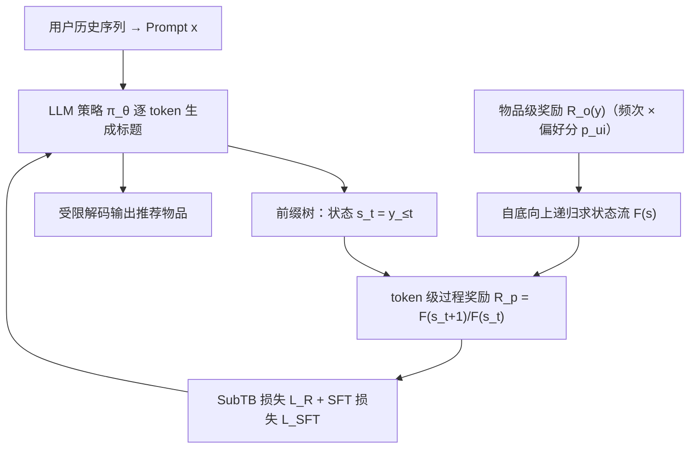

# Process-Supervised LLM Recommenders via Flow-guided Tuning (基于流引导微调的过程监督式 LLM 推荐器)

- **会议/期刊**: SIGIR 2025
- **作者与机构**: Chongming Gao, Mengyao Gao, Chenxiao Fan, Shuai Yuan, Wentao Shi, Xiangnan He (USTC / HKUST)
- **推荐链路定位**: 端到端生成式（LLM 指令微调阶段）
- **研究方向**: 大语言模型推荐 / 生成式推荐
- **论文原文**: [https://arxiv.org/abs/2503.07377v3](https://arxiv.org/abs/2503.07377v3)
- **开源代码**: [https://github.com/MrPeach0301/Flower](https://github.com/MrPeach0301/Flower)

## TL;DR (1分钟核心速览)

LLM 推荐器普遍用 SFT（交叉熵逐 token 最大化）微调，其似然最大化目标会放大流行度偏置、压缩推荐多样性。本文提出 Flower，把 GFlowNet 的"流"概念搬到物品标题前缀树上：将物品级奖励递归分解为 token 级过程奖励 $R_p(s_t,a_t)=F(s_{t+1})/F(s_t)$，用 SubTB 平衡损失让每个 token 的生成概率正比于其奖励流，从而在微调阶段即完成分布对齐。在 Amazon CDs/Video Games/Movies 三数据集上，Flower 在 NDCG@5、DGU@10、MGU@10、词熵与 TTR 上全面优于 BIGRec、D³、IFairLRS，且作为 PPO/DPO 的参考策略仍保持增益。

## Background & Motivation (背景与核心矛盾)

- **主流范式**: LLM 推荐以 BIGRec 为代表，将用户历史序列拼成 prompt，用交叉熵 SFT 让模型逐 token 生成目标物品标题，推理时用受限解码保证输出合法物品。
- **前人局限**: 其一，SFT 的似然最大化天然偏向训练集中高频 token/物品，导致流行度偏置与公平性恶化（图 2 显示 top-5 推荐严重向最热门组倾斜，提高温度只能部分缓解且牺牲精度）；其二，后续补救方案各有硬伤——IFairLRS 仅对整条标题重加权、无法提升多样性，多阶段 SFT 依赖人工流程且误差传播，RLHF/PPO 的奖励最大化会向高奖励坍缩，DPO 把负样本概率压向零引发分布坍缩。
- **核心洞察 (Key Insight)**: 问题的根不在"奖励设计"而在"监督粒度"——SFT 是逐 token 的局部监督，而奖励是物品级的全局信号，二者错位；若能把物品级奖励无损地摊到每个 token 上，就能在微调阶段直接做过程监督。
- **本文切入点**: 物品标题天然构成前缀树（一棵特殊 DAG），GFlowNet 的流平衡在此可**解析计算、无需学习流函数**，于是"奖励→token 级奖励"的分解是免费的。

## Method (核心方法设计)

### 1. 整体框架 (Overall Architecture)

Flower 把"生成一个物品标题"视为在前缀树上从根到叶的路径遍历：节点是 token 前缀状态 $s_t=y_{\le t}$，边是追加合法 token 的动作。先由物品级奖励$R_o(y)$（训练集出现频次，可乘个性化偏好分$p_{ui}$）自底向上递归求和得到每个前缀节点的状态流$F(s)=\sum_{s'\in \text{Child}(s)}F(s')$，叶节点流即奖励、根节点流即归一化常数$Z$；再由相邻两层流之比得到 token 级过程奖励，用 SubTB 平衡损失约束"策略概率乘积 = 流之比"，与原始 SFT 损失加权联合训练。推理沿用 BIGRec 的受限解码，仅在合法前缀分支上采样。

### 2. 关键设计拆解 (Key Designs)

1. **前缀树上的解析状态流（免学习流函数）**：通用 GFlowNet 需额外参数化流函数 $F_\phi(s)$并学习，代价高且在小数据上不稳。本文利用标题集合共享前缀的树结构，直接令叶流等于奖励、内部节点流等于子节点流之和，即$F(s)=\sum_{s'\in\text{Child}(s)}F(s')$，一次自底向上遍历即可精确得到全部$F(s)$。直觉上，$F(s)$ 就是"经过该前缀的所有物品的奖励总和"，天然刻画了该前缀的"潜在价值质量"。

2. **token 级过程奖励与 SubTB 目标**：定义过程奖励为相邻状态流之比 $R_p(s_t,a_t)=F(s_{t+1})/F(s_t)$，它表示"在前缀$s_t$下选 token$y_{t+1}$所分得的奖励份额"。代入 SubTB 平衡约束（前缀树中每个节点只有一个父节点，故反向策略$P_B\equiv 1$）得到

$$\mathcal{L}_R(\tau_{m,n})=\Big(\sum_{t=m}^{n-1}\log\pi_\theta(y_{t+1}\mid x,y_{\le t})-\sum_{t=m}^{n-1}\log R_p(y_{\le t},y_{t+1})\Big)^2$$

当子轨迹长度退化为 2 时，该目标即"令 $\pi_\theta(y_{t+1}\mid\cdot)$直接拟合$R_p$"，实现真正的逐 token 过程监督。其物理直觉是：策略在每一步的采样概率应与该步所承载的奖励份额成正比，从而整体生成分布正比于$R_o$，即经验分布匹配。

3. **个性化奖励注入与训练目标**：纯频次奖励对所有用户相同，缺乏个性化。作者用任意辅助模型（此处 SASRec）给出偏好分 $p_{ui}$，以三种方式改写过程奖励项：$\log R_p$、$\log(R_p\cdot p_{ui})$、$\log\frac{R_p}{p_{ui}}$，实验表明$\log\frac{R_p}{p_{ui}}$ 综合最优。总损失为

$$\mathcal{L}_{\text{Flower}}=\mathcal{L}_{\text{SFT}}+\lambda\sum_{\tau\in\mathcal{T}}\sum_{0\le m<n\le T}\mathcal{L}_R(\tau_{m,n})$$

其中 SFT 项在离线数据上训练、SubTB 项 on-policy 采样标题集合 $\mathcal{T}$ 后遍历所有可行子轨迹；**无需负采样**（GFlowNet 的流平衡本身提供对比信号），奖励为启发式赋值、不引入额外可学习参数。

## Experimental Setup & Evaluation Protocol (实验设置与评估协议)

- **数据集与预处理**: Amazon Review 三个类目，按 BIGRec 策略截断时间窗、过滤交互数 <5 的用户与物品（5-core）、历史序列最长 10：

| 数据集 | #Users | #Items | #Interactions | 时间窗 | 说明 |
| :--- | :---: | :---: | :---: | :---: | :--- |
| CDs and Vinyl | 7,685 | 5,841 | 69,249 | 2015.10–2018.10 | 音乐 |
| Video Games | 9,066 | 3,858 | 70,483 | 2015.10–2018.10 | 游戏 |
| Movies and TV | 3,663 | 2,653 | 31,085 | 2017.10–2018.10 | 影视 |

- **数据划分与防穿越**: 按时间戳**比例划分** 8:1:1（训练/验证/测试），严格时序切分。
- **排名评测协议**: 采用**受限解码 + 全候选合法前缀采样**的生成式评测（非采样负例排序），top-5 报告 NDCG@5、HR@5；公平性用 DGU@10、MGU@10（推荐结果与训练集历史分布的组间差异，按流行度八等分分组，越低越好）；多样性在**词级**度量：词熵 H 与 Type-Token Ratio（TTR）。
- **对比基线与超参**: SASRec（传统序列）、BIGRec（SFT 代表）、Temp（推理调温）、D³（去长度归一化 + SASRec 辅助）、IFairLRS（类别重加权公平化）；基座 Qwen2.5-1.5B-Instruct，lr=3e-4，batch=128，最多 7 epoch，早停 patience=2，AdamW，$\lambda\in[1\text{e-}4,5\text{e-}1]$。

## Key Experimental Results (实验关键数据)

### 1. 主实验对比 (Main Results)

| 方法 | CDs NDCG@5 | CDs HR@5 | CDs DGU@10↓ | CDs MGU@10↓ | CDs H↑ | VG NDCG@5 | VG HR@5 | VG DGU@10↓ | Movies NDCG@5 | Movies DGU@10↓ | Movies H↑ |
| :--- | :---: | :---: | :---: | :---: | :---: | :---: | :---: | :---: | :---: | :---: | :---: |
| SASRec | 0.0641 | 0.0851 | 0.184 | 0.038 | 9.188 | 0.0369 | 0.0544 | 0.167 | 0.0902 | 0.138 | 8.892 |
| BIGRec | 0.0573 | 0.0715 | 0.217 | 0.045 | 5.900 | 0.0326 | 0.0466 | 0.151 | 0.0930 | 0.123 | 8.297 |
| Temp | 0.0503 | 0.0627 | 0.222 | 0.044 | 6.202 | 0.0306 | 0.0444 | 0.129 | 0.0852 | 0.139 | 8.145 |
| D³ | **0.0812** | **0.0999** | 0.355 | 0.072 | 7.635 | **0.0413** | **0.0607** | 0.220 | **0.1007** | 0.147 | 8.348 |
| IFairLRS | 0.0621 | 0.0762 | 0.217 | 0.045 | 6.420 | 0.0396 | 0.0568 | 0.144 | 0.0957 | 0.159 | 8.048 |
| **Flower** | 0.0700 | 0.0885 | **0.075** | **0.021** | **7.919** | 0.0543 | 0.0799 | **0.108** | 0.0959 | **0.076** | **8.808** |

Flower 相对 BIGRec：CDs NDCG +22.2%、DGU 降低 65.4%；Video Games NDCG +66.6%、HR +71.5%；Movies DGU 降低 38.2%。相对 D³，Flower 精度略低（VG NDCG 0.0543 vs 0.0413 实为反超，CDs/Movies 略逊）但公平性大幅领先（CDs DGU 0.075 vs 0.355）。

### 2. 消融实验 (Ablation Study)

| 配置 | CDs NDCG@5 | CDs DGU@10↓ | VG NDCG@5 | VG DGU@10↓ | Movies NDCG@5 | Movies DGU@10↓ |
| :--- | :---: | :---: | :---: | :---: | :---: | :---: |
| $\log R_p$（无个性化） | **0.0712** | 0.071 | 0.0372 | 0.102 | 0.0930 | 0.084 |
| $\log(R_p\cdot p_{ui})$ | 0.0700 | **0.060** | 0.0366 | **0.092** | 0.0905 | 0.115 |
| $\log\frac{R_p}{p_{ui}}$（默认） | 0.0700 | 0.075 | **0.0543** | 0.108 | **0.0953** | **0.076** |
| 粒度=整条标题 | 0.022 | 0.20 | — | — | — | — |
| 粒度=每 10 token | 0.024 | 0.18 | — | — | — | — |
| 粒度=每 5 token | 0.026 | 0.16 | — | — | — | — |
| 粒度=每 1 token | **0.028** | **0.14** | — | — | — | — |

（粒度行为 Video Games 上每 20 步评估的均值，趋势与 CDs 一致；$\lambda=0.005$ 时综合最优。）

### 3. 关键实验发现 (Key Findings)

1. **过程监督粒度越细越好**：从"整条标题一个状态"到"每 token 一个状态"，Video Games 上 NDCG@5 由 0.022 升至 0.028、DGU@10 由 0.20 降至 0.14，说明理论等价的分布在有限步优化下，细粒度子轨迹带来更高样本效率与更强约束。
2. **公平性与精度并非零和**：D³ 靠 SASRec 协同信号把 VG NDCG 推到 0.0413，但 DGU 恶化到 0.220（全方法最差）；Flower 在 VG 上 NDCG 反超至 0.0543 同时 DGU 仅 0.108，证明把公平约束写进 token 级奖励可在提升精度的同时改善公平。
3. **Flower 是更好的对齐起点**：以 Flower 为参考策略接 S-DPO 后，CDs NDCG 0.0772 / DGU 0.085，全面优于 BIGRec 起点的 B_S-DPO（0.0712 / 0.104）；但接 RosePO 时因 RosePO 过度压制热门物品，F_RosePO 的 DGU 反而劣于 B_RosePO（0.127 vs 0.105），说明下游对齐器与初始分布需匹配。

## Highlights & Limitations (亮点、对比与审稿批判)

- **与代表作对比 (vs. Prior Work)**: 与 BIGRec 的本质区别是监督信号从"单 token 交叉熵"变为"token 分布对齐奖励流"；与 IFairLRS 的区别是公平约束从"整条标题重加权"下沉到"token 级概率约束"，故能同时改善多样性；与 DPO/PPO 类后验对齐的区别是 Flower 在微调阶段即完成分布塑形，且不追求奖励最大化而是**比例采样**，从根本上避免模式坍缩。
- **可迁移亮点**: ①"前缀树 + 解析流"技巧可迁移到任何以文本/语义 ID 序列表示物品的生成式推荐（如 TIGER 的 RQ-VAE 码本树），把物品级曝光/公平/多样性目标无损摊到码字级；②启发式 token 奖励免去 PRM 训练，适合反馈稀疏场景。
- **审稿级局限批判**: ①奖励仅取训练集频次，本质是拟合历史曝光分布，若历史本身有偏则"公平"只是复现旧分布，未必等于用户真实偏好；②SubTB 需 on-policy 采样并遍历所有子轨迹，训练开销显著高于 SFT，且 $\lambda$ 跨三个数量级敏感（最优 0.005，过大即崩溃），工程调参成本高；③仅在 1.5B 小模型与三个 Amazon 子集上验证，未报告线上 A/B 或更大模型的可扩展性。

## Rating (四维评分)

- **方法创新性 (Novelty)**: ⭐⭐⭐⭐ （首次将 GFlowNet 引入 LLM 推荐微调，前缀树解析流是简洁而有效的结构性洞察）
- **评估协议与实验扎实度 (Protocol & Experiments)**: ⭐⭐⭐⭐ （三维度六指标 + 分布拟合 KL/JS 定量 + 作为参考策略的下游验证，但缺线上实验与更大模型）
- **写作与数学规范度 (Clarity & Rigor)**: ⭐⭐⭐⭐ （流/过程奖励推导清晰、图示直观，SubTB 与 SFT 的量级差异有专门讨论）
- **工业落地与复现价值 (Industrial & Practical Value)**: ⭐⭐⭐ （代码开源、奖励免学习易落地，但 on-policy 子轨迹训练开销与 $\lambda$ 敏感性制约大规模部署）

