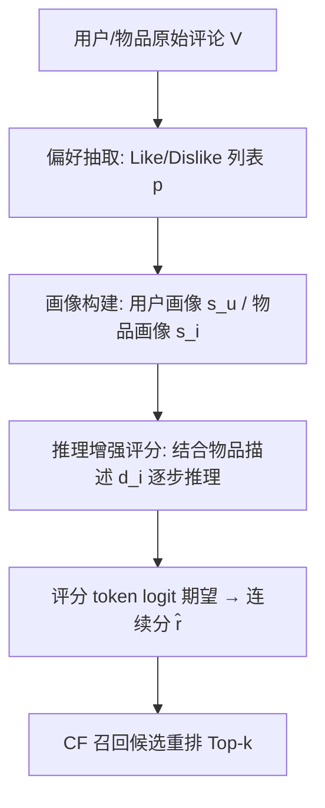
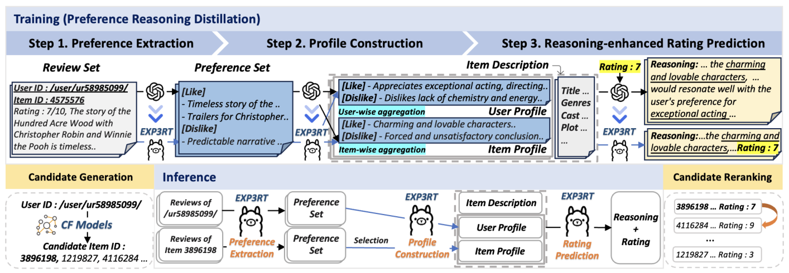

# Review-driven Personalized Preference Reasoning with Large Language Models for Recommendation (基于评论驱动个性化偏好推理的大语言模型推荐)

- **会议/期刊**: SIGIR 2025
- **作者与机构**: Jieyong Kim, Hyunseo Kim, Hyunjin Cho, SeongKu Kang, Buru Chang, Jinyoung Yeo, Dongha Lee（延世大学、高丽大学）
- **推荐链路定位**: 精排/重排（可独立做评分预测）
- **研究方向**: 大语言模型推荐 / 多任务学习与列表级重排
- **论文原文**: [https://arxiv.org/abs/2408.06276v5](https://arxiv.org/abs/2408.06276v5)
- **开源代码**: [https://github.com/jieyong99/EXP3RT](https://github.com/jieyong99/EXP3RT)

## TL;DR (1分钟核心速览)

现有 LLM 推荐器输入信息贫乏（仅 ID/标题/交互历史）、输出目标过短（yes/no 或单个分数），既限制精度又无法给出可信解释。Exp3rt 从用户/物品评论中抽取 Like/Dislike 偏好描述并聚合为结构化画像，再用 GPT-3.5 教师标注"逐步推理+评分"数据，通过 QLoRA 蒸馏进 Llama3-8B 学生模型。在 IMDB 与 Amazon-Book 上，评分预测 RMSE 相对最优基线降低约 2.1%–4.5%，冷启动子集优势更大；作为 BPR-MF/LightGCN 的重排器，Recall@10 提升 8%–18%，且解释质量人工评测全面胜出。

## Background & Motivation (背景与核心矛盾)

- **主流范式**: 微调 LLM 做二分类推荐（TALLRec）、评分预测（P5、LLMRec）、候选重排（LlamaRec、ZS-Ranker），输入多为用户/物品 ID、标题与交互历史。
- **前人局限**: 其一，输入信息不足，LLM 难以理解潜在偏好，泛化能力受限；其二，训练目标被压缩为短输出（yes/no 或整数分），缺乏丰富目标上下文，模型无法发挥 CoT 式推理能力，也无法产出有据可依的解释。
- **解释侧的另一矛盾**: P5/XRec 等直接把"评论首句或摘要"当解释标签，这类标注缺乏证据支撑与逻辑推理，对未观测交互泛化差，忠实性（faithfulness）不足。
- **核心洞察 (Key Insight)**: 评论蕴含用户主观偏好细节，但原始评论噪声大；若先抽取关键偏好描述、再按用户/物品维度聚合为"画像"，既能降噪又能提供结构化证据，使逐步推理有据可依。
- **本文切入点**: 以"偏好抽取 → 画像构建 → 推理增强评分"三阶段流水线替代单步短输出，并用教师 LLM 蒸馏把推理能力灌入 8B 学生模型以控制成本。

## Method (核心方法设计)

### 1. 整体框架 (Overall Architecture)

训练阶段，教师 LLM（GPT-3.5）为三个子任务分别生成高质量标注：从单条评论抽取 Like/Dislike 偏好列表、将某用户（或物品）的全部偏好聚合为画像文本、以及在给定用户画像、物品画像、物品描述与真实评分的条件下生成逐步推理与评分。三份数据转为指令微调样本，用 QLoRA 监督微调 Llama3-8B。推理阶段，对未观测的 $(u,i)$ 对依次执行偏好抽取、画像构建（已缓存则直接复用）、推理打分；打分时对整数评分 token 的 logit 做 softmax 取期望得到连续分，再作为重排器对 CF 召回的 top-20 候选按预测分排序。

<figure class="paper-figure" markdown="span">
  <figcaption>图2：Exp3rt框架概览。训练时，我们将教师LLM（即GPT-3.5）的推理能力蒸馏到学生LLM（即Llama3-8B）中，分为三步：（1）从原始评论中提取偏好描述，（2）通过聚合这些偏好构建用户/物品画像，（3）基于文本推理预测评分。推理时，给定用户-物品对，Exp3rt依次执行这些步骤来预测评分；此外，它可作为top-k推荐的物品重排序器，与其他CF模型兼容。</figcaption>
</figure>

### 2. 关键设计拆解 (Key Designs)

1. **评论驱动的偏好抽取与画像构建（降噪 + 结构化证据）**：原始评论非结构化且噪声大，直接喂 LLM 效果差。本文令教师模型把每条评论 $v$压缩为偏好列表$p$，即$D_{\text{PE}}=\{(v,p)\mid p\sim P_{\text{teacher}}(\cdot\mid v,T_{\text{PE}})\}$；再按用户/物品聚合$P_u=\{p\mid (v\in V_u,p)\in D_{\text{PE}}\}$生成画像$s_u$。直觉上，画像把"多源碎片化主观意见"提炼为稳定偏好表征，既抑制单条评论噪声，又让后续推理可引用具体证据而非凭空生成。

2. **推理增强评分 + 连续化解码（让 LLM 真正"想"再"答"）**：短输出目标使模型无法推理。本文用教师模型在给定 $(s_u,s_i,d_i,r_{u,i})$时生成解释$e$，构成$D_{\text{RP}}=\{(s_u,s_i,d_i,e,r_{u,i})\mid e\sim P_{\text{teacher}}(\cdot\mid s_u,s_i,d_i,r_{u,i},T_{\text{RG}})\}$，学生模型先输出逐步推理再输出评分。为突破整数评分的精度上限，对评分 token logit$l_i$做 softmax 后取期望$\mathbb{E}[R]=\sum_{r_i} r_i\cdot p(r_i)$，其中$p(r_i)=\exp(l_i)/\sum_{j=1}^{|S|}\exp(l_j)$，从而在离散训练下获得连续预测，区分度更高。

3. **训练目标、蒸馏与推理效率**：总损失为三阶段指令数据的负对数似然 $\max_{\Theta}\sum_{(x,y)\in D}\sum_{t=1}^{|y|}\log P_{\Phi+\Theta}(y_t\mid x,y_{<t})$，仅更新 QLoRA 参数$\Theta$，基座$\Phi$ 冻结；无负采样（评分回归任务）。推理侧不做全库打分，而是 CF 召回 20 候选后重排，实测较 Exp3rt-only 全量排序降低 98% 以上计算时间。

## Experimental Setup & Evaluation Protocol (实验设置与评估协议)

- **数据集与预处理**: 均做 `5-core` 迭代过滤，并按时间戳 8:1:1 划分训练/验证/测试（防穿越）。

| 数据集 | #Users | #Items | #Interactions | 稀疏度/密度 | 特征/场景说明 |
| :--- | :---: | :---: | :---: | :---: | :--- |
| IMDB | 859 | 1,155 | 19,124 | 较高密度 | 电影域，评分 1–10 |
| Amazon-Book | 10,761 | 10,084 | 118,705 | 低密度 | 图书域，评分 1–5，含冷启动/未见用户 |

- **数据划分与防穿越 (Splitting Strategy)**: 按交互时间戳的 `比例划分`（8:1:1）；Amazon-Book 额外切出 warm-start（训练集中交互 >3 次的用户）、cold-start 与 unseen（训练集未出现用户，从原始数据采样）三个子集。
- **排名评测协议 (Ranking Protocol)**: 评分预测用 MAE/RMSE 全测试集回归；top-k 重排用 `Full-Ranking` 语义下的 Recall@K 与 NDCG@K（K∈{5,10,15,20}），候选由 BPR-MF / LightGCN 各召回 top-20，测试集仅保留评分 ≥9 的高偏好物品以构造平衡评测。
- **对比基线与超参设置**: 评分预测对比 MF、WDL、RGCL、P5(T5-base)、LLMRec(GPT-3.5/4, ZS/FS)；重排对比 P5、TALLRec、ZS-Ranker；解释对比 P5、XRec。学生模型 Llama3-8B-Instruct，学习率 2e-4，最大 epoch 10，早停 patience=1，最大 token 1200；IMDB 用 lora_r=512/alpha=128，Amazon-Book 用 lora_r=128/alpha=32；三次随机种子取均值，显著性 $p<0.05$。

## Key Experimental Results (实验关键数据)

### 1. 主实验对比 (Main Results)

评分预测（节选，MAE 越低越好）：

| 方法 | IMDB RMSE | IMDB MAE | Amazon RMSE | Amazon MAE | Amazon Cold RMSE | Amazon Unseen MAE |
| :--- | :---: | :---: | :---: | :---: | :---: | :---: |
| MF | 1.9530 | 1.4771 | 0.6683 | 0.4572 | 0.6769 | - |
| RGCL | 2.3143 | 1.8036 | 0.7562 | 0.6117 | 0.7693 | - |
| P5 | 2.5471 | 1.8604 | 0.8868 | 0.4756 | 0.8846 | - |
| LLMRec (GPT-3.5, FS) | 2.2161 | 1.6223 | 0.7852 | 0.4562 | 0.7688 | 1.3000 |
| LLMRec (GPT-4, FS) | 2.1410 | 1.6334 | 0.8386 | 0.5004 | 0.8460 | 1.0300 |
| **Exp3rt** | **1.9122\*** | **1.4691\*** | **0.6508\*** | **0.4297\*** | **0.6072\*** | **1.1192** |
| Improv.% (vs 最优基线) | 2.09% | 0.54% | 2.62% | 5.81% | 10.29% | - |

重排（IMDB，LightGCN 召回）：

| Reranker | R@5 | N@5 | R@10 | N@10 | R@20 | N@20 |
| :--- | :---: | :---: | :---: | :---: | :---: | :---: |
| 无重排 | 0.0401 | 0.0463 | 0.0693 | 0.0560 | 0.0739 | - |
| P5 | 0.0362 | 0.0375 | 0.0578 | 0.0456 | 0.0682 | - |
| TALLRec | 0.0274 | 0.0294 | 0.0583 | 0.0423 | 0.1169 | 0.0650 |
| ZS-Ranker | 0.0461 | 0.0520 | 0.0717 | 0.0593 | 0.0765 | - |
| **Exp3rt** | **0.0543\*** | **0.0560\*** | **0.0846\*** | **0.0669\*** | **0.0796** | - |
| Improv.% (vs 无重排) | 35.4% | 21.0% | 22.1% | 19.5% | 7.7% | - |

### 2. 消融实验 (Ablation Study)

| 配置 | IMDB RMSE | IMDB MAE | Amazon RMSE | Amazon MAE |
| :--- | :---: | :---: | :---: | :---: |
| Exp3rt 完整（推理 R + 偏置 B） | **1.9122** | **1.4691** | **0.6508** | **0.4297** |
| w/o 推理（仅 B） | 2.1802 | 1.6848 | 0.8793 | 0.5598 |
| w/o 偏置（仅 R） | 2.0655 | 1.6919 | 0.9181 | 0.8006 |
| GPT-3.5 ZS + Exp3rt 输入（不微调） | 2.0688 | 1.6489 | 0.9038 | 0.6518 |
| 物品画像：Helpfulness 选择 | 1.9451 | 1.4530 | 0.9727 | 0.7058 |
| 物品画像：Neighbor 选择 | 1.9812 | 1.4931 | 0.9555 | 0.6876 |

### 3. 关键实验发现 (Key Findings)

1. **推理与偏置互补且缺一不可**：去掉逐步推理后 Amazon-Book RMSE 从 0.6508 升至 0.8793（+35%），去掉用户/物品平均分偏置后升至 0.9181（+41%）；两者同时保留才最优，说明推理负责偏好匹配、偏置负责校正评分尺度不一致。
2. **蒸馏优于纯提示**：把同样的 Exp3rt 输入直接喂 GPT-3.5 零样本，IMDB RMSE 为 2.0688，显著差于微调后的 1.9122，证明领域内指令微调而非更强基座才是收益来源；图 4 中换用 GPT-4 输入亦不改变该结论。
3. **冷启动与重排是最大受益场景**：Amazon-Book 冷启动子集 RMSE 相对 MF 降低 10.3%，且 Exp3rt 可对训练集未出现的用户直接预测（CF 为 transductive 无法做到）；重排侧 P5/TALLRec 常把排序弄差，而 Exp3rt 在 BPR-MF 与 LightGCN 两种召回下均稳定提升，Recall@10 分别达 0.0624 与 0.0846。

## Highlights & Limitations (亮点、对比与审稿批判)

- **与代表作对比 (vs. Prior Work)**: 相比 P5/LLMRec 的"ID+标题→短答案"，本文以评论画像替代稀疏 ID 并强制长链推理；相比 XRec/PEPLER 的"评论摘要当解释标签"，本文解释由画像证据+推理生成，泛化性与忠实性更强；相比 LlamaRec/ZS-Ranker 仅做重排，本文同一模型兼顾评分回归与重排，且 8B 学生模型成本远低于 GPT-3.5 在线调用。
- **可迁移亮点**: 其一，"抽取—聚合—推理"三段式画像管线可直接迁移到电商/短视频评论场景做用户表征增强；其二，对评分 token logit 取期望的连续化解码技巧，可低成本用于任何 LLM 数值预测任务。
- **审稿级局限批判**: 其一，画像构建依赖评论可得性，评论稀疏的新物品仍受限，且三阶段串行推理带来额外延迟（虽重排阶段已用 CF 召回缓解）；其二，实验规模较小（IMDB 仅 859 用户、约 10 万交互采样），top-k 仅在 IMDB 平衡子集上评测，缺乏大规模工业数据与线上 A/B 验证，物品画像选择策略在 Amazon-Book 上反而劣化（RMSE 0.97 vs 0.65），显示对数据分布较敏感。

## Rating (四维评分)

- **方法创新性 (Novelty)**: ⭐⭐⭐⭐ （以评论画像替代稀疏 ID 并蒸馏三阶段推理，思路清晰但各组件均为已有技术的组合式创新）
- **评估协议与实验扎实度 (Protocol & Experiments)**: ⭐⭐⭐⭐ （覆盖评分/重排/解释三任务与冷启动分桶、三次种子+显著性检验，但数据规模偏小、重排仅在单数据集验证）
- **写作与数学规范度 (Clarity & Rigor)**: ⭐⭐⭐⭐ （三阶段流程与蒸馏目标定义清楚，公式简洁；理论分析较少，主要靠实验支撑）
- **工业落地与复现价值 (Industrial & Practical Value)**: ⭐⭐⭐⭐ （代码开源、8B 学生模型+CF 召回重排降低 98% 耗时，具备多阶段链路落地形态，但画像离线构建与更新成本需工程权衡）

