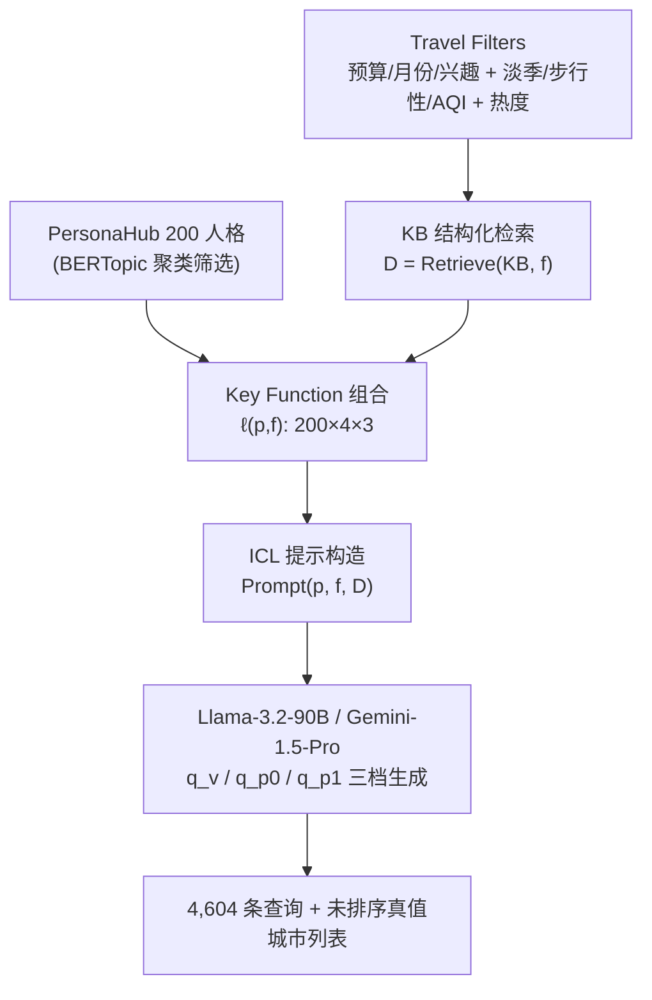

# SynthTRIPs: A Knowledge-Grounded Framework for Benchmark Query Generation for Personalized Tourism Recommenders (面向个性化旅游推荐的知识接地基准查询生成框架)

- **会议/期刊**: SIGIR 2025 (Resource Track)
- **作者与机构**: Ashmi Banerjee, Adithi Satish, Fitri Nur Aisyah, Wolfgang Wörndl (TU Munich); Yashar Deldjoo (Polytechnic University of Bari)
- **推荐链路定位**: 数据侧 / 基准构建（服务于召回与对话式推荐的评测）
- **研究方向**: 大语言模型推荐 (LLM4Rec) / 对话推荐与智能体仿真
- **论文原文**: [https://arxiv.org/abs/2504.09277v1](https://arxiv.org/abs/2504.09277v1)
- **开源代码**: [https://github.com/baturin/wikivoyage-listings](https://github.com/baturin/wikivoyage-listings)（KB 构建源；完整 pipeline 见论文 bit.ly 链接）

## TL;DR (1分钟核心速览)

旅游推荐（TRS）公开数据在**广度**（只覆盖热门城市）与**深度**（缺可持续性、淡季、预算等细粒度偏好）上双重匮乏，导致个性化与可持续旅游研究无基准可用。本文提出 SynthTRIPs：以 PersonaHub 聚类出的 200 个人格为偏好载体，叠加预算/月份/兴趣三类旅行过滤器与淡季、步行性、空气质量三类可持续过滤器，从 Wikivoyage+Tripadvisor+W2W+Nomadlist 构建的 200 城 KB 中检索接地上下文，驱动 Llama-3.2-90B 与 Gemini-1.5-Pro 生成 4,604 条查询。在 J-LLM 与双专家双轨验证下，接地查询的上下文对齐度达 0.48（Lorem Ipsum 基线仅 0.073），过滤器接地率最高 0.869，且揭示出"个性化越强、约束接地越弱"的关键权衡。

## Background & Motivation (背景与核心矛盾)

- **主流范式**: 旅游推荐长期依赖历史订单与评论文本（Reddit QA、TravelDest、TravelPlanner），近期开始用 LLM 合成旅行查询与行程。
- **前人局限**: ① 现有数据集**广度不足**——TravelDest 仅 50 条手工查询、TravelPlanner 仅 1,225 条且模板高度同质，无法训练偏好抽取；② **深度不足**——几乎无数据集显式编码可持续性（步行性、AQI、淡季）与预算约束，而这些恰是可持续旅游研究的核心变量。
- **核心洞察 (Key Insight)**: LLM 能模拟多样人格并生成自然语言请求，但直接生成会**幻觉**目的地属性与成本；若把生成严格锚定在结构化 KB 的检索结果上，即可在规模化合成的同时保住事实正确性。
- **本文切入点**: 将"人格 × 过滤器 × KB 接地上下文"三元组形式化为 key function，把查询合成从"自由创作"改造为"受约束的条件生成 + 双轨验证"。

## Method (核心方法设计)

### 1. 整体框架 (Overall Architecture)

框架由三模块闭环构成：**Persona Hub** 提供偏好载体，**Travel Filters** 定义约束并驱动 KB 结构化检索，**Contextual Prompting with KB Grounding** 完成条件生成。对每个人格 $p$、复杂度等级$f$与城市热度档位组合成 key function$\ell(p,f)$，检索得到接地上下文$\mathcal{D}=\mathrm{Retrieve}(\mathrm{KB},f)$，拼装为$\mathrm{Prompt}(p,f,\mathcal{D})$送入生成器$\mathcal{L}_{query\_gen}$，输出查询$Q=\mathcal{L}_{query\_gen}(\mathrm{Prompt}(p,f,\mathcal{D}))$。若检索为空则该过滤器组合判为无效，最终 2,400 个理论组合中保留 2,302 个有效 key function。

### 2. 关键设计拆解 (Key Designs)

1. **人格去冗余与过滤器分层（Persona × Filter 组合空间）**：PersonaHub 原始 20 万条人格直接使用会导致语义高度重叠、生成同质化。作者用 all-MiniLM-L6-v2 嵌入 + BERTopic 将 196,693 条英文人格聚为 201 簇，每簇取最高概率代表，压缩至 200 个。过滤器被形式化为 $\mathcal{F}=\mathcal{F}_{pref}\cup\mathcal{F}_{sust}\cup\mathcal{F}_{pop}$，并仿 TravelPlanner 定义四档复杂度：Easy（单偏好）、Medium（双偏好）、Hard（全偏好）、Sustainable（双偏好 + 一个可持续因子）。直觉在于：复杂度分层让数据集同时覆盖"简单直白"与"多约束冲突"两类真实请求，避免模板化。

2. **KB 接地与热度分层（Grounding + Popularity Stratification）**：幻觉的根源是 LLM 对城市成本、AQI、步行性等长尾属性缺乏可靠记忆。作者构建 $\mathrm{KB}=(C,A,V)$，其中$V:C\times A\to\mathcal{D}$ 为城市-属性到值域的部分映射，仅将满足过滤器约束的已验证属性注入提示，并做正则 + LLM 解析器 + 人工三重后处理校验。热度用 Tripadvisor 评论数归一化后分三档：

$$\mathrm{popularity}(c)=\frac{R(c)-\min_{c'\in C}R(c')}{\max_{c'\in C}R(c')-\min_{c'\in C}R(c')}$$

由于原始 KB 中 59.16% 城市属高热度，若按自然分布采样会严重偏斜，故在 key function 层面强制低/中/高三档等量分层，最终生成查询分布为 32%/34%/33%，从数据构造端就为后续"热度去偏"研究预留了对照条件。

3. **三档生成条件与验证目标**：同一 key function 下生成三种变体——$q_v$（去人格，纯过滤器）、$q_{p0}$（含人格零样本）、$q_{p1}$（含人格 + 单样本 ICL），温度 0.5、top_p 0.95。验证侧不设单一训练损失，而是构造多目标评估：过滤器接地用平均召回$MR=\frac{1}{N}\sum_{i}\frac{len(matches)_i}{len(filters)_i}$；可持续性均衡用

$$MAE=\frac{1}{N}\sum_{i=1}^{N}\left|sim_{sust,q_i}-\frac{1}{M}\sum_{j=1}^{M}sim_{j,q_i}\right|$$

即衡量可持续因子与其余因子的语义相似度是否被系统性压制；多样性用 4-gram Self-BLEU 取补 $Diversity=1-\frac{1}{|G|}\sum_{i=1}^{|G|}SelfBLEU(q_i)$。这套指标的意义在于：把"合成数据好不好"从主观判断转化为可复现的多维量化。

## Experimental Setup & Evaluation Protocol (实验设置与评估协议)

- **数据集与预处理**: 本文为资源型工作，核心产物是 KB 与合成查询集，而非传统交互数据集。

| 资源 | 规模 | 关键说明 |
| :--- | :---: | :--- |
| KB 城市 | 200 城 / 43 国 | Wikivoyage Listings + Tripadvisor + W2W + Nomadlist 合并 |
| POI 分类 | 5 类兴趣 | bart-large-mnli 零样本 NLI 映射，每子类取 Top-3 |
| 人格池 | 200（源自 196,693） | BERTopic 聚 201 簇后取代表 |
| 有效 key function | 2,302 / 2,400 | 检索为空的组合被剔除 |
| 生成查询 | 4,604 | 2,302 × 2 模型（每模型 3 档设置） |
| 真值城市 | 平均 11 城/查询 | 未排序列表，热度三档均衡 |

- **数据划分与防穿越 (Splitting Strategy)**: 不涉及训练/测试划分；采用**分层构造**（热度三档等量）与**双轨验证**（J-LLM 自动 + 双专家人工）替代传统划分，专家评估对模型与设置**盲测**以抑制偏置。
- **排名评测协议 (Ranking Protocol)**: 非排序评测。核心协议为：J-LLM（gpt-4o）打分 + 两名领域专家用自建 Streamlit 工具独立评分（0–3 四级），并报告评分者间 MAE 作为一致性证据（过滤器接地 MAE=0.083，清晰度 MAE=0.011，人格对齐 MAE=0.3）。
- **对比基线与超参设置**: 基线为 Lorem Ipsum 随机文本（上下文对齐 0.073）；生成器为 llama-3.2-90b 与 gemini-1.5-pro，temperature=0.5、top_p=0.95；语义相似度用 all-mpnet-base-v2。

## Key Experimental Results (实验关键数据)

### 1. 主实验对比 (Main Results)

过滤器接地（$\mathcal{F}$）与人格对齐（$p$）双轨结果（↑ 越高越好，粗体为该模型最优）：

| 模型 | 设置 | $\mathcal{F}$J-LLM |$\mathcal{F}$Expert |$p$J-LLM |$p$ Expert |
| :--- | :---: | :---: | :---: | :---: | :---: |
| Llama | $q_v$ | **0.759** | **0.869** | N/A | N/A |
| Llama | $q_{p0}$ | 0.644 | 0.806 | 34.35 | 33.33 |
| Llama | $q_{p1}$ | 0.043 | 0.346 | **61.54** | **59.17** |
| Gemini | $q_v$ | **0.717** | **0.867** | N/A | N/A |
| Gemini | $q_{p0}$ | 0.595 | 0.840 | 32.84 | 39.17 |
| Gemini | $q_{p1}$ | 0.042 | 0.344 | **60.38** | 50.83 |

上下文对齐、可持续性与多样性（↑ 越高越好，MAE ↓ 越低越好）：

| 模型 | 设置 | Context↑ | 可持续相似度↑ | Diversity↑ | 可持续 MAE↓ |
| :--- | :---: | :---: | :---: | :---: | :---: |
| — | Lorem Ipsum | 0.073 | — | — | — |
| Llama | $q_v$ | **0.482** | 0.138 | 0.169 | **0.179** |
| Llama | $q_{p0}$ | 0.455 | **0.352** | **0.299** | 0.319 |
| Llama | $q_{p1}$ | 0.430 | 0.307 | 0.315 | 0.327 |
| Gemini | $q_v$ | 0.463 | 0.140 | 0.113 | **0.167** |
| Gemini | $q_{p0}$ | 0.451 | **0.415** | 0.327 | 0.360 |
| Gemini | $q_{p1}$ | 0.411 | 0.346 | **0.342** | 0.378 |

### 2. 消融实验 (Ablation Study)

本文以"生成条件"作为消融维度（移除人格 / 移除 ICL 示例 / 移除 KB 接地）：

| 配置 | 过滤器接地 | 人格对齐 | 上下文对齐 | 多样性 | 结论 |
| :--- | :---: | :---: | :---: | :---: | :--- |
| 完整 $q_{p1}$ | 0.043 | 61.54 | 0.430 | 0.315 | 人格强、约束弱 |
| w/o ICL 示例 ($q_{p0}$) | 0.644 | 34.35 | 0.455 | 0.299 | 约束回升、人格下降 |
| w/o 人格 ($q_v$) | **0.759** | N/A | **0.482** | 0.169 | 约束最强、多样性最低 |
| w/o KB 接地 | — | — | 0.073 | — | 事实性崩塌 |

### 3. 关键实验发现 (Key Findings)

1. **个性化与约束接地存在系统性权衡**：从 $q_v$到$q_{p1}$，过滤器接地率从 0.759 骤降至 0.043（Llama），而人格对齐从 34.35 升至 61.54。作者归因为模型对人格与 ICL 示例的**过拟合**——注意力被风格模仿占据，挤占了约束遵循的容量，这直接说明"单样本 ICL 不是免费的午餐"。
2. **KB 接地是事实性的必要条件而非充分条件**：所有接地设置上下文对齐在 0.41–0.48 区间，是 Lorem Ipsum 基线 0.073 的 5.6–6.6 倍，证明检索注入确实抑制了幻觉；但 $q_{p1}$ 的接地率仅 0.043 说明"事实正确"与"约束满足"是两个可解耦的维度，需分别优化。
3. **可持续因子未被牺牲，但推荐端存在严重热度偏置**：可持续 MAE 在各设置下均低（0.167–0.378），说明 LLM 未用非可持续因子挤占可持续约束；然而在 RecGenLLM 初步分析中，即便查询明确要求低热度城市，模型仍有 **77%** 概率推荐高热度城市（如七月推荐布达佩斯、布拉格，而真值应为 Syktyvkar、Kars），且仅 80% 推荐落在 KB 内——这恰好验证了本数据集作为"热度去偏测试床"的价值。

## Highlights & Limitations (亮点、对比与审稿批判)

- **与代表作对比 (vs. Prior Work)**: 相较 TravelDest（50 条手工查询，无法训练）与 TravelPlanner（1,225 条模板化查询，无人格维度），SynthTRIPs 在规模（4,604）、人格多样性（200 簇代表）与约束维度（含可持续三因子）上全面扩展；相较 FeB4RAG 等通用合成基准，本文是首个把**可持续性显式编码进查询约束**的旅游基准。
- **可迁移亮点**: ① "人格聚类去冗余 + 复杂度分层 + 热度分层"的三重分层采样策略，可直接迁移到电商/内容场景的合成查询构造；② 用"可持续因子与其余因子的语义相似度 MAE"来检测约束是否被稀释，是一个轻量且通用的约束保真度探针。
- **审稿级局限批判**: ① PersonaHub 本身为合成数据，人格真实性与领域对齐性存疑，作者亦承认"unrealism 仍残留在数据集中"；② 验证完全依赖 J-LLM + 仅两名专家、每模型 60 条样本，人格对齐的评分者间 MAE 高达 0.3，统计效力与主观性风险明显；③ 数据集仅覆盖欧洲 200 城，跨区域泛化与 KB 时效性维护均未解决。

## Rating (四维评分)

- **方法创新性 (Novelty)**: ⭐⭐⭐ （框架工程扎实、分层构造有巧思，但"人格 + 检索接地 + ICL"各组件均为已有技术的组合，理论增量有限）
- **评估协议与实验扎实度 (Protocol & Experiments)**: ⭐⭐⭐⭐ （J-LLM 与双专家盲测双轨互证、报告评分者间 MAE、四档复杂度消融完整，唯专家样本量与人格对齐一致性偏弱）
- **写作与数学规范度 (Clarity & Rigor)**: ⭐⭐⭐⭐ （key function 形式化清晰、指标定义完整可复现，但部分符号如 $\mathcal{D}$与$\mathcal{D}$ 值域混用，公式编号与正文对应略松散）
- **工业落地与复现价值 (Industrial & Practical Value)**: ⭐⭐⭐⭐ （全 pipeline 与评估工具开源、Colab 可一键复现、KB 可增量更新，作为基准资源的长期价值高于其方法本身）

