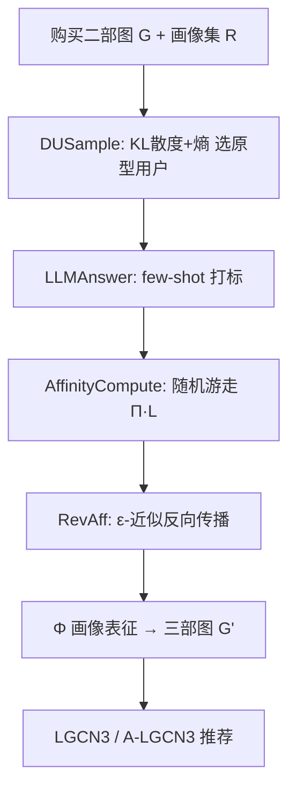

# You Are What You Bought: Generating Customer Personas for E-commerce Applications (你买什么就是什么人：为电商应用生成顾客人物画像)

- **会议/期刊**: SIGIR 2025
- **作者与机构**: Yimin Shi, Yang Fei, Shiqi Zhang, Haixun Wang, Xiaokui Xiao (新加坡国立大学 / PyroWis AI / EvenUp)
- **推荐链路定位**: 召回（用户表征增强，可注入任意 GCN 协同过滤骨干）
- **研究方向**: 大语言模型推荐 / 图神经网络推荐
- **论文原文**: [https://arxiv.org/abs/2504.17304v1](https://arxiv.org/abs/2504.17304v1)
- **开源代码**: [https://github.com/Hanc1999/YouAreWhatYouBought](https://github.com/Hanc1999/YouAreWhatYouBought)

## TL;DR (1分钟核心速览)

现有电商用户表征是稠密隐向量，人类与 LLM 都无法理解、难以对接外部知识。本文提出 **customer persona**（如 "Busy Parent"、"Bargain Hunter"）作为可读显式表征，并给出 **GPLR**：仅用 LLM 标注少量"原型用户"，再通过二部图随机游走把画像传播给其余用户；配套 **RevAff** 以 $\epsilon$绝对误差保证把亲和度计算从$O(|E||U|+|U|^3)$ 降到近线性。在 3 个真实电商数据集上，画像注入 LGCN 后 NDCG@K / F1@K 最高提升 **12%**，且 5% 采样率即可逼近全量 LLM 标注效果。

## Background & Motivation (背景与核心矛盾)

- **主流范式**: 电商推荐普遍把用户历史映射为固定维隐向量（MF、LightGCN、LGCN、AFDGCF），仅在系统内部有意义。
- **前人局限**: ① 隐向量不可读，无法作为 prompt 喂给 LLM，也无法与外部知识（品类体系、常识图谱）对齐；② 基于品类的显式表征（如 Li et al.）粒度太粗，丢失"同品类内的细微偏好"（如 Health Enthusiast 偏爱猕猴桃而回避香蕉）。
- **核心洞察 (Key Insight)**: 画像与价值观/生活习惯绑定，比"事件驱动的购买意图"更**持久、可复用**；且真实数据中画像分布极度偏斜（Instacart 上最热两个画像覆盖 76.2% / 75.8% 用户，最冷 20 个合计仅 7.4%），随机采样标注会继承该偏置。
- **本文切入点**: 用"少量 LLM 标注 + 图上游走传播"替代"全量 LLM 标注"，把百万级用户的标注成本压到可承受范围。

## Method (核心方法设计)

### 1. 整体框架 (Overall Architecture)

输入为用户-商品二部图 $G=(U,V,E)$与预定义画像集$R$；目标是输出 0/1 表征矩阵$\Phi\in\{0,1\}^{|U|\times|R|}$。GPLR 迭代$T$轮：每轮用 **DUSample** 按"多样性-不确定性"分数挑出$\tau/T$个未标注用户交给 **LLMAnswer**（few-shot 序列化购买记录 + 画像定义）打标；随后 **AffinityCompute** 基于随机游走重算用户-画像亲和矩阵$\Psi$；最终对未标注用户取$\Psi[u_i]$的 top-$k$ 画像作为其表征。下游把二部图扩成"用户-商品-画像"三部图，直接替换邻接矩阵即可注入 LGCN/AFDGCF。

### 2. 关键设计拆解 (Key Designs)

1. **DUSample（多样性-不确定性主动采样）**：随机采样会让热门画像主导原型集，冷门画像信号被淹没。DU 分数定义为
$s(u_i)=\sum_{r_m}\hat{Q}(r_m)\log\frac{\hat{Q}(r_m)}{Q_i(r_m)}-Q_i(r_m)\log Q_i(r_m)$，
第一项是"当前已收集画像分布 $\hat{Q}$"与"该用户亲和分布$Q_i$"的 KL 散度（越大说明行为越偏离主流，补多样性），第二项是$Q_i$ 的熵（熵高说明该用户画像判定尚模糊，标注收益最大）。直觉上它把有限预算花在"信息增益最高"的用户上。

2. **随机游走亲和度 + 去偏系数**：注意力矩阵取 $\hat\ell$步内游走概率均值$\Pi=\frac{1}{\hat\ell}\sum_{\ell\le\hat\ell}\mathbf{I}\cdot(\mathbf{P}\mathbf{P}')^{\ell}$，其中$\mathbf{P},\mathbf{P}'$ 为归一化转移矩阵；再构造
$\mathbf{L}[u_i,r_m]=c_m\cdot\frac{\Phi[u_i,r_m]}{\sum_{r_n}\Phi[u_i,r_n]},\quad c_m=\left(\frac{\min_{r_n}\hat{Q}(r_n)}{\hat{Q}(r_m)}\right)^{\beta}$，
最终 $\Psi=\Pi\cdot\mathbf{L}$。系数$c_m$ 按画像频率的倒数做幂次放大，直接对抗长尾偏置——这是"少数画像用户不被主流淹没"的关键算子。

3. **RevAff（$\epsilon$-近似反向传播）**：精确解需物化$\Pi$，Instacart Full 上$\mathbf{P}\mathbf{P}'$超 400 亿浮点数（160GB），不可行。RevAff 从每个原型用户出发做**反向确定性遍历**，用优先队列按当前最大残量$\mathbf{q}_t[\hat w]$逐跳传播增量$\Delta=\mathbf{q}_t[\hat w]/|N(w)|$，当所有残量低于$\epsilon/2\hat\ell$即截断，保证$|\Psi-\hat\Psi|\le\epsilon$。复杂度$O(\frac{1}{\epsilon}\hat\ell^2(N\log(\hat\ell N)+|E|))$，较精确解加速至少$O(\frac{\epsilon|E|N}{|E|+N\log N})$倍。训练侧仍用标准 BPR 损失，画像节点仅新增$|R|$ 个可训练嵌入，推理开销与 LGCN 同阶。

## Experimental Setup & Evaluation Protocol (实验设置与评估协议)

- **数据集与预处理**:

| 数据集 | #Users | #Items | #Interactions | 稀疏度 | 场景说明 |
| :--- | :---: | :---: | :---: | :---: | :--- |
| OnlineRetail | 4,297 | 3,846 | 263,267 | 98.41% | 欧洲零售商 2010 销售记录 |
| Instacart | 20,620 | 41,521 | 1,333,805 | 99.84% | 2017 生鲜订单采样 |
| Instacart Full | 206,209 | 49,677 | 13,307,953 | 99.87% | 全量版本 |

- **数据划分与防穿越**: 每个用户随机取约 **80% 历史购买**构图训练，剩余 **20% 作测试**（比例划分，非时间切分）。
- **排名评测协议**: 报告 NDCG@K 与 F1-Score@K，$K\in\{2,5,10,20,50,100\}$；未明确说明是否为全库 Full-Ranking，从指标形态看为**测试集内排序**（每用户测试正例数不定，故 F1 随$K$ 先升后降）。
- **对比基线与超参**: 基线 MF、GCMC、LCFN、LightGCN、LGCN、AFDGCF；改进模型 LGCN3（LGCN+画像三部图）与 A-LGCN3（再加 AFDGCF 去相关损失）。GPLR 设 $k=5$、$T=10$、GPT-4-Turbo、$\hat\ell=1$、$\beta=0.5$、Instacart Full 用$\epsilon=0.001$的 RevAff；每实验重复 3 次取均值，并对 LGCN vs LGCN3 做配对 t 检验（F1 平均$p=0.027$，NDCG 平均$p=0.012$）。

## Key Experimental Results (实验关键数据)

### 1. 主实验对比 (Main Results)

| 数据集 | 指标 | MF | LightGCN | LGCN | AFDGCF | **LGCN3** | **A-LGCN3** | Improv. |
| :--- | :--- | :---: | :---: | :---: | :---: | :---: | :---: | :---: |
| OnlineRetail | N@10 | 0.2104 | 0.2443 | 0.2274 | 0.2489 | 0.2503 | **0.2497** | +10.1% vs LGCN |
| OnlineRetail | F@10 | 0.1225 | 0.1416 | 0.1352 | 0.1436 | 0.1431 | **0.1432** | +5.8% vs LGCN |
| Instacart | N@2 | 0.1166 | 0.1477 | 0.1405 | 0.1535 | 0.1570 | **0.1634** | +11.7% vs LGCN |
| Instacart | F@20 | 0.0602 | 0.0752 | 0.0710 | 0.0768 | 0.0758 | **0.0780** | +9.9% vs LGCN |
| Instacart Full | N@100 | 0.1268 | OOM | 0.1634 | OOM | 0.1773 | **0.1758** | +8.5% vs LGCN |
| Instacart Full | F@100 | 0.0434 | OOM | 0.0545 | OOM | **0.0587** | 0.0583 | +7.7% vs LGCN |

（LightGCN/AFDGCF 在 Instacart Full 上超内存；A-LGCN3 在多数指标上再超 AFDGCF 最多 6.4%。）

### 2. 消融实验 (Ablation Study)

| 变体 | 设置 | N@10 | F@10 | 说明 |
| :--- | :--- | :---: | :---: | :--- |
| LGCN3 (GPT-4-Turbo) | 默认 | **0.2503** | 0.1431 | 主配置 |
| LGCN3 (Llama-3-70B) | 换 LLM | 0.2455 | **0.1440** | 对 LLM 不敏感 |
| LGCN3 ($\hat\ell=2$) | 游走加长 | 0.2444 | 0.1425 | 平均增益 7.3% < 8.3% |
| LGCNL（品类表征） | 替代画像 | 0.1173 | 0.0713 | Instacart 上被 LGCN3 全面超越 |
| 采样率 5% | 仅标 5% 用户 | ≈100% 水平 | ≈100% 水平 | 传播几乎无损 |

### 3. 关键实验发现 (Key Findings)

1. **画像带来的是"去流行度偏置"而非单纯特征增益**：案例中 LGCN 的 top-10 全部落在 41,521 个商品中最热的 100 名内（6 个进前 20），而 LGCN3 把冷门但匹配 "Baby Care Provider" 画像的婴儿食品提到高位，命中 2 个额外测试正例并剔除 3 个热门假阳性——说明画像通过外部知识补足了协同信号对长尾品类的盲区。
2. **传播机制极其高效**：采样率从 100% 降到 5%，NDCG/F1 几乎不变（图 1），意味着 95% 的 LLM 调用成本可被随机游走替代；RevAff 在 Instacart Full 上 $\epsilon=0.02$时经验 AAE 仅$9.2\times10^{-4}$（比理论界小约 20 倍），耗时从 268.8s 降至 77.7s，$\epsilon=0.1$ 时 47.9s。
3. **画像的持久性在分割任务上被量化验证**：跨半年对比，画像表征下"表征不变"的稳定用户占 18%，RFM 仅 1.3%（13.8 倍）；K-means 轮廓系数在 35 簇时 0.788 vs RFM 0.445，平均高 61.3%。

## Highlights & Limitations (亮点、对比与审稿批判)

- **与代表作对比 (vs. Prior Work)**: 相比 LightGCN/LGCN 等纯隐式协同过滤，本文不改动骨干、仅扩邻接矩阵即可注入外部语义；相比 FolkScope/COSMO 只产出"商品对共购理由"的文本知识，本文把知识**落到用户粒度**并形成可计算矩阵；相比 Li et al. 的单标签品类画像，本文是多标签、带定义、跨品类细粒度的人物刻画。
- **可迁移亮点**: ① "少量 LLM 标注 + 图传播补全"的预算化标注范式可平移到商品侧标签、内容标签冷启动；② RevAff 的残量优先队列截断是任意"多跳图传播 + 误差容忍"场景的通用加速器。
- **审稿级局限批判**: ① 评估为 80/20 随机划分而非时间切分，画像本身是"长期稳定"假设，缺少时序漂移下的验证；② 画像集 $R$ 由平台预定义且依赖 LLM 生成，跨平台可迁移性与画像集质量敏感性未做系统分析；③ 三部图注入需为商品也查询 LLM 建立画像边，这部分成本与误差未量化。

## Rating (四维评分)

- **方法创新性 (Novelty)**: ⭐⭐⭐⭐ （把"人物画像"引入推荐表征，并用带 $\epsilon$ 保证的随机游走近似把 LLM 成本工程化，思路清晰但单点算法创新偏温和）
- **评估协议与实验扎实度 (Protocol & Experiments)**: ⭐⭐⭐ （三数据集 + 配对 t 检验 + 分割/效率多维验证较完整，但随机划分而非时间切分、排序协议未明确全库，削弱说服力）
- **写作与数学规范度 (Clarity & Rigor)**: ⭐⭐⭐⭐ （DU 分数、$\Psi=\Pi\mathbf{L}$、RevAff 递推与两条复杂度定理定义严谨，符号表完备）
- **工业落地与复现价值 (Industrial & Practical Value)**: ⭐⭐⭐⭐⭐ （代码开源、5% 采样即达标、RevAff 秒级处理千万级交互，直接对应线上标注预算痛点）

