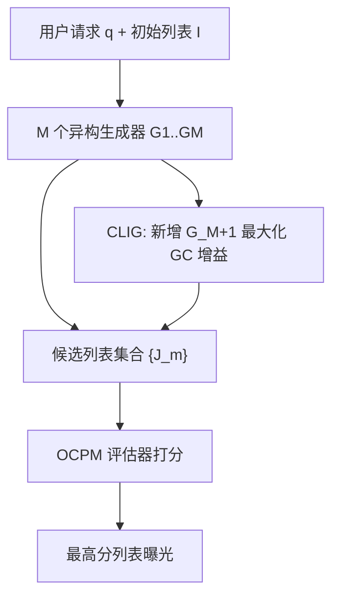
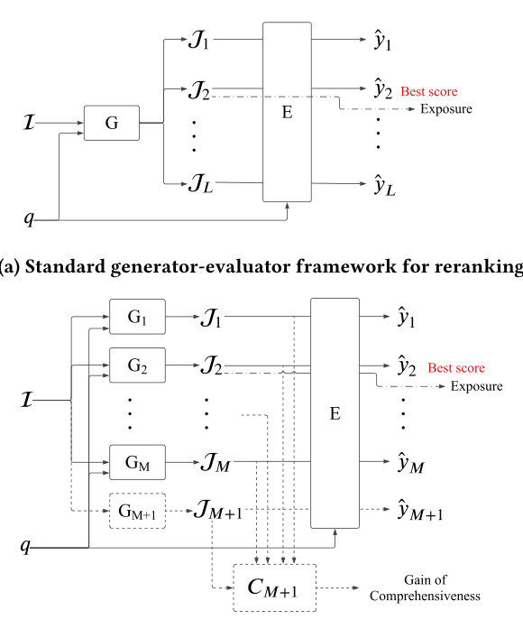

# Comprehensive List Generation for Multi-Generator Reranking (面向多生成器重排的全面性列表生成)

- **会议/期刊**: SIGIR 2025
- **作者与机构**: Hailan Yang, Zhenyu Qi, Shuchang Liu 等（快手科技；Kun Gai 无隶属）
- **推荐链路定位**: 重排（Reranking，$n\to n$及$n\to k$ 过滤）
- **研究方向**: 多任务学习与列表级重排 / 生成式推荐
- **论文原文**: [https://arxiv.org/abs/2504.15625v1](https://arxiv.org/abs/2504.15625v1)
- **开源代码**: [https://github.com/hellohelen222/LC_MGE_code](https://github.com/hellohelen222/LC_MGE_code)

## TL;DR (1分钟核心速览)

重排的生成器-评估器（G-E）范式受限于单生成器的局部最优与置换采样的低效探索。本文提出多生成器-评估器（MG-E）框架，从概率上证明 $M$个生成器命中最优列表的概率随$M$ 单调上升；并识别出"列表全面性挑战"——同源训练的生成器输出高度相似会稀释集成收益，进而定义 LC/GC 指标并设计 CLIG 损失自动学习互补生成器。在 Avito/RecFlow 全库列表级 AUC/NDCG 上，MG-E+CLIG 较 SOTA PIER-20 的 AUC 提升约 1.6%/3.0%，线上 A/B 观看时长 +0.48%。

## Background & Motivation (背景与核心矛盾)

- **主流范式**: 重排需建模列表内物品互影响，现有工作分两支——generator-only（Seq2Slate/PRM/EXTR 直接学排序策略）与 G-E 两步框架（PIER/NAR4Rec 先由生成器产出候选列表，再由评估器 OCPM 打分选优）。
- **前人局限**: ① 列表置换空间随 $n$指数爆炸（线上$n=50$时约$1.5\times10^{10}$），单生成器基于相似性扰动的探索只能覆盖局部最优邻域；② 即便 PIER 把候选列表扩到 20 条，精度也仅边际提升（Avito AUC 0.7180→0.7185），说明"多列表"不等于"多视角"。
- **核心洞察 (Key Insight)**: 集成收益的本质是"个体准确 + 行为相异"。作者用实验（表 2）验证：两生成器组合的 AUC 与 LC 指标正相关（G1+G3 的 LC(EBD)=0.7398 优于 G1+G2 的 0.4239，AUC 亦更高），即生成器有效性取决于它对其他生成器视角的补充程度。
- **本文切入点**: 用多生成器替代单生成器的置换采样以跳出局部最优，再用可微的全面性奖励自动"造"出一个与现有生成器差异最大的互补生成器，免去人工组合的指数级搜索。

## Method (核心方法设计)

### 1. 整体框架 (Overall Architecture)

输入为用户请求 $q$与上游粗排列表$\mathcal{I}$；$M$个异构生成器$G_1,\dots,G_M$各自输出一条重排列表$\mathcal{J}_m$，共享的 OCPM 评估器对全部候选打分并选出最高分列表曝光。训练上先训评估器至收敛，再各自训生成器；CLIG 扩展则新增第$M+1$ 个生成器，其损失同时对齐用户偏好与最大化相对已有生成器的全面性增益，可迭代叠加形成"主成分式"互补集成。

<figure class="paper-figure" markdown="span">
  <figcaption>图2：标准G-E与所提出的带CLIG扩展的MG-E框架的概览对比。</figcaption>
</figure>

### 2. 关键设计拆解 (Key Designs)

1. **多生成器集成的概率上界（MG-E 的理论依据）**：单生成器是确定性贪心输出，只给最优列表概率 1、其余为 0，天然受局部最优约束。MG-E 将命中概率改写为独立并集形式，随 $M$ 单调递增：
$$P(\mathcal{J}^*|q,\mathcal{I}) = 1-\prod_{m=1}^{M}\left(1-P_m(\mathcal{J}^*|q,\mathcal{I})\right)$$
直觉上每个生成器覆盖真值分布的一侧，并集扩大覆盖；且相比置换采样，候选数从 $L$条压缩到$M$ 条，评估开销更低。

2. **列表全面性 LC / 增益 GC 指标**：MG-E 只保证"准"不保证"异"，同源数据预训练的生成器易输出雷同列表。定义两两差异核的求和 $\mathrm{LC}_m=\sum_{m_1\neq m_2}\delta(\mathcal{J}_{m_1},\mathcal{J}_{m_2})$，新增生成器的边际贡献$\mathrm{GC}_m=\mathrm{LC}_m-\mathrm{LC}_{m-1}$。差异核提供两种选择：嵌入式 EBD$\delta=0.5(1-\cos(E(\mathcal{J}_m),E(\mathcal{J}_{m'})))$粒度细且支持$n\to k$ 过滤后列表；偏序式 POD 统计两列表逆序对数量，模型无关但更粗。该指标在评估器之前度量跨列表多样性，与 intra-list diversity 正交。

3. **CLIG 互补生成器学习与训练目标**：把 GC 直接做成奖励加权交叉熵，让"高奖励且高差异"的列表获得更大生成概率。非自回归形式为
$$\mathcal{L}_{\text{align}}=-\mathcal{R}(q,\mathcal{J}_{M+1})\log P_\theta(\mathcal{J}_{M+1}|q,\mathcal{I}),\quad \mathcal{L}_{\text{comp}}=-\Big(\sum_{m'=1}^{M}\delta(\mathcal{J}_{m'},\mathcal{J}_{M+1})\Big)\log P_\theta(\mathcal{J}_{M+1}|q,\mathcal{I})$$
自回归版本将列表级奖励与差异核拆解到逐项 $j_t$（附录给出 POD 的逐项分解$\delta(\mathcal{J}_{m'},j_t)=\|\Delta_{M+1,m'}[j_t][:]\|_1$，保证与列表级核的一致性）。总损失$\mathcal{L}=\mathcal{L}_{\text{align}}+\lambda\mathcal{L}_{\text{comp}}$，$\lambda$控制全面性权重；训练采用奖励加权（非负采样对比），推理时各生成器可并行以隐藏延迟，但算力随$M$线性增长，且边际收益随$M\to\infty$ 趋于零（式 11），需在成本与收益间取平衡。

## Experimental Setup & Evaluation Protocol (实验设置与评估协议)

- **数据集与预处理**:

| 数据集 | #Items | #Users | #Requests | 正样本率 | 场景说明 |
| :--- | :---: | :---: | :---: | :---: | :--- |
| Avito | 23,562,269 | 1,324,103 | 53,562,269 | 3.516% | 搜索日志，列表长 $n=5$，沿用 PIER 预处理 |
| RecFlow | 1,361,856 | 652,490 | 24,637,522 | 60.656% | 多阶段视频推荐，$n=6$，`long_view=1` 为正 |

- **数据划分与防穿越**: Avito 沿用 PIER 设定；RecFlow 按**全局时间戳 80-20 切分**，按用户交互历史（`effective_view=1`）切成长度 6 的列表。
- **排名评测协议**: $n\to n$重排场景，以用户反馈为相关性真值计算列表级 **AUC 与 NDCG**（非采样排序，直接对整条重排列表打分），并辅以 LC/GC 多样性指标；线上为$n=50\to k=6$的 top-$k$ 过滤场景。
- **对比基线与超参**: 基线含 item-wise（DNN、DCN）、generator-only（Seq2Slate、PRM、EXTR）、G-E（NAR4Rec、PRS、PIER-3/PIER-20）；Adam 优化器，学习率网格 $\{10^{-5},10^{-4},10^{-3},10^{-2}\}$，batch$\{256,512,1024\}$，5 轮随机种子均值，Student-t 检验$p<0.05$。

## Key Experimental Results (实验关键数据)

### 1. 主实验对比 (Main Results)

| 框架 | 方法 | Avito AUC | Avito NDCG | RecFlow AUC | RecFlow NDCG |
| :--- | :--- | :---: | :---: | :---: | :---: |
| G-only | DNN | 0.6876 | 0.6028 | 0.7067 | 0.6831 |
| G-only | Seq2Slate | 0.6911 | 0.6115 | 0.7098 | 0.6898 |
| G-only | PRM | 0.7124 | 0.6245 | 0.7613 | 0.7004 |
| G-only | EXTR | 0.7113 | 0.6228 | 0.7641 | 0.7082 |
| G-E | NAR4Rec | 0.7066 | 0.6205 | 0.7284 | 0.6979 |
| G-E | PRS | 0.7182 | 0.6301 | 0.7639 | 0.7067 |
| G-E | PIER-20 | 0.7185 | 0.6327 | 0.7645 | 0.7102 |
| MG-E | Base | 0.7225 | 0.6487 | 0.7842 | 0.7217 |
| MG-E | **+CLIG** | **0.7297** | **0.6629** | **0.7878** | **0.7357** |
| | *Improv. vs PIER-20* | *+1.56%* | *+4.77%* | *+3.05%* | *+3.59%* |

### 2. 消融实验 (Ablation Study)

| 配置 | Avito AUC | RecFlow AUC | 说明 |
| :--- | :---: | :---: | :--- |
| MG-E Base | 0.7225 | 0.7842 | 三生成器（DNN+NAR4Rec+Seq2Slate） |
| +CLIG (EBD 核) | **0.7878** | — | RecFlow 上 +0.459% |
| +CLIG (POD 核) | 0.7863 | — | 粗粒度核，增益略低 |
| NAR4Rec → +CLIG | 0.7066→0.7154 | 0.7284→0.7375 | 骨干无关性验证 |
| PRS → +CLIG | 0.7182→0.7198 | 0.7639→0.7698 | 同上 |
| PIER-20 → +CLIG | 0.7185→0.7211 | 0.7645→0.7735 | 同上 |
| #CLIG 扩展 1/3/5 | 0.7878/0.7882/0.7894 | — | 迭代叠加持续增益 |

### 3. 关键实验发现 (Key Findings)

1. **"多列表"不如"多视角"**：PIER 把候选从 3 条扩到 20 条，Avito AUC 仅从 0.7180 升到 0.7185；而 MG-E 仅用 3 个异构生成器即达 0.7225（+0.5%），证明跳出局部最优的关键是生成器行为差异而非采样数量。
2. **全面性与精度强正相关**：表 2 中两生成器组合的 AUC 排序与 LC(EBD) 排序一致（G1+G3 的 0.7398 > G1+G2 的 0.4239），CLIG 自动找到的互补生成器 LC 达 0.7681，超过人工挑选的 G3，验证 GC 奖励是有效的代理信号。
3. **线上收益与多样性双赢**：MG-E(3) 相对 PIER 观看时长 +0.481%、有效播放 +0.416%（均显著）；叠加 CLIG 后 item coverage +11.54%、intra-list diversity +11.25%，且 CLIG 生成器在 9 个生成器中曝光占比约 18%（排第 4），说明它既准又足够不同，而非靠挤占他人曝光取胜。

## Highlights & Limitations (亮点、对比与审稿批判)

- **与代表作对比 (vs. Prior Work)**: 相比 PIER 的"单生成器 + 置换扰动"，本文用异构生成器集成从结构上突破局部最优，且候选数更少、评估更省；相比 NAR4Rec 的纯 G-E，本文补上了"生成器之间要相异"这一被忽视的维度；相比传统 DPP/MMR 等列表内多样性方法，LC 度量的是**跨列表**多样性，作用在评估器之前以指导生成。
- **可迁移亮点**: ① "奖励加权 CE + 差异核奖励"的联合损失可直接迁移到任何需要多模型集成去相关的场景（如多路召回融合、多专家 MoE 路由）；② POD 核的偏序矩阵并行计算（$\mathbf{O}_m=\mathbb{I}[(\mathbf{r}_m^\top-\mathbf{r}_m)<0]$）可在 GPU 上高效实现，适合无统一嵌入空间的异构模型比较。
- **审稿级局限批判**: ① 算力随 $M$线性增长，论文仅给出"边际收益趋零"的定性结论，未给出$M$ 的最优选择准则或延迟实测；② 线上仅报告一周 A/B 且 CLIG 部分指标（观看时长 +0.031%、点赞 +0.009%）不显著，长期效应与生成器选择偏差对在线学习数据流的累积影响仍需更长周期验证；③ 自动生成的生成器缺乏可解释的决策逻辑，与论文自述的局限一致。

## Rating (四维评分)

- **方法创新性 (Novelty)**: ⭐⭐⭐⭐ （把集成学习的"准确+相异"原则形式化为可微的 LC/GC 奖励，并用概率并集给出 MG-E 的理论支撑，思路清晰但组件本身不算全新）
- **评估协议与实验扎实度 (Protocol & Experiments)**: ⭐⭐⭐⭐ （两个公开数据集 + 5 轮种子 + 显著性检验 + 骨干无关性消融 + 线上 A/B 完整，唯线上周期偏短、部分指标不显著）
- **写作与数学规范度 (Clarity & Rigor)**: ⭐⭐⭐⭐ （LC/GC 定义与 EBD/POD 两核对比表清晰，附录给出 POD 逐项分解保证自回归/非自回归一致性，式 11 的边际收益分析稍显简略）
- **工业落地与复现价值 (Industrial & Practical Value)**: ⭐⭐⭐⭐ （快手线上百亿级流量验证，代码开源，生成器可并行部署；但多生成器算力成本与 $\lambda$ 敏感性需工程权衡）

