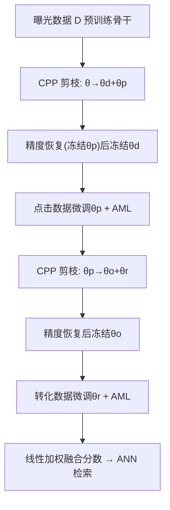
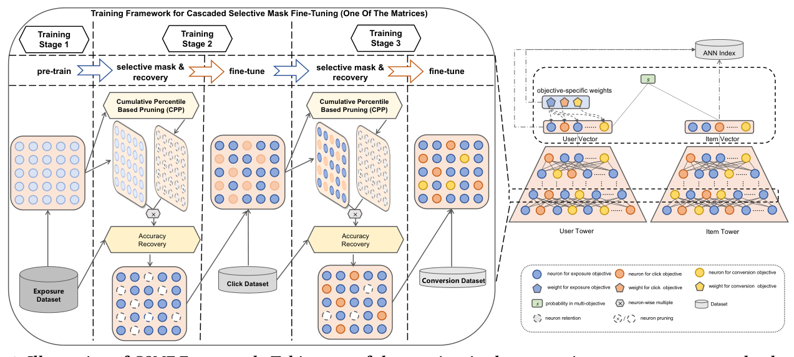

# CSMF: Cascaded Selective Mask Fine-Tuning for Multi-Objective Embedding-Based Retrieval (级联选择性掩码微调的多目标嵌入式召回)

- **会议/期刊**: SIGIR 2025
- **作者与机构**: Hao Deng, Haibo Xing, Kanefumi Matsuyama, Moyu Zhang, Jinxin Hu, Hong Wen, Yu Zhang, Xiaoyi Zeng, Jing Zhang（阿里巴巴国际数字商业集团 / 武汉大学）
- **推荐链路定位**: 召回（双塔 EBR + ANN 在线检索）
- **研究方向**: 多任务学习与列表级重排 / 协同过滤与双塔召回
- **论文原文**: [https://arxiv.org/abs/2504.12920v1](https://arxiv.org/abs/2504.12920v1)
- **开源代码**: 暂未开源

## TL;DR (1分钟核心速览)

工业电商 EBR 需同时优化曝光→点击→转化三个级联目标，但多模型方案无法共享信息、MoE 方案参数与向量维度膨胀导致 ANN 延迟与存储激增、混合训练又存在梯度冲突与灾难性遗忘。本文提出 CSMF，将训练拆为「曝光预训练→点击微调→转化微调」三阶段，每阶段前用累积百分位剪枝（CPP）选择性掩码冗余神经元腾出独立参数空间，配合跨阶段自适应间隔损失（AML）缓解目标冲突，最终在不增加任何参数与向量维度的前提下，用线性加权融合分数实现多目标召回。工业数据集上 Recall@50 相对最优基线提升 6.61%（点击）与 7.51%（转化），线上 A/B 中 RPM/CTR/CVR 分别提升 0.42%/0.57%/0.67%。

## Background & Motivation (背景与核心矛盾)

- **主流范式**: 多目标 EBR 分两派——多模型独立训练（YouTubeDNN-Sep）与单模型共享（YouTubeDNN-Mix 混合训练、MVKE/DMMP 的 MoE 共享专家+专属子网、MOPPR 的 listwise 聚合）。
- **前人局限**: ① 多模型方案无法建模目标间级联依赖，且转化数据极稀疏（工业集曝光 2.1B vs 转化 0.3M，差三个数量级）；② MoE 方案为每个目标分配等量参数，输出向量维度随专家数线性膨胀，直接推高 ANN 检索延迟与存储（MVKE 存储 +299%、延迟 +227%），且忽视目标间的顺序因果结构。
- **核心洞察 (Key Insight)**: 用户行为天然满足 $\mathcal{R}\subset\mathcal{O}\subset\mathcal{D}$ 的级联包含关系，上游大数据的知识应可无损迁移给下游稀疏目标；而深度网络存在大量冗余神经元，剪枝它们几乎不损精度，恰好可为新目标"腾出"独立参数空间。
- **本文切入点**: 把 LLM 领域的 PEFT 选择性微调（PackNet 思路）首次迁移到多目标 EBR，用"预训练→选择性掩码→精度恢复→微调"的循环替代参数扩张。

## Method (核心方法设计)

### 1. 整体框架 (Overall Architecture)

模型沿用标准双塔结构，用户/物品特征分别经编码器 $f_\theta, g_\theta$得到向量$\mathbf{e}_u^\theta, \mathbf{v}_i^\theta$，打分$h_\theta(u,i)=\mathbf{e}_u^{\theta\top}\mathbf{v}_i^\theta$。训练分三阶段：Stage-1 用大规模曝光数据预训练骨干，收敛得$\hat{\theta}_d$；随后 CPP 剪掉低信息量神经元，将参数划分为冗余集$\theta_p$与保留集$\theta_d$，用曝光数据小子集$\mathcal{D}'\subset\mathcal{D}$做精度恢复后冻结$\theta_d$；Stage-2 冻结$\theta_d$、仅更新$\theta_p$拟合点击目标，再剪枝得$\theta_r$与$\theta_o$，恢复后冻结$\theta_o$；Stage-3 用剩余$\theta_r$拟合转化目标。最终参数空间被互斥划分为$\theta_d,\theta_o,\theta_r$ 三块，单塔即可同时输出三个目标概率，向量维度不变。

<figure class="paper-figure" markdown="span">
  <figcaption>图 3：CSMF 框架示意图。以用户塔或物品塔中的一个矩阵为例，面向三个目标（曝光、点击和转化）的 CSMF 框架分为三个阶段。首先，骨干模型在大规模曝光数据上进行预训练。随后，模型分别使用点击数据和转化数据进行两个微调阶段。在微调之前，CSMF 选择性地掩蔽冗余参数，为新任务腾出空间。为确保准确性，未剪枝的参数在当前阶段数据的小子集上再次微调，然后</figcaption>
</figure>

### 2. 关键设计拆解 (Key Designs)

1. **CPP 累积百分位剪枝（自适应逐层分配参数）**：PackNet 对每层用固定剪枝率，忽视层间重要性差异。CPP 先算每层神经元绝对值累积和 $C_k=\{c_1,\dots,c_{n_k}\}$，$c_{n_k}=\sum_{1\le j\le n_k}|w_{kj}|$为该层总信息量，令待剪阈值$ind_k=c_{n_k}\cdot\tau$，凡累积百分位落入该阈值的神经元即剪除。直觉：信息分布集中的层自动少剪、分散的层多剪，把参数预算按真实信息密度分配，而非一刀切。

2. **AML 跨阶段自适应间隔损失（缓解负迁移）**：下游继承全部上游参数，目标冲突仍会造成负迁移。AML 让间隔随上游打分动态伸缩：若上游认为正样本 $i$已优于负样本$j$（$s_d^{ui}\ge s_d^{uj}$），则点击任务只需保持该间隔；反之则放大间隔以纠偏。点击阶段损失为
$$\mathcal{L}_{clk}=\sum_u\sum_{i\in\mathcal{O}_u}-\log\frac{e^{s_o^{ui}}}{e^{s_o^{ui}}+\sum_{j\in I_N^i}e^{(s_o^{uj}-m_d^{ij})}},$$
其中 $m_d^{ij}=s_d^{ui}-s_d^{uj}+\sigma$（一致时）或$(s_d^{uj}-s_d^{ui})\cdot\eta+\sigma$（冲突时）。转化阶段将上游概率取级联乘积$s_{o'}^{ui}=s_d^{ui}\cdot s_o^{ui}$构造$m_o^{ij}$，避免额外估计偏差。直觉：把上游预测当作"先验难度"，一致样本少费力、冲突样本多纠偏，等价于对负迁移做软性惩罚。

3. **训练目标、负采样与推理效率**：各阶段均用 softmax 对比损失 $p_\theta(i|u)\propto e^{h_\theta(u,i)}/\sum_{j=1}^{|I_N|}e^{h_\theta(u,j)}$，曝光阶段负样本为 in-batch 负采样（BNS）+ 同 PV 未曝光物品，点击/转化阶段仅用 BNS。推理时利用参数互斥性，融合分数可解析展开为
$$s^{ui}=(k_d+k_o+k_r)\mathbf{e}_{\theta_d}^\top\mathbf{v}_{\theta_d}+(k_o+k_r)\mathbf{e}_{\theta_o}^\top\mathbf{v}_{\theta_o}+k_r\mathbf{e}_{\theta_r}^\top\mathbf{v}_{\theta_r},$$
即对三段子向量分别乘权重后拼接，仍是一次内积 + 一次 ANN 检索，零额外在线开销，且权重三元组 $\langle k_d,k_o,k_r\rangle$ 可按场景灵活调节。

## Experimental Setup & Evaluation Protocol (实验设置与评估协议)

- **数据集与预处理**:

| 数据集 | #Items | #Pvs | #Exposures | #Clicks | #Conversions | 特征/场景说明 |
| :--- | :---: | :---: | :---: | :---: | :---: | :--- |
| Industrial | 0.11B | 109M | 2.1B | 19M | 0.3M | 东南亚电商广告系统真实日志，用户侧含画像/3&30天行为序列/CTR-CVR 统计，物品侧含 ID 类与统计类特征 |
| AliExpress (RU) | 16.7M | 8.7M | 130M | 3.6M | 61.8K | 公开数据集，无同请求未曝光物品标签 |

- **数据划分与防穿越 (Splitting Strategy)**: 两数据集均按**全局时间戳切分**，训练数据严格早于测试数据。
- **排名评测协议 (Ranking Protocol)**: 采用 `Full-Ranking` 式全库排序，在点击数据集上评点击目标、转化数据集上评转化目标，指标为 `Recall@50` 与 `nDCG@50`；线上用 RPM/CVR/CTR。
- **对比基线与超参设置**: 基线含 YouTubeDNN-Sep、YouTubeDNN-Mix、DTML（蒸馏）、MVKE（MMoE）、DMMP（MoE+蒸馏三塔）、MOPPR（listwise）。向量维度 $d=64$，batch=256，lr=1e-4，CPP 剪枝率$\tau=0.75$，AML 系数$\eta=1.8$，线上权重$\langle k_d,k_o,k_r\rangle=\langle1,1.8,1.2\rangle$；性能增益均通过$p<0.05$ 显著性检验。

## Key Experimental Results (实验关键数据)

### 1. 主实验对比 (Main Results)

| Method | Industrial Click nDCG@50 | Industrial Click R@50 | Industrial Conv. nDCG@50 | Industrial Conv. R@50 | AliExpress Click R@50 | AliExpress Conv. R@50 |
| :--- | :---: | :---: | :---: | :---: | :---: | :---: |
| YouTubeDNN-Sep | 0.0998 | 0.2715 | 0.0698 | 0.2990 | 0.1502 | 0.0514 |
| YouTubeDNN-Mix | 0.0978 | 0.2692 | 0.0715 | 0.3089 | 0.1497 | 0.0525 |
| DTML | 0.1098 | 0.2824 | 0.0845 | 0.3283 | 0.1567 | 0.1179 |
| MVKE | 0.1118 | 0.2957 | 0.0885 | 0.3338 | 0.1741 | 0.1367 |
| DMMP | 0.1138 | 0.2980 | 0.0878 | 0.3319 | 0.1746 | 0.1378 |
| MOPPR | 0.1128 | 0.2946 | 0.0895 | 0.3436 | 0.1738 | 0.1329 |
| **CSMF (Ours)** | **0.1178** | **0.3177** | **0.0915** | **0.3694** | **0.1777** | **0.1397** |
| **Improv.** | **+3.51%** | **+6.61%** | **+2.23%** | **+7.51%** | **+1.78%** | **+1.38%** |

### 2. 消融实验 (Ablation Study)

| 变体 | Click nDCG@50 | Click R@50 | Conv. nDCG@50 | Conv. R@50 |
| :--- | :---: | :---: | :---: | :---: |
| CSMF (Full) | **0.1178** | **0.3177** | **0.0915** | **0.3694** |
| w/o CPP（固定剪枝率 0.75） | 0.1158 | 0.3060 | 0.0885 | 0.3529 |
| w/o AML | 0.1148 | 0.3097 | 0.0895 | 0.3574 |
| w/o AR（精度恢复） | 0.1134 | 0.3002 | 0.0912 | 0.3690 |

### 3. 关键实验发现 (Key Findings)

1. **CPP 是最大贡献模块**：去掉后点击/转化 Recall@50 分别掉 3.68%/4.47%，说明按层信息密度自适应分配参数空间比固定剪枝率更能保住上游知识；而 w/o AR 对点击任务伤害最大（R@50 掉 5.5%）、对末阶段转化几乎无影响，印证"剪枝必损当前任务精度、精度恢复不可省"。
2. **MoE 类方法在级联目标上顾此失彼**：MVKE/DMMP 在点击上优于 MOPPR，但转化上反被 MOPPR 超越，暴露等量参数分配与忽视顺序依赖的缺陷；CSMF 在两类目标上同时最优，验证"选择性释放参数空间 + 顺序建模"的双重收益。
3. **在线效率优势是决定性的**：相比 MOPPR，MVKE 存储 +299%、ANN 延迟 +227%，DMMP 延迟 +77%，而 CSMF 存储 -0.02%、延迟仅 +0.83%；代价是离线训练时间 +34.9%（3h23min→4h34min），仍在日更可接受范围内。剪枝率敏感性实验显示 $\tau$ 从 25%→75% 性能单调上升、75%→95% 急剧下降，75% 为信息保留与独立空间的平衡点。

## Highlights & Limitations (亮点、对比与审稿批判)

- **与代表作对比 (vs. Prior Work)**: 与 MVKE/DMMP 的 MoE 路线本质不同——后者靠"加参数"隔离目标冲突，本文靠"剪参数"腾空间，参数量与向量维度均不增；与 MOPPR 的 listwise 聚合相比，本文显式利用 $\mathcal{R}\subset\mathcal{O}\subset\mathcal{D}$ 的级联因果结构做顺序迁移，而非平铺多目标；与 PackNet 相比，CPP 将固定逐层剪枝率升级为按信息分布自适应。
- **可迁移亮点**: ① "剪枝腾空间 + 精度恢复 + 冻结"的三段式参数隔离范式可迁移到任何多任务双塔召回（如短视频的多时长目标）；② 用上游打分构造自适应 margin 的 AML 思路，可推广到任意有因果先序的多任务精排。
- **审稿级局限批判**: ① 阶段数随目标数线性增长，若目标达 5+ 个（如淘宝四目标），离线训练与调参成本将显著放大，且每阶段剪枝率 $\tau$ 需人工设定；② AliExpress 因缺少未曝光标签被迫把预训练任务从曝光降级为点击，增益缩水至 1.38%–1.78%，说明方法强依赖"有未曝光负样本"的工业日志，公开数据集上复现优势有限；③ 线上 A/B 仅报告 RPM/CTR/CVR 三个点估计，未给置信区间与实验时长内的方差分析。

## Rating (四维评分)

- **方法创新性 (Novelty)**: ⭐⭐⭐⭐ （首次将 PEFT 选择性掩码引入多目标 EBR，用"剪枝而非加参"破解 MoE 参数膨胀，思路简洁且有级联因果支撑）
- **评估协议与实验扎实度 (Protocol & Experiments)**: ⭐⭐⭐⭐ （双数据集 + 6 个强基线 + 消融 + 超参敏感性 + 在线 A/B + 系统开销表，链条完整，但公开集增益偏小且缺置信区间）
- **写作与数学规范度 (Clarity & Rigor)**: ⭐⭐⭐⭐ （融合分数的解析展开推导清晰，AML 分段定义严谨；部分符号如 $\theta_p/\theta_r$ 的划分边界描述略绕）
- **工业落地与复现价值 (Industrial & Practical Value)**: ⭐⭐⭐⭐⭐ （零在线开销、零存储增量、权重可热调，已在阿里广告系统上线验证，工程价值极高；可惜未开源）

