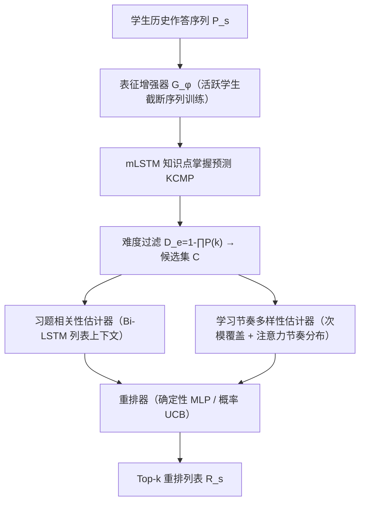
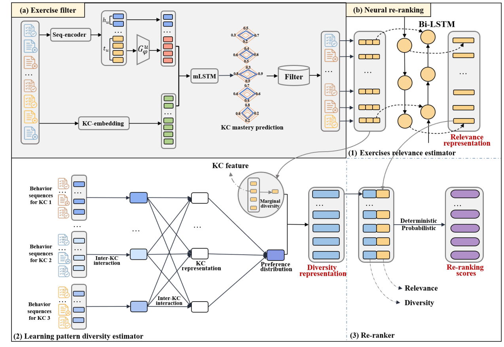

# NR4DER: Neural Re-ranking for Diversified Exercise Recommendation (面向多样化习题推荐的神经重排)

- **会议/期刊**: SIGIR 2025 (Full Papers)
- **作者与机构**: Xinghe Cheng, Xufang Zhou, Liangda Fang, Chaobo He, Yuyu Zhou, Weiqi Luo, Zhiguo Gong, Quanlong Guan（暨南大学、琶洲实验室、华南师范大学、澳门大学）
- **推荐链路定位**: 重排（多阶段召回-排序-重排中的重排阶段）
- **研究方向**: 多任务学习与列表级重排 / 冷启动与长尾推荐
- **论文原文**: [https://arxiv.org/abs/2506.06341v1](https://arxiv.org/abs/2506.06341v1)
- **开源代码**: [https://github.com/chanllon/NR4DER.Exercise-Recommendation](https://github.com/chanllon/NR4DER.Exercise-Recommendation)

## TL;DR (1分钟核心速览)

在线教育习题推荐面临两大痛点：学生交互呈极端长尾（前 5% 活跃学生多样性得分 45.133，后 95% 仅 8.900），且现有 KT/RL 方法只盯"未掌握知识点"导致推荐同质化、无法匹配个体学习节奏。NR4DER 先用 mLSTM 预测知识点掌握度并做难度过滤，再用"活跃学生截断序列"训练表征增强器迁移给不活跃学生，最后引入电商领域的神经重排（相关性 + 学习节奏多样性）生成列表。在 Nips34/Assist2009/Assist2012 上 NDCG@1 相对最强基线 SimpleKTRec 提升约 24.5%/3.1%/32.5%。

## Background & Motivation (背景与核心矛盾)

- **主流范式**: 习题推荐分三支——KT-based（DKT/AKT/SimpleKT 预测知识状态）、RL-based（DRER/MMER 多目标优化）、MS-based（KCPER/KG4Ex 召回-排序-重排）。
- **前人局限**: 其一，长尾学生分布下模型严重偏向活跃学生，不活跃学生表征稀疏、推荐精度崩塌；其二，KT/RL 方法受局部贪心最优所限，只推"未掌握知识点"的同质习题，MS 方法（如 KCPER 模拟退火）虽求多样性却产出雷同重排结果，忽视学生"专精少数概念 vs 广泛覆盖"的差异化学习节奏。
- **核心洞察 (Key Insight)**: 活跃学生的完整序列与其最近 $T$ 条截断子序列所蕴含的学习模式高度相似，因此可用"截断序列"模拟不活跃学生场景，把活跃学生的知识迁移过去。
- **本文切入点**: 把电商重排框架 RAPID 的"相关性-多样性"双目标思想迁移到教育场景，用知识点覆盖的次模函数刻画学习节奏多样性。

## Method (核心方法设计)

### 1. 整体框架 (Overall Architecture)

模型分两段：**习题过滤模块**接收学生历史作答序列，经表征增强器与 mLSTM 知识点掌握预测器（KCMP）算出各知识点掌握度 $P(k)$，再由难度公式过滤出难度合适的候选集$C$；**神经重排模块**对候选集计算习题相关性矩阵与学习节奏多样性矩阵，经确定性/概率性聚合得到重排分数，取 top-$k$ 输出。两模块分别以序列增强损失 + 知识点预测损失、以及交叉熵重排损失端到端训练。

<figure class="paper-figure" markdown="span">
  <figcaption>图2：NR4DER框架。习题过滤模块(a)以学生的历史习题序列为输入，为每个学生生成难度合适的候选习题列表。神经重排序模块(b)首先处理习题和知识概念的嵌入以计算相关性和多样性矩阵，然后计算重排序分数，最后基于这些分数推荐习题。该模块由三个关键组件组成：习题相关性估计器、学习模式多样性估计器和重排序器。</figcaption>
</figure>

### 2. 关键设计拆解 (Key Designs)

1. **活跃学生序列增强器（Student Representation Enhancer）**：针对不活跃学生表征稀疏，将活跃学生完整序列截断为最近 $T$条$\bar{P}_s$模拟"短序列学生"，训练增强器$G_\phi$从短序列表征$r_s=f(\bar{P}_s)$重建完整表征$h_s$：
$$\mathcal{L}_s = w_s \| h_s - G_\phi(r_s) \|^2,\quad w_s=\sin\!\Big(\tfrac{\pi}{2}\big(\tfrac{epo}{epo_{max}}+\tfrac{|p_s|-L_{min}}{L_{max}-L_{min}}\big)\Big)$$
增强时仅对不活跃学生做 $h_s^+ = G_\phi(r_s)+\beta h_s$。直觉：短序列学生可"借用"活跃学生学到的模式补全表征，权重$w_s$ 随训练进程从长序列学生平滑转向短序列学生，避免早期被长序列主导。

2. **学习节奏多样性估计器（Learning Pattern Diversity）**：针对"专精 vs 广覆盖"的个体差异，先把学生长序列按知识点拆分为多条子序列，各自过 LSTM 后用自注意力聚合得到节奏分布 $\hat{\boldsymbol{\omega}}=f_m(\text{Attention}(W))\in\mathbb{R}^m$；再用次模覆盖函数量化候选集对知识点$k$的覆盖概率$b_k(C)=1-\prod_{e\in C}(1-\tau_{ke})$，边际多样性$d(C_l)=b(C)-b(C\setminus\{C_l\})$，最终多样性增益为
$$\boldsymbol{\Delta}(C_l)=\hat{\boldsymbol{\omega}}\odot d(C_l)$$
即用个体节奏分布对知识点覆盖增益加权——偏好广覆盖的学生 $\hat{\omega}$平坦，偏好专精的学生$\hat{\omega}$ 尖峰，同一候选集对不同学生产生不同多样性打分。

3. **重排聚合与训练目标**：相关性矩阵 $H_C$（Bi-LSTM 双向编码$[x_s,x_{C_l},\tau_{C_l}]$）与$\Delta(C)$拼接后，确定性法用 MLP 直接打分$\phi(C)=f_m^\phi(V)$；概率法建模均值-方差$\phi_l(C)=f_m^\varphi(V)+\xi_{C_l}f_m^s(V)$，推理时用置信上界$U(C_l)=f_m^\varphi(V)+f_m^s(V)$促进探索。损失为逐位置交叉熵$\mathcal{L}=-\sum_l\{y_l\log\phi(C_l)+(1-y_l)\log(1-\phi(C_l))\}$，$y_l=1$ 表示该题尚未掌握。无显式负采样，候选集内已掌握题天然充当负例。

## Experimental Setup & Evaluation Protocol (实验设置与评估协议)

- **数据集与预处理**:

| 数据集 | #Users | #Items | #Interactions | 稀疏度/密度 | 特征/场景说明 |
| :--- | :---: | :---: | :---: | :---: | :--- |
| Nips34 | 4,918 | 984 | 1,399,470 | 密度约 28.9% | NeurIPS 2020 教育挑战赛 Eedi 数学题（Task 3/4） |
| Assist2009 | 4,217 | 17,737 | 374,422 | 密度约 0.50% | ASSISTments 2009-2010 数学练习 |
| Assist2012 | 27,066 | 45,716 | 2,541,201 | 密度约 0.21% | ASSISTments 2012-2013，含情感预测 |

- **数据划分与防穿越 (Splitting Strategy)**: 按 `8:2` 比例划分训练/测试集（非严格时间戳切分，存在轻度信息泄漏风险）。
- **排名评测协议 (Ranking Protocol)**: 基于候选子集 $C$ 的列表级排序评测，报告 `NDCG@K / F1@K / Recall@K`（K=1,3,5,10）及多样性 `DIV@K`；未采用全库 Full-Ranking，候选集由难度过滤模块生成。
- **对比基线与超参设置**: 7 个基线覆盖 KT-based（DKTRec、DKVMNRec、AKTRec、SimpleKTRec）、MS-based（KCPER、KG4Ex）、RL-based（MMER）。超参：$\beta\in\{0.4,0.6,0.8,1.0\}$，$\lambda_s\in\{0.1,\dots,1.0\}$，难度阈值$\delta=0.7$，学习率 0.001，batch$\in\{16,32,64,128\}$，注意力头数$\in\{2,4,6,8\}$。

## Key Experimental Results (实验关键数据)

### 1. 主实验对比 (Main Results)

| 数据集 | 模型 | NDCG@1 | NDCG@5 | NDCG@10 | Recall@5 | Recall@10 |
| :--- | :--- | :---: | :---: | :---: | :---: | :---: |
| Nips34 | SimpleKTRec（最强基线） | 0.735 | 0.854 | 0.845 | 0.650 | 0.584 |
| Nips34 | AKTRec | 0.740 | 0.855 | 0.846 | 0.648 | 0.582 |
| Nips34 | MMER | 0.472 | 0.666 | 0.686 | 0.456 | 0.454 |
| Nips34 | **NR4DER-p** | **0.915** | **0.934** | **0.919** | **0.762** | **0.622** |
| Nips34 | NR4DER-d | 0.905 | 0.924 | 0.914 | 0.756 | 0.628 |
| Assist2009 | SimpleKTRec | 0.543 | 0.701 | 0.713 | 0.367 | 0.312 |
| Assist2009 | AKTRec | 0.552 | 0.719 | 0.732 | 0.369 | 0.312 |
| Assist2009 | **NR4DER-p** | **0.569** | **0.751** | **0.775** | **0.369** | 0.302 |
| Assist2012 | SimpleKT | 0.385 | 0.547 | 0.553 | 0.254 | 0.173 |
| Assist2012 | MMER | 0.315 | 0.562 | 0.603 | 0.312 | 0.307 |
| Assist2012 | **NR4DER-p** | **0.510** | **0.734** | **0.816** | **0.386** | **0.336** |

NDCG@1 相对提升：Nips34 较 AKTRec **+23.6%**，Assist2009 较 AKTRec **+3.1%**，Assist2012 较 SimpleKT **+32.5%**。概率版 NR4DER-p 在多数指标上略优于确定性版 NR4DER-d。

### 2. 消融实验 (Ablation Study)

| 数据集 | 配置 | NDCG@1 | NDCG@10 | Recall@10 |
| :--- | :--- | :---: | :---: | :---: |
| Nips34 | w/o En（整体） | 0.854 | 0.882 | 0.596 |
| Nips34 | w En（整体） | **0.915** | **0.919** | **0.622** |
| Nips34 | w/o En（不活跃学生） | 0.843 | 0.879 | 0.587 |
| Nips34 | w En（不活跃学生） | **0.880** | **0.901** | **0.601** |
| Assist2009 | w/o NR | 0.271 | 0.326 | 0.265 |
| Assist2009 | w NR | **0.569** | **0.775** | **0.302** |
| Assist2012 | w/o NR | 0.281 | 0.362 | 0.272 |
| Assist2012 | w NR | **0.510** | **0.816** | **0.336** |

### 3. 关键实验发现 (Key Findings)

1. **神经重排是最大增益来源**：移除重排模块后 Nips34 NDCG@1 从 0.915 暴跌至 0.511（-44%），Assist2009 从 0.569 跌至 0.271，说明难度过滤后的候选集若无列表级相关性-多样性联合重排，排序质量几乎不可用。
2. **序列增强对不活跃学生收益更显著**：Nips34 不活跃学生 NDCG@1 从 0.843 提升至 0.880（+4.4%），而活跃学生从 0.910 升至 0.940（+3.3%）；Assist2009 不活跃学生 NDCG@1 提升 8.7%，验证了"活跃→不活跃"知识迁移对长尾群体的定向补偿作用。
3. **多样性不牺牲精度**：图 3 显示 NR4DER 在三个数据集 DIV@K 上全面超越 KCPER 与 KG4Ex，而 KT-based 方法虽多样性高却因忽略学习节奏导致精度远低（如 Nips34 NDCG@1 仅 0.74 左右），说明本文实现了精度-多样性的双赢而非权衡。

## Highlights & Limitations (亮点、对比与审稿批判)

- **与代表作对比 (vs. Prior Work)**: 相比 KCPER（模拟退火求多样性但重排结果雷同）与 KG4Ex（重知识图谱可解释性、轻节奏匹配），NR4DER 首次把"个体学习节奏分布"显式建模为注意力加权的次模覆盖增益；相比电商重排 RAPID，本文用知识点覆盖替代主题覆盖，并额外引入长尾学生表征增强这一教育场景特有模块。
- **可迁移亮点**: ①"活跃用户截断序列训练增强器、再迁移给冷启动用户"的范式可直接迁移到电商/内容冷启动场景；②用 $\hat{\omega}\odot d(C_l)$ 将用户偏好分布与列表边际多样性相乘，是一种轻量且可解释的多目标重排打分技巧。
- **审稿级局限批判**: ①数据按 8:2 随机划分而非时间戳切分，学生未来作答可能泄漏进训练集，NDCG 绝对值偏高（Nips34 达 0.915）需谨慎解读；②候选集由难度阈值 $\delta=0.7$硬过滤，评测非全库排序，且$\delta$、$\beta$、$\lambda_s$ 多组超参敏感，缺少复杂度与线上延迟分析；③概率版与确定性版差异微小，UCB 探索的实际收益未被充分论证。

## Rating (四维评分)

- **方法创新性 (Novelty)**: ⭐⭐⭐ （将电商神经重排迁移至教育场景并引入节奏分布加权次模覆盖，组合新颖但单点算子创新有限）
- **评估协议与实验扎实度 (Protocol & Experiments)**: ⭐⭐⭐ （三数据集 + 7 基线 + 分组消融较完整，但随机划分存在泄漏、非全库排序削弱说服力）
- **写作与数学规范度 (Clarity & Rigor)**: ⭐⭐⭐⭐ （公式与模块定义清晰、图示直观，复杂度与理论分析略欠）
- **工业落地与复现价值 (Industrial & Practical Value)**: ⭐⭐⭐⭐ （代码已开源，两段式过滤+重排架构易部署，但阈值调参与推理开销需进一步验证）

