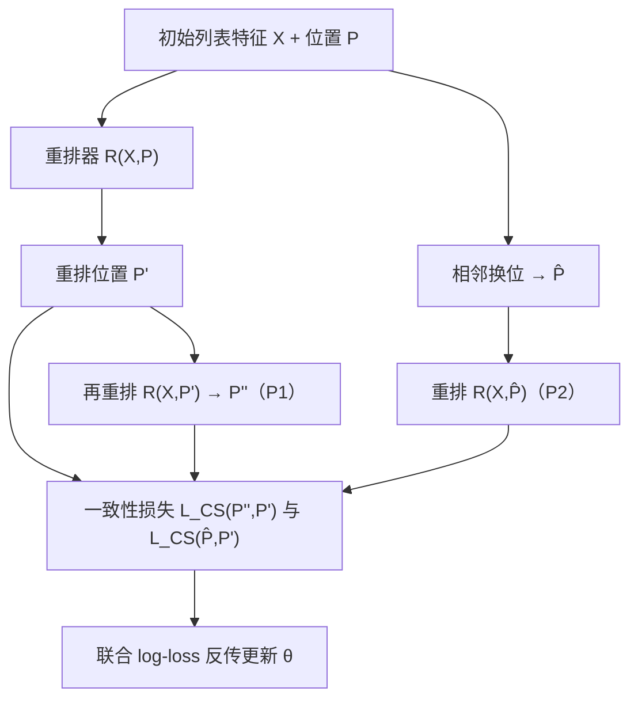

# Towards Principled Learning for Re-ranking in Recommender Systems (面向推荐系统重排的原则化学习)

- **会议/期刊**: SIGIR 2025
- **作者与机构**: Qunwei Li, Linghui Li, Jianbin Lin, Wenliang Zhong（蚂蚁集团）
- **推荐链路定位**: 重排（Re-ranking，精排之后的列表级调整）
- **研究方向**: 多任务学习与列表级重排 / 列表级上下文重排
- **论文原文**: [https://arxiv.org/abs/2504.04188v1](https://arxiv.org/abs/2504.04188v1)
- **开源代码**: 暂未开源（正文称 "We release the codes here" 但未给出可访问链接）

## TL;DR (1分钟核心速览)

重排模型长期缺乏"训练过程中如何判断输出列表已经足够好"的准则，现有工作只靠测试集上的 NDCG/MAP 做事后评价，无法指导学习。本文提出两条可度量的原则：**收敛一致性 P1**（重排结果再喂回重排器应保持不变）与**对抗一致性 P2**（初始列表相邻两项换位不应改变重排结果），并给出把二者写成额外损失项的通用算法，无需新增模型参数。在 Ad 与 PRM Public 两个数据集上，对 DLCM/MiDNN/PRM/SetRank/PEAR/RAISE 六种基线做即插即用增强，AUC、NDCG、MAP@k、Precision@k 全面正向提升，幅度约 0.05%–9.89%。

## Background & Motivation (背景与核心矛盾)

- **主流范式**: 重排以 Transformer/RNN 对初始列表做 listwise 上下文编码（PRM、SetRank、PEAR、RAISE），建模物品两两互影响后联合打分，训练目标基本是逐物品的 log-loss。
- **前人局限**: 其一，模型只被要求"拟合点击标签"，没有任何约束保证输出列表是模型自己认可的稳定解，可能出现 $A\to B\to C$ 的漂移；其二，初始列表顺序既携带精排信息又含噪声，SetRank 直接丢弃顺序、GSF 枚举排列，均未处理"顺序该被信任到什么程度"。
- **核心洞察 (Key Insight)**: 重排的输入与输出同为有序列表，这一结构对称性本身可转化为监督信号——一个好的重排器应当对自身输出不动点、对输入的微小扰动鲁棒。
- **本文切入点**: 把两条原则实现为"再重排一次"与"相邻换位一次"的额外前向，用一致性损失正则化排序差异，作为 off-the-shelf 插件挂到任意重排器上。

## Method (核心方法设计)

### 1. 整体框架 (Overall Architecture)

沿用通用重排四段式：输入层（初始列表特征 $\boldsymbol{X}\in\mathbb{R}^{n\times d}$、用户特征$\boldsymbol{U}$、位置$\boldsymbol{P}$）→ 特征交互（位置嵌入$\boldsymbol{X}+\boldsymbol{P}$）→ 物品交互建模（Transformer 自注意力编码两两影响）→ 输出层（MLP + softmax 得点击概率）。本文不改动该主干，而是在训练循环中额外执行两次前向：一次把首次重排得到的位置$\boldsymbol{P}'$作为新输入再重排得$\boldsymbol{P}''$（P1），一次把初始列表相邻两项换位得$\hat{\boldsymbol{P}}$ 后重排（P2），并将三路 log-loss 与两路一致性损失加权求和反传。推理时只走原始单次前向，零额外开销。

### 2. 关键设计拆解 (Key Designs)

1. **收敛一致性 P1（Convergence Consistency）**：痛点是重排器对自身输出不自信，二次重排会改变结果。做法是把首次输出位置当作输入再跑一次，得 $\boldsymbol{P}''\sim\mathcal{R}(\boldsymbol{X},\boldsymbol{P}')$，并把这次前向的标签损失也计入目标，迫使模型在"已被自己排好的列表"上依然给出相同排序。直觉上这是把重排器推向一个不动点，等价于对输出分布做自洽性约束，减少训练与推理之间的排序漂移。

2. **对抗一致性 P2 与对比相似损失 CS（Adversarial Consistency）**：痛点是初始顺序含精排噪声，模型对微小扰动过敏。做法是随机交换相邻两项得 $\hat{\boldsymbol{P}}$，要求重排结果与原始结果一致，并设计加权平方误差
$$\mathcal{L}_{CS}(\boldsymbol{P}_A,\boldsymbol{P}_B)=\left|\boldsymbol{P}_A-\boldsymbol{P}_B\right|^{\top}\left(\mathcal{R}(\boldsymbol{X},\boldsymbol{P}_A)-\mathcal{R}(\boldsymbol{X},\boldsymbol{P}_B)\right)^2$$
其中权重为两次重排所得位置的差异，只有排序真的不同时才被惩罚，从而避免对完全一致的情形施加无意义梯度。该形式模仿对抗训练：输入小扰动、输出不变，提升对精排噪声的鲁棒性。

3. **训练目标、负采样与推理效率**：总损失为
$$\mathcal{L}=\underbrace{\mathcal{L}(\boldsymbol{X},\boldsymbol{P})+\mathcal{L}(\boldsymbol{X},\boldsymbol{P}')+\mathcal{L}_{CS}(\boldsymbol{P}'',\boldsymbol{P}')}_{P1}+\underbrace{\mathcal{L}(\boldsymbol{X},\hat{\boldsymbol{P}})+\mathcal{L}_{CS}(\hat{\boldsymbol{P}},\boldsymbol{P}')}_{P2}$$
沿用逐物品 log-loss，不引入额外负采样（重排阶段候选列表已由精排给定，属 listwise 全列表打分）。训练时每步多两次前向，推理时与基线完全一致，部署成本为零增量。

## Experimental Setup & Evaluation Protocol (实验设置与评估协议)

- **数据集与预处理**: 沿用 LibRerank 库的数据与特征处理；Ad 按用户 5 分钟内广告曝光/点击日志聚成列表，PRM Public 为真实电商推荐列表。

| 数据集 | #Users | #Items | #Interactions | 稀疏度/密度 | 特征/场景说明 |
| :--- | :---: | :---: | :---: | :---: | :--- |
| Ad | 1M | 26M 曝光记录 | 26M 曝光/点击 | 极稀疏 | 8 个用户画像特征、6 个物品特征，广告场景 |
| PRM Public | 未披露 | 未披露 | 未披露 | 未披露 | 3 用户画像 + 5 类别 + 19 稠密物品特征，电商场景 |

- **数据划分与防穿越 (Splitting Strategy)**: 原文未明确说明划分方式（LibRerank 默认按列表样本划分），初始列表由 LambdaMart 生成，长度分别为 10（PRM Public）与 30（Ad）。
- **排名评测协议 (Ranking Protocol)**: 列表级指标 AUC、NDCG、MAP@k、Precision@k（$k=5,10,15,20$），在给定候选列表内做全列表排序评估，非全库 Full-Ranking；结果为 10 次试验均值，标准差在$e^{-3}\sim e^{-5}$ 量级故省略。
- **对比基线与超参设置**: 基线为 DLCM、MiDNN、PRM、SetRank、PEAR、RAISE 六种代表性重排模型；Adam 优化器，学习率在 $\{e^{-4},5e^{-5},e^{-5}\}$ 中调优，训练轮数分别为 100（PRM Public）与 30（Ad）。原文未报告显著性检验。

## Key Experimental Results (实验关键数据)

### 1. 主实验对比 (Main Results)

表中数值为"基线指标值 + 叠加本文原则后的相对提升"，加粗为各列最优基线值。

**PRM Public**

| 方法 | AUC | NDCG | MAP@5 | MAP@10 | P@5 | P@10 |
| :--- | :---: | :---: | :---: | :---: | :---: | :---: |
| DLCM | 0.5805 (+1.23%) | 0.4771 (+0.13%) | 0.3044 (+0.16%) | 0.3141 (+0.15%) | 0.1340 (+0.33%) | 0.1050 (+0.43%) |
| MiDNN | **0.6172** (+0.49%) | 0.4735 (+0.45%) | 0.2991 (+0.96%) | 0.3094 (+0.86%) | 0.1322 (+0.90%) | 0.0964 (+8.70%) |
| PRM | 0.6161 (+0.41%) | 0.4750 (+0.29%) | 0.3012 (+0.64%) | 0.3113 (+0.57%) | 0.1331 (+0.55%) | 0.1047 (+0.41%) |
| SetRank | 0.6101 (+1.28%) | 0.4670 (+0.41%) | 0.2898 (+0.70%) | 0.3012 (+0.36%) | 0.1295 (+0.27%) | 0.1027 (+0.01%) |
| PEAR | 0.6082 (+2.93%) | 0.4606 (+2.91%) | 0.2810 (+6.98%) | 0.2929 (+6.05%) | 0.1245 (+6.08%) | 0.0996 (+4.13%) |
| RAISE | 0.6152 (+0.16%) | **0.4741** (+0.05%) | **0.2997** (+0.10%) | **0.3101** (+0.09%) | **0.1329** (+0.12%) | **0.1046** (+0.10%) |

**Ad**

| 方法 | AUC | NDCG | MAP@5 | MAP@10 |
| :--- | :---: | :---: | :---: | :---: |
| DLCM | 0.8149 (+0.58%) | 0.6923 (+0.60%) | 0.5962 (+0.82%) | 0.5987 (+1.05%) |
| MiDNN | 0.8444 (+0.74%) | 0.6943 (+0.61%) | 0.5980 (+0.96%) | 0.6018 (+0.96%) |
| PRM | **0.8461** (+0.36%) | 0.6928 (+1.00%) | 0.5959 (+1.57%) | 0.6000 (+1.54%) |
| SetRank | 0.8181 (+1.93%) | 0.6940 (+0.79%) | 0.5972 (+1.27%) | 0.6010 (+1.29%) |
| PEAR | 0.8133 (+1.93%) | 0.6860 (+1.03%) | 0.5794 (+2.78%) | 0.5837 (+2.79%) |
| RAISE | 0.8163 (+3.88%) | **0.6886** (+0.65%) | **0.5841** (+2.12%) | **0.5882** (+2.06%) |

### 2. 消融实验 (Ablation Study)

表 3 报告"仅用单条原则带来的提升 / 两条原则同时使用的提升"之比（%），表 4 报告测试样本中满足对应原则的比例。

| 方法 | P1 单独贡献 (AUC) | P2 单独贡献 (AUC) | P1 服从率 (基线→+P1) | P2 服从率 (基线→+P2) |
| :--- | :---: | :---: | :---: | :---: |
| DLCM | 84.01% | 27.28% | 0.5708 → 0.8166 | 0.6235 → 0.7769 |
| MiDNN | 55.49% | 67.47% | 0.3015 → 0.3938 | 0.3059 → 0.4168 |
| PRM | 42.12% | 44.47% | 0.4074 → 0.4576 | 0.3803 → 0.3992 |
| SetRank | 11.93% | 33.15% | 0.5106 → 0.5665 | 0.4413 → 0.4861 |
| PEAR | 36.36% | 40.50% | 0.0320 → 0.0450 | 0.0303 → 0.0440 |
| RAISE | 3.39% | 5.80% | 0.3988 → 0.4295 | 0.3093 → 0.4271 |

### 3. 关键实验发现 (Key Findings)

1. **提升与基线强弱无关，弱基线获益更大**：PRM Public 上 PEAR 的 MAP@5 提升 6.98%、MiDNN 的 P@10 提升 8.70%，而本身较强的 RAISE 仅提升 0.05%–0.16%，说明原则主要修补的是"列表建模不充分"的模型，对已高度自洽的模型增益有限。
2. **两条原则近似正交，可叠加**：表 3 中多数单项贡献低于 100%，但 DLCM-P1 已达 84.01%、PRM-P1 在 MAP@5 上达 131.04%，两者之和与 100% 无固定关系，表明 P1 与 P2 从不同方向（自洽性 vs 输入鲁棒性）提供互补梯度。
3. **性能提升确实伴随原则服从率上升**：DLCM 的 P1 服从率从 0.5708 升至 0.8166、P2 从 0.6235 升至 0.7769，RAISE 的 P2 服从率从 0.3093 升至 0.4271，说明增益并非来自指标过拟合，而是模型行为真的更接近"不动点 + 扰动不变"的理想重排器。

## Highlights & Limitations (亮点、对比与审稿批判)

- **与代表作对比 (vs. Prior Work)**: PRM/PEAR/RAISE 的增量都在"如何更强地建模物品互影响"（更多注意力、历史点击、个性化权重），本文不碰主干结构，转而补上"学习准则"这一空白；与 SetRank 丢弃顺序、GSF 枚举排列的排列不变路线相反，本文承认初始顺序有价值但含噪，用扰动一致性而非完全忽略来处理。
- **可迁移亮点**: ①"把模型输出再喂回模型"的自洽损失可直接迁移到生成式重排、扩散式列表生成等迭代式解码场景；②相邻换位扰动 + 加权平方误差的 CS 损失形式轻量，可作为通用排序正则项用于粗排/精排的列表级训练。
- **审稿级局限批判**: ①训练时每步需 3 次前向（原始、再重排、扰动重排），训练开销约增至 3 倍，论文未给出收敛速度与训练时长对比；②实验仅两个数据集、无显著性检验、无全库 Full-Ranking 评估，且未报告划分方式与数据统计，复现与结论外推性偏弱；③原则的"小扰动"仅实现为相邻换位，扰动强度、换位次数等超参敏感性未做分析。

## Rating (四维评分)

- **方法创新性 (Novelty)**: ⭐⭐⭐⭐ （首次把重排学习从"拟合标签"推进到"自洽性 + 鲁棒性"原则层面，思路简洁且有对抗训练的理论类比，但缺少形式化收敛保证）
- **评估协议与实验扎实度 (Protocol & Experiments)**: ⭐⭐⭐ （六种基线 × 两个数据集 × 多指标覆盖较广，且有服从率这一新颖验证，但无显著性检验、无数据统计与划分说明、仅列表内排序）
- **写作与数学规范度 (Clarity & Rigor)**: ⭐⭐⭐ （原则动机与算法流程清晰，但 CS 损失中位置向量与打分向量的维度对应、$\mathcal{L}(\boldsymbol{X},\boldsymbol{P}')$ 的标签对齐等细节交代不足）
- **工业落地与复现价值 (Industrial & Practical Value)**: ⭐⭐⭐⭐ （推理零额外开销、即插即用、来自蚂蚁真实广告场景，工程落地门槛极低；扣分在于训练成本增至约 3 倍且代码未实际公开）

