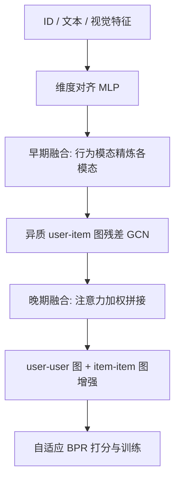
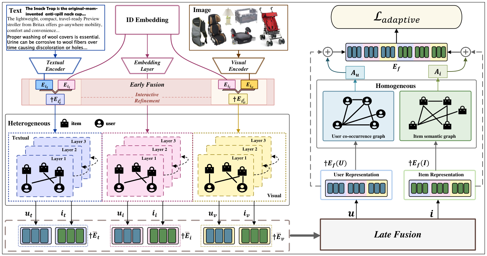

# COHESION: Composite Graph Convolutional Network with Dual-Stage Fusion for Multimodal Recommendation (双阶段融合的复合图卷积多模态推荐)

- **会议/期刊**: SIGIR 2025
- **作者与机构**: Jinfeng Xu, Edith C. H. Ngai (香港大学)；Zheyu Chen (香港理工大学)；Wei Wang (深圳北理莫斯科大学)；Xiping Hu (北京理工大学)；Sang-Wook Kim (汉阳大学)
- **推荐链路定位**: 召回（Top-K 排序）
- **研究方向**: 多模态推荐 / 图神经网络推荐
- **论文原文**: [https://arxiv.org/abs/2504.04452v2](https://arxiv.org/abs/2504.04452v2)
- **开源代码**: [https://github.com/Jinfeng-Xu/COHESION](https://github.com/Jinfeng-Xu/COHESION)

## TL;DR (1分钟核心速览)

多模态推荐中"模态融合"与"表征学习"长期被当作两个独立过程，早期融合丢失模态特异性、晚期融合易被跨模态无关信息污染，且单一同质图（仅 user-user 或仅 item-item）无法同时刻画双边关系。本文提出 COHESION：用行为模态在早期精炼文本/视觉表征、在晚期做注意力融合，并叠加 user-item 异质图 + user-user/item-item 同质图的复合 GCN，辅以自适应 BPR 平衡弱模态。在 Baby/Sports/Clothing 三数据集、8:1:1 随机划分、Full-Ranking 协议下，R@20 相对最强基线提升 4.41%–6.05%，且参数量与训练耗时与 LATTICE/FREEDOM 同量级。

## Background & Motivation (背景与核心矛盾)

- **主流范式**: 以 MMGCN 为代表的"每模态一张 user-item 二部图 + 晚期融合打分"，以及 DualGNN（user-user 图）、LATTICE/FREEDOM（item-item 图）对同质关系的单边扩展。
- **前人局限**: ① 融合策略要么在构图前做早期拼接（模态特异性被抹平），要么在打分端做晚期加权（无关模态噪声直接污染最终分数）；② 同质图研究各自为战，user-user 与 item-item 从未在同一框架内被联合验证，且融合与表征学习被割裂设计。
- **核心洞察 (Key Insight)**: 作者用 MMGCN 的 8 个变体做受控实验（表 1）：仅加单边同质图时晚期融合更优，但同时加双边图时早期融合反超（MMGCN$^{ui}_e$R@10=0.0630 vs. MMGCN$^{ui}_l$=0.0601），说明**融合策略与图表征能力是互补的**——表征越强，越需要早期对齐来压制跨模态噪声。
- **本文切入点**: 既然多模态推荐的终极目标是预测偏好而非理解内容，就用行为（ID）模态作为"锚"在早期把文本/视觉拉到同一语义空间，再在晚期融合，从而"解放"复合图卷积的表征能力。

## Method (核心方法设计)

### 1. 整体框架 (Overall Architecture)

输入为物品的 ID 嵌入、384 维文本特征与 4096 维视觉特征。流程为：先经两层 MLP 把各模态投影到统一维度，再用行为模态对每个模态做逐元素"几何平均式"精炼（早期融合）；随后每个模态各自在 user-item 异质图上做带残差相似度门控的 GCN 传播并跨层求和；三模态表征经可学习注意力加权拼接（晚期融合）；融合结果再分别送入 user-user 与 item-item 同质图增强，最终拼接为用户/物品表征并以自适应 BPR 训练。关键工程决策是**把晚期融合放在同质图之前**，从而只需构建一次同质图，省去 $|\mathcal{M}|$ 倍构图开销。

<figure class="paper-figure" markdown="span">
  <figcaption>图1：COHESION的总体结构。</figcaption>
</figure>

### 2. 关键设计拆解 (Key Designs)

1. **早期融合：用行为模态做"语义锚点"精炼**：痛点在于文本/视觉与 ID 处于不同语义空间，直接拼接会引入无关信息。作者不做注意力，而是对已对齐维度的模态嵌入 $\tilde{E}_{i_m}$与行为嵌入$\tilde{E}_{i_i}$ 取逐元素几何平均：
$$\tilde{E}_{i_i m}=\sqrt{\left|0.5\times\left((\tilde{E}_{i_m})^2+(\tilde{E}_{i_i})^2\right)+\epsilon\right|}$$
该算子等价于对两向量做逐维 RMS 式的"软交集"，只有当某维度在两模态中同时显著时才被保留，天然抑制单边噪声；同时它把行为模态的偏好信号注入内容模态，使后续图传播在"推荐语义"而非"内容语义"上进行。

2. **复合图卷积：残差相似度门控的异质图 + 双边同质图**：深层 GCN 在 user-item 图上过平滑。作者在每层传播前用当前层表征与初始表征的余弦相似度作为自门控：
$$\tilde{E}^{(l)}_m=\left(\mathrm{Sim}(\tilde{A}\tilde{E}^{(l-1)}_m,\ \tilde{E}^{(0)}_m)+\epsilon\right)\times\tilde{A}\tilde{E}^{(l-1)}_m$$
相似度越低（表征漂移越远）门控越小，从而保留初始模态信息，使最优层数从常规的 1 层放宽到 2 层（图 6）。同质图侧，user-user 图取 top-$k$（$k{=}10$）余弦相似邻居后做 Softmax 归一化传播，item-item 图取 top-$k$ 后做相似度加权聚合，二者分别增强用户侧与物品侧表征后拼接。

3. **自适应 BPR：按"打分差距"反向加权弱模态**：标准 BPR 只优化整体偏好，弱模态的特定兴趣学不到。作者以各模态正负样本打分差 $y^m_{u,p}-y^m_{u,n}$ 的 softmax 反比作为权重：
$$w^m_{u,p,n}=1-\frac{\exp(y^m_{u,p}-y^m_{u,n})}{\sum_{m\in\mathcal{M}}\exp(y^m_{u,p}-y^m_{u,n})}$$
差距越小的模态（学得越差）权重越大，总损失为 $\mathcal{L}=-\sum_{(u,p,n)\in\mathcal{D}}\log\sigma\left(\sum_m w^m_{u,p,n}(y^m_{u,p}-y^m_{u,n})\right)+\lambda\|\Theta\|_2^2$。负采样为均匀随机负采样，无自监督辅助任务，因此训练开销低于 SLMRec/BM3 类方法。

## Experimental Setup & Evaluation Protocol (实验设置与评估协议)

- **数据集与预处理**: 三个 Amazon 子集，均按 `5-core` 过滤；文本用 sentence-transformer 提 384 维，视觉用公开 4096 维特征。

| 数据集 | #Users | #Items | #Interactions | 稀疏度 | 特征/场景说明 |
| :--- | :---: | :---: | :---: | :---: | :--- |
| Baby | 19,445 | 7,050 | 160,792 | 99.88% | 母婴，V 4096 / T 384 |
| Sports | 35,598 | 18,357 | 296,337 | 99.95% | 运动户外，V 4096 / T 384 |
| Clothing | 39,387 | 23,033 | 278,677 | 99.97% | 服饰，V 4096 / T 384 |

- **数据划分与防穿越 (Splitting Strategy)**: 随机 `8:1:1` 比例划分训练/验证/测试，以验证集 R@20 做早停（patience 20，总 epoch 1000）。
- **排名评测协议 (Ranking Protocol)**: 沿用 MMRec 生态的 `Full-Ranking` 全库未交互物品排序，报告 Recall@{10,20} 与 NDCG@{10,20} 的全用户平均值；显著性检验 $p<0.01$。
- **对比基线与超参设置**: 传统组 MF-BPR / LightGCN / SimGCL / LayerGCN；多模态组 VBPR / MMGCN / DualGNN / SLMRec / LATTICE / FREEDOM / BM3 / LGMRec。统一嵌入维度 $d{=}64$、Xavier 初始化、Adam；COHESION 网格搜索学习率与$\lambda\in\{10^{-1},\dots,10^{-4}\}$，异质图层数$L\in\{1,2,3,4\}$，同质图固定$L_u{=}L_i{=}1$，$k{=}10$。

## Key Experimental Results (实验关键数据)

### 1. 主实验对比 (Main Results)

| 数据集 | 模型 | R@10 | R@20 | N@10 | N@20 |
| :--- | :--- | :---: | :---: | :---: | :---: |
| Baby | LightGCN | 0.0479 | 0.0754 | 0.0257 | 0.0328 |
| Baby | LATTICE | 0.0547 | 0.0850 | 0.0292 | 0.0370 |
| Baby | FREEDOM | 0.0627 | 0.0992 | 0.0330 | 0.0424 |
| Baby | LGMRec | 0.0639 | 0.0989 | 0.0337 | 0.0430 |
| Baby | **COHESION** | **0.0680** | **0.1052** | **0.0354** | **0.0454** |
| Sports | FREEDOM | 0.0717 | 0.1089 | 0.0385 | 0.0481 |
| Sports | LGMRec | 0.0719 | 0.1068 | 0.0387 | 0.0477 |
| Sports | **COHESION** | **0.0752** | **0.1137** | **0.0409** | **0.0503** |
| Clothing | LATTICE | 0.0492 | 0.0733 | 0.0268 | 0.0330 |
| Clothing | FREEDOM | 0.0628 | 0.0941 | 0.0341 | 0.0420 |
| Clothing | **COHESION** | **0.0665** | **0.0983** | **0.0358** | **0.0438** |
| — | **Improv.** | **+6.42%** | **+6.05%** | **+5.04%** | **+5.58%** |

（Improv. 为 Baby 上相对最强基线的提升；Sports 为 +4.59%/+4.41%，Clothing 为 +5.89%/+4.46%，均 $p<0.01$。）

### 2. 消融实验 (Ablation Study)

| 变体 | Baby R@20 | Sports R@20 | Clothing R@20 | 说明 |
| :--- | :---: | :---: | :---: | :--- |
| COHESION | **0.1052** | **0.1137** | **0.0983** | 完整模型 |
| COHESION-u | 0.1024 | 0.1086 | 0.0942 | 去 user-user 图 |
| COHESION-i | 0.0884 | 0.0963 | 0.0744 | 去 item-item 图 |
| COHESION-ui | 0.0870 | 0.0937 | 0.0701 | 去双边同质图 |
| COHESION-itv | 最低 | 最低 | 最低 | 去整个早期融合（图 2） |
| DualGNN → DualGNN+ | 0.0716→0.0753 | 0.0859→0.0894 | 0.0683→0.0737 | 插入自适应 BPR |
| LATTICE → LATTICE+ | 0.0850→0.0881 | 0.0953→0.0974 | 0.0733→0.0787 | 插入自适应 BPR |

### 3. 关键实验发现 (Key Findings)

1. **双边同质图存在强互补，且 item-item 图贡献远大于 user-user 图**：去掉 item-item 图使 Clothing R@20 从 0.0983 暴跌至 0.0744（−24.3%），而去掉 user-user 图仅降至 0.0942（−4.2%）；两者同时去掉（0.0701）甚至略低于仅保留 user-user，说明 user-user 图的价值高度依赖 item-item 图提供的语义骨架。
2. **"多模态反而更差"的陷阱被双阶段融合破解**：表 6 显示 VBPR/MMGCN/DualGNN/SLMRec/LATTICE/BM3/LGMRec 在加入双模态后相对最优单模态普遍负增益（DualGNN 在 Baby 上 −31.17%），仅 FREEDOM（+1.22%）与 COHESION（+4.99%）为正；t-SNE（图 3）进一步显示双阶段融合下 ID/文本/视觉三簇重叠度显著高于纯晚期融合。
3. **自适应 BPR 是即插即用的通用增益件**：将其移植到 DualGNN 与 LATTICE 后，三数据集全部指标单调上升（如 LATTICE 在 Clothing 上 R@20 +7.4%），证明"按模态打分差反向加权"确实补偿了弱模态；同时 COHESION 在 (0,5] 最稀疏用户分桶上仍稳定领先 LATTICE/FREEDOM/LGMRec（图 4），且收敛更快（图 5）。

## Highlights & Limitations (亮点、对比与审稿批判)

- **与代表作对比 (vs. Prior Work)**: 相比 DualGNN（仅 user-user 图 + 晚期融合）与 LATTICE（仅 item-item 图 + 早期融合），COHESION 首次在同一框架内同时容纳双边同质图，并用受控实验（表 1）证明"融合策略必须随图表征能力同步升级"这一此前被忽略的耦合关系；相比 FREEDOM 的图冻结+去噪路线，本文走的是"用行为模态做语义对齐"的正向精炼路线，无需额外自监督任务即可获得更低训练开销。
- **可迁移亮点**: ① 几何平均式早期精炼算子极轻量（无参数、无注意力），可直接插入任何多模态召回塔做模态对齐；② "晚期融合前置到同质图之前"的排布把构图复杂度从 $|\mathcal{M}|$ 倍降为 1 倍，是工业多模态召回中值得复用的工程 trick。
- **审稿级局限批判**: ① 早期融合的几何平均对"行为模态本身稀疏"的冷启动物品可能过度主导，论文未在严格 zero-shot 物品上做验证；② 同质图 top-$k$与层数等超参在三个数据集上需分别调优（Baby 最优$L{=}1$，其余为 2），且 user-user 图构建涉及$O(|U|^2)$ 相似度计算，用户规模上亿时需依赖 ANN 近似，论文未讨论该场景下的精度损失。

## Rating (四维评分)

- **方法创新性 (Novelty)**: ⭐⭐⭐⭐ （双阶段融合与复合图的耦合洞察有新意，但单个算子（几何平均、残差门控、反比加权）均为已有组件的巧妙重组，理论分析偏经验）
- **评估协议与实验扎实度 (Protocol & Experiments)**: ⭐⭐⭐⭐ （三数据集 + 12 个基线 + Full-Ranking + $p<0.01$ 显著性 + 稀疏分桶/效率/收敛/超参五组补充实验齐全，但缺少严格冷启动划分与线上验证）
- **写作与数学规范度 (Clarity & Rigor)**: ⭐⭐⭐⭐ （受控变体实验的表 1 极具说服力，公式与算法伪代码完整；但符号 $\dagger$与$\sim$ 混用、部分公式排版有噪声，复杂度分析略粗）
- **工业落地与复现价值 (Industrial & Practical Value)**: ⭐⭐⭐⭐ （代码已开源，参数量 37M/91.5M 与 LATTICE 同量级、单 epoch 4.47s 可接受，晚期融合前置省去 $|\mathcal{M}|$ 倍构图，具备直接落地多模态召回的条件）

