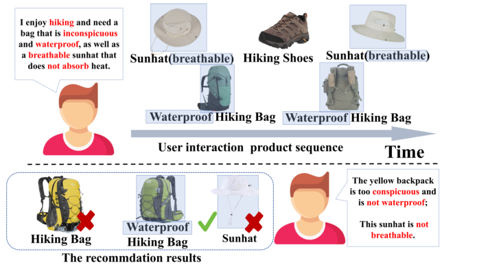
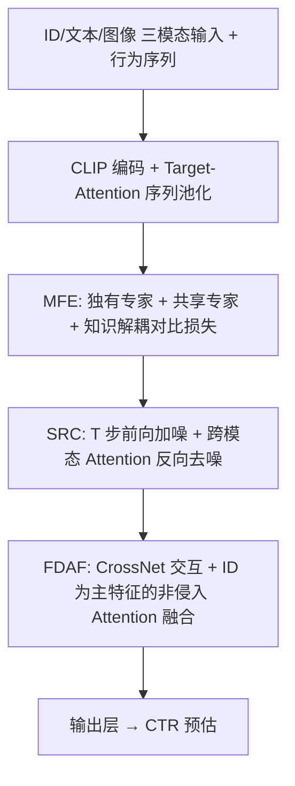
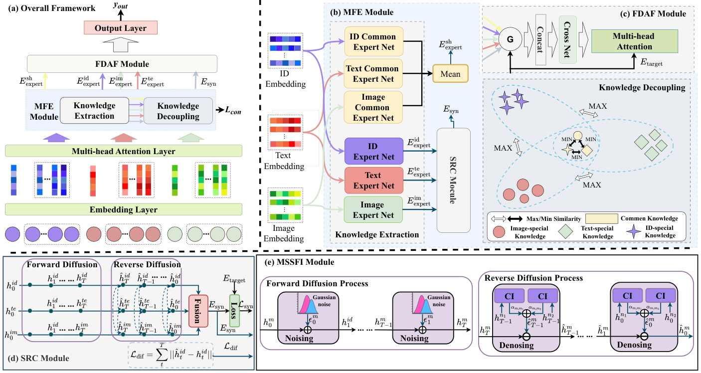

# Diffusion-based Multi-modal Synergy Interest Network for Click-through Rate Prediction (基于扩散的多模态协同兴趣网络用于点击率预估)

- **会议/期刊**: SIGIR 2025 (pp. 581–591)
- **作者与机构**: Xiaoxi Cui (Takway.AI)、Weihai Lu (北京大学, 通讯)、Yu Tong (武汉大学)、Yiheng Li (上海对外经贸大学)、Zhejun Zhao (Microsoft)
- **推荐链路定位**: 精排 (CTR 预估)
- **研究方向**: 多模态推荐 / CTR 预估与特征交叉
- **论文原文**: [https://arxiv.org/abs/2508.21460v1](https://arxiv.org/abs/2508.21460v1)
- **开源代码**: [https://github.com/Cxx-0/Diff-MSIN](https://github.com/Cxx-0/Diff-MSIN)

## TL;DR (1分钟核心速览)

现有多模态 CTR 方法把图文特征直接拼进 DIN 类序列模型，既无法剥离"跨模态共性 vs 模态独有性"，也忽略了模态间的协同增益（如"防水"文本 + "绿色"图像共同触发点击）。Diff-MSIN 用 PLE 式共享/独有专家 + 余弦对比解耦知识，用扩散式多步跨模态 Attention 去噪捕捉协同表征，再以 ID 为主、辅助特征加权的非侵入方式融合。在 Rec-Tmall 与三个 Amazon 数据集上，AUC 相对最优基线提升 1.67%–2.34%（RelaImpr 最高 +2.34%），且可即插即用地增强 DIN/ETA/TWIN/DPN。

## Background & Motivation (背景与核心矛盾)

- **主流范式**: 多模态 CTR 沿两条路线——(a) 以 LMF/MTFN/NAML/MARN/GMMF/EM3/MAKE 为代表的模态融合网络，将图文表征与 ID 特征拼接或门控后送入 CTR 塔；(b) 以 DIN/DIEN/SIM 为代表的 ID 行为序列建模，仅用 item/cate/brand 等 ID 刻画兴趣演化。
- **前人局限**: 其一，融合前不做知识解耦，跨模态重叠信息被重复编码（文本与图像都强调"颜色"），遇到冲突信号（用户多数品类偏好深色、唯独遮阳帽偏好浅色）时表征纠缠、鲁棒性崩塌；其二，模态间被当作独立特征并列，缺乏对"协同关系"的显式建模，导致"浅色 + 透气"这类联合偏好被拆散，推荐出"绿色透气帽"或"不透气帽"。
- **核心洞察 (Key Insight)**: 点击由多模态特征的**联合触发**驱动（图 1：徒步包的"Waterproof"文本与"Green"视觉缺一不可），因此共性、独有性、协同性三类知识必须显式分离并分别建模；同时扩散过程的多步"加噪—跨模态去噪"天然适合让一个模态为另一个模态提供上下文去噪。
- **本文切入点**: 把 PLE 的多专家结构用于模态知识解耦，把扩散前向/反向过程重解释为"多步跨模态特征交互 + 互去噪"，最后用 Attention 让辅助模态只"加权"而不"污染" ID 主特征。

<figure class="paper-figure" markdown="span">
  <figcaption>图1：用户点击由多模态特征（如文本和视觉）的协同作用驱动。例如，一款徒步背包的“防水”文本特征和“绿色”视觉特征共同提高了寻找丛林徒步装备的用户的点击可能性；缺少任一特征都会降低这种可能性。</figcaption>
</figure>

## Method (核心方法设计)

### 1. 整体框架 (Overall Architecture)

输入为用户画像、目标物品与行为序列三部分，每部分均含 ID / 文本 / 图像三种模态；文本与图像经 CLIP 编码（$d_{te},d_{im}=512$，ID 为 16），序列侧先用 target-aware Attention 加权再 Sum 池化得到$\mathbf{E}^{im}_a,\mathbf{E}^{te}_a$。MFE 模块以独有专家 + 共享专家产出$\mathbf{E}^{im}_{expert},\mathbf{E}^{te}_{expert},\mathbf{E}^{id}_{expert}$与$\mathbf{E}^{sh}_{expert}$，并由 Knowledge Decoupling 对比损失拉开彼此距离；SRC 模块在$T$步内对三模态做前向加噪与反向跨模态 Attention 去噪，输出协同表征$\mathbf{E}_{syn}$；FDAF 以 ID 特征为 query、CrossNet 交互后的辅助特征为 key/value 做多头注意力，实现非侵入融合；最终拼接送入输出层，与主任务 NLL 损失联合训练。

<figure class="paper-figure" markdown="span">
  <figcaption>图2：（a）我们提出的Diff-MSIN框架的整体框架，展示了不同模态的前向计算过程；（b）展示了我们提出的MFE模块，SRC模块包含在MFE模块中；（c）表示我们提出的FDAF模块；（d）是SRC模块；（e）提供了MSSFI模块的详细信息。</figcaption>
</figure>

### 2. 关键设计拆解 (Key Designs)

1. **MFE + Knowledge Decoupling（共性/独有性分离）**：痛点是不分离则重叠信息重复编码、冲突信号下表征纠缠。做法是每个模态配一个独有专家、三模态再各配一个共享专家，共享表征取均值 $\mathbf{E}^{sh}_{expert}=\frac{1}{3}\sum_m \mathbf{E}^{sh,m}_{expert}$，再门控混合$\mathbf{E}^{m}=w_m\odot\mathbf{E}^{m}_{expert}+(1-w_m)\odot\mathbf{E}^{sh}_{expert}$；解耦损失把五个专家张量两两推远、共享张量两两拉近：
$$\mathcal{L}_{con}=\sum_{i}\sum_{j\neq i}\cos(\mathbf{E}^{i}_{expert},\mathbf{E}^{j}_{expert})-\sum_{i}\sum_{j\neq i}\cos(\mathbf{E}^{i}_{share},\mathbf{E}^{j}_{share})$$
直觉是"独有知识正交、共性知识聚拢"，从几何上强制表征空间分区，避免模态间语义串扰。

2. **SRC / MSSFI（扩散式多步协同交互）**：痛点是单轮拼接无法刻画细粒度与粗粒度依赖，也无法互去噪。前向按标准 DDPM 调度注入高斯噪声 $\hat{h}^{m}_{t+1}=\sqrt{\alpha_t}h^{m}_{t+1}+\sqrt{1-\alpha_t}\epsilon^{m}_{t}$；反向不用参数化 UNet，而用**跨模态 Attention 充当去噪器**，让其他模态的上下文预测本模态噪声：
$$\hat{\epsilon}^{m}_{t}=\sum_{n\neq m}\alpha_{m,n}\cdot \mathrm{Attention}(h^{m}_{t},h^{n}_{t},h^{n}_{t}),\quad \hat{h}^{m}_{t-1}=\frac{1}{\sqrt{\alpha_t}}\Big(\hat{h}^{m}_{t}-\frac{1-\alpha_t}{\sqrt{1-\bar{\alpha}_t}}\hat{\epsilon}^{m}_{t}\Big)$$
物理直觉：文本描述可为图像物体提供细节、抑制视觉噪声，反之图像为文本提供外观佐证，多步迭代即多粒度协同精炼。协同表征再经 MLP 得 $\mathbf{E}_{syn}$，并用点击标签做余弦 hinge 约束$\mathcal{L}_{syn}$（正样本拉近、负样本推远目标表征）。

3. **FDAF 与训练目标**：痛点是直接 concat 会让图文噪声侵入 ID 主特征。做法是以 $\mathbf{E}^{id}_{target}$门控出四路权重$w_{im},w_{te},w_{sh},w_{syn}$，拼接后过 CrossNet 得$\mathbf{E}_c$，再以$\mathbf{E}^{id}$为 query、$\mathbf{E}_c$为 key/value 做多头注意力$\mathbf{E}_{att}=\mathrm{MHA}(\mathbf{E}^{id},\mathbf{E}_c)$，辅助信息只调制不替换主特征。总损失$\mathcal{L}=\mathcal{L}_{y}+w_1\mathcal{L}_{con}+w_2\mathcal{L}_{syn}$，$\mathcal{L}_y$为 NLL；无负采样环节（CTR 点式二分类），$w_1,w_2$在 0.001–0.3 内搜索，扩散步数$T$ 默认 50、最优约 12。

## Experimental Setup & Evaluation Protocol (实验设置与评估协议)

- **数据集与预处理**: 序列长度至少 5，每用户保留最近 50 条历史；图文分别取商品标题与主图，ID 含 item/brand/user/seller。

| 数据集 | #Users | #Items | #Interactions | 稀疏度/密度 | 特征/场景说明 |
| :--- | :---: | :---: | :---: | :---: | :--- |
| Rec-Tmall | 72,051 | 93,466 | 328,387 | 极稀疏 | 天猫电商，含 seller ID |
| Home | 31,387 | 64,302 | 296,428 | 极稀疏 | Amazon 家居 |
| Clothing | 64,183 | 134,064 | 614,601 | 极稀疏 | Amazon 服饰 |
| Arts | 23,592 | 16,340 | 264,801 | 相对稠密 | Amazon 工艺品 |

- **数据划分与防穿越 (Splitting Strategy)**: 沿用 EM3/GMMF 与 DIN 的 CTR 设定，按样本级训练/测试划分（非 Leave-One-Out、非全局时间戳切分），序列侧仅取目标交互之前的历史，避免未来信息泄漏。
- **排名评测协议 (Ranking Protocol)**: 点式二分类评估，指标为 **AUC** 与 **RelaImpr**（相对 LR 的相对提升），非 Full-Ranking 也非 Sampled Ranking；无负采样比例概念，测试集为全量曝光样本。
- **对比基线与超参设置**: 基线覆盖 LR/FM、DeepFM/YoutubeNet/DIN、以及 LMF/MTFN/NAML/MARN/GMMF/QARM/SimCEN/EM3/MAKE 共 15 个；ID 维度 16、图文 512、专家维度 128、batch 1024、学习率 $\{10^{-5},10^{-4},10^{-3}\}$、隐层$\{64,128,256,512\}$，8 头 Attention，早停 patience=10。

## Key Experimental Results (实验关键数据)

### 1. 主实验对比 (Main Results)

| Method | Rec-Tmall AUC | Home AUC | Clothing AUC | Arts AUC | Arts RelaImpr |
| :--- | :---: | :---: | :---: | :---: | :---: |
| DIN (2018) | 0.6839 | 0.7383 | 0.7061 | 0.6664 | 11.02% |
| NAML (2019) | 0.7172 | 0.7276 | 0.7001 | 0.6919 | 15.14% |
| MARN (2020) | 0.7133 | 0.7340 | 0.7098 | 0.7120 | 18.40% |
| GMMF (2022) | 0.7124 | 0.7428 | 0.7131 | 0.7167 | 19.15% |
| QARM (2024) | 0.7152 | 0.7338 | 0.7101 | 0.7135 | 18.67% |
| SimCEN (2024) | 0.7149 | 0.7344 | 0.7076 | 0.7125 | 18.44% |
| EM3 (2024) | 0.7181 | 0.7410 | 0.7219 | 0.7199 | 19.67% |
| MAKE (2024) | 0.7149 | 0.7427 | 0.7207 | 0.7189 | 19.51% |
| **Diff-MSIN** | **0.7270** | **0.7543** | **0.7331** | **0.7312** | **21.49%** |
| Improv.% (vs best baseline) | +1.24% | +1.55% | +1.55% | +1.57% | +1.82pp |

泛化性实验（表 3）显示即插即用增益稳定：DIN 0.6839→0.7270、ETA 0.6890→0.7279、TWIN 0.7095→0.7293、DPN 0.7142→0.7301（Rec-Tmall）；Arts 上 DPN 0.6879→0.7369，提升幅度最大。

### 2. 消融实验 (Ablation Study)

| 变体 | Rec-Tmall | Home | Clothing | Arts |
| :--- | :---: | :---: | :---: | :---: |
| w/o MFE,SRC,FDAF | 0.7138 (-1.29%) | 0.7328 (-2.75%) | 0.7182 (-1.86%) | 0.7325 (-2.35%) |
| w/o MFE and SRC | 0.7172 (-0.82%) | 0.7389 (-1.94%) | 0.7237 (-1.11%) | 0.7354 (-1.96%) |
| w/o SRC | 0.7169 (-0.85%) | 0.7433 (-1.35%) | 0.7278 (-0.55%) | 0.7399 (-1.36%) |
| w/o FDAF | 0.7190 (-0.57%) | 0.7474 (-0.81%) | 0.7295 (-0.31%) | 0.7403 (-1.31%) |
| Full Diff-MSIN | **0.7270** | **0.7543** | **0.7331** | **0.7312** |

### 3. 关键实验发现 (Key Findings)

1. **SRC 是最大贡献源，且与 MFE 强耦合**：单独去掉 SRC 在 Home 掉 1.35%、Arts 掉 1.36%，而去掉 MFE+SRC 在 Home 掉 1.94%，说明扩散式协同交互依赖解耦后的干净专家表征才能发挥去噪增益；FDAF 单独移除仅掉 0.31%–1.31%，属于"锦上添花"的降噪层。
2. **模态贡献随品类漂移**：图 3 显示去掉文本或图像均降 AUC，但 Rec-Tmall 与 Clothing 对图像更敏感、Home 对文本更敏感，印证"不同品类偏好不同模态"的动机；图 4 进一步表明移除关键模态对应的独有专家网络时跌幅最大，共性/协同专家移除亦有稳定下降，验证三类知识均非冗余。
3. **扩散步数存在明显最优区间**：$T=5$时 AUC 仅 0.7203（交互不足、只学到浅层特征），$T=20$时降至 0.7192（过拟合、交互多样性下降），$T=12$取得 0.7264 的峰值；同时$w_1,w_2$ 过小则解耦/协同约束失效、过大则压制主任务，需在 0.001–0.3 内精调。效率上训练 97.3s/epoch、推理 0.36s，与 MAKE（89.5s / 0.33s）同量级，未显著恶化。

## Highlights & Limitations (亮点、对比与审稿批判)

- **与代表作对比 (vs. Prior Work)**: 相比 EM3/MAKE 仅做模态差异特征或端到端冷启动对齐，本文首次把"共性—独有—协同"三分知识显式拆开；相比 GMMF 的图融合与 QARM 的量化多模态定制，本文用扩散多步交互替代单轮融合，且反向过程由跨模态 Attention 参数化，比 DiffuRec/DiffRec 的生成式扩散更轻量、更贴合 CTR 判别任务。
- **可迁移亮点**: (a) "共享专家 + 独有专家 + 余弦解耦损失"可作为任意多源特征（如多场景、多行为类型）的通用去冗余插件；(b) 用 Attention 充当扩散反向去噪器、以另一模态上下文预测本模态噪声，可迁移到模态缺失鲁棒性场景。
- **审稿级局限批判**: 其一，扩散反向过程缺乏严格的噪声预测监督目标，$\hat{\epsilon}^m_t$由 Attention 直接给出而非拟合真实噪声，$T$ 步的"扩散"更像多轮交互的比喻，理论正当性弱于标准 DDPM；其二，评估仅用 AUC、无 GAUC/LogLoss 与线上 A/B，且四个数据集均为公开离线集、序列截断 50 条，长序列与工业级稀疏场景下的收益与 0.36s 推理开销的性价比仍待验证。

## Rating (四维评分)

- **方法创新性 (Novelty)**: ⭐⭐⭐⭐ （三分知识解耦 + 扩散式跨模态互去噪的组合有新意，但扩散部分偏"借喻"，缺严格生成式推导）
- **评估协议与实验扎实度 (Protocol & Experiments)**: ⭐⭐⭐⭐ （四数据集 + 15 基线 + 泛化性 + 消融 + 效率 + 案例齐全，但仅 AUC 单指标、无显著性检验与线上验证）
- **写作与数学规范度 (Clarity & Rigor)**: ⭐⭐⭐ （模块图清晰、公式完整，但符号 $E^{id}_a$未定义、式 (9) 与式 (11) 的$\alpha$ 语义混用、部分记号前后不一致）
- **工业落地与复现价值 (Industrial & Practical Value)**: ⭐⭐⭐⭐ （代码开源、可作为 DIN/ETA/TWIN/DPN 插件即插即用，推理开销与 MAKE 同量级，工程可落地性强）

