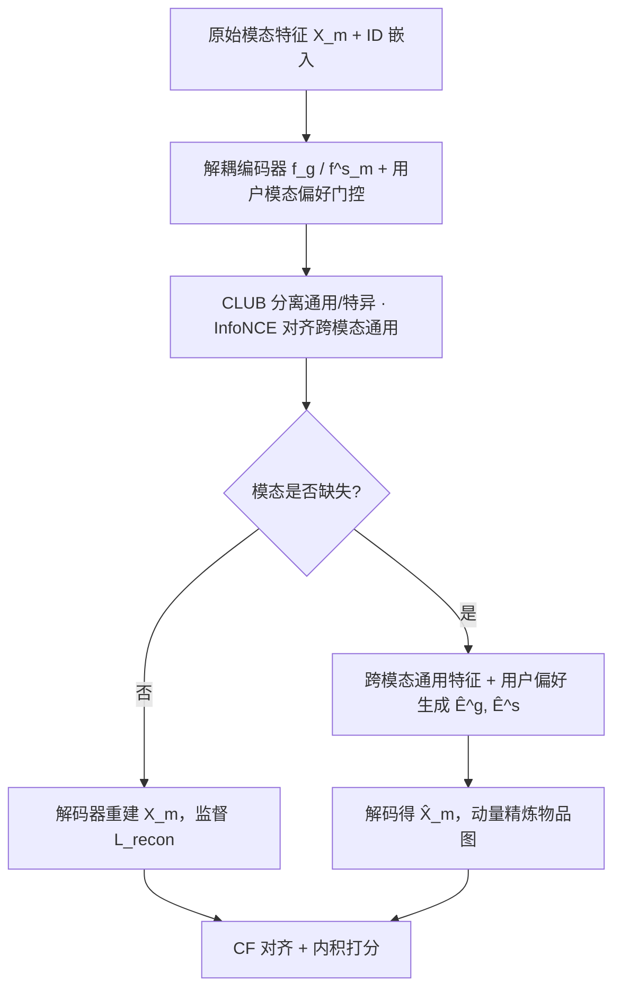

# Disentangling and Generating Modalities for Recommendation in Missing Modality Scenarios (缺失模态场景下的模态解耦与生成推荐)

- **会议/期刊**: SIGIR 2025
- **作者与机构**: Jiwan Kim, Hongseok Kang, Sein Kim, Kibum Kim, Chanyoung Park (KAIST)
- **推荐链路定位**: 召回（多模态物品表征 + 物品-物品图）
- **研究方向**: 多模态推荐 / 自监督对比与去噪
- **论文原文**: [https://arxiv.org/abs/2504.16352v1](https://arxiv.org/abs/2504.16352v1)
- **开源代码**: [https://github.com/ptkjw1997/DGMRec](https://github.com/ptkjw1997/DGMRec)

## TL;DR (1分钟核心速览)

现有多模态推荐（MRS）默认物品各模态特征齐全，工业中模态缺失时只能"丢样本"或用最近邻均值（NN）注入，导致推荐分数剧烈漂移；同时它们强行对齐不同模态，抹掉了图像（外观）与文本（功能）各自的独有信息。本文提出 DGMRec：先用 CLUB + InfoNCE 把每个模态解耦为"通用/特有"两类特征，再用其他可用模态的通用特征与交互用户的模态偏好分别生成缺失模态的通用/特有分量，并据此周期性精炼物品-物品图。在 4 个数据集、8:1:1 划分、全库排序协议下，缺失模态场景 R@20 相对最强基线提升 4.69%–8.21%，叠加新物品场景提升至 6.86%–14.06%。

## Background & Motivation (背景与核心矛盾)

- **主流范式**: 以 LATTICE/LGMRec/GUME 为代表的 MRS 通过模态特征直接融合或模态图对齐来增强 CF 表征，均假设物品的图像/文本/音频特征完整可得。
- **前人局限一（缺失模态）**: 工业流中模态常整块缺失；现有做法要么丢弃缺失物品（损失大量交互），要么用全局均值或 NN 均值注入。图 1(b) 显示 NN 注入特征与原模态的推荐分数差越大，该用户-物品对的排序性能下降越严重——即"注入特征替代不了原模态"，且越依赖模态特征的 SOTA 模型（LGMRec/DAMRS/GUME）跌得越狠。
- **前人局限二（忽视模态独特性）**: 图像刻画颜色/风格等具象属性，文本承载功能/背景等描述性信息，二者并非同义。强行对齐会把"文本有用、图像反而干扰"的物品（图 1(b) 中红蓝柱反号样本）压成同一表征，损害排序。
- **核心洞察 (Key Insight)**: 模态信息应显式拆成"跨模态共享的通用部分"与"模态独有的特有部分"；缺失时前者可由其他模态迁移，后者只能由用户对该模态的偏好隐式推断。
- **本文切入点**: 用信息论损失做解耦，用双通道生成器分别补全两类特征，再以生成特征重建原始模态并修复被 NN 注入污染的物品图。

## Method (核心方法设计)

### 1. 整体框架 (Overall Architecture)

输入为 ID 嵌入 $E_{id}$与各模态原始特征$X_m$（缺失项以均值初始化）。**解耦模块**用共享参数的通用编码器$f_g$与模态私有的特有编码器$f^s_m$得到$E^g_m, E^s_m$，经用户模态偏好$P_{i,m}$门控去噪后，在 top-k 模态相似图上做 LightGCN 传播得$\bar{E}^g_m, \bar{E}^s_m$；CLUB 压低同模态内通用/特异的互信息，InfoNCE 拉高跨模态通用特征的互信息。**生成模块**训练解码器$f^m_{dec}$从拼接特征重建原始模态，对缺失物品则用其他模态通用特征生成$\hat{E}^g_m$、用$P_{i,m}$生成$\hat{E}^s_m$，解码得$\hat{X}_m$ 并每 5 个 epoch 以动量方式更新物品图。最后经行为-模态对齐与用户-物品对齐把模态知识注入 CF，内积打分 + BPR 训练。

### 2. 关键设计拆解 (Key Designs)

1. **信息论模态解耦（CLUB + InfoNCE）**：仅用两个独立编码器不足以真正分离信息。本文对同模态内 $(\bar{E}^g_m,\bar{E}^s_m)$最小化 CLUB 上界$\mathcal{L}_{club}=\sum_i[\log q_\phi(\bar{e}^g_i|\bar{e}^s_i)-\frac{1}{|\mathcal{I}|}\sum_j\log q_\phi(\bar{e}^g_j|\bar{e}^s_i)]$，压掉冗余；对跨模态通用特征用 InfoNCE 最大化下界，使$\bar{E}^g_m$与$\bar{E}^g_{m'}$ 落入同一语义空间。直觉：通用分量被"拉齐"才能跨模态迁移，特异分量被"推开"才能保留图像/文本的互补信息。

2. **双通道缺失模态生成**：通用分量由其他可用模态拼接后经 2 层 MLP 生成 $\hat{E}^g_m=\mathcal{G}^g_m(\Vert_{m'\neq m}\bar{E}^g_{m'})$（全缺失时退化为均值占位以保持维度）；特异分量无法跨模态获得，改用交互用户偏好$\hat{E}^s_m=\mathcal{G}^s_m(P_{i,m})$，其中$p_{i,m}=\frac{1}{|\mathcal{N}_i|}\sum_{u\in\mathcal{N}_i}p_{u,m}$。生成特征经解码器得$\hat{X}_m$，仅对缺失物品计算$\mathcal{L}_{gen}$，避免污染可用模态。

3. **图精炼与训练目标**：NN 注入会在物品图上制造伪边，故用生成特征重建相似度 $\hat{S}_m$并做动量融合$S_m=\alpha S_m+(1-\alpha)\hat{S}_m$，且只更新"有模态物品 → 缺失物品"的有向边，既防欠训练特征回流污染，又省去全图重算。总损失$\mathcal{L}=\mathcal{L}_{bpr}+\mathcal{L}_{recon}+\mathcal{L}_{gen}+\lambda_1\mathcal{L}_{disentangle}+\lambda_2\mathcal{L}_{align}$，负采样为标准 BPR 均匀采样，无额外难负样本挖掘；推理时仅需一次前向内积，生成过程离线周期性执行。

## Experimental Setup & Evaluation Protocol (实验设置与评估协议)

- **数据集与预处理**: 均采用 `5-core` 过滤；Amazon 三集含图像+文本，TikTok 含图像+文本+音频。

| 数据集 | #Users | #Items | #Interactions | 稀疏度 | 特征/场景说明 |
| :--- | :---: | :---: | :---: | :---: | :--- |
| Baby | 19,445 | 7,050 | 160,792 | 99.88% | 图像+文本 |
| Sports | 35,598 | 18,357 | 296,337 | 99.95% | 图像+文本 |
| Clothing | 39,387 | 23,033 | 278,677 | 99.97% | 图像+文本 |
| TikTok | 9,308 | 6,710 | 68,722 | 99.89% | 图像+文本+音频 |

- **数据划分与防穿越**: 按 `8:1:1` 比例划分训练/验证/测试；新物品设定下额外选 20% 物品仅出现在测试集（训练与验证阶段完全不可见），属冷启动划分。
- **缺失模态构造**: 双模态数据将物品均分为 0/1/2 个模态缺失三组，三模态数据分为 0/1/2/3 四组，缺失模态类型逐物品随机；缺失比例实验取 0%–80%，且各比例下缺失集合保持嵌套一致。
- **排名评测协议**: 采用无偏 `Full-Ranking`（全库未交互物品排序），指标 Recall@20/50 与 NDCG@20/50；跨模态检索任务用 Hit@10/20。
- **对比基线与超参**: 5 个 CF（MF/NGCF/LightGCN/SGL/SimGCL）、10 个 MRS（VBPR/MMGCN/GRCN/SLMRec/BM3/LATTICE/MGCN/LGMRec/DAMRS/GUME）、3 个 MMA-RS（CI2MG/MILK/SIBRAR）；嵌入维度 $d=64$，Adam 优化，$\lambda_1,\lambda_2\in\{1,10^{-1},10^{-2},10^{-3}\}$，$\alpha$以 0.2 步长在$[0,1]$ 搜索，生成间隔 5 epoch，早停 30 epoch。

## Key Experimental Results (实验关键数据)

### 1. 主实验对比 (Main Results)

缺失模态设定（节选 R@20 / N@20，完整表见原文 Table 2）：

| 模型 | Baby R@20 | Baby N@20 | Sports R@20 | Clothing R@20 | TikTok R@20 | TikTok N@20 |
| :--- | :---: | :---: | :---: | :---: | :---: | :---: |
| LightGCN | 0.0733 | 0.0320 | 0.0829 | 0.0514 | 0.0916 | 0.0406 |
| SGL | 0.0804 | 0.0348 | 0.0917 | 0.0600 | 0.0939 | 0.0403 |
| LATTICE | 0.0738 | 0.0319 | 0.0867 | 0.0581 | 0.0824 | 0.0372 |
| LGMRec | 0.0813 | 0.0352 | 0.0906 | 0.0624 | 0.0791 | 0.0335 |
| DAMRS | 0.0804 | 0.0355 | 0.0941 | 0.0670 | 0.1044 | 0.0452 |
| GUME | 0.0835 | 0.0369 | 0.0947 | 0.0639 | 0.0968 | 0.0389 |
| CI2MG | 0.0720 | 0.0305 | 0.0717 | 0.0523 | 0.0772 | 0.0327 |
| **DGMRec** | **0.0897** | **0.0404** | **0.1024** | **0.0725** | **0.1093** | **0.0476** |
| Improv.% | +7.43% | +9.49% | +8.13% | +8.21% | +4.69% | +5.31% |

缺失模态 + 新物品设定下，DGMRec 在 Baby 上 R@20 达 0.0519（+14.06%），Clothing 上 0.0413（+8.68%），TikTok 上 0.0639（+6.86%），提升幅度普遍高于纯缺失场景。

### 2. 消融实验 (Ablation Study)

| 变体 | Baby R@20 | Baby N@20 | Clothing R@20 | TikTok R@20 | TikTok N@20 |
| :--- | :---: | :---: | :---: | :---: | :---: |
| DGMRec 完整 | **0.0897** | **0.0404** | **0.0725** | **0.1093** | **0.0476** |
| w/o Disentangle | 0.0756 | 0.0331 | 0.0596 | 0.0985 | 0.0419 |
| w/o CLUB | 0.0854 | 0.0373 | 0.0617 | 0.1031 | 0.0452 |
| w/o InfoNCE | 0.0778 | 0.0347 | 0.0631 | 0.1001 | 0.0429 |
| w/o Generation | 0.0848 | 0.0373 | 0.0646 | 0.0988 | 0.0402 |
| w/o Recon Loss | 0.0872 | 0.0376 | 0.0703 | 0.1034 | 0.0434 |
| w/o Gen Loss | 0.0862 | 0.0374 | 0.0647 | 0.1041 | 0.0438 |
| w/o Alignment | 0.0554 | 0.0248 | 0.0392 | 0.0745 | 0.0335 |
| w/o UI-align | 0.0789 | 0.0335 | 0.0634 | 0.0903 | 0.0389 |
| w/o BM-align | 0.0811 | 0.0346 | 0.0576 | 0.1011 | 0.0422 |

### 3. 关键实验发现 (Key Findings)

1. **CF 对齐是命门，解耦次之**：去掉 $\mathcal{L}_{align}$使 Baby R@20 从 0.0897 崩至 0.0554（−38%），跌幅远超去掉解耦（−15.7%）与生成（−5.5%），说明模态特征若不经行为对齐几乎无法转化为排序收益；而$\mathcal{L}_{club}$与$\mathcal{L}_{infoNCE}$ 单独移除各掉 4.8%/13.3%，证明"推开特异 + 拉齐通用"两者缺一不可。
2. **缺失越极端，生成越值钱**：缺失比例从 20% 升至 80% 时，DGMRec 相对 0% 基线的性能跌幅仅 2.7%→4.9%，而 GUME 为 5.9%→15.1%，80% 缺失时相对最优基线提升达 10.05%；且"部分模态可用"场景增益大于"全缺失"，印证跨模态通用特征迁移是主要增益来源，偏好驱动的特异生成是兜底。
3. **生成特征可反哺检索，且开销可控**：单模态缺失时跨模态检索 Hit@10 由 NN 的 0.1344 提升至 0.3577（+166%），全缺失时 NN 完全失效而 DGMRec 仍达 0.3496；时间上 Baby 每 epoch 训练 2.63s 与 LGMRec 的 2.81s 持平，Clothing 总时长 802.4s 高于 GUME 的 667.2s 但远低于 DAMRS 的 1934.2s，性能-开销比合理。

## Highlights & Limitations (亮点、对比与审稿批判)

- **与代表作对比**: 相比 LGMRec/GUME 的"强制跨模态对齐"，本文显式保留模态特异信息；相比 CI2MG 用最优传输生成缺失模态，本文避免 OT 的 $O(n^2)$ 开销且生成过程与推荐损失端到端耦合；相比 MILK/SIBRAR 仅做鲁棒性学习而不补全模态，本文真正重建了缺失特征，因而在纯 CF 基线上仍有明显优势。
- **可迁移亮点**: ①"通用/特异"双通道 + CLUB/InfoNCE 的解耦范式可直接迁移到多行为或多场景推荐中的共享/场景私有表征分离；②只更新"完整物品 → 缺失物品"有向边并做动量融合 $\alpha$ 的图修复策略，是任何动态图推荐中低成本防污染更新的通用技巧。
- **审稿级局限批判**: ①生成质量高度依赖用户模态偏好嵌入 $P_{i,m}$，对交互极少的物品（新物品早期）特异分量生成近乎无信息，论文未给出该子群的细粒度分析；②图精炼每 5 epoch 触发一次且需重算缺失物品相似度，在千万级物品库上的增量构图成本与$\alpha$ 的跨数据集敏感性（最优值随数据集漂移）尚未充分讨论。

## Rating (四维评分)

- **方法创新性 (Novelty)**: ⭐⭐⭐⭐ （首次从互信息视角把模态解耦与缺失模态生成统一到一个框架，CLUB+InfoNCE 的组合有明确信息论依据，但解耦思想本身在多模态领域已有先声）
- **评估协议与实验扎实度 (Protocol & Experiments)**: ⭐⭐⭐⭐ （4 数据集 + 全库排序 + 缺失/新物品/缺失比例/跨模态检索四类场景 + 10 项消融，覆盖充分；不足在于未报告显著性检验与多随机种子方差）
- **写作与数学规范度 (Clarity & Rigor)**: ⭐⭐⭐⭐ （损失项与生成流程符号统一、公式完整，图 1 的动机分析极具说服力；但 Eq.3 等处上下标省略略影响可读性，部分模块缺少复杂度推导）
- **工业落地与复现价值 (Industrial & Practical Value)**: ⭐⭐⭐⭐ （代码已开源，Baby 上训练开销与 LightGCN 系持平，跨模态检索能力对冷启动物品上架场景有直接价值；大规模图精炼成本仍需线上验证）

