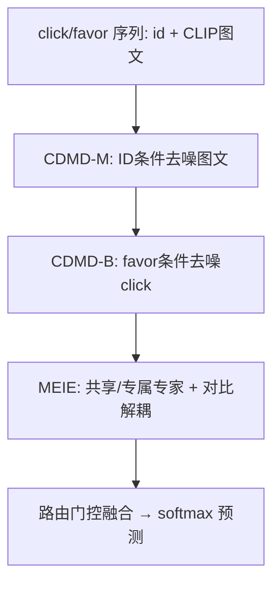
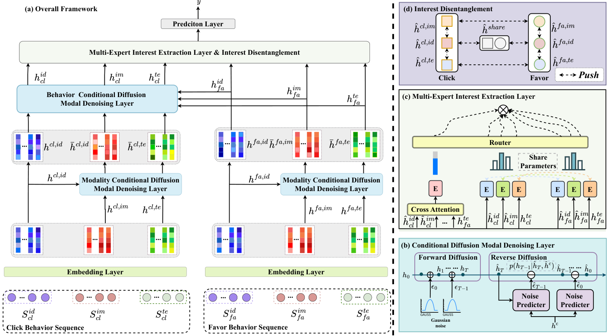

# Multi-Modal Multi-Behavior Sequential Recommendation with Conditional Diffusion-Based Feature Denoising (基于条件扩散特征去噪的多模态多行为序列推荐)

- **会议/期刊**: SIGIR 2025 (Pages 1593–1602)
- **作者与机构**: Xiaoxi Cui (Takway.AI), Weihai Lu (Peking University), Yu Tong (Wuhan University), Yiheng Li (SUIBE), Zhejun Zhao (Microsoft)
- **推荐链路定位**: 召回（序列下一物品预测）
- **研究方向**: 多模态推荐 / 序列与会话推荐
- **论文原文**: [https://arxiv.org/abs/2508.05352v1](https://arxiv.org/abs/2508.05352v1)
- **开源代码**: 暂未开源

## TL;DR (1分钟核心速览)

本文针对多模态多行为序列推荐中三个叠加痛点：不同行为对模态偏好差异未被刻画、隐式反馈（误点击）噪声、多模态表征自身噪声。提出 M$^3$BSR：用 ID 特征作条件引导条件扩散去除图文模态噪声，再用深层行为（favor）作条件去噪浅层行为（click），最后以共享/专属专家网络解耦共性兴趣与行为-模态特性兴趣。在 Rec-Tmal 与 Kuaishou 上采用 99 负采样排序协议，HR@10 相对最强基线 EBM 提升约 4.0%（0.3083→0.3207）与 7.6%（0.2420→0.2603）。

## Background & Motivation (背景与核心矛盾)

- **主流范式**: 多行为序列推荐（NMTR/MB-STR/EBM）建模行为级联关系，多模态序列推荐（MISSRec/MMMLP/M$^3$SRec）融合图文特征，但两条线基本各自为战。
- **前人局限**: 其一，现有方法未显式刻画"同一物品在不同行为下模态重要性不同"——图 1 显示连衣裙的图片驱动 click、而面料成分文本驱动 favor；其二，隐式反馈噪声（误点击）与 CLIP 图文嵌入中与用户偏好无关的模态噪声被直接送入序列编码器并逐层放大。
- **核心洞察 (Key Insight)**: ID 特征比复杂图文特征更贴近用户偏好、噪声更低，天然适合作去噪条件；深层行为（favor）信噪比高于浅层行为（click），可作行为去噪的条件信号。
- **本文切入点**: 把"去噪"从特征工程升级为两级条件扩散过程（模态级 + 行为级），再用多专家路由显式分离共性与特性兴趣。

## Method (核心方法设计)

### 1. 整体框架 (Overall Architecture)

输入为用户的两条行为序列（click / favor），每条序列拆成 id、image（CLIP）、text（CLIP）三路模态嵌入。先经条件扩散模态去噪层（CDMD-M），以 ID 嵌入为条件对图文嵌入做前向加噪-反向去噪；再经条件扩散行为去噪层（CDMD-B），以 favor 各模态特征为条件对 click 特征去噪。去噪后的 6 路特征（2 行为 × 3 模态）进入多专家兴趣提取层（MEIE）：cross-attention 对齐 click/favor 后由共享 Transformer 专家抽共性兴趣，各行为-模态由专属 Transformer 专家抽特性兴趣，经对比损失解耦、路由门控融合，最后 softmax 预测下一 favor 物品。

<figure class="paper-figure" markdown="span">
  <figcaption>图 2：(a) 我们提出的 M3BSR 框架的整体框架，展示了完整的算法流程；(b) 展示了我们提出的 CDMD 层；(c) 展示了我们提出的 MEIE 模块；(d) 展示了不同模态和行为下不同特征的特征解耦过程。</figcaption>
</figure>

### 2. 关键设计拆解 (Key Designs)

1. **条件扩散模态去噪 (CDMD-M)**：痛点是从 CLIP 继承的图文噪声会污染偏好建模。前向按 $\tilde{h}^m_{t+1}=\sqrt{\alpha^m_t}h^m_t+\sqrt{1-\alpha^m_t}\epsilon^m_t$加噪，反向噪声预测器借 IP-Adapter 思路用 cross-attention 注入条件：$\hat{\epsilon}^m_t=\text{CrossAttention}(h^m_t,h_c,h_c)$，其中$h_c=h_{id}$。直觉是 ID 嵌入噪声低、语义直指偏好，充当"干净锚点"把图文特征拉回用户兴趣流形；重建损失$\mathcal{L}_m=\sum_t\sum_{m\in\{im,te\}}\|\tilde{h}^m_t-h^m_t\|_2^2$ 约束去噪保真。

2. **条件扩散行为去噪 (CDMD-B)**：click 含误触噪声而 favor 是深思后的显式反馈。对 click 各模态特征重复同一扩散-反向流程，但条件换成 $h_c=h^{fa,m}$，即用深层行为同模态特征引导浅层行为去噪，损失$\mathcal{L}_b=\sum_m\sum_t\|\hat{h}^{cl,m}_t-\tilde{h}^{cl,m}_t\|_2^2$。物理直觉是"高信噪比行为为低信噪比行为提供监督方向"，等价于跨行为的软标签蒸馏。

3. **多专家兴趣提取与解耦 (MEIE)**：共性兴趣由 $\hat{h}_{share}=\text{CrossAttention}(h_{cl},h_{fa})$再经共享 Transformer 得到；特性兴趣由 6 个专属 Transformer 分别编码。为防止专家塌缩为同一表征，引入对比损失$\mathcal{L}_{contrast}=-\sum_{i\neq j}\log\frac{\exp(\text{sim}(h_i,h_j)/\tau)}{\sum_{k\neq i}\exp(\text{sim}(h_i,h_k)/\tau)}$强制 7 路表征在空间分离；路由门控$g=\sigma(W_g[h_{common};h_{cl};h_{fa}]+b_g)$动态加权融合。总损失$\mathcal{L}=\mathcal{L}_{main}+\lambda_c\mathcal{L}_{contrast}+\lambda_m\mathcal{L}_m+\lambda_b\mathcal{L}_b$，训练用 softmax 交叉熵 + 99 随机负采样，扩散步数$T=15$。

## Experimental Setup & Evaluation Protocol (实验设置与评估协议)

- **数据集与预处理**: 序列最短长度 5，每用户保留最近 50 条记录；目标行为 favor，click 为辅助行为。

| 数据集 | #Users | #Items | #Interactions | 平均 click / favor | 场景说明 |
| :--- | :---: | :---: | :---: | :---: | :--- |
| Rec-Tmal | 72,051 | 93,466 | 328,387 | 4.16 / 1.73 | 天猫电商，id 含 item/brand/user/seller |
| Kuaishou | 22,793 | 618,529 | 5,852,725 | 255.02 / 40.96 | 快手短视频，id 含 user/video |

- **数据划分与防穿越 (Splitting Strategy)**: `Leave-One-Out`——每用户最后一个 favor 为测试、倒数第二个为验证，严格按序列时序。
- **排名评测协议 (Ranking Protocol)**: `Sampled Ranking`，每正样本配 99 个随机负样本（1:99），指标 HR@10/20、NDCG@10/20。
- **对比基线与超参设置**: 三类共 16 个基线（传统序列 5 个、多模态 5 个、多行为 6 个）；ID 嵌入 16 维、图文 512 维，batch 1024，学习率 $\{10^{-5},10^{-4},10^{-3}\}$，隐藏维$\{64,128,256,512\}$，扩散步数$T=15$，早停 patience=10。

## Key Experimental Results (实验关键数据)

### 1. 主实验对比 (Main Results)

| 方法 | Rec-Tmal HR@10 | NDCG@10 | HR@20 | Kuaishou HR@10 | NDCG@10 | HR@20 |
| :--- | :---: | :---: | :---: | :---: | :---: | :---: |
| SASRec | 0.1662 | 0.0578 | 0.2145 | 0.1001 | 0.0083 | 0.1490 |
| BERT4Rec | 0.2123 | 0.0964 | 0.2629 | 0.1435 | 0.0494 | 0.1958 |
| SSDRec | 0.2827 | 0.1637 | 0.3315 | 0.2176 | 0.1151 | 0.2671 |
| MMMLP | 0.2928 | 0.1753 | 0.3421 | 0.2284 | 0.1285 | 0.2769 |
| M$^3$SRec | 0.2997 | 0.1803 | 0.3486 | 0.2315 | 0.1293 | 0.2859 |
| CMCLRec | 0.3075 | 0.1886 | 0.3602 | 0.2394 | 0.1375 | 0.2918 |
| EBM | 0.3083 | 0.1877 | 0.3601 | 0.2420 | 0.1395 | 0.2882 |
| **M$^3$BSR** | **0.3207** | **0.2028** | **0.3815** | **0.2603** | **0.1630** | **0.3101** |
| Improv.% (vs 最强基线) | +4.0% | +7.5% | +5.9% | +7.6% | +16.8% | +7.6% |

### 2. 消融实验 (Ablation Study)

| 变体 | Rec-Tmal HR@10 | Rec-Tmal NDCG@10 | Kuaishou HR@10 | Kuaishou NDCG@10 |
| :--- | :---: | :---: | :---: | :---: |
| Full M$^3$BSR | **0.3207** | **0.2028** | **0.2603** | **0.1630** |
| w/o CDMD-M | 0.3128 | 0.1954 | 0.2512 | 0.1535 |
| w/o CDMD-B | 0.3169 | 0.1983 | 0.2556 | 0.1552 |
| w/o MEIE | 0.3065 | 0.1891 | 0.2401 | 0.1418 |
| w/o Shared Expert | 0.3144 | 0.1917 | 0.2433 | 0.1463 |
| w/o Disent | 0.3165 | 0.1961 | 0.2564 | 0.1570 |

### 3. 关键实验发现 (Key Findings)

1. **MEIE 是最大贡献源**：移除后 Rec-Tmal HR@10 掉 4.4%（0.3207→0.3065）、Kuaishou 掉 7.8%（0.2603→0.2401），降幅超过两个扩散模块，说明"共性/特性兴趣解耦"比单纯去噪更关键；而 CDMD-M 的降幅（2.5%/3.5%）大于 CDMD-B，印证图文模态噪声比行为噪声更严重。
2. **扩散步数与损失权重存在明确甜点**：两数据集均在 $T=10$、$\lambda=0.02$达峰（Rec-Tmal 0.3207、Kuaishou 0.2603），步数增至 25 且权重 0.15 时过正则化使 HR@10 回落至 0.3155/0.2572；对比损失最优为$\tau=0.3$、$\lambda_c=0.05$，过低温度（0.01）导致错误配对降至 0.3168。
3. **冷启动与效率的权衡可接受**：Kuaishou 稀疏用户（≤10 交互）上 M$^3$BSR HR@10 达 0.2897，较 EBM 的 0.2560 提升 13.2%，说明多模态去噪可部分替代交互历史；代价是训练 35.2s/epoch、单次推理 0.16s，较 EBM（32.5s/0.13s）仅增约 8%/23%，t-SNE 亦显示 CDMD 后嵌入簇显著紧致。

## Highlights & Limitations (亮点、对比与审稿批判)

- **与代表作对比 (vs. Prior Work)**: 相较 EBM 的硬/软行为去噪，本文把去噪升级为"模态级 + 行为级"两级条件扩散，且条件信号来自 ID 与深层行为而非启发式规则；相较 M$^3$SRec/MMMLP 仅做多模态融合，本文显式处理模态噪声并引入行为-模态交叉的专家解耦；相较 MISSRec 的对比预训练，本文的对比损失作用于专家输出而非输入增广。
- **可迁移亮点**: ①"低噪模态/高信噪比行为作扩散条件"的去噪范式可迁移到跨域推荐与多场景特征对齐；②路由门控 + 对比解耦的组合可直接用于 MMoE/PLE 类多专家结构的专家塌缩抑制。
- **审稿级局限批判**: ①评测仅用 1:99 采样排序，未报告 Full-Ranking，采样负例可能高估绝对指标；②扩散步数 $T$与三个损失权重$\lambda$ 共 4 个敏感超参需网格搜索，且推理需多步反向扩散，在线部署成本未在真实流量下验证；③两数据集均为自建（Rec-Tmal/Kuaishou），缺乏公开标准 benchmark 与代码，复现性存疑。

## Rating (四维评分)

- **方法创新性 (Novelty)**: ⭐⭐⭐⭐ （首次将条件扩散同时用于模态与行为两级去噪，条件选择有明确物理直觉，但扩散骨架本身沿用 DDPM/IP-Adapter）
- **评估协议与实验扎实度 (Protocol & Experiments)**: ⭐⭐⭐ （16 个基线覆盖三类且含冷启动与效率实验，但仅 1:99 采样排序、无 Full-Ranking 与显著性检验）
- **写作与数学规范度 (Clarity & Rigor)**: ⭐⭐⭐ （框架图清晰、公式完整，但 Eq.10/13 符号重复、5.4.1 与 5.4.2 段落文字几乎完全重复，编辑疏漏明显）
- **工业落地与复现价值 (Industrial & Practical Value)**: ⭐⭐⭐ （推理开销仅增 23% 且模块可并行，但未开源、数据集自建，复现与线上验证门槛较高）

