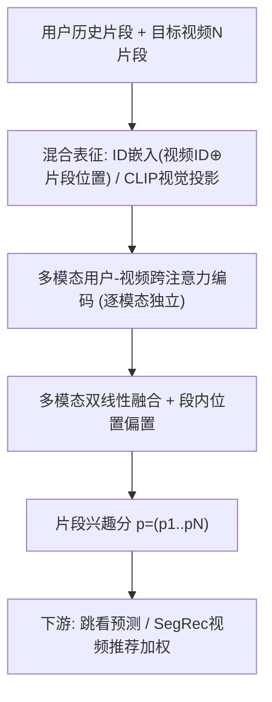
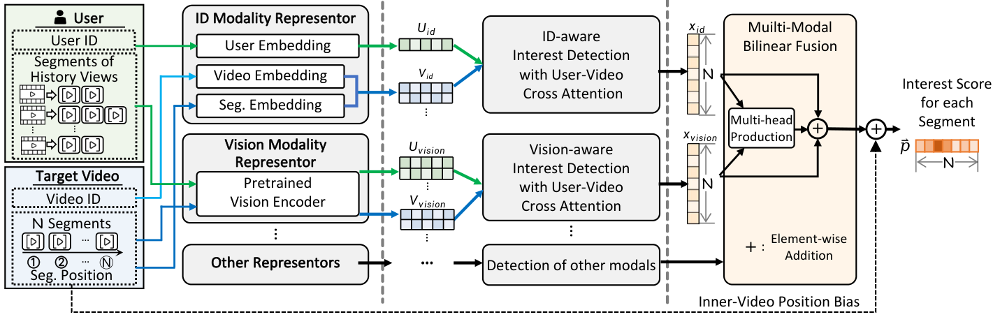

# Short Video Segment-level User Dynamic Interests Modeling in Personalized Recommendation (短视频片段级用户动态兴趣建模)

- **会议/期刊**: SIGIR 2025
- **作者与机构**: Zhiyu He, Jiayu Li, Zhiqiang Guo, Weizhi Ma, Min Zhang (清华大学/泉城实验室)；Zhixin Ling, Xinchen Luo, Guorui Zhou (快手科技)
- **推荐链路定位**: 精排（片段级兴趣打分，可服务跳看预测与视频级推荐加权）
- **研究方向**: 多模态推荐 / 序列推荐
- **论文原文**: [https://arxiv.org/abs/2504.04237v3](https://arxiv.org/abs/2504.04237v3)
- **开源代码**: [https://github.com/hezy18/SegMMInterest](https://github.com/hezy18/SegMMInterest)

## TL;DR (1分钟核心速览)

现有短视频推荐把整条视频当作一个原子物品打分，忽略了用户在视频时间轴上兴趣的剧烈漂移（同一视频内不同片段吸引力差异巨大）。本文首次提出**片段级用户兴趣建模**：将视频等分为 5 秒片段，用 CLIP 视觉特征 + ID/位置嵌入构成混合表征，经模态感知的用户-视频跨注意力编码，再由双线性融合解码器输出每段兴趣分；针对片段级标签缺失，设计**段内排序损失**（跳看段兴趣应最低）。在自建 SegMM 与 KuaiRand 上，跳看预测 HR@1 相对最强基线提升约 87%（0.2177→0.4072），视频推荐 AUC 在 WideDeep 骨干上提升约 1.4 个点。

## Background & Motivation (背景与核心矛盾)

- **主流范式**: 现有短视频推荐将视频视为整体物品，抽取封面/固定帧多模态特征并学习视频 ID 嵌入，输出单一视频级偏好分（LightGCN、SASRec、DIN/DIEN、BM3/FREEDOM 等）。
- **前人局限**: (1) 视频级建模无法刻画视频内部快速场景切换带来的兴趣漂移，用户"看到第几秒划走"这一强信号被完全丢弃；(2) 少数片段级工作（如 Shang et al. 按规则挑正/负帧构图）把片段当作孤立实体，割裂了前后片段兴趣的**时序连续性**。
- **核心洞察 (Key Insight)**: 用户在同一视频内的跳看位置高度集中于特定片段（ItemPosition 基线 HR@1 达 0.26，远超全局位置概率 0.13），说明片段兴趣既由内容决定、又受"人类注意力随时间衰减"这一与内容无关的先验调制。
- **本文切入点**: 用"片段位置偏置"显式拟合注意力先验，用"段内相对排序"替代缺失的片段级绝对标签，把兴趣建模粒度从视频下沉到片段。

## Method (核心方法设计)

### 1. 整体框架 (Overall Architecture)

输入为用户历史观看片段序列 $S_u$与目标视频的$N$个片段$S_v$。混合表征模块分别构建 ID 模态（用户 ID 嵌入；视频 ID 嵌入与片段位置嵌入拼接）与视觉模态（CLIP 提特征后线性投影）。多模态用户-视频编码器在每个模态内部独立执行用户-视频跨注意力，输出模态专属片段兴趣隐分。片段兴趣解码器用多模态双线性融合整合各模态，再叠加段内位置偏置，得到最终片段兴趣分序列$\boldsymbol{p}=(p_1,\dots,p_N)$。训练用段内排序损失，推理时直接前向打分，可冻结后作为插件服务下游推荐。

<figure class="paper-figure" markdown="span">
  <figcaption>图2：融合用户与视频混合表示、多模态用户-视频编码器及分段兴趣解码器的用户分段兴趣建模概览。𝑁为目标视频中的分段数，分段兴趣分数为模型输出。</figcaption>
</figure>

### 2. 关键设计拆解 (Key Designs)

1. **模态感知的用户-视频跨注意力（Modal-aware Interest Detection）**：常规 Transformer 把用户与物品拼进同一序列统一注意，但用户序列长度 $M$与视频片段数$N$语义结构不同（$M>N$）。本文为每个模态单独构造跨注意力，同时拼接"视频自注意"与"用户-视频交叉注意"两路 logits 再 softmax：
$A^{(l)}_{VU}=\mathrm{FFN}(V^{(l)})\cdot\mathrm{FFN}(U^{(l)})/\sqrt{d},\quad V'^{(l)}=\mathrm{Softmax}(A^{(l)}_{VU}\oplus A^{(l)}_{VV})\cdot(\mathrm{FFN}(V^{(l)})\oplus\mathrm{FFN}(U^{(l)}))$
直觉：让每个片段既能"看自己"保持内容连贯，又能"看用户历史"实现个性化，避免统一序列注意中用户 token 淹没片段 token。

2. **多模态双线性融合 + 段内位置偏置**：简单拼接无法刻画模态间乘性交互。解码器对模态输出 $x_i$ 做线性投影并显式加入两两多头部内积：
$o=\sigma\big(b_f+\sum_i \mathrm{Proj}(x_i)+\sum_{i\neq j}\mathrm{Proj}(x_i^\top x_j)\big),\quad \boldsymbol{p}=o+(w_p\cdot \boldsymbol{pos}+b_p)$其中$\boldsymbol{pos}=(1,\dots,N)$ 为片段序号。位置偏置项专门拟合"越往后越易失去兴趣"的人类注意力先验，使模型在冷启视频（无 ID 信息）时仍能靠位置与视觉泛化。

3. **段内排序损失与训练推理**：片段级标签不可得，唯一可用信号是跳看位置 $y$。本文假设"被跳看片段在已观看片段中兴趣最低"，构造成对排序损失：
$\mathcal{L}_{u,v}=-\sum_{i=y,\,j\neq y}^{N-1}\ln\sigma(p_j-p_i)$
相比把跳看段硬标为 0 的 BCE（各段独立、忽略段间相对关系），该损失只在同一视频内部比较，天然适配"兴趣是相对量"的物理直觉，且无需负采样。推理仅一次前向，开销与视频级模型同阶。

## Experimental Setup & Evaluation Protocol (实验设置与评估协议)

- **数据集与预处理**:

| 数据集 | #Users | #Items | #View | #Segment | 特征/场景说明 |
| :--- | :---: | :---: | :---: | :---: | :--- |
| SegMM (自建) | 2,369 | 362,430 | 902,115 | 3,920,483 | 含每片段视觉特征，剔除快进行为，视频≤200s、段长5s |
| KuaiRand | 983 | 717,652 | 1,615,315 | 8,140,477 | 仅 ID/行为，无视觉特征 |

- **数据划分与防穿越**: 采用 **8:1:1 用户级划分**（user-based split），两任务共用同一划分以防泄漏；视频级 CTR 标签按"有效观看"定义（按时长分 10 桶、取桶内观看比例中位数作阈值）。
- **排名评测协议**: 任务一为**视频内片段排序**（非全库），以真实跳看段是否落入 Top-K 计 HR@K 与 NDCG@K（K=1,5,10）；任务二为视频级 CTR 预测，报告 AUC / F1 / Logloss。
- **对比基线与超参**: 四类基线——MostPopular（Random/AllPosition/UserPosition/ItemPosition）、GeneralRec（LightGCN、DirectAU、Caser、SASRec）、ContextRec（WideDeep、DCNv2、FinalMLP、AdaGIN、DIN、DIEN、CAN）、MMRec（SLMRec、BM3、FREEDOM）。嵌入维度 32–128、学习率 1e-4~1e-2、batch=1024、历史长度 20，t-test 检验 $p<0.05$。

## Key Experimental Results (实验关键数据)

### 1. 主实验对比 (Main Results)

**任务一：跳看预测（SegMM，节选核心指标）**

| 类别 | 方法 | HR@1 | HR@5 | N@5 | HR@10 | N@10 |
| :--- | :--- | :---: | :---: | :---: | :---: | :---: |
| MostPopular | ItemPosition | 0.2619 | 0.3824 | 0.3269 | 0.4701 | 0.3548 |
| GeneralRec | SASRec | 0.1831 | 0.4381 | 0.3201 | 0.5048 | 0.3420 |
| ContextRec | AdaGIN | 0.2177 | 0.5868 | 0.4167 | 0.6778 | 0.4465 |
| ContextRec | CAN | 0.2031 | 0.4817 | 0.3517 | 0.5640 | 0.3785 |
| MMRec | FREEDOM | 0.1808 | 0.3783 | 0.2874 | 0.4243 | 0.3025 |
| **Ours** | **Both** | **0.4072** | **0.8214** | **0.6228** | **0.9225** | **0.6572** |
| Improv. | vs 最强基线 | +87.0% | +40.0% | +49.5% | +36.1% | +47.2% |

**任务二：视频推荐（SegRec 插件，WideDeep 骨干，SegMM）**

| 方法 | AUC | F1 | Logloss↓ |
| :--- | :---: | :---: | :---: |
| Video（无片段） | 0.7301 | 0.6550 | 0.6188 |
| SegAdjust（可学习权重） | 0.7312 | 0.6682 | 0.6154 |
| 基线 AdaGIN 权重 | 0.7338 | 0.6612 | 0.6085 |
| **SegRec (Both)** | **0.7441** | **0.6762** | **0.5959** |

### 2. 消融实验 (Ablation Study)

| 配置 | SegMM HR@1 | SegMM N@10 | KuaiRand HR@1 | KuaiRand N@10 |
| :--- | :---: | :---: | :---: | :---: |
| Ours (Both) | **0.4072** | **0.6572** | **0.2904** | **0.4818** |
| w/o 视觉（仅 ID） | 0.3353 | 0.5740 | 0.2904 | 0.4818 |
| w/o 跨注意力 | 下降 | 下降 | 下降 | 下降 |
| w/o 片段位置索引 | 下降 | 下降 | 显著下降 | 显著下降 |
| BCE 替换段内损失 | 显著下降 | 显著下降 | 显著下降 | 显著下降 |

### 3. 关键实验发现 (Key Findings)

1. **片段位置是强先验但非全部**：ItemPosition 基线 HR@1=0.2619 已超多数深度模型，说明同视频跳看点高度一致；但本文叠加内容与用户个性化后 HR@1 翻倍至 0.4072，证明"位置先验 + 内容/用户交互"缺一不可。
2. **视觉模态是冷启泛化的关键**：冷启视频子集上，仅 ID 的 Ours 在 SegMM 冷启 HR@1=0.3211，加入视觉后升至 0.4068（+26.7%），而 KuaiRand 无视觉数据时性能明显受限，直接印证 CLIP 内容表征对无 ID 新视频的补偿作用。
3. **段内相对排序优于绝对二分类**：将段内排序损失换成 BCE 后性能显著下滑，因为 BCE 把各段独立打标、丢失"跳看段是段内最低点"的相对结构；同时任务二中并非所有片段兴趣都对推荐有正贡献（部分基线权重反而掉点），说明兴趣分精度决定其可用性。

## Highlights & Limitations (亮点、对比与审稿批判)

- **与代表作对比 (vs. Prior Work)**: 相比 Shang et al. 按规则挑帧构图，本文保留片段时序连续性并用跨注意力建模；相比 BM3/FREEDOM 等视频级多模态推荐，本文把粒度下沉到片段并输出可解释兴趣曲线；相比视频高光检测（VHD），本文引入协同行为而非仅图像特征与人工 GIF 标签。
- **可迁移亮点**: (1) "段内成对排序损失"可迁移到任何只有"退出/停留位置"弱标签的序列兴趣建模（如长文阅读、直播）；(2) 冻结兴趣模型作为插件、以 softmax 兴趣分加权骨干片段打分的 SegRec 范式，工程上低耦合、易上线。
- **审稿级局限批判**: (1) 片段等分 5 秒的假设较粗糙，场景切换边界与固定切分不对齐，可能稀释兴趣信号；(2) 仅用 CLIP 视觉 + ID 两模态，未验证音频/文本/OCR，且 KuaiRand 缺视觉导致跨数据集结论不完全可比；(3) 段内损失假设"跳看段必为最低兴趣"，对"早跳未展示兴趣"（如广告前贴）情形存在系统性偏差。

## Rating (四维评分)

- **方法创新性 (Novelty)**: ⭐⭐⭐⭐ （首次将推荐粒度从视频级下沉到片段级，段内排序损失与位置偏置的组合有清晰物理直觉，但各模块均为已有技术的针对性重组）
- **评估协议与实验扎实度 (Protocol & Experiments)**: ⭐⭐⭐⭐ （双数据集、双下游任务、四类基线覆盖全面且含冷启分桶与显著性检验，但片段排序协议非全库、KuaiRand 缺视觉削弱跨集对比）
- **写作与数学规范度 (Clarity & Rigor)**: ⭐⭐⭐⭐ （框架图与案例可视化清晰、公式简洁，但部分符号如 $p_1$ 重复出现、融合公式记号略松散）
- **工业落地与复现价值 (Industrial & Practical Value)**: ⭐⭐⭐⭐⭐ （开源代码与首个片段级短视频数据集 SegMM，插件式 SegRec 低耦合易部署，快手真实场景背书）

