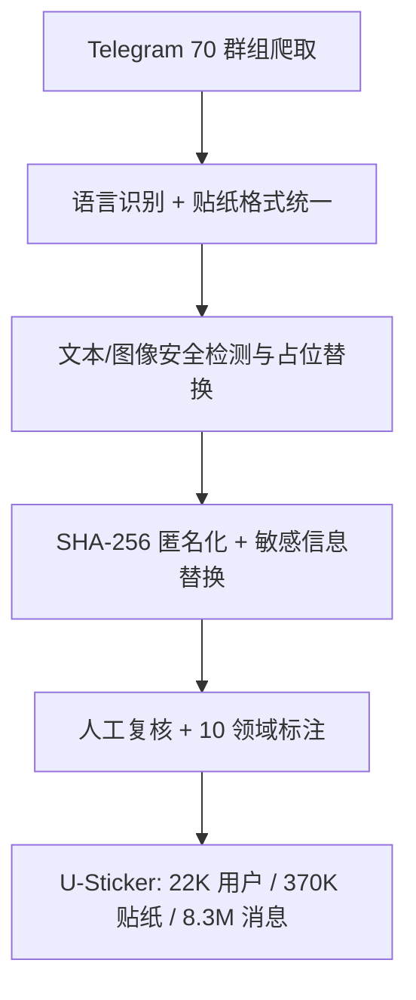

# U-Sticker: A Large-Scale Multi-Domain User Sticker Dataset for Retrieval and Personalization (面向检索与个性化的大规模多领域用户贴纸数据集)

- **会议/期刊**: SIGIR 2025
- **作者与机构**: Heng Er Metilda Chee, Jiayin Wang, Zhiqiang Guo, Weizhi Ma, Qinglang Guo, Min Zhang（清华大学 DCST/AIR、泉城实验室、中电科）
- **推荐链路定位**: 召回（贴纸检索/候选排序）
- **研究方向**: 多模态推荐 / 冷启动与长尾
- **论文原文**: [论文原文链接](https://arxiv.org/abs/2502.19108v2)
- **开源代码**: [数据集仓库](https://huggingface.co/datasets/metchee/u-sticker)

## TL;DR (1分钟核心速览)

贴纸检索与个性化推荐长期受制于「无用户 ID、无时间戳、无跨领域标注」的数据缺口。本文发布 U-Sticker——迄今最大公开贴纸数据集：22K 匿名用户、370K 贴纸、8.3M 消息、10 个领域、18 种语言，人均贴纸历史 16.90 条（此前公开集仅 1.36–2.03）。作者用 MOD/SRS 两个基线在英中双语子集、分领域子集与全量集上做 1:4/1:9/1:19 负采样排序评测，验证了数据集的可用性并揭示跨领域、时序与对话对象驱动的行为差异。

## Background & Motivation (背景与核心矛盾)

- **主流范式**: 贴纸检索多沿用「对话语句编码 + 贴纸图像编码 + 交互融合打分」的匹配范式（SRS/PESRS/CKES/StickerCLIP），本质是图文匹配而非个性化推荐。
- **前人局限**: 其一，现有 9 个贴纸数据集中 6 个闭源，公开集人均贴纸历史仅 1.36–2.03 条，无法做用户建模；其二，全部数据集缺失跨领域标签与时间信息，无法研究「同一用户在不同话题/不同对话对象下的风格漂移」。
- **核心洞察 (Key Insight)**: 贴纸不同于通用图像——它承载情绪与语义表达，且用户偏好呈现「长期主题稳定 + 短期风格演化」的双重结构（图 7/图 8 的 User C 与 User D 对比即为直接证据）。
- **本文切入点**: 以 Telegram 公开群组为源，经严格安全/隐私清洗与人工复核，构建首个同时具备用户匿名 ID、时间戳、跨领域、多语言四要素的大规模贴纸交互数据集。

## Method (核心方法设计)

### 1. 整体框架 (Overall Architecture)

本文为数据集论文，核心「方法」是数据构建流水线：从 70 个候选群组爬取原始消息，依次经过文本语言识别（xlm-roberta 检测，置信度阈值 0.99，保留 18 种语言）、贴纸格式统一（.tgs→.gif、.webp→.png、.webm 保留，动图按每秒抽帧）、不安全文本检测与占位替换、不安全图像四模型投票过滤、SHA-256 用户/消息 ID 哈希匿名化与敏感信息替换、人工抽检复核，最终保留 67 个群组并完成 10 领域人工标注。

### 2. 关键设计拆解 (Key Designs)

1. **多模型投票式图像安全过滤**：单一 NSFW 分类器偏差极大——四个检测器在原始数据上的 NSFW 占比分别为 0.88%、0.93%、27.27%、0.47%，暴力检测器误报率高出两个数量级。作者采用投票机制平衡个体偏差，仅将高共识的违规图像替换为占位符并从贴纸库中彻底移除，最终 72.28% 的贴纸（370,222/512,192）通过安全校验。直觉上，投票把「单模型阈值敏感」转化为「多模型共识」，显著降低假阳性对数据规模的侵蚀。
2. **可逆性为零的隐私双轨匿名化**：用户与消息原始整数 ID 经 SHA-256 映射为 256 位不可逆字符串，文本中的 @提及替换为 `#USER`、超链接提及替换为 `#USER_ID`、姓名/年龄/地址等经上下文词典 + Llama-1.5b 标注后替换为 `#SENSITIVE-INFORMATION`。关键在于**只替换敏感片段而非整句**，从而在隐私合规前提下最大程度保留对话上下文——这是后续做「回复对象感知」用户建模的前提。
3. **领域标注与稀疏度刻画**：采用「群组名先验 + 内容浏览」两步法将 67 个群组划入 Language/Arts/Games/Technology/Finance/Social/Media Sharing/Outdoor/Anime/Fan Club 十域，重叠主题按主导域归类（如 crypto gaming 归 Finance）。领域稀疏度跨度极大：Media Sharing 最稠密（2.58×10⁻⁴），Technology 最稀疏（198.73×10⁻⁴），为跨域迁移与冷启动研究提供了天然的难度梯度。

## Experimental Setup & Evaluation Protocol (实验设置与评估协议)

- **数据集与预处理**: 原始爬取 70 群组，清洗后保留 67 群组；贴纸 512,192→370,222，文本 8,332,351→8,286,422（99.45% 通过安全校验）。

| 数据集 | #Users | #Items(Stickers) | #Interactions | 稀疏度/密度 | 特征/场景说明 |
| :--- | :---: | :---: | :---: | :---: | :--- |
| U-Sticker (全局) | 22.6K | 370,222 | 8.29M 文本 + 370K 贴纸 | 人均 16.90 贴纸 | 10 领域 / 18 语言 / 含时间戳 |
| Anime | 22,572 | 87,833 | — | 19.89×10⁻⁴ | 贴纸最活跃域 |
| Media Sharing | 45,451 | 87,827 | — | 2.58×10⁻⁴ | 最稠密域 |
| Technology | 210 | 313 | — | 198.73×10⁻⁴ | 最稀疏域 |

- **数据划分与防穿越 (Splitting Strategy)**: 原文未显式声明训练/测试切分方式，实验以「负采样候选池 + 单个正样本」构造排序任务，属于**采样排序（Sampled Ranking）**设定，负正比分别为 1:4、1:9、1:19。
- **排名评测协议 (Ranking Protocol)**: 采样排序，指标为 MRR、R@1、R@3、R@5、R@10、R@20；未采用 Full-Ranking 全库排序，这是本文评估环节的主要短板。
- **对比基线与超参设置**: 仅对比 MOD 与 SRS 两个贴纸检索基线；MOD 受限于英中双语，故英中双语子集实验同时跑 MOD/SRS，分领域与全量实验仅跑 SRS。原文未报告 Embedding 维度与显著性检验。

## Key Experimental Results (实验关键数据)

### 1. 主实验对比 (Main Results)

英中双语子集（1:9 与 1:19 负采样）：

| Lang | NS | Method | MRR | R@1 | R@3 | R@5 | R@10 |
| :--- | :---: | :--- | :---: | :---: | :---: | :---: | :---: |
| En | 1:9 | MOD | 0.289 | 0.307 | 0.495 | 0.224 | 1.000 |
| En | 1:9 | SRS | **0.291** | 0.098 | 0.298 | **0.495** | 1.000 |
| En | 1:19 | MOD | 0.180 | **0.051** | 0.145 | 0.250 | **0.511** |
| En | 1:19 | SRS | **0.299** | 0.050 | **0.155** | **0.256** | 0.429 |
| Zh | 1:9 | MOD | **0.317** | **0.125** | **0.344** | **0.531** | 1.000 |
| Zh | 1:9 | SRS | 0.264 | 0.056 | 0.281 | 0.500 | 1.000 |
| Zh | 1:19 | MOD | 0.156 | **0.063** | 0.094 | 0.156 | **0.406** |
| Zh | 1:19 | SRS | **0.270** | 0.061 | **0.138** | **0.219** | 0.377 |

分领域（SRS，全量负采样设定）：

| Domain | MRR | R@1 | R@3 | R@5 |
| :--- | :---: | :---: | :---: | :---: |
| Media Sharing | **0.335** | **0.143** | **0.365** | **0.552** |
| Tech | 0.321 | 0.125 | 0.361 | **0.611** |
| Social | 0.300 | 0.105 | 0.305 | 0.513 |
| Outdoor | 0.298 | 0.103 | 0.324 | 0.500 |
| Finance | 0.296 | 0.080 | 0.280 | 0.510 |
| Language | 0.296 | 0.103 | 0.307 | 0.501 |
| Anime | 0.294 | 0.101 | 0.298 | 0.500 |
| Game | 0.293 | 0.100 | 0.301 | 0.498 |
| Arts | 0.288 | 0.094 | 0.281 | 0.484 |
| Fan Club | 0.280 | 0.080 | 0.280 | 0.510 |

全量集随负采样规模变化（SRS）：

| NS | MRR | R@1 | R@3 | R@5 | R@10 | R@20 |
| :---: | :---: | :---: | :---: | :---: | :---: | :---: |
| 1:4 | **0.425** | **0.202** | **0.603** | 1.0 | — | — |
| 1:9 | 0.294 | 0.102 | 0.303 | 0.499 | 1.0 | — |
| 1:19 | 0.296 | 0.054 | 0.153 | 0.251 | 0.332 | 1.0 |

### 2. 消融实验 (Ablation Study)

本文为数据集论文，未设组件消融；其「消融」等价物为**子集/领域切片实验**，即上表的分领域结果与英中双语子集结果，用以检验数据在不同稀疏度与语言条件下的可用性。

### 3. 关键实验发现 (Key Findings)

1. **负采样规模是性能主导因子而非模型差异**：全量集上负正比从 1:4 增至 1:19，MRR 由 0.425 骤降至 0.296、R@1 由 0.202 降至 0.054，降幅远超 MOD 与 SRS 之间的差距（英/中 1:9 下两者 MRR 差仅 0.002–0.053），说明现有基线在真实全库检索场景下几乎不可用，凸显个性化检索方法的空白。
2. **领域稠密度与检索性能正相关但非单调**：最稠密的 Media Sharing 取得最佳 MRR 0.335，而最稀疏的 Arts（191.43×10⁻⁴）MRR 仅 0.288；但 Tech 虽极稀疏（198.73×10⁻⁴）却拿到最高 R@5 0.611，说明小样本高同质领域反而易命中，稀疏性影响的是排序头部精度而非召回上限。
3. **语言数据量而非语言本身决定效果**：中文子集在 MOD 下 1:9 的 MRR（0.317）反超英文（0.289），但在 1:19 下骤降至 0.156，作者归因于中文样本量远小于英文（英文占 62.6%，中文仅 8.0%），提示多语言贴纸检索需按语种做样本量均衡。

## Highlights & Limitations (亮点、对比与审稿批判)

- **与代表作对比 (vs. Prior Work)**: 相较 MOD（307 贴纸、人均 1.36 条、2 语言）与 MCDSCS（14,400 贴纸、人均 2.03 条、2 语言），U-Sticker 在贴纸规模（370K，约 25–1200 倍）、人均历史（16.90 条，约 8–12 倍）、语言数（18 种）与跨领域/时间信息四个维度全面领先；相较 SRS/PESRS 等闭源数据集，其公开可复现性是核心增量。
- **可迁移亮点**: ①「多模型投票 + 占位替换而非整句删除」的安全清洗范式可直接迁移到任何 UGC 多模态数据集构建；②「只替换敏感片段保留上下文」的匿名化策略，对构建对话推荐/会话推荐数据集具有直接参考价值。
- **审稿级局限批判**: 其一，评估仅用两个弱基线且为采样排序（1:4–1:19），未做 Full-Ranking 与个性化基线（如序列推荐、多模态对齐模型）对比，难以证明数据集对 SOTA 方法的增益；其二，数据源自 Telegram 公开群组，用户行为受群组语境强约束，且清洗后贴纸量缩减 27.7%，分布偏移与领域标注的主观性均未被量化讨论。

## Rating (四维评分)

- **方法创新性 (Novelty)**: ⭐⭐⭐ （数据集贡献扎实，但方法层面无新模型，创新主要体现在数据要素的首次齐备）
- **评估协议与实验扎实度 (Protocol & Experiments)**: ⭐⭐ （仅两个基线、采样排序、无显著性检验与 Full-Ranking，实验更偏可行性验证而非严格 benchmark）
- **写作与数学规范度 (Clarity & Rigor)**: ⭐⭐⭐⭐ （构建流程、清洗阈值与统计口径交代清晰，表格完备，几乎无公式推导需求）
- **工业落地与复现价值 (Industrial & Practical Value)**: ⭐⭐⭐⭐⭐ （数据与代码全开源、含时间戳与匿名用户 ID，可直接支撑贴纸推荐、对话推荐与生成式贴纸研究）

