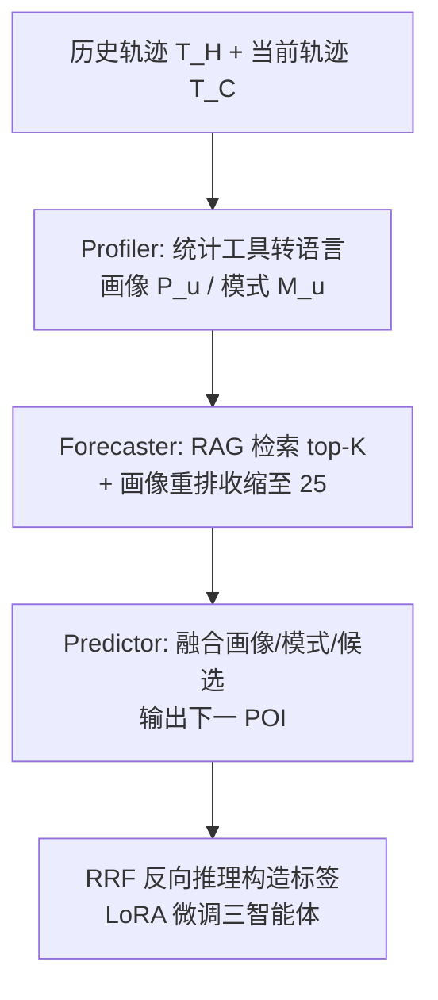
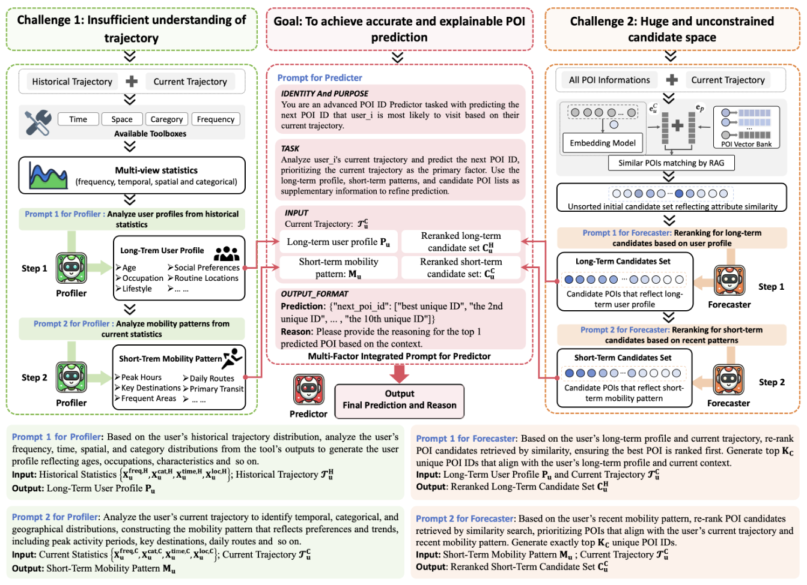

# CoMaPOI: A Collaborative Multi-Agent Framework for Next POI Prediction Bridging the Gap Between Trajectory and Language (弥合轨迹与语言鸿沟的协同多智能体下一 POI 预测框架)

- **会议/期刊**: SIGIR 2025
- **作者与机构**: Lin Zhong, Lingzhi Wang, Xu Yang, Qing Liao（哈尔滨工业大学（深圳）计算机科学与技术学院）
- **推荐链路定位**: 端到端生成式（LLM 直接输出下一 POI ID）
- **研究方向**: 时空轨迹与 POI 本地生活推荐 / 大语言模型推荐
- **论文原文**: [https://arxiv.org/abs/2505.23837v1](https://arxiv.org/abs/2505.23837v1)
- **开源代码**: [https://github.com/Chips98/CoMaPOI](https://github.com/Chips98/CoMaPOI)

## TL;DR (1分钟核心速览)

LLM 做下一 POI 预测存在两大硬伤：预训练语料是纯文本，无法理解经纬度/时间戳的物理含义；城市级 POI 动辄上万，无约束生成极易"胡说"。CoMaPOI 用三个 LLM 智能体分工破局——Profiler 借统计工具把数值轨迹翻译成"用户画像 + 移动模式"的自然语言，Forecaster 用 RAG 检索 + 画像重排把候选从全库压到 25 个，Predictor 在候选集内做最终决策；再配一套 Reverse Reasoning Fine-Tuning (RRF) 反向构造子任务标签。在 NYC/TKY/CA 三个基准上，HR@10 相对最强基线提升 10.84%/5.94%/8.54%，且给出候选集降低误差的理论下界证明。

## Background & Motivation (背景与核心矛盾)

- **主流范式**: 传统路线用 RNN/Transformer/图网络/扩散模型建模签到序列的时空转移（SASRec、GETNext、MTNet、DiffuRec）；近期 LLM 路线（LLM4POI、LLMMove）把轨迹转文本做语义增强或相似用户共识挖掘。
- **前人局限**: 其一，LLM 缺乏对数值时空数据的内在理解——经纬度相近但实际隔河/隔楼层的 POI 无法区分，不规则签到间隔（季节性景点）更是盲区；其二，候选空间无约束，城市级 POI 数万，全量喂给 LLM 既不可行也引入巨量噪声，而改造 LLM 输入输出层（如 TIME-LLM）又会削弱语言能力、抬高部署复杂度。
- **核心洞察 (Key Insight)**: 与其让 LLM 硬啃数值，不如先用确定性统计工具把轨迹"翻译"成 LLM 天生擅长的语言分布描述；与其让 LLM 在全库中搜索，不如先用检索把候选压到高命中率的小集合，让"缩小搜索空间"成为降误差的显式手段。
- **本文切入点**: 把 POI 预测拆成"画像构建 → 候选收缩 → 集成决策"三个子任务，交给三个专职智能体串行协作，并用反向推理补齐子任务缺失的监督信号。

## Method (核心方法设计)

### 1. 整体框架 (Overall Architecture)

输入是用户历史轨迹 $\mathcal{T}^H_u$与最近$L$条当前轨迹$\mathcal{T}^C_u$。Profiler 先调用统计工具箱$\text{Tools}=\{\text{Tool}_{freq},\text{Tool}_{cat},\text{Tool}_{time},\text{Tool}_{loc}\}$对两条轨迹分别产出频次/类别/时间/空间分布，再由 LLM 分别归纳为长期画像$P_u$与短期移动模式$M_u$。Forecaster 以 BCE 嵌入建向量库，对当前轨迹每个 POI 做 top-$K_C$相似检索得到初始候选$C^{C,init}_u$，再分别以$P_u$、$M_u$为条件重排收缩为长期候选$C^H_u$与短期候选$C^C_u$。Predictor 融合$\{P_u, M_u, C^H_u, C^C_u, \mathcal{T}^C_u\}$ 输出下一 POI，允许跳出候选集。训练阶段用 RRF 反向构造各智能体的"理想输出"作为标签，LoRA + 量化微调。

<figure class="paper-figure" markdown="span">
  <figcaption>图1：CoMaPOI框架概览，由三个专门智能体（Profiler、Forecaster和Predictor）协作生成准确的下一POI预测。该过程包括提取长期用户画像和短期移动模式、检索受约束的候选集，最终生成预测。</figcaption>
</figure>

### 2. 关键设计拆解 (Key Designs)

1. **Profiler：数值轨迹 → 语言分布（工具增强的语义桥接）**：痛点是 LLM 无法从离散高精度坐标中稳定统计访问频次与偏好。做法是先用工具函数把轨迹压成四类分布，再让 LLM 做"分布 → 画像/模式"的归纳：$\{X^{freq,H}_u, X^{cat,H}_u, X^{time,H}_u, X^{loc,H}_u\} = \text{Tools}(\mathcal{T}^H_u)$，$P_u \leftarrow \text{LLM}(\cdot, \mathcal{T}^H_u)$；当前轨迹同理得$M_u$。直觉：把"数值计算"外包给确定性工具、把"语义归纳"留给 LLM，各司其职，规避了 LLM 的算术与量纲短板。

2. **Forecaster：RAG 检索 + 画像重排的双重候选收缩**：痛点是全库候选既喂不进 LLM 又噪声大。先用嵌入相似度取初始集 $C_{p_{u,i}} = \arg\max_{C\subseteq\mathcal{P},|C|=K_C}\sum_{p\in C}\text{sim}(\mathbf{e}_{p_{u,i}},\mathbf{e}_p)$，其中$\text{sim}$为余弦相似度，跨当前轨迹所有 POI 聚合得$C^{C,init}_u$；再由 LLM 以$P_u$、$M_u$为条件重排并压缩（250 → 25）：$C^H_u \leftarrow \text{LLM}(P_u, C^{C,init}_u)$，$C^C_u \leftarrow \text{LLM}(M_u, C^{C,init}_u)$。直觉：检索保证召回（真值大概率在初始集内），重排保证精度（把高概率项顶到前面），二者互补。

3. **RRF 反向推理微调与理论下界**：痛点是 Profiler/Forecaster 没有天然标签。做法是给定真值 $p_{u,n_u}$反推能"导向"该真值的画像、模式与候选集：$(P^+_u, M^+_u) \leftarrow \arg\max_{P,M} S(P_u, C^H_u; p_{u,n_u})$，$(C^{H+}_u, C^{C+}_u) \leftarrow \arg\max_{M,C} S(M_u, C^C_u; p_{u,n_u})$，再统一优化$(\hat{\theta}_p,\hat{\theta}_f,\hat{\theta}_r) = \arg\min \sum -\log P_\theta(p_{u,n_u}\mid X^+)$。理论上，候选法优于全局搜索的充要条件为
$$\mathbb{P}(p^*\in C) > \frac{P(p^*\mid \mathcal{T}^C_u) - P(p^*\mid \mathcal{T}^C_u, p^*\notin C)}{P(p^*\mid \mathcal{T}^C_u, p^*\in C) - P(p^*\mid \mathcal{T}^C_u, p^*\notin C)}$$
即候选命中率需超过一个由"集内/集外后验差"决定的下界；RRF 同时抬高命中率与集内后验，故误差单调下降。推理侧无负采样，靠检索 + 重排替代。

## Experimental Setup & Evaluation Protocol (实验设置与评估协议)

- **数据集与预处理**: 沿用前人过滤规则剔除低频用户与 POI（等价 10-core 级别过滤），每条记录含 user/POI/category/GPS/timestamp：

| 数据集 | #Users | #Items | #Interactions | 稀疏度/密度 | 特征/场景说明 |
| :--- | :---: | :---: | :---: | :---: | :--- |
| NYC | 988 | 5,086 | 99,964 | 密度约 1.99% | 纽约市 2012.04–2013.02 签到 |
| TKY | 2,206 | 7,849 | 325,313 | 密度约 1.88% | 东京同期签到 |
| CA | 1,818 | 13,564 | 174,791 | 密度约 0.71% | 加州+内华达 2009.02–2010.10，地理跨度最大 |

- **数据划分与防穿越 (Splitting Strategy)**: 采用**按用户尾部切分**——每个用户最后 30 个签到点作为测试集（即当前轨迹 $\mathcal{T}^C_u$），此前全部作为训练集（历史轨迹$\mathcal{T}^H_u$）。固定 30 长度是为控制 LLM token 预算、防显存溢出，属"定长窗口 + 时间序"划分，无未来信息泄漏。
- **排名评测协议 (Ranking Protocol)**: 采用 **Full-Ranking（全库未交互 POI 排序）**，指标为 HR@5/HR@10/NDCG@5/NDCG@10/MRR；LLM 解码设 top_p=1、temperature=0、n=1 消除采样随机性。
- **对比基线与超参设置**: 11 个基线分四组——序列模型（SASRec/BERT4Rec/TiCoSeRec）、图与对比（GETNext/CrossDR/MAERec/DuoRec）、生成与扩散（POIGDE/MTNet/DiffuRec）、LLM 路线（LLM4POI）。主干 LLM 为 Llama3.1:8B，微调 lr=1e-4、batch=16、≤200 步、warm-up 50、weight decay 0.01，3×H800 80G；候选规模 $K=25$（每路），合并后喂入 Predictor。

## Key Experimental Results (实验关键数据)

### 1. 主实验对比 (Main Results)

| Model | NYC HR@10 | NYC NDCG@10 | NYC MRR | TKY HR@10 | TKY NDCG@10 | CA HR@10 | CA NDCG@10 |
| :--- | :---: | :---: | :---: | :---: | :---: | :---: | :---: |
| SASRec | 48.28 | 31.26 | 27.01 | 43.25 | 28.37 | 26.40 | 17.68 |
| BERT4Rec | 46.70 | 30.94 | 27.11 | 43.47 | 29.08 | 28.22 | 18.66 |
| GETNext | 51.30 | 35.13 | 30.97 | 48.50 | 33.21 | 29.32 | 19.48 |
| POIGDE | 38.36 | 27.97 | 25.40 | 31.82 | 23.57 | 26.73 | 19.49 |
| MTNet | 53.24 | 37.69 | 33.40 | 51.22 | 35.37 | 36.08 | 24.27 |
| DiffuRec | 40.79 | 30.23 | 27.74 | 39.89 | 28.70 | 24.15 | 18.06 |
| LLM4POI | 46.66 | 38.16 | 35.90 | 39.48 | 28.22 | 25.91 | 19.39 |
| **CoMaPOI (ours)** | **59.01** | **42.82** | **37.67** | **54.26** | **37.20** | **39.16** | **26.96** |
| **Improv.%** | **+10.84%** | **+12.21%** | **+4.93%** | **+5.94%** | **+5.17%** | **+8.54%** | **+11.08%** |

（HR@5 亦全面领先：NYC 51.62 vs MTNet 47.57，+8.51%；TKY 45.83 vs 44.15，+3.81%；CA 33.00 vs 30.25，+9.09%。五指标平均提升 NYC 8.86%、TKY 4.3%、CA 9.68%。）

### 2. 消融实验 (Ablation Study)

| Setting | NYC HR@10 | NYC NDCG@10 | TKY HR@10 | TKY NDCG@10 | CA HR@10 | CA NDCG@10 |
| :--- | :---: | :---: | :---: | :---: | :---: | :---: |
| CoMaPOI (full) | **59.01** | **42.82** | **54.26** | **37.20** | **39.16** | **26.96** |
| w/o Profiler | 58.60 | 40.59 | 52.40 | 34.93 | 32.01 | 22.31 |
| w/o Forecaster | 56.48 | 39.61 | 49.86 | 34.86 | 35.64 | 23.61 |
| w/o RRF | 54.35 | 38.40 | 46.51 | 31.83 | 32.84 | 22.86 |
| w/o Refine（仅 RAG 不重排） | 57.79 | 40.63 | 51.86 | 35.11 | 37.46 | 26.09 |
| only Single Agent | 56.91 | 40.52 | 51.72 | 35.61 | 37.27 | 25.48 |
| only SFT | 47.77 | 35.32 | 41.75 | 30.39 | 29.10 | 22.38 |

### 3. 关键实验发现 (Key Findings)

1. **RRF 是最大单点贡献，且数据越难越关键**：去掉 RRF 后 CA 的 HR@10 从 39.16 暴跌至 32.84（−6.32），NYC 也掉 4.66；而 only SFT 在 CA 仅 29.10，说明"有监督微调但无反向构造标签"几乎退化到传统基线水平，反向推理才是让子任务真正可学的关键。
2. **候选收缩的收益可被命中率量化验证**：NYC 初始 RAG 命中率仅 43.52%，经画像/模式重排后合并集命中率升至 67.51%，集内后验从全局搜索的 36.03% 跃至 88.16%，且 67.51% > 理论下界 45.27%，三数据集均满足不等式；去掉 Forecaster 后 CA HR@10 掉 3.52，印证"约束候选空间"而非"堆模型"是降误差主因。
3. **候选规模存在甜点 K≈25**：K 从 0 增至 25 性能单调上升，超过 25 后持平甚至下滑，说明候选集"召回-噪声"权衡在 25 附近最优；同时 CoMaPOI 在 Llama3.2:3B 等小模型上仍能超越 MTNet，证明框架的非侵入式设计具备跨骨干可迁移性。

## Highlights & Limitations (亮点、对比与审稿批判)

- **与代表作对比 (vs. Prior Work)**: 相比 LLM4POI（仅借相似用户共识做数据增强，NYC NDCG@10 38.16），CoMaPOI 直接改造推理流程，NDCG@10 达 42.82；相比 MTNet（强序列建模但 CA 上因地理跨度大而失手，HR@10 仅 36.08），CoMaPOI 靠语言化画像 + 候选约束在 CA 上拉开 3.08 个点；相比 TIME-LLM 类"改结构"路线，本文完全不侵入 LLM 架构，保留语言能力且部署更轻。
- **可迁移亮点**: ①"统计工具外包数值计算 + LLM 只做语义归纳"的 Profiler 范式可平移到任何数值-语言混合任务（如金融时序、传感器日志）；②"检索保召回 + 画像重排保精度 + 理论下界校验"的候选收缩流程，可直接复用到生成式推荐的候选剪枝环节。
- **审稿级局限批判**: ①三智能体串行推理需多次 LLM 调用，在线延迟与 token 成本远高于单塔模型，论文仅给出 CoMaPOI(RRF) 单智能体轻量变体作缓解，未报告实际 QPS/延迟数据；②固定 30 长度测试窗口与"尾部切分"虽控 token，但对超长轨迹用户与严格冷启动场景的泛化性未做分桶验证，且 TKY 的集外后验高达 13.17%，说明候选集在部分数据上仍会漏掉真值。

## Rating (四维评分)

- **方法创新性 (Novelty)**: ⭐⭐⭐⭐ （首次将多智能体协作引入 POI 预测，并以候选命中率下界给出可验证的理论支撑，但各智能体内部仍以 prompt 工程为主）
- **评估协议与实验扎实度 (Protocol & Experiments)**: ⭐⭐⭐⭐ （三数据集 + 11 基线 + Full-Ranking + 完整消融与候选规模分析，惟缺显著性检验与线上延迟评测）
- **写作与数学规范度 (Clarity & Rigor)**: ⭐⭐⭐⭐ （不等式推导清晰、符号统一，但部分公式如 $S(\cdot)$ 对齐分数定义偏抽象，工具函数细节留在附录）
- **工业落地与复现价值 (Industrial & Practical Value)**: ⭐⭐⭐⭐ （代码已开源、非侵入式设计可跨骨干复用，但多智能体串行调用的推理成本是落地主要门槛）

