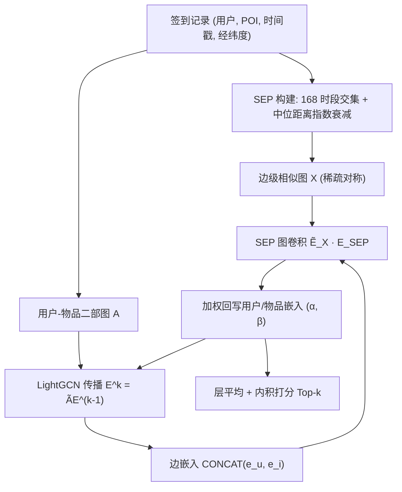
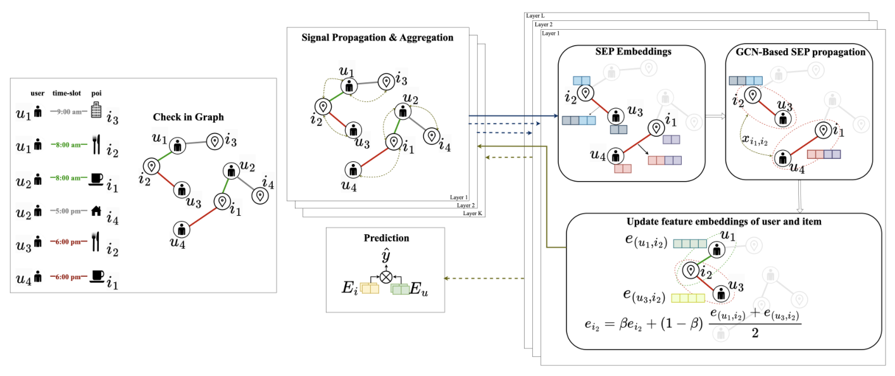
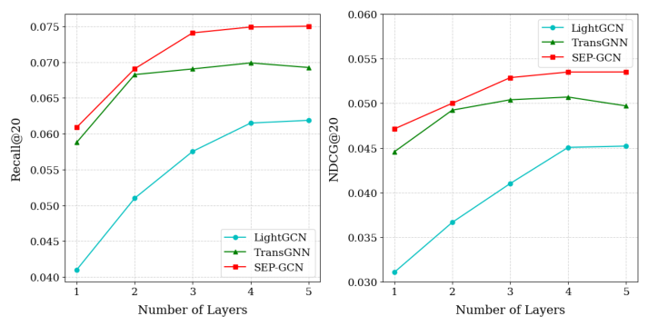

# SEP-GCN: Leveraging Similar Edge Pairs with Temporal and Spatial Contexts for Location-Based Recommender Systems (利用时空上下文相似边对的位置推荐图卷积网络)

- **会议/期刊**: ACM SIGIR-ICTIR 2025 (Padua, Italy)
- **作者与机构**: Tan Loc Nguyen, Tin T. Tran (Ton Duc Thang University, Vietnam)
- **推荐链路定位**: 召回 (Top-k 检索排序)
- **研究方向**: 时空轨迹与 POI 本地生活推荐 / 图神经网络推荐
- **论文原文**: [https://arxiv.org/abs/2506.16003v1](https://arxiv.org/abs/2506.16003v1)
- **开源代码**: 暂未开源

## TL;DR (1分钟核心速览)

现有 POI 推荐 GNN 只建模节点级表征或孤立边属性，忽略了"签到事件之间"的时空关联结构，且受限于 2–3 跳传播与过平滑，无法连接拓扑遥远但语义相近的交互。SEP-GCN 将每条签到边视为可传播的实体，用"周内 168 时段重叠 + 用户中位距离指数衰减"筛出相似边对 (SEP)，构建边级相似图 $\mathbf{X}$ 并与 LightGCN 的用户-物品传播逐层耦合。在 NYC/Gowalla/Brightkite 三个数据集上，Recall@20 相对最强基线最高提升 **14.89%**，5-core 极端稀疏场景下提升达 **23.2%**。

## Background & Motivation (背景与核心矛盾)

- **主流范式**: NGCF/LightGCN 类图协同过滤在用户-物品二部图上做邻居聚合；POI 侧则用 STGN/DeepMove/STAN 等序列模型或 TGAT/Jodie 等时序图网络刻画轨迹动态。
- **前人局限**: 其一，时空信号多被当作**静态输入特征**（时间槽 one-hot、距离权重矩阵）拼进节点或邻接矩阵，缺乏跨图的显式传播通道；其二，模型聚焦**单条边或单个节点**，无法利用"不同用户在不同地点、却在同一时段/相近区域签到"这类关系型证据。
- **核心洞察 (Key Insight)**: 真实签到图中存在大量**拓扑遥远但上下文同构**的交互对（如早餐时段咖啡店与面包房的签到），它们天然构成跨越社区鸿沟的"语义捷径"，可绕开深层 GNN 的过平滑与计算瓶颈实现长程信息流动。
- **本文切入点**: 把学习单元从"节点/单边"上移到"**相似边对**"，用边级相似图作为第二条传播通道，与原始二部图传播并行耦合。

## Method (核心方法设计)

### 1. 整体框架 (Overall Architecture)

模型采用双通道逐层耦合结构：左通道为 LightGCN 式用户-物品二部图传播 $\mathbf{E}^{k}=\tilde{\mathbf{A}}\mathbf{E}^{(k-1)}$；右通道将每条签到边$(u,i)$的用户与物品嵌入拼接为边嵌入$\boldsymbol{e}_{(u,i)}=\text{CONCAT}(\boldsymbol{e}_u,\boldsymbol{e}_i)$，在预构建的 SEP 相似图$\mathbf{X}$上做一次轻量图卷积，得到上下文增强的边表征；随后按可调权重$\alpha,\beta$将边表征回写至对应的用户与物品节点，作为下一层的输入。训练采用 BPR 损失，推理时以第$K$ 层平均嵌入做内积打分。

<figure class="paper-figure" markdown="span">
  <figcaption>图 3：所提出的 SEP-GCN 模型架构，将时空边相似性融入基于 GCN 的传播中</figcaption>
</figure>

### 2. 关键设计拆解 (Key Designs)

1. **SEP 判定与软距离衰减权重**：痛点是把距离当硬阈值会割裂长尾分布。本文要求两条边的时间槽集合（周内 0–167 离散槽，按**用户本地时区**而非全局时间戳计算）交集非空，再用用户自身访问距离中位数做个性化半径归一：
$\sigma(e_1,e_2)=\exp\!\left(\frac{d(i_1,i_2)}{\mathrm{median}(\mathcal{D})}\ln\alpha\right)$其中$d$为 Haversine 大圆距离，$\alpha$为中位距离处的相似度基准值。该式保证距离等于中位数时得分为$\alpha$，近于中位数趋近 1、远于中位数指数衰减至 0——等价于一个**无需固定阈值的个性化半径滤波器**，既压制空间离群点又保留距离长尾。

2. **边级图卷积与节点回写**：痛点是边信号若只做一次聚合会与节点表征脱节。本文在归一化 SEP 图 $\tilde{\mathbf{X}}=\mathbf{D}_X^{-1/2}\mathbf{X}\mathbf{D}_X^{-1/2}$ 上传播边嵌入，再**分用户、分物品独立回写**以降低过平滑风险：
$\boldsymbol{e}_u^{k}=\alpha\cdot\boldsymbol{e}_u^{k}+(1-\alpha)\cdot\frac{1}{|\mathcal{N}_u|}\sum_{i\in\mathcal{N}_u}\boldsymbol{e}_{(u,i)}$物品侧同理用$\beta$。直觉是：SEP 通道在浅层即注入跨社区语义信号，使模型无需堆叠深层 GCN 即可获得长程感受野。

3. **训练目标与推理开销**：总损失为标准 BPR 加 L2 正则：
$\mathcal{L}=\sum_{\Omega^{+}}\sum_{\Omega^{-}}-\ln\sigma(\hat{y}_{ui}-\hat{y}_{uj})+\lambda\|\Phi\|_2^2$负采样为均匀负采样（未交互物品），无额外对比/硬负样本设计。SEP 矩阵$\mathbf{X}$离线预计算且对称稀疏，在线仅需一次稀疏矩阵乘，主要开销集中在构图阶段的$O(|\mathcal{E}|^2)$ 候选对枚举（原文以时间交集条件剪枝）。

## Experimental Setup & Evaluation Protocol (实验设置与评估协议)

- **数据集与预处理**: 过滤交互数少于 5 的用户（5-core），时间戳统一为各地**本地时区**：

| 数据集 | #Users | #Items | #Interactions | 密度 | 场景说明 |
| :--- | :---: | :---: | :---: | :---: | :--- |
| NYC | 1,083 | 9,989 | 179,468 | 1.157% | 纽约市单城签到 |
| Gowalla | 8,685 | 13,812 | 507,197 | 0.293% | 全球多城市（Austin/NYC/Bangkok/Tokyo 等） |
| Brightkite | 5,766 | 14,653 | 841,511 | 0.694% | 跨时区多区域（Chicago/Tokyo/London/Sydney） |

- **数据划分与防穿越 (Splitting Strategy)**: **比例划分 70%/30%**（训练/测试），未采用 Leave-One-Out 或全局时间戳切分，存在一定时间信息泄漏风险。
- **排名评测协议 (Ranking Protocol)**: 原文未明确声明候选集构造方式，从指标量级（Precision@20 约 0.03、Recall@20 约 0.03–0.10）推断为**全库排序 (Full-Ranking)** 而非采样排序；指标为 Recall/Precision/NDCG/Accuracy @5 与 @20。
- **对比基线与超参设置**: 基线含 NGCF、GCN-LOC、LightGCN、NCL、EEDN、BIGCF、CaDRec、TransGNN 共 8 个；嵌入维度 $d=64$，LGCN 层数 3，学习率 0.001，L2 系数$1\times10^{-5}$，5 次独立运行取均值，配对 t 检验显著性水平$p<0.01$。

## Key Experimental Results (实验关键数据)

### 1. 主实验对比 (Main Results)

Top-20 结果（节选核心指标，加粗为最优）：

| 数据集 | 模型 | Recall@20 | Precision@20 | NDCG@20 | Accuracy@20 |
| :--- | :--- | :---: | :---: | :---: | :---: |
| NYC | LightGCN | 0.0274 | 0.0276 | 0.0382 | 0.3958 |
| NYC | BIGCF | 0.0295 | 0.0304 | 0.0425 | 0.4208 |
| NYC | CaDRec | 0.0304 | 0.0307 | 0.0426 | 0.4272 |
| NYC | TransGNN | 0.0300 | 0.0304 | 0.0427 | 0.4384 |
| NYC | **SEP-GCN** | **0.0332** | **0.0331** | **0.0432** | **0.4624** |
| NYC | Improv. | +9.21% | +7.82% | +1.17% | +5.47% |
| Gowalla | LightGCN | 0.0714 | 0.0354 | 0.0809 | 0.4563 |
| Gowalla | EEDN | 0.0811 | 0.0393 | 0.0835 | 0.4680 |
| Gowalla | CaDRec | 0.0853 | 0.0413 | 0.0874 | 0.4932 |
| Gowalla | TransGNN | 0.0880 | 0.0410 | 0.0879 | 0.4903 |
| Gowalla | **SEP-GCN** | **0.1011** | **0.0462** | **0.0917** | **0.5291** |
| Gowalla | Improv. | +14.89% | +11.86% | +4.32% | +7.28% |
| Brightkite | LightGCN | 0.0253 | 0.0147 | 0.0265 | 0.4088 |
| Brightkite | EEDN | 0.0295 | 0.0173 | 0.0309 | 0.4545 |
| Brightkite | CaDRec | 0.0308 | 0.0181 | 0.0328 | 0.4859 |
| Brightkite | TransGNN | 0.0309 | 0.0188 | 0.0331 | 0.4950 |
| Brightkite | **SEP-GCN** | **0.0333** | **0.0206** | **0.0368** | **0.5317** |
| Brightkite | Improv. | +7.77% | +9.57% | +11.18% | +7.42% |

Top-5 侧同样全面领先：Gowalla Recall@5 达 0.0440（较 CaDRec 0.0400 提升 10.00%），NYC Accuracy@5 达 0.2324（+7.54%）。

### 2. 消融实验 (Ablation Study)

| 变体 | NYC R@20 | NYC N@20 | Gowalla R@20 | Gowalla N@20 | Brightkite R@20 | Brightkite N@20 |
| :--- | :---: | :---: | :---: | :---: | :---: | :---: |
| LightGCN w/ Spatial | 0.0278 | 0.0390 | 0.0709 | 0.0805 | 0.0250 | 0.0262 |
| LightGCN (Original) | 0.0274 | 0.0382 | 0.0714 | 0.0809 | 0.0253 | 0.0265 |
| SEP-GCN only Temporal | 0.0253 | 0.0308 | 0.0674 | 0.0681 | 0.0213 | 0.0248 |
| SEP-GCN only Spatial | 0.0306 | 0.0361 | 0.0837 | 0.0729 | 0.0288 | 0.0279 |
| **SEP-GCN Original** | **0.0332** | **0.0432** | **0.1011** | **0.0917** | **0.0333** | **0.0368** |

### 3. 关键实验发现 (Key Findings)

1. **时空必须联合而非叠加**：把空间距离直接塞进 LightGCN 邻接矩阵（`LightGCN w/ Spatial`）在 Gowalla/Brightkite 上反而**低于**原版（0.0709 vs 0.0714、0.0250 vs 0.0253），说明静态空间权重引入噪声；而 SEP-GCN 去掉空间项后 Gowalla Recall@20 从 0.1011 骤降至 0.0837（−17.2%），证明空间信息的价值在于**作为时间关系的过滤器**而非独立特征。
2. **稀疏度越高收益越大**：5-core 极端稀疏设定下（NYC 稀疏度 98.843%、Gowalla 99.883%），SEP-GCN 相对 TransGNN 的 Recall@20 提升达 18.3%/23.2%/18.4%，显著高于 10-core 的 10.67%/14.89%/10.05%，说明 SEP 边有效充当了孤立节点的"语义补边"，缓解近冷启动问题。
3. **浅层即饱和、深层不退化**：层数实验中 SEP-GCN 从第 1 层起即领先，且在 3 层以上保持稳定，而 LightGCN 与 TransGNN 在 2–3 层后因过平滑出现下降——验证了边级通道提前注入长程信号、从而绕开深层传播瓶颈的设计假设。

<figure class="paper-figure" markdown="span">
  <figcaption>图 4：不同模型和层数下 Recall@20 与 NDCG@20 的比较。</figcaption>
</figure>

## Highlights & Limitations (亮点、对比与审稿批判)

- **与代表作对比 (vs. Prior Work)**: 相较 LightGCN/NGCF 仅做节点级二部图传播，本文将学习单元上移至边对；相较 TransGNN 用 Transformer 全局注意力换取长程建模（$O(n^2)$ 开销），本文以稀疏边相似图实现同等长程效果且更轻量；相较 EEDN 用超图卷积处理冷启动，本文的 SEP 图是**数据驱动的动态补边**而非固定超边结构。
- **可迁移亮点**: (1) "以用户自身行为分布的中位数做个性化归一化半径"可迁移到任何需要软距离衰减的场景（如 LBS 广告、本地生活团购）；(2) 边级相似图与节点图逐层耦合的回写范式（$\alpha/\beta$ 分离控制）可低成本插入现有 LightGCN 类工业召回模型。
- **审稿级局限批判**: 其一，**评估协议存疑**——70/30 随机划分未做时间切分，签到数据存在明显时序漂移，随机划分可能高估性能；且未明确声明 Full-Ranking 还是采样排序，削弱了与序列式 POI 基线（STGN/STAN/DeepMove）的可比性（原文亦未纳入这些基线）。其二，**构图开销与超参敏感**：$\mathbf{X}$的候选对枚举为$O(|\mathcal{E}|^2)$量级，在百万级签到上需依赖时间交集剪枝，论文未给出构图耗时与内存实测；同时$\alpha$（中位相似度基准）与回写权重$\alpha,\beta$ 符号重名且未做敏感性分析，工程复现存在调参风险。

## Rating (四维评分)

- **方法创新性 (Novelty)**: ⭐⭐⭐⭐ （将学习单元从节点/单边上移至时空相似边对，视角新颖且直觉清晰，但边级传播本身在 EGAT/边增强 GNN 中已有先例，属组合式创新）
- **评估协议与实验扎实度 (Protocol & Experiments)**: ⭐⭐⭐ （三数据集 + 8 基线 + 5 次运行 + $p<0.01$ 检验较规范，但随机划分未防时序泄漏、未声明候选集构造、缺序列式 POI 基线）
- **写作与数学规范度 (Clarity & Rigor)**: ⭐⭐⭐ （公式与算法伪代码完整，但 $\alpha$ 在相似度函数与回写权重中重复使用、符号冲突，且缺少复杂度与构图开销分析）
- **工业落地与复现价值 (Industrial & Practical Value)**: ⭐⭐⭐ （SEP 图可离线预计算、在线仅增一次稀疏乘，插入成本低；但 $O(|\mathcal{E}|^2)$ 构图与未开源代码限制了大规模直接复用）

