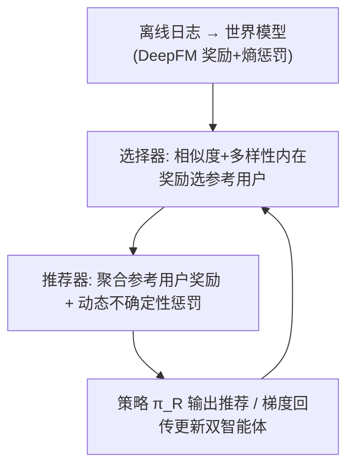
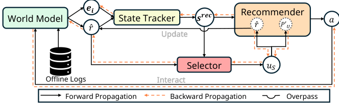

# DARLR: Dual-Agent Offline Reinforcement Learning for Recommender Systems with Dynamic Reward (双智能体动态奖励离线强化学习推荐)

- **会议/期刊**: SIGIR 2025
- **作者与机构**: Yi Zhang, Ruihong Qiu, Xuwei Xu, Jiajun Liu, Sen Wang（The University of Queensland / CSIRO Data61）
- **推荐链路定位**: 端到端策略学习（离线 RL 长期留存优化）
- **研究方向**: 强化学习与动态探索推荐 / 去偏与可信推荐
- **论文原文**: [https://arxiv.org/abs/2505.07257v1](https://arxiv.org/abs/2505.07257v1)
- **开源代码**: [https://github.com/ArronDZhang/DARLR](https://github.com/ArronDZhang/DARLR)

## TL;DR (1分钟核心速览)

模型式离线 RL4RS 把世界模型的奖励函数当作**冻结查找表**使用，稀疏日志下的奖励误差被策略学习直接放大，且不确定性惩罚是静态的、无法随训练演化。DARLR 提出双智能体框架：**选择器**在相似度与多样性之间权衡、为当前用户挑选参考用户集，**推荐器**聚合参考用户的奖励估计做动态奖励塑形，并用选择统计量自适应调节不确定性惩罚。在 KuaiRand/KuaiRec/Coat/Yahoo 四个基准上，累积奖励 $R_{tra}$ 分别达 13.82/35.22/78.04/68.54，全面超越 SOTA ROLeR，KuaiRec 上相对提升约 5.9%。

## Background & Motivation (背景与核心矛盾)

- **主流范式**: 模型式离线 RL（DORL、ROLeR、CIRS）先用离线日志监督训练世界模型（DeepFM 奖励函数 + 不确定性/熵惩罚），再在冻结的模拟环境中训练推荐策略。
- **前人局限一**: 奖励函数被当作**静态查找表**，对日志中罕见交互的估计误差在策略训练中被反复放大——高估物品被优先推荐、低估物品被系统性忽略，单步满意度与长期留存双输。
- **前人局限二**: 不确定性惩罚（如 DORL 的 GPM 方差 $\max_k \sigma^2_{\theta_k}$）与 ROLeR 的一次性聚类奖励塑形都是**静态设计**，既不感知奖励函数质量，也不随策略训练动态调整，无法刻画决策风险。
- **核心洞察 (Key Insight)**: 图 1 显示，从零训练时使用动态奖励的策略在 KuaiRand/KuaiRec 上收敛更快、累积奖励更高，说明"奖励函数本身应当随策略学习迭代精化"。
- **本文切入点**: 把"找谁来修正当前用户的奖励估计"建模为第二个 RL 任务，用选择器-推荐器双智能体实现**全程动态**的奖励塑形与不确定性估计。

## Method (核心方法设计)

### 1. 整体框架 (Overall Architecture)

DARLR 由世界模型、选择器、推荐器三模块构成。世界模型沿用 DORL 设定：用户/物品编码为 $\mathbf{e}_u,\mathbf{e}_i$，DeepFM 预测奖励$\hat{r}$，并保留熵惩罚$P_E$以缓解马太效应。推荐器在模拟环境中逐步推荐物品，每一步先由选择器以 A2C 策略顺序挑选$K_{sel}$个参考用户；推荐器聚合这些参考用户的奖励预测得到精化奖励，并以选择统计量构造动态不确定性惩罚，最终用$r_{rec}=\hat{r}-\lambda_U P'_U+\lambda_E P_E$ 训练策略。选择器与推荐器的梯度反向传播同时更新两个智能体与世界模型，形成闭环。

<figure class="paper-figure" markdown="span">
  <figcaption>图2：DARLR的整体框架，包含三个主要模块：世界模型、选择器智能体和推荐器智能体。梯度流将影响两个智能体的训练以及世界模型的更新。</figcaption>
</figure>

### 2. 关键设计拆解 (Key Designs)

1. **选择器与内在奖励设计（解决"谁来修正奖励"）**：离线场景下世界模型无法直接教选择器"参考用户是否具有代表性"，故设计内在奖励。状态由推荐器状态与当前用户预测反馈向量拼接 $s^{sel}_{u,0}=s^{rec}_t\oplus \mathbf{p}_u$，转移用 Transformer 序列建模。内在奖励融合三部分：单步奖励$\hat{r}$、相似度增益$r^{sel}_s=\cos(\mathbf{p}_u,\mathbf{p}_{u_t})$、多样性增益$r^{sel}_d=\frac{1}{|u_S|}\sum_{u_i\in u_S}[1-\cos(\mathbf{p}_{u_i},\mathbf{p}_{u_t})]$，即
$$r^{sel}=\hat{r}+\lambda_s r^{sel}_s+\lambda_d r^{sel}_d.$$
直觉：相似用户保证偏好可迁移，多样性避免参考集同质化而失去信息量；用 ROLeR 静态塑形做初始化可抑制早期选择误差的传播。

2. **动态奖励塑形（解决"冻结查找表"）**：在每个推荐步 $t$，对选择器给出的参考用户集$u_{S,t}$ 聚合奖励预测：
$$\hat{r}(u,i_t)=\frac{1}{|u_{S,t}|}\sum_{u'\in u_{S,t}}\hat{r}(u',i_t).$$
与 ROLeR 的一次性聚类不同，该聚合沿整个训练过程持续进行，奖励估计随策略演化被反复精化，从而持续压制世界模型误差。

3. **动态不确定性惩罚与训练目标**：用奖励变化幅度与参考集代表性共同定义
$$P'_U=\frac{|\hat{r}-\hat{r}_{-1}|}{r^{sel}_s+r^{sel}_d},$$
即当奖励预测剧烈跳变、而参考集又不够代表性（相似度+多样性增益低）时施加强惩罚；若参考集足够可信则允许快速修正。最终 $r_{rec}=\hat{r}-\lambda_U P'_U+\lambda_E P_E$。两智能体均用 A2C 训练，负采样/环境交互完全来自离线世界模型（免在线探索）；选择器前向可在聚类子集内采样、反向可并行，整体复杂度与 DORL/ROLeR 相当。

## Experimental Setup & Evaluation Protocol (实验设置与评估协议)

- **数据集与预处理**: 沿用 DORL/ROLeR 的四个基准，未额外做 k-core 过滤：

| 数据集 | #Users (Train/Test) | #Items (Train/Test) | 密度 | 场景说明 |
| :--- | :---: | :---: | :---: | :--- |
| KuaiRand | 27285 / 27285 | 7551 / 7583 | 0.697% / 0.573% | 短视频随机曝光，极稀疏 |
| KuaiRec | 7176 / 1411 | 10728 / 3327 | 16.277% / 99.620% | 全观测交互矩阵 |
| Coat | 290 / 290 | 300 / 300 | 8.046% / 5.287% | 自选+均匀采样商品评分 |
| Yahoo | 15400 / 5400 | 1000 / 1000 | 2.024% / 1.000% | 音乐评分，训练自选/测试随机 |

- **数据划分与防穿越**: 采用**离线日志固定划分**（训练日志训练世界模型，测试环境仅用于评估策略），策略训练全程不与测试环境交互，属严格离线设定。
- **排名评测协议**: 非传统 Top-N 排序，而是**测试环境轨迹模拟**：每用户最多 30 步交互，终止条件为最近 4 次转移中出现同类别物品（$M=0,N=4$）。指标为累积奖励$R_{tra}$、单步奖励$R_{each}$、交互长度 Length、多数类支配度 MCD（仅 KuaiRand/KuaiRec 可用，需控制在合理区间而非越低越好）。
- **对比基线与超参设置**: 三类基线——Naive（$\epsilon$-greedy、UCB）、Model-free（SQN、BCQ、CQL、CRR）、Model-based（IPS、MBPO、MOPO、DORL、ROLeR），外加 GT 理想上界；所有 model-based 方法共享同一 DeepFM 世界模型。$K_{sel}$按数据集在 [10,200] 内网格搜索，$\lambda_s\in[0.5,5]$、$\lambda_d\in[0.01,0.5]$、$\lambda_U,\lambda_E\in[0.01,1]$；Transformer 层数/头数$\in\{1,2,3\}$，窗口$\in\{3,5,10\}$，Adam 学习率 0.001，单次实验 10 GPU 小时内完成。

## Key Experimental Results (实验关键数据)

### 1. 主实验对比 (Main Results)

| 方法 | KuaiRand $R_{tra}$| KuaiRand$R_{each}$| KuaiRec$R_{tra}$| KuaiRec$R_{each}$| Coat$R_{tra}$| Yahoo$R_{tra}$ |
| :--- | :---: | :---: | :---: | :---: | :---: | :---: |
| UCB | 1.6510 | 0.3725 | 3.6059 | 0.8531 | 73.6713 | 66.7578 |
| BCQ | 0.8515 | 0.4246 | 2.1234 | 0.7078 | 68.8012 | 61.7388 |
| CQL | 2.0323 | 0.2258 | 2.5062 | 0.6843 | 68.9835 | 62.2909 |
| MOPO | 10.9344 | 0.4367 | 11.4269 | 0.8917 | 71.1805 | 65.5098 |
| DORL | 11.8500 | 0.4284 | 20.4942 | 0.7673 | 71.3992 | 66.3509 |
| ROLeR | 13.4553 | 0.4574 | 33.2457 | 1.2293 | 76.1603 | 68.3637 |
| **DARLR** | **13.8152** | **0.4670** | **35.2203** | **1.2600** | **78.0429** | **68.5418** |
| GT (Ideal) | 14.3689 | 0.4993 | 36.7475 | 1.5600 | 80.0895 | 68.8791 |
| **Improv. vs ROLeR** | **+2.7%** | +2.1% | **+5.9%** | +2.5% | **+2.5%** | +0.3% |

### 2. 消融实验 (Ablation Study)

| 变体 | KuaiRec | KuaiRand | Coat | Yahoo |
| :--- | :---: | :---: | :---: | :---: |
| ROLeR (静态塑形基线) | 33.2457 | 13.4553 | 76.1603 | 68.3637 |
| DARLR w. $r_{static}$ | 32.4758 | 12.9016 | 74.7500 | 66.0434 |
| DARLR w. $P_{U,static}$ | 32.8984 | 11.5230 | 73.7688 | 66.7788 |
| DARLR w. $\hat{r}$（共享奖励） | 13.4651 | 8.6143 | 69.4249 | 56.2085 |
| DARLR w. $\hat{r}+r^{sel}_s$ | 34.1514 | 11.7861 | 75.0405 | 67.6826 |
| DARLR w. $\hat{r}+r^{sel}_d$ | 15.7642 | 6.7861 | 67.8568 | 58.5037 |
| **DARLR (完整)** | **35.2203** | **13.8152** | **78.0429** | **68.5418** |

### 3. 关键实验发现 (Key Findings)

1. **动态塑形是收益主源，且必须"奖励+不确定性"同步动态化**：把奖励或不确定性任一退回 ROLeR 静态版本，KuaiRand 上分别掉到 12.90 与 11.52（完整版 13.82），说明静态奖励塑形与动态不确定性估计互不兼容，二者耦合才有效。
2. **内在奖励的相似度与多样性缺一不可**：仅用 $\hat{r}+r^{sel}_d$时 KuaiRand 崩至 6.79（甚至低于 DORL 的 11.85），仅用$\hat{r}+r^{sel}_s$ 也只有 11.79；只有二者联合才超过 ROLeR，验证"相似保证可迁移、多样性保证信息量"的互补性。
3. **奖励误差曲线与性能曲线同向**：图 4 中 DARLR 的训练期平均奖励偏差在 KuaiRec/Coat 全程低于 DORL 与 ROLeR，且 KuaiRec 上 DARLR 与 ROLeR 的 $R_{each}$接近（1.26 vs 1.23）但$R_{tra}$拉开 5.9%，说明优势来自更好的探索-利用平衡而非单纯单步精度；此外$K_{sel}$呈数据集相关最优（稠密 KuaiRec 宜小、稀疏 KuaiRand 宜大），$\lambda_s$量级应显著大于$\lambda_d$。

## Highlights & Limitations (亮点、对比与审稿批判)

- **与代表作对比 (vs. Prior Work)**: 与 DORL 的本质区别在于 DORL 的不确定性惩罚来自冻结 GPM 方差、奖励为静态查找表；与 ROLeR 的区别在于 ROLeR 用非参数软标签聚类做**一次性**奖励塑形，而 DARLR 把"选参考用户"变成逐步决策的 RL 任务，奖励与不确定性惩罚全程演化；与 CIRS 的因果图表征路线正交。
- **可迁移亮点**: ①"用相似+多样双增益构造内在奖励"的选择器设计可直接迁移到跨域/多场景的邻居聚合与冷启动用户画像补全；②用奖励变化幅度除以参考集代表性来定义动态惩罚，是一种轻量、无需集成的保守性度量，可替代昂贵的 world-model ensemble 方差估计。
- **审稿级局限批判**: ①双智能体引入额外 RL 循环与 5 个敏感超参（$K_{sel},\lambda_s,\lambda_d,\lambda_U,\lambda_E$），且$K_{sel}$最优值随数据稀疏度漂移，大规模场景的调参成本与选择器前向开销未被量化；②评估完全依赖模拟器轨迹指标（$R_{tra}$/Length/MCD），缺乏真实线上 A/B 或标准 Top-N 排序指标，且 KuaiRec 测试密度高达 99.6%、Coat/Yahoo 规模极小，结论外推性存疑。

## Rating (四维评分)

- **方法创新性 (Novelty)**: ⭐⭐⭐⭐ （把奖励塑形重构为"选参考用户"的第二 RL 任务，双增益内在奖励与动态惩罚公式简洁且有清晰物理直觉，但整体仍是 DORL/ROLeR 框架的增量式改良）
- **评估协议与实验扎实度 (Protocol & Experiments)**: ⭐⭐⭐⭐ （四数据集、三类基线加 GT 上界、消融与超参敏感性完整，但缺 Top-N 排序指标与线上验证，部分数据集规模偏小）
- **写作与数学规范度 (Clarity & Rigor)**: ⭐⭐⭐⭐ （三模块与算法伪代码清晰、公式定义完整，但 $P'_U$中$\hat{r}_{-1}$ 的时序定义与分母为零的边界处理交代略简）
- **工业落地与复现价值 (Industrial & Practical Value)**: ⭐⭐⭐⭐ （代码已开源、复杂度与 DORL/ROLeR 相当、单卡 10 小时可复现，但超参敏感与选择器额外开销在大规模工业场景仍需工程优化）

