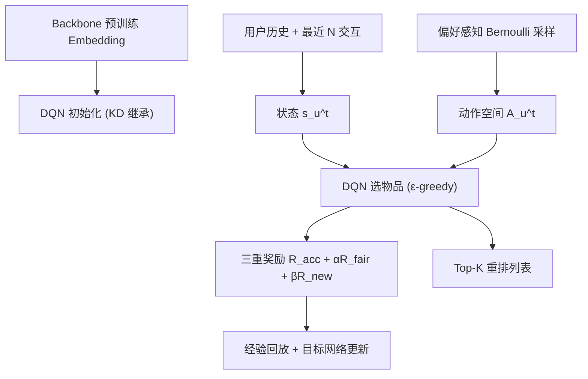

# Enhancing New-item Fairness in Dynamic Recommender Systems (动态推荐系统中的新物品公平性增强)

- **会议/期刊**: SIGIR 2025
- **作者与机构**: Huizhong Guo, Zhu Sun, Dongxia Wang, Tianjun Wei, Jinfeng Li, Jie Zhang（浙江大学 / SUTD / 南洋理工 / 阿里巴巴）
- **推荐链路定位**: 重排（在 backbone 打分基础上做列表级 RL 重排）
- **研究方向**: 强化学习与动态探索推荐 / 去偏公平与可信推荐
- **论文原文**: [https://arxiv.org/abs/2504.21362v1](https://arxiv.org/abs/2504.21362v1)
- **开源代码**: [https://github.com/Grey-z/FairAgent](https://github.com/Grey-z/FairAgent)

## TL;DR (1分钟核心速览)

动态推荐系统（DRS）中新物品因曝光窗口短、交互稀疏，被传统模型系统性压制，且这种不公平会沿反馈回路逐阶段累积、侵蚀系统长期稳定性。本文提出 FairAgent：以知识蒸馏继承 backbone 对老物品的推荐能力，再用 DQN 智能体配合「新物品探索奖励 + 个性化公平奖励 + 准确度奖励」三重信号做列表级重排。在 KuaiRec-Small/Large、Steam 三数据集、MF/LightGCN/ALDI 三 backbone 上，TGF 平均下降 86.34%/93.35%/42.13%，同时 HR 不降反升（KuaiRec-Small 上 +39.41%）。

## Background & Motivation (背景与核心矛盾)

- **主流范式**: 现有新物品公平工作（CNIF、PD、Pearson）均为**静态场景**设计——在固定物品池上通过重加权、因果干预或正则项平衡曝光，模型训练一次即定型。
- **前人局限**: ① DRS 中新物品持续涌入，静态优化目标无法随时间自适应；② 现有方法只做**全局平均公平**，忽略不同用户对新物品的偏好差异及其动态演化；③ 用户反馈持续回流驱动模型更新，公平性缺口会沿反馈回路**逐阶段放大**。
- **核心洞察 (Key Insight)**: 作者在 Steam 上做阶段化数据分析（图 2）发现：到第 5 个测试阶段，新物品在真实交互中已占据 **51%** 的市场份额，但 MF/LightGCN 的推荐列表中几乎为 0，ALDI 也远低于真值——即"用户想要新物品，模型却不给"，且偏差随阶段单调恶化。
- **本文切入点**: 把新物品公平建模为**序列决策问题**，用 RL 智能体在每一阶段动态重排，让奖励函数同时编码"探索新物品""贴合用户个性化公平诉求""保持准确度"三个目标。

## Method (核心方法设计)

### 1. 整体框架 (Overall Architecture)

FairAgent 挂载在任意预训练 backbone（MF/LightGCN/ALDI）之上。每个推荐阶段 $T_m$，先用 backbone 预训练 embedding 初始化 DQN 的 Q 网络（知识蒸馏式继承老物品推荐能力）；随后对每个用户构造状态$s_u^t=[e_u,e_{v_1},\dots,e_{v_N}]$（用户 + 最近$N$个交互物品）与**偏好感知采样的动作空间**$\mathcal{A}_u^t$（按用户历史新物品比例$p_{new}$做 Bernoulli 采样，控制新老物品配比）；DQN 以$\varepsilon$-greedy 逐步选出$K$个物品构成列表，每步依据三重奖励更新状态与动作空间；经验回放 + 目标网络（每 5 步同步）稳定训练。推理时直接贪心解码 top-$K$ 列表。

### 2. 关键设计拆解 (Key Designs)

1. **用户级个性化新物品公平度量 UNF（把 TGF 从全局拉到个体）**：原 TGF 对所有用户取平均，无法刻画个体差异。本文定义 $UNF=\frac{1}{|\mathcal{U}|}\sum_{u}[TGF(L_u)-TGF(H_u)]^2$，即"推荐列表的新老曝光分布"与"用户历史交互的新老曝光分布"之差的平方——用户历史上就爱新物品，就应多推新物品；反之则少推。这一项把公平从"人人均等"改写为"人人贴合自身偏好"，是后续公平奖励的度量基础。

2. **三重奖励机制（本文最核心增量）**：总奖励 $R_{total}=R_{acc}+\alpha R_{fair}+\beta R_{new}$。
   - 探索奖励 $R_{new}=\gamma\cdot\mathbb{I}(v\in\mathcal{V}^n_{T_m})+(1-\gamma)\cdot\mathbb{I}(v\in\mathcal{V}^n_{T_m})\cdot\mathbb{I}(\hat{y}_{uv}=1)$：只要推新物品就给基础分，被点击再给额外分，$\gamma$ 调节二者配比，直接对抗新物品的曝光饥饿。
   - 公平奖励 $R_{fair}=\frac{2\tanh(UNF_u^t-UNF_u^{t+1})}{1+\tanh(2)}\in(-1,1)$：用**相邻两步 UNF 的差分**做奖励，只要当前步让列表更贴近用户历史偏好就给正分——这是把"公平"转成可逐步优化的稠密信号的关键技巧，避免了直接优化绝对值导致的稀疏奖励。
   - 准确度奖励 $R_{acc}=\mathbb{I}(\hat{y}_{uv}=1)\log_2(r_{uv}+1)$：位置折扣的点击奖励，保证重排不牺牲相关性。

3. **训练目标、负采样与推理效率**：DQN 用标准 TD 损失 $\mathcal{L}_\theta=\mathbb{E}[(Q_{target}-Q(s_u^t,a_u^t;\theta))^2]$，$Q_{target}=r_u^t+\lambda\max_{a^{t+1}}Q(s_u^{t+1},a^{t+1};\theta')$。训练沿用 BPR + 负采样率 4，batch size 8192；RL 阶段无需额外负采样（动作空间内已含采样负例）。推理为逐用户$K$步贪心，开销为$O(K\cdot|\mathcal{A}|)$ 次前向，作者在局限中承认 RL 收敛慢、大规模扩展性是短板。

## Experimental Setup & Evaluation Protocol (实验设置与评估协议)

- **数据集与预处理**: 三数据集均过滤交互数 < 10 的用户；KuaiRec 系列保留 watch ratio > 1.0 为正样本。

| 数据集 | 场景特点 | 新物品演化 | 内容特征 |
| :--- | :--- | :--- | :--- |
| KuaiRec-Small | 短视频，稠密 | 新物品涌入快、兴趣漂移剧烈 | 标题+类目（PLM 编码） |
| KuaiRec-Large | 短视频，大规模 | 物品扩张较平滑、兴趣漂移较慢 | 同上 |
| Steam | 游戏，用户/物品池大 | 扩张稳定、兴趣变化平缓 | 游戏名+标签 |

- **数据划分与防穿越 (Splitting Strategy)**: 按时间 1:1 切分训练/测试；backbone 在完整训练集上训练，**最后 20% 训练集**用于训练 FairAgent 与所有基线；测试集再均分为 5 个阶段，每阶段开始时注入一批新物品（$V^{te}_1\sim V^{te}_5$），模拟 DRS 动态引入。
- **排名评测协议 (Ranking Protocol)**: `Sampled Ranking`——每阶段为每用户采样负例构造**固定 1000 候选集**，报告 $K=20$的 HR、NDCG、TGF（越接近 0 越公平）、UNF、NC（新物品覆盖率）与平衡指标$\%\delta_T$。
- **对比基线与超参设置**: 基线为 PD（因果干预）、Pearson（相关性正则）、CNIF（时间感知公平损失，最强基线）；backbone 为 MF / LightGCN / ALDI；贝叶斯优化调学习率、正则与维度，$\alpha\in[0.5,2.5]$、$\beta\in[0,1]$、$\gamma=0.1$。

## Key Experimental Results (实验关键数据)

### 1. 主实验对比 (Main Results)

5 个测试阶段平均结果（$K=20$，节选 MF 与 ALDI 两个 backbone）：

| Backbone / 数据集 | 方法 | HR↑ | NDCG↑ | TGF↓ | UNF↓ | NC↑ | %$\delta_T$↑ |
| :--- | :--- | :---: | :---: | :---: | :---: | :---: | :---: |
| MF / KuaiRec-Small | Backbone | 0.6035 | 0.2741 | 0.5949 | 0.1252 | 0.0000 | - |
| | PD | 0.6154 | 0.2781 | 0.5729 | 0.1195 | 0.0000 | 102.9% |
| | Pearson | 0.5729 | 0.2584 | 0.5667 | 0.1170 | 0.0000 | 99.8% |
| | CNIF | 0.6957 | 0.3211 | 0.4552 | 0.0903 | 0.0000 | 120.9% |
| | **FairAgent** | **0.9600** | **0.5082** | **0.0793** | **0.0061** | **0.3003** | **197.5%** |
| MF / KuaiRec-Large | CNIF | 0.6638 | 0.3477 | 0.4789 | 0.0836 | 0.0000 | 103.9% |
| | **FairAgent** | **0.8252** | **0.4280** | **-0.0547** | **0.0224** | **0.3440** | **161.1%** |
| MF / Steam | CNIF | 0.3485 | 0.1713 | 0.5537 | 0.0453 | 0.0000 | 96.1% |
| | **FairAgent** | **0.5143** | **0.2674** | **0.4584** | **0.0325** | **0.1348** | **116.8%** |
| ALDI / KuaiRec-Small | CNIF | 0.8883 | 0.4538 | 0.2286 | 0.0357 | 0.0054 | 105.1% |
| | **FairAgent** | **0.9591** | **0.5540** | **-0.0304** | **0.0096** | **0.3097** | **160.3%** |

### 2. 消融实验 (Ablation Study)

MF backbone 下移除各奖励项（$f$=公平奖励，$n$=探索奖励）：

| 数据集 | 配置 | HR↑ | TGF↓ | UNF↓ | NC↑ |
| :--- | :--- | :---: | :---: | :---: | :---: |
| KuaiRec-Small | FairAgent | **0.9600** | **0.0793** | **0.0061** | **0.3003** |
| | w/o $f$ | 0.9340 | 0.1985 | 0.0576 | 0.1945 |
| | w/o $n$ | 0.9315 | 0.1824 | 0.0370 | 0.1699 |
| | w/o $f$\&$n$ | 0.7946 | 0.4649 | 0.0410 | 0.0450 |
| KuaiRec-Large | FairAgent | 0.8445 | **-0.0377** | **0.0251** | 0.3168 |
| | w/o $f$ | 0.8686 | 0.0786 | 0.0312 | **0.3562** |
| | w/o $n$ | 0.8311 | -0.0685 | 0.0270 | 0.2704 |
| | w/o $f$\&$n$ | 0.7574 | 0.3161 | 0.0513 | 0.1343 |
| Steam | FairAgent | 0.4477 | 0.4438 | **0.0250** | 0.1733 |
| | w/o $f$ | 0.4055 | 0.4584 | 0.0396 | 0.1918 |
| | w/o $n$ | **0.5143** | **0.4051** | 0.0325 | 0.1348 |
| | w/o $f$\&$n$ | 0.5028 | 0.5401 | 0.0425 | 0.0938 |

### 3. 关键实验发现 (Key Findings)

1. **公平与准确度并非零和，反而在"用户爱新物品"场景下互相成就**：KuaiRec-Small 上 FairAgent 的 HR 从 0.6035 升至 0.9600（+39.41%），TGF 从 0.5949 压到 0.0793（-86.34%），而最强基线 CNIF 为换公平牺牲了 2.19% HR——说明当用户真实偏好被旧模型的曝光偏差掩盖时，纠偏本身就是提效。
2. **探索奖励是"曝光量"的唯一开关，公平奖励是"分布形状"的调节器**：消融中移除 $R_{new}$使 NC 从 0.3003 暴跌至 0.1699（KuaiRec-Small），移除$R_{fair}$ 则使 UNF 从 0.0061 恶化到 0.0576；两者同时移除时 TGF 反弹至 0.4649，几乎退回 backbone 水平，证明二者缺一不可。
3. **个性化公平在"用户不爱新物品"场景下会自动收敛为温和策略**：Steam 上多数用户 TGF>0（偏好老物品），FairAgent 的 TGF 仍为 0.4584（未强行压到 0），但 UNF 最优（0.0250），且 $\%\delta_T$ 达 116.8%——说明 UNF 度量成功阻止了"为公平而公平"的过度纠偏。

## Highlights & Limitations (亮点、对比与审稿批判)

- **与代表作对比 (vs. Prior Work)**: CNIF 是唯一显式考虑物品进入时间的工作，但仍是静态训练期的损失正则，无法随阶段自适应；PD/Pearson 只按交互量或流行度做全局重加权，NC 恒为 0（完全不推新物品）。FairAgent 的本质差异是把公平从"训练期约束"搬到"推理期序列决策"，并用 UNF 把公平目标个体化。
- **可迁移亮点**: ① 用"相邻步 UNF 差分 + tanh 压缩"构造稠密公平奖励，可迁移到任何需要逐步优化分布对齐的 RL 重排任务；② 按用户历史新物品比例做 Bernoulli 动作空间采样，是一种轻量且有效的候选集配比控制手段。
- **审稿级局限批判**: ① 依赖 backbone 预训练 embedding，且 RL 收敛慢、大规模扩展性未验证，论文自身在结论中承认；② 评测采用 1000 候选的 Sampled Ranking 而非 Full-Ranking，且新物品注入是人工按时间切分模拟，与真实工业 DRS 的新物品到达分布仍有差距；③ 未考虑新用户引入，公平性只覆盖物品侧单一利益方。

## Rating (四维评分)

- **方法创新性 (Novelty)**: ⭐⭐⭐⭐ （首次将新物品公平建模为 DRS 中的 RL 序列决策问题，UNF 度量与差分式公平奖励设计有巧思，但 DQN + 三重奖励的组合本身工程性大于理论突破）
- **评估协议与实验扎实度 (Protocol & Experiments)**: ⭐⭐⭐⭐ （三数据集 × 三 backbone × 五阶段 + 完整消融与可视化，覆盖面扎实；扣分在 Sampled Ranking 与人工阶段切分）
- **写作与数学规范度 (Clarity & Rigor)**: ⭐⭐⭐⭐ （TGF/UNF 定义与奖励公式推导清晰，算法伪代码完整；部分符号如 $Q(s_u^t,s_u^t)$ 存在笔误）
- **工业落地与复现价值 (Industrial & Practical Value)**: ⭐⭐⭐⭐ （代码已开源、可插拔任意 backbone，实用性强；但 RL 在线推理与训练开销是规模化部署的主要障碍）

