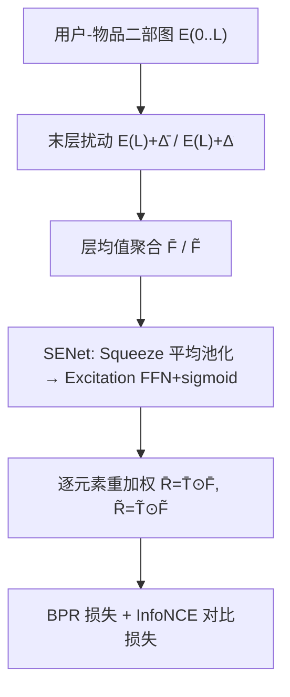
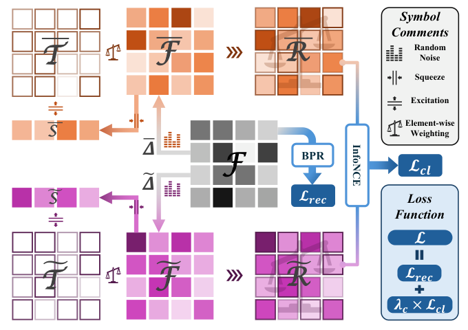

# Squeeze and Excitation: A Weighted Graph Contrastive Learning for Collaborative Filtering (挤压与激励：面向协同过滤的加权图对比学习)

- **会议/期刊**: SIGIR 2025
- **作者与机构**: Zheyu Chen (香港理工大学), Jinfeng Xu (香港大学), Yutong Wei (中南大学), Ziyue Peng (澳门大学)
- **推荐链路定位**: 召回
- **研究方向**: 自监督对比学习与交互去噪 / 图神经网络推荐
- **论文原文**: [论文原文链接](https://arxiv.org/abs/2504.04443v1)
- **开源代码**: [开源代码仓库链接](https://github.com/Zheyu-Chen/WeightedGCL)

## TL;DR (1分钟核心速览)

现有图对比学习（GCL）推荐模型对扰动视图内所有特征赋予**均等权重**，无法区分关键特征与噪声特征；同时在全层施加扰动会破坏前层表征稳定性。本文提出 WeightedGCL：仅在 GCN **末层**注入随机噪声构造鲁棒扰动视图，并引入 SENet 的 squeeze-excitation 结构对扰动视图做**动态特征重加权**。在 Amazon/Pinterest/Alibaba 三数据集、8:1:1 随机划分、全库排序协议下，NDCG@20 分别提升 3.61%、7.13%、24.45%。

## Background & Motivation (背景与核心矛盾)

- **主流范式**: LightGCN 类图卷积 + 图对比学习（SGL/SimGCL/NCL 等），通过构造扰动视图并最大化视图间互信息来缓解数据稀疏。
- **前人局限**: ① 现有 GCL 模型（如 SimGCL）对扰动视图内**所有特征维度一视同仁**，关键特征被无关维度稀释，特征注意力分配不合理；② 全层扰动策略（如 SGL 的 edge/node dropout 施加于每层）在浅层引入噪声，破坏表征学习的稳定性。
- **核心洞察 (Key Insight)**: 扰动视图本身带有随机性，直接学习权重矩阵不可行；但特征维度的重要性差异客观存在，需要一个能对**随机视图**做稳定统计并回传权重的轻量模块。
- **本文切入点**: 将 CV 中的 SENet 通道注意力迁移到 GCL——先 squeeze 出节点级统计量，再 excitation 还原为特征权重，与"末层扰动"配合形成稳定且加权的对比视图。

## Method (核心方法设计)

### 1. 整体框架 (Overall Architecture)

以 LightGCN 为骨干，逐层聚合得到 $E^{(0)},\dots,E^{(L)}$，最终表征为各层均值$F=\frac{1}{L+1}\sum_{l=0}^{L}E^{(l)}$。核心改动在于：仅对末层$E^{(L)}$加两次独立均匀噪声$\bar{\Delta},\tilde{\Delta}\sim U(0,1)$得到两个扰动视图$\bar{F},\tilde{F}$；随后各自经 squeeze（平均池化压缩为$1\times|\mathcal{N}|$统计矩阵）与 excitation（多层 FFN + sigmoid 还原为$d\times|\mathcal{N}|$权重矩阵）得到$\bar{T},\tilde{T}$，逐元素相乘完成重校准$\bar{R}=\bar{T}\odot\bar{F}$。最终以 BPR 主损失 + InfoNCE 对比损失联合训练。

<figure class="paper-figure" markdown="span">
  <figcaption>图1：我们的WeightedGCL的整体架构。</figcaption>
</figure>

### 2. 关键设计拆解 (Key Designs)

1. **鲁棒末层扰动 (Robust Perturbation)**：痛点在于全层扰动让浅层噪声污染传播路径。本文只扰动末层，前 $L-1$层在两个视图中完全共享，即$\bar{F}=\frac{1}{L+1}(E^{(0)}+\dots+E^{(L-1)}+E^{(L)}+\bar{\Delta})$。直觉：浅层承载低频协同信号，应保持稳定；末层承载高阶混合信息，适度噪声恰好制造"有意义但不破坏结构"的对比差异。

2. **SENet 动态特征重加权**：痛点在于随机视图无法直接学权重。Squeeze 用平均池化把节点 $n$的$d$维表征压成标量统计$s_n=\frac{1}{d}\sum_{k=1}^{d}f_n^k$，保留全局特征响应；Excitation 用$K$层 FFN 按等比尺度$s=\sqrt[K]{d}$逐级升维还原至$d$维，末层 sigmoid 输出权重$T=\sigma(W_K(\cdots(W_1 S+b_1)\cdots)+b_K)$。直觉：先"看全局"再"分配注意力"，使高响应特征维度获得更大权重，抑制噪声维度。

3. **训练目标、负采样与推理效率**：总损失 $\mathcal{L}=\mathcal{L}_{rec}+\lambda_c\mathcal{L}_{cl}$，其中$\mathcal{L}_{rec}$为 BPR（每正样本随机采 1 负样本），$\mathcal{L}_{cl}$为 InfoNCE，温度$\tau$控制视图间对齐锐度。推理阶段丢弃 SENet 与对比分支，仅用主干$F$ 做内积打分，**在线开销与 LightGCN 完全一致**，SENet 仅训练期生效。

## Experimental Setup & Evaluation Protocol (实验设置与评估协议)

- **数据集与预处理**:

| 数据集 | #Users | #Items | #Interactions | 稀疏度 | 过滤/场景说明 |
| :--- | :---: | :---: | :---: | :---: | :--- |
| Amazon Books | 58,144 | 58,051 | 2,517,437 | 99.925% | 15-core 过滤 |
| Pinterest | 55,188 | 9,912 | 1,445,622 | 99.736% | 5-core 过滤 |
| Alibaba | 300,001 | 81,615 | 1,607,813 | 99.993% | 保留全部交互（极稀疏） |

- **数据划分与防穿越 (Splitting Strategy)**: 三数据集均按 **8:1:1 随机划分**训练/验证/测试（非时间戳切分，存在轻度未来信息泄漏风险）。
- **排名评测协议 (Ranking Protocol)**: 采用 **Full-Ranking 全库未交互排序**，报告 Recall@{10,20} 与 NDCG@{10,20}，对测试集全体用户取平均。
- **对比基线与超参设置**: 基线含 MF-BPR、NGCF、LightGCN、UltraGCN、LayerGCN、FKAN-GCF 及 7 个 GCL SOTA（SGL/NCL/SimGCL/LightGCL/DCCF/RecDCL/BIGCF）。Embedding 维度 $d=64$，batch 4096，Adam 学习率 1e-4，$\lambda_c\in\{10^{-1},10^{-2},10^{-3}\}$，$\tau\in\{0.2,0.4,0.6,0.8\}$，$L\in\{2,3,4\}$，早停 30 epoch；显著性$p<0.01$。

## Key Experimental Results (实验关键数据)

### 1. 主实验对比 (Main Results)

| Model | Amazon R@20 | Amazon N@20 | Pinterest R@20 | Pinterest N@20 | Alibaba R@20 | Alibaba N@20 |
| :--- | :---: | :---: | :---: | :---: | :---: | :---: |
| LightGCN | 0.1206 | 0.0689 | 0.1621 | 0.0830 | 0.0692 | 0.0299 |
| SGL | 0.1331 | 0.0777 | 0.1704 | 0.0897 | 0.0692 | 0.0307 |
| NCL | 0.1381 | 0.0815 | 0.1609 | 0.0833 | 0.0713 | 0.0319 |
| SimGCL | 0.1336 | 0.0832 | 0.1576 | 0.0871 | 0.0691 | 0.0317 |
| RecDCL | 0.1345 | 0.0780 | 0.1619 | 0.0839 | 0.0768 | 0.0338 |
| BIGCF | 0.1341 | 0.0810 | 0.1619 | 0.0864 | 0.0744 | 0.0322 |
| WGCL-all pert. | 0.1378 | 0.0853 | 0.1768 | 0.0961 | 0.0831 | 0.0374 |
| **WeightedGCL** | **0.1396** | **0.0862** | **0.1793** | **0.0961** | **0.0879** | **0.0397** |
| Improv.% | +4.49% | +3.61% | +5.22% | +7.13% | +20.58% | +24.45% |

### 2. 消融实验 (Ablation Study)

| 变体 | Amazon R@20 | Pinterest R@20 | Alibaba R@20 | 说明 |
| :--- | :---: | :---: | :---: | :--- |
| WGCL-w/o pert. | 0.0159 | 0.0168 | 0.0167 | 去掉扰动，对比学习失效 |
| WGCL-all pert. | 0.1378 | 0.1768 | 0.0831 | 全层扰动替代末层扰动 |
| **WeightedGCL** | **0.1396** | **0.1793** | **0.0879** | 末层扰动 + SENet |

### 3. 关键实验发现 (Key Findings)

1. **扰动是 GCL 的"生命线"而非锦上添花**：去掉扰动后 R@20 从 0.1396 暴跌至 0.0159（Amazon，约 89% 跌幅），说明 InfoNCE 依赖视图间差异提供梯度，无扰动时两视图近乎相同、对比信号消失。
2. **末层扰动优于全层扰动，且增益在稀疏数据上被放大**：WGCL-all pert. 在 Alibaba 上 R@20 为 0.0831，末层扰动提升至 0.0879（+5.8%）；Alibaba 稀疏度 99.993%，说明浅层噪声对极稀疏图的高阶信号传播破坏更严重。
3. **SENet 粒度存在"先升后降"拐点**：Amazon 最优为 4 级（R@20=0.1396），Pinterest/Alibaba 最优为 3 级（0.1793/0.0879），4 级在 Alibaba 回落至 0.0826，印证过深 FFN 带来的训练复杂度反噬。

## Highlights & Limitations (亮点、对比与审稿批判)

- **与代表作对比 (vs. Prior Work)**: 相比 SimGCL（全层噪声 + 均匀权重），本文把"扰动位置"与"特征权重"两个自由度解耦并分别优化；相比 SGL（图结构增广），本文走特征空间扰动路线，无需重构图，工程成本更低；相比 NCL（邻域聚类对比），本文不引入额外聚类目标，训练更轻。
- **可迁移亮点**: ① "末层扰动 + 前层共享"的视图构造范式可迁移到任何多层 GNN 对比学习；② SENet 的 squeeze-excitation 重加权可作为即插即用模块挂到任意 GCL 骨干上，且推理零开销。
- **审稿级局限批判**: ① 8:1:1 随机划分而非时间戳切分，存在未来交互泄漏，实际线上收益可能被高估；② 仅报告 Recall/NDCG，缺少与 LightGCN 的推理延迟/显存对比，且 SENet 训练期额外 FFN 前向开销未量化；③ 三数据集均为公开基准，无线上 A/B 验证，工业落地证据不足。

## Rating (四维评分)

- **方法创新性 (Novelty)**: ⭐⭐⭐ （SENet 迁移到 GCL 属组合式创新，末层扰动有直觉支撑但缺理论分析）
- **评估协议与实验扎实度 (Protocol & Experiments)**: ⭐⭐⭐ （三数据集 + 13 基线 + 显著性检验较完整，但随机划分与缺效率实验拉低分数）
- **写作与数学规范度 (Clarity & Rigor)**: ⭐⭐⭐⭐ （公式与符号定义清晰，SENet 升维尺度 $s=\sqrt[K]{d}$ 交代明确，篇幅紧凑）
- **工业落地与复现价值 (Industrial & Practical Value)**: ⭐⭐⭐⭐ （代码开源，推理零额外开销，SENet 即插即用，落地门槛低）

