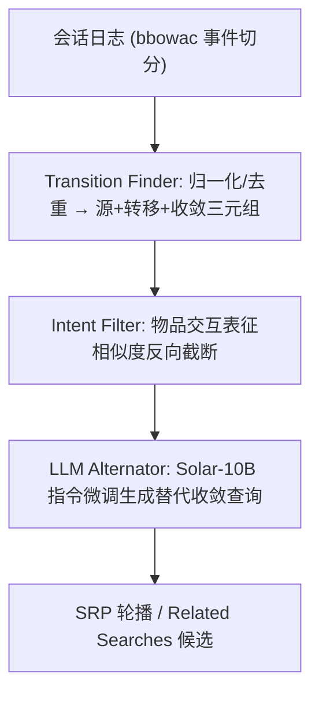
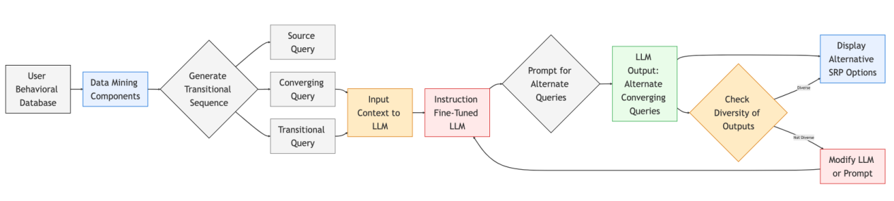

# AI Guided Accelerator For Search Experience (面向搜索体验的 AI 引导加速器)

- **会议/期刊**: SIGIR 2025 Workshop on eCommerce (eCom'25)
- **作者与机构**: Jayanth Yetukuri, Mehran Elyasi, Samarth Agrawal, Aritra Mandal, Shuang Zhou, Rui Kong, Harish Vempati, Ishita Khan（eBay Inc.）
- **推荐链路定位**: 重排 / 搜索结果页（SRP）体验模块（Related Searches 与意图聚类轮播）
- **研究方向**: 序列与会话推荐 / 大语言模型推荐
- **论文原文**: [https://arxiv.org/abs/2508.05649v2](https://arxiv.org/abs/2508.05649v2)
- **开源代码**: 暂未开源

## TL;DR (1分钟核心速览)

本文针对电商查询改写长期被建模为「源查询→目标查询」孤立二元对、丢失购物漏斗中途探索信号的痛点，提出把用户会话切成「源查询 + 转移查询链 + 收敛查询」三元结构，用基于物品交互表征的**意图一致性过滤**截断意图漂移，再用 Solar-10B-Instruct 指令微调生成语义对齐但词面多样的替代收敛查询，驱动 SRP 轮播与 Related Searches。在 eBay 线上两周匿名日志对比生产 RS 系统，CTR 相对提升 **+32.2%**、转化 **+38.3%**；而仅用挖掘序列（不过 LLM）反而 CTR **-33.6%**、转化 **-40.3%**。

## Background & Motivation (背景与核心矛盾)

- **主流范式**: 查询改写主流做法是从历史日志挖 source-target 查询对，用表征学习、意图分类或 NMT 式序列生成产出更相关/更多样的改写；Related Searches 模块则依赖协同过滤式的共现统计。
- **前人局限**: 其一，把改写视为**两点变换**，丢弃了用户从宽泛探索到精准购买之间反复 pivot 的中间转移态，无法刻画「不确定性—探索—意图收敛」的漏斗结构；其二，纯协同过滤/共现挖掘产出的候选**词面与语义多样性不足**，在 SRP 上呈现高度冗余，用户无新路径可走。
- **核心洞察 (Key Insight)**: 转移查询（transitional query）本身携带最强的意图演化信号——它既锚定了源查询的语义边界，又指向收敛方向；只要保证链上意图不漂移，就能把「行为挖掘的精准」与「生成模型的多样」拼起来。
- **本文切入点**: 用结构化序列挖掘 + 意图边界过滤构造高质量上下文，再把该上下文喂给指令微调 LLM 做**受约束的替代查询生成**（禁止复述已挖掘的收敛查询），直接落到线上体验模块。

## Method (核心方法设计)

### 1. 整体框架 (Overall Architecture)

管线分四段闭环：先从 eBay 大规模行为日志中按会话切分出以 `bbowac`（buy/bid/offer/watch/ask/cart）事件为分隔符的查询链，Transition Finder 做归一化与去重得到「源查询—转移查询列表—收敛查询列表」三元组；Intent Filter 以物品交互表征的查询相似度从收敛端反向回溯，截断意图边界外的查询；LLM Alternator 以完整用户旅程为上下文、用 few-shot 指令微调 Solar-10B-Instruct，生成语义对齐但词面互异、且显式排除已挖掘收敛查询的替代查询；最终这些替代查询作为锚点组织 SRP 轮播与 Related Searches 候选，经搜索服务回填物品后下发前端。

<figure class="paper-figure" markdown="span">
  <figcaption>图2：AI引导加速器驱动替代搜索分组的高层概览</figcaption>
</figure>

### 2. 关键设计拆解 (Key Designs)

1. **转移链切分与意图边界过滤（Transition Finder + Intent Filter）**：痛点是原始会话噪声大、跨意图查询混在一条链里。切分规则为遇到 `bbowac` 事件即断链，例如 $a\to b\to c\to d(\text{bbowac})\to e\to f(\text{bbowac})$被拆为$a\to b\to c\to d$与$e\to f$，保证每条链至少含 1 个转化事件与 2 个查询。意图过滤则从收敛查询反向遍历，设相邻查询相似度为$s(q_i,q_{i-1})$，保留满足$s(q_i,q_{i-1})\ge \tau$ 的最长后缀链：
$$\mathcal{C}^{*}=\arg\max_{\{q_k,\dots,q_T\}}\;|\{q_k,\dots,q_T\}|\quad \text{s.t.}\;\; s(q_i,q_{i-1})\ge\tau,\;\forall i\in[k+1,T]$$
其中 $s(\cdot)$由基于「查询所召物品集合」训练的表征模型给出（如 `macbook`[0.6]→`iphone 12`[0.9]→`iphone 12 red`[0.95]→`iphone 12 128gb` 中，`macbook` 因 0.6 低于阈值被剔除）。直觉是：相似度沿链单调爬升正是意图收敛的物理表征，阈值$\tau$ 即意图边界超参，由领域专家标定。

2. **LLM Alternator 的受约束生成（指令微调 + 多样性约束）**：痛点是协同过滤只能复述历史共现，无法外推品牌/属性维度。做法是把「源查询 + 转移查询 + 收敛查询」整条旅程作为 in-context 输入，指令要求生成**不同于输入收敛列表**、且高概率导向交易的替代查询。以转移查询 `18k gold diamonds necklace` 为例，模型输出 `18k white gold diamond necklace`、`18k gold diamond necklace tiffany & co`、`... cartier` 等，成功把品牌、金种、吊坠结构等显著属性从上下文抽取并传播。作者同时指出失败模式：若不加约束，模型会退化为 `air jordan 3 retro / black cement / true blue` 这类同质变体，组间多样性崩塌，故多样性是显式优化目标而非副产品。

3. **训练目标、负采样与推理效率**：本文为工业系统论文，未给出显式损失函数；LLM 侧采用 few-shot 指令微调（SFT），数据即上述过滤后的高质量旅程三元组，等价于最大化给定上下文下替代查询序列的似然 $\mathcal{L}_{\text{SFT}}=-\sum_t \log p_\theta(y_t\mid y_{<t},x)$，无负采样环节。推理侧为离线/近线批量生成替代查询并缓存，线上仅做候选检索与轮播组装，避免实时大模型调用开销。

## Experimental Setup & Evaluation Protocol (实验设置与评估协议)

- **数据集与预处理**: 基于 eBay 生产环境两周回看窗口的匿名用户交互日志；会话过滤要求至少含 1 个 `bbowac` 事件且至少 2 个查询；查询链经归一化、去重与意图一致性过滤。因隐私合规，论文未披露用户/物品/交互量级与稀疏度统计，仅报告相对指标。

| 数据集 | #Users | #Items | #Interactions | 稀疏度/密度 | 特征/场景说明 |
| :--- | :---: | :---: | :---: | :---: | :--- |
| eBay 生产日志（两周回看） | 未披露（匿名） | 未披露 | 未披露 | 未披露 | 电商搜索会话，含查询、曝光物品与 `bbowac` 行为 |

- **数据划分与防穿越 (Splitting Strategy)**: 非学术式划分，采用线上两周回看窗口的**时间切分**做离线对比评估，基线为 eBay 现网生产 Related Searches 系统，天然避免训练/评估穿越。
- **排名评测协议 (Ranking Protocol)**: 非 Full-Ranking 也非 Sampled Ranking，而是**线上业务指标协议**——以 CTR 与转化率（Conversion）相对生产基线的相对变化衡量，属真实流量下的 A/B 式对比。
- **对比基线与超参设置**: 基线为 (i) 现网生产 RS 系统，(ii) 仅挖掘序列至 Intent Filter 阶段的候选（无 LLM）。LLM 采用 Solar-10B-Instruct 指令微调；意图相似度阈值 $\tau$ 为应用级超参，由领域专家设定；未报告显著性检验。

## Key Experimental Results (实验关键数据)

### 1. 主实验对比 (Main Results)

| 方法 | CTR 相对变化 | 转化率 相对变化 |
| :--- | :---: | :---: |
| 生产 Related Searches 基线 | 0.0% | 0.0% |
| 仅挖掘序列（至 Intent Filter） | -33.6% | -40.3% |
| **+ LLM Alternator（本文完整系统）** | **+32.2%** | **+38.3%** |

### 2. 消融实验 (Ablation Study)

| 配置 | CTR 相对变化 | 转化率 相对变化 | 说明 |
| :--- | :---: | :---: | :--- |
| w/o LLM（仅行为挖掘候选） | -33.6% | -40.3% | 词面/语义多样性不足 |
| w/ LLM Alternator（完整） | **+32.2%** | **+38.3%** | 多样性 + 意图对齐 |
| 增益差（LLM 贡献） | +65.8 pt | +78.6 pt | 生成模块为决定性组件 |

### 3. 关键实验发现 (Key Findings)

1. **生成模块是唯一决定性增益来源**：仅靠结构化挖掘的候选相对生产系统 CTR 掉 33.6%、转化掉 40.3%，说明「更精准的历史共现」并不等于「更好的 SRP 体验」，多样性缺口会直接反噬点击与成交。
2. **LLM 带来的净增益达 65.8/78.6 个百分点**：从 -33.6% 翻转到 +32.2%，量级远超常规改写模型的个位数提升，印证了「行为上下文 + 世界知识外推」的组合在电商属性维度（品牌、材质、型号）上的稀缺价值。
3. **意图过滤是必要前置而非可选清洗**：论文示例中 `macbook` 因相似度 0.6 被截断，若保留则会把跨品类噪声注入 LLM 上下文，导致替代查询偏离收敛方向；过滤质量直接决定生成的可部署性。

## Highlights & Limitations (亮点、对比与审稿批判)

- **与代表作对比 (vs. Prior Work)**: 相较经典 query-chain / 点击日志改写工作（Radlinski & Joachims 的查询链、Hasan 等的电商 query suggestion），本文把建模单元从「二元对」升级为「三元旅程」并引入意图边界算子；相较 NMT 式改写，本文不做端到端翻译而是用 LLM 做受约束的**候选空间扩张**，显式排除已挖掘收敛查询以保证新颖性；相较纯协同过滤 RS 模块，本文补足了属性级外推能力。
- **可迁移亮点**: (i) 「反向回溯 + 相似度阈值」的意图边界截断可直接迁移到会话推荐与 next-item 序列清洗；(ii) 「禁止复述已知目标」的负约束提示词设计，是生成式召回/改写中控制多样性的低成本手段。
- **审稿级局限批判**: 其一，评估仅有相对业务指标，缺少离线可复现的公开数据集、绝对数值与显著性检验，且未披露流量规模与实验周期，结论的外部效度存疑；其二，LLM 生成依赖离线批量缓存，冷启动查询与长尾品类覆盖、生成延迟与成本、以及多样性退化的自动检测机制均未量化讨论。

## Rating (四维评分)

- **方法创新性 (Novelty)**: ⭐⭐⭐ （转移查询三元建模与意图边界过滤有工程洞察，但整体是成熟组件的系统集成，理论贡献有限）
- **评估协议与实验扎实度 (Protocol & Experiments)**: ⭐⭐⭐ （线上真实流量对比有说服力，但仅两个相对指标、无公开数据、无显著性检验与细粒度消融）
- **写作与数学规范度 (Clarity & Rigor)**: ⭐⭐⭐ （管线叙述清晰、示例具体，但形式化程度低，阈值选择与相似度模型细节交代不足）
- **工业落地与复现价值 (Industrial & Practical Value)**: ⭐⭐⭐⭐ （完整落地于 eBay 生产 SRP，架构与提示词设计可直接复用，唯缺开源代码与数据）

