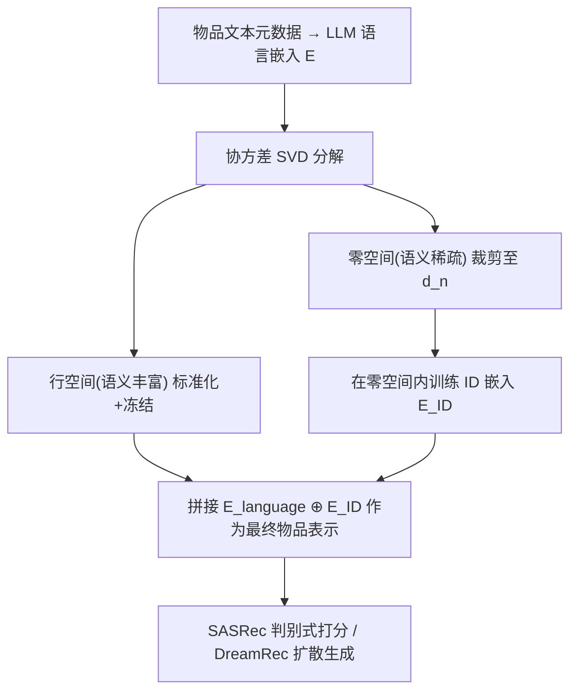
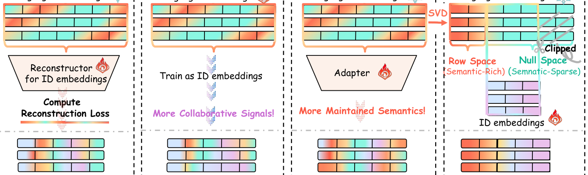

# AlphaFuse: Learn ID Embeddings for Sequential Recommendation in Null Space of Language Embeddings (在语言嵌入零空间中学习序列推荐 ID 嵌入)

- **会议/期刊**: SIGIR 2025
- **作者与机构**: Guoqing Hu, An Zhang, Shuo Liu, Zhibo Cai, Xun Yang, Xiang Wang（中国科学技术大学、新加坡国立大学、华东师范大学、中国人民大学）
- **推荐链路定位**: 召回（序列下一物品预测）
- **研究方向**: 序列与会话推荐 / 大语言模型推荐
- **论文原文**: [https://arxiv.org/abs/2504.19218v2](https://arxiv.org/abs/2504.19218v2)
- **开源代码**: [https://github.com/Hugo-Chinn/AlphaFuse](https://github.com/Hugo-Chinn/AlphaFuse)

## TL;DR (1分钟核心速览)

现有语言引导的 ID 嵌入学习存在三大痛点：高维语言嵌入（1536 维）映射到低维 ID 空间（64/128 维）导致语义退化、语言嵌入仅作训练引导而在推理时被丢弃、以及依赖适配器等额外可训练模块。AlphaFuse 通过 SVD 将语言嵌入空间分解为语义丰富的行空间与语义稀疏的零空间，仅在裁剪后的零空间内学习 ID 嵌入，行空间语义冻结保留并与 ID 嵌入拼接为最终物品表示。在 Movies/Toys/Sports 三数据集、冷启动用户划分与 Full-Ranking 协议下，SASRec 主干 N@10 最高相对提升 24.05%，DreamRec 扩散生成主干亦提升 8.85%，且参数量与推理 GFLOPs 与原生 SASRec 持平。

## Background & Motivation (背景与核心矛盾)

- **主流范式**: 语言引导推荐分三派——语义重构（RLMRec 用重构损失约束 ID 嵌入逼近语义空间）、语义初始化（LLMInit 用语言嵌入初始化后自由训练）、自适应投影（MoRec/UniSRec/WhitenRec 用 MLP 适配器把语义空间映射到行为空间）。
- **前人局限**: 其一，高维语义空间被压缩到低维行为流形，语义必然退化；其二，重构与初始化两派在推理阶段完全丢弃语言嵌入，世界知识未被利用；其三，适配器参数量常超过推荐模型本身（RLMRec 7.10M vs SASRec 5.72M），带来参数冗余与推理开销。
- **核心洞察 (Key Insight)**: 对语言嵌入协方差做 SVD 后发现语义呈强低秩结构——少量奇异向量承载绝大部分语义权重，而近 80% 维度奇异值趋零（图 3）；这些零空间维度与语言嵌入正交，天然是"无冲突"的注入槽位。
- **本文切入点**: 把协同信号的学习限制在语言嵌入的零空间内，行空间语义原封不动保留，从而同时实现"语义锚定"与"免额外参数"。

## Method (核心方法设计)

### 1. 整体框架 (Overall Architecture)

输入为物品文本元数据经 OpenAI text-embedding-3 编码的语言嵌入矩阵 $\mathbf{E}\in\mathbb{R}^{N\times d_l}$。先计算均值与协方差并对协方差做 SVD，按奇异值阈值把空间切分为语义丰富行空间与语义稀疏零空间；对零空间裁剪至$d_n$维（SASRec 取 64，DreamRec 不裁剪），对行空间按奇异值做标准化以缓解各向异性；随后在裁剪后的零空间内初始化并训练 ID 嵌入$\mathbf{E}_{ID}$，行空间语言嵌入全程冻结；最终物品表示为二者拼接。整个流程与主干解耦，SASRec 与 DreamRec 均可直接套用。

<figure class="paper-figure" markdown="span">
  <figcaption>图2：语言引导的ID嵌入学习策略的整体框架。</figcaption>
</figure>

### 2. 关键设计拆解 (Key Designs)

1. **零空间分解与裁剪（Null-Space Decomposition & Clipping）**：针对"高维语义压缩必退化"的矛盾，对协方差 $\boldsymbol{\Sigma}$做 SVD 得$\mathbf{U}\mathbf{S}\mathbf{U}^{\top}$，按阈值把奇异向量划分为行空间基与零空间基。由于零空间与$\mathbf{E}$正交，在其中更新 ID 嵌入不会扰动任何已保留语义；又因零空间维度远超行为空间所需（近 80%），需裁剪至$d_n$ 以匹配判别式模型的低维需求。物理直觉：把新信息写进"空白页"而非涂改"已写满的页"。

2. **行空间标准化（Standardization of Semantic-Rich Subspaces）**：原始语言嵌入高度各向异性，行空间内各基的语义权重差异悬殊。按奇异值对基做缩放 $\mathcal{V}_1=\frac{1}{s_i}\mathcal{V}_{s_i}$，均衡各子空间的信息量。图 4 显示该操作显著压低了物品对余弦相似度的累积分布，使嵌入更具区分度；同时标准化保证$\mathbf{E}_{\text{language}}^{\top}\mathbf{E}_{\text{language}}=\mathbf{I}$，从而在扩散前向过程中维持方差保持性质$\mathbf{E}_{\text{noise}}^{\top}\mathbf{E}_{\text{noise}}=\alpha_t\mathbf{E}_{\text{item}}^{\top}\mathbf{E}_{\text{item}}+(1-\alpha_t)\mathbf{I}$，这是 DreamRec 主干能正常工作的前提。

3. **训练目标、负采样与推理效率**：最终表示 $\mathbf{E}_{\text{item}}=\mathbf{E}_{\text{language}}+(\mathbf{0},\mathbf{E}_{ID})$，其中$\mathbf{E}_{ID}$ 以零或标准高斯初始化。SASRec 主干沿用 InfoNCE 损失配 64 个负样本，DreamRec 主干用扩散 MSE 损失、免负采样。由于无适配器，可训练参数仅 2.90M（低于原生 SASRec 的 5.72M），推理 GFLOPs 0.22 与 SASRec 完全一致，实现"零额外推理开销"。

## Experimental Setup & Evaluation Protocol (实验设置与评估协议)

- **数据集与预处理**:

| 数据集 | #Users | #Items | #Interactions | 稀疏度 | 特征/场景说明 |
| :--- | :---: | :---: | :---: | :---: | :--- |
| Movies | 20,515 | 44,014 | 637,157 | 0.07% | 电影元数据与评论（1996–2023） |
| Toys | 19,412 | 11,924 | 138,444 | 0.06% | 玩具游戏评论与元数据 |
| Sports | 35,598 | 18,357 | 256,598 | 0.04% | 运动户外商品 |

- **数据划分与防穿越 (Splitting Strategy)**: 采用两种设置。`Leave-One-Out`：末位物品测试、倒数第二验证、其余训练（复现 LLM-ESR 划分）。`冷启动用户划分`：按用户末次交互时间排序，最近 10% 用户作测试、次近 10% 作验证、其余训练，每用户保留最近 10 条交互作历史序列。
- **排名评测协议 (Ranking Protocol)**: 无偏 `Full-Ranking`（全库未交互物品排序），指标为 N@10/M@10/N@20/M@20。
- **对比基线与超参设置**: 基线覆盖语义重构（RLMRec-Con/Gen）、语义初始化（LLMInit）、自适应投影（MoRec、UniSRec、WhitenRec）、双视角（LLM-ESR）与扩散增强（iDreamRec）。SASRec 主干最终物品维度固定 128、ID 维度 64；DreamRec 主干不裁剪、保持原始语言嵌入维度，阈值在 $\{0.001,0.01,0.1,0.25,0.5\}$ 中搜索；批大小 256，Adam 优化器，随机种子固定为 22。

## Key Experimental Results (实验关键数据)

### 1. 主实验对比 (Main Results)

冷启动用户设置（表 2，节选 SASRec 主干，Full-Ranking）：

| 主干 | 方法 | Movies N@10 | Movies M@10 | Toys N@10 | Toys M@10 | Sports N@10 | Sports M@10 |
| :--- | :--- | :---: | :---: | :---: | :---: | :---: | :---: |
| SASRec | Base | 0.0338 | 0.0238 | 0.0255 | 0.0191 | 0.0073 | 0.0049 |
| SASRec | UniSRec | 0.0232 | 0.0160 | 0.0271 | 0.0191 | 0.0071 | 0.0051 |
| SASRec | WhitenRec | 0.0168 | 0.0116 | 0.0258 | 0.0181 | 0.0115 | 0.0081 |
| SASRec | RLMRec-Gen | 0.0355 | 0.0252 | 0.0303 | 0.0246 | 0.0080 | 0.0054 |
| SASRec | LLMInit | 0.0370 | 0.0264 | 0.0275 | 0.0215 | 0.0083 | 0.0055 |
| SASRec | LLM-ESR | 0.0139 | 0.0094 | 0.0122 | 0.0104 | 0.0101 | 0.0075 |
| SASRec | **AlphaFuse** | **0.0459** | **0.0324** | **0.0339** | **0.0287** | **0.0137** | **0.0098** |
| SASRec | Improv. | +24.05% | +22.73% | +11.88% | +16.67% | +19.13% | +20.99% |
| DreamRec | Base | 0.0016 | 0.0013 | 0.0383 | 0.0333 | 0.0158 | 0.0132 |
| DreamRec | iDreamRec | 0.0226 | 0.0180 | 0.0350 | 0.0301 | 0.0141 | 0.0119 |
| DreamRec | **AlphaFuse** | **0.0246** | **0.0201** | **0.0408** | **0.0348** | **0.0165** | **0.0139** |
| DreamRec | Improv. | +8.85% | +11.67% | +6.53% | +4.50% | +3.13% | +2.96% |

长尾设置（表 3，SASRec 主干，与 LLM-ESR 对比）：Fashion 上 AlphaFuse 整体 R@10 达 0.6008（较 LLM-ESR +6.92%），尾物品 R@10 从 0.1095 跃升至 0.2601（+137.53%）；Beauty 上整体 N@10 提升 8.97%；Yelp 上整体基本持平（-0.63%），但尾物品指标落后 LLM-ESR。

### 2. 消融实验 (Ablation Study)

Movies 数据集（表 4/表 5）：

| 主干 | 变体 | N@10 | M@10 | N@20 | M@20 |
| :--- | :--- | :---: | :---: | :---: | :---: |
| SASRec | AlphaFuse | **0.0459** | **0.0324** | **0.0574** | **0.0355** |
| SASRec | w/o Frozen | 0.0350 | 0.0249 | 0.0444 | 0.0274 |
| SASRec | w/o Clip | 0.0148 | 0.0096 | 0.0197 | 0.0109 |
| SASRec | w/o Stand. | 0.0354 | 0.0250 | 0.0450 | 0.0276 |
| DreamRec | AlphaFuse | **0.0246** | **0.0201** | **0.0279** | **0.0209** |
| DreamRec | w/o Decom. | 0.0103 | 0.0084 | 0.0120 | 0.0089 |
| DreamRec | w/o Frozen | 0.0214 | 0.0177 | 0.0242 | 0.0185 |
| DreamRec | w/o Stand. | 0.0114 | 0.0089 | 0.0140 | 0.0095 |

### 3. 关键实验发现 (Key Findings)

1. **零空间裁剪是判别式主干的命门**：去掉裁剪后 SASRec 主干 N@10 从 0.0459 暴跌至 0.0148（-67.8%），甚至低于原生 SASRec，说明未裁剪的高维零空间会让 ID 嵌入学习被稀释；而 DreamRec 因扩散模型适配高维空间无需裁剪，其最关键组件转为空间分解（w/o Decom. 掉至 0.0103，-58.1%）。
2. **冻结行空间语义是跨主干一致的刚需**：SASRec 与 DreamRec 上去掉冻结分别损失 23.7% 与 13.0% 的 N@10，证明一旦让语义空间参与训练，协同信号会反向侵蚀世界知识，冷启动泛化能力随之瓦解。
3. **效率与效果同向而非权衡**：AlphaFuse 可训练参数 2.90M，仅为 RLMRec（7.10M）的 41%、LLM-ESR（4.10M）的 71%，推理 GFLOPs 0.22 与 SASRec 持平，却在冷启动设置下全面领先——说明适配器带来的参数冗余不仅低效，其有限泛化能力反而拖累了冷启动表现（表 2 中带额外模块的 RLMRec/LLM-ESR 在冷启动上普遍弱于无模块方法）。

## Highlights & Limitations (亮点、对比与审稿批判)

- **与代表作对比 (vs. Prior Work)**: 与 RLMRec 的本质区别在于后者把语言嵌入当"重构靶子"、推理时丢弃，AlphaFuse 则把语言嵌入直接写进最终表示；与 UniSRec/WhitenRec 的适配器路线相比，AlphaFuse 用一次 SVD 替代整个 MLP 映射，参数量降一个量级；与 LLM-ESR 的双视角相比，AlphaFuse 不引入双分支结构，却在 Fashion 尾物品上取得 +137.53% 的 R@10 提升。
- **可迁移亮点**: 其一，"在冻结大模型表征的零空间内注入任务信号"这一范式可平移到多模态推荐（视觉/文本嵌入零空间注入协同信号）与跨域迁移；其二，行空间标准化维持 $\mathbf{E}^{\top}\mathbf{E}=\mathbf{I}$ 的技巧，对任何需要方差保持的扩散式推荐器都是即插即用的预处理。
- **审稿级局限批判**: 其一，SVD 需对全物品协方差矩阵做分解，物品集动态增删时需重算，冷启动新物品的零空间基如何增量维护未讨论；其二，长尾实验中尾物品指标在 Yelp/Beauty 上不及 LLM-ESR（如 Beauty 尾物品 R@10 低 28.00%），说明零空间注入对极稀疏物品的协同信号捕获仍不充分，且阈值 $\{0.001,\dots,0.5\}$ 的选取对 DreamRec 性能敏感（图 5c），缺乏自适应确定方案。

## Rating (四维评分)

- **方法创新性 (Novelty)**: ⭐⭐⭐⭐ （借 AlphaEdit 的零空间思想迁移至推荐，视角新颖且有 SVD 谱分析与图 3/图 4 的实证支撑，但本质是线性代数工具的巧妙套用）
- **评估协议与实验扎实度 (Protocol & Experiments)**: ⭐⭐⭐⭐ （三数据集 × 双主干 × 冷启动/长尾双设置 + Full-Ranking 协议 + 完整消融与效率对比，唯缺显著性检验与线上验证）
- **写作与数学规范度 (Clarity & Rigor)**: ⭐⭐⭐⭐ （四步流程表述清晰、方差保持推导完整，但式 (9) 中 $d_s+d_n$ 的维度分配与阈值选取的对应关系交代略含糊）
- **工业落地与复现价值 (Industrial & Practical Value)**: ⭐⭐⭐⭐⭐ （代码开源、零额外推理开销、参数量低于原生 SASRec，SVD 可离线预计算，工程落地门槛极低）

