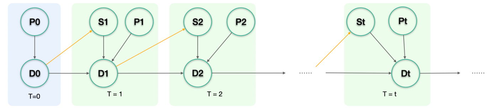
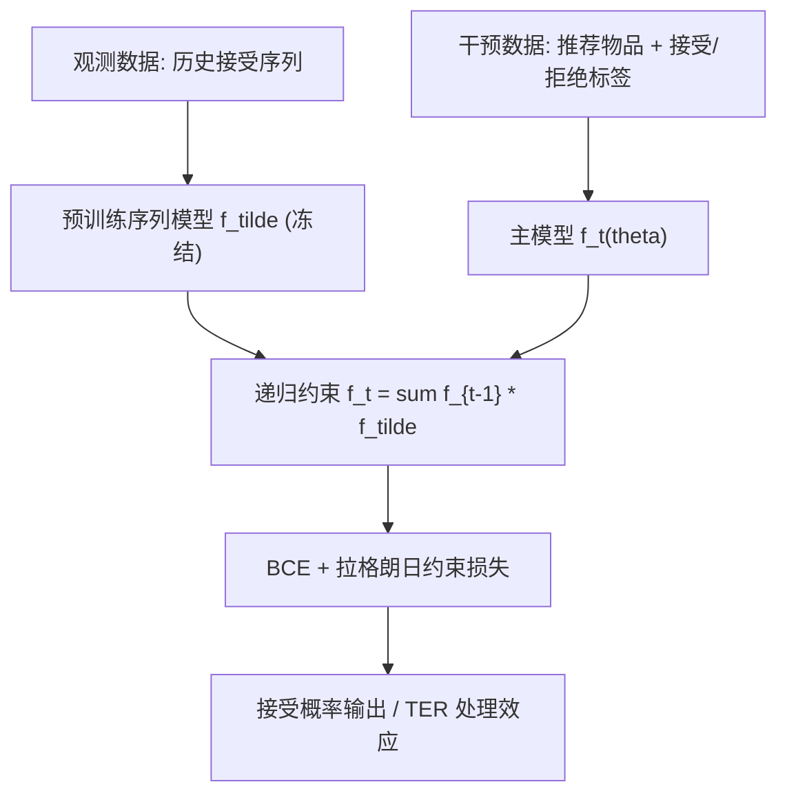

# CSRec: Rethinking Sequential Recommendation from A Causal Perspective (从因果视角重新审视序列推荐)

- **会议/期刊**: SIGIR 2025
- **作者与机构**: Xiaoyu Liu, Jiaxin Yuan, Yuhang Zhou, Jingling Li, Furong Huang, Wei Ai（University of Maryland, College Park）
- **推荐链路定位**: 精排（序列决策建模）
- **研究方向**: 序列与会话推荐 / 去偏与因果推荐
- **论文原文**: [论文原文链接](https://arxiv.org/abs/2409.05872v1)
- **开源代码**: 暂未开源

## TL;DR (1分钟核心速览)

现有序列推荐把任务等同于"预测下一个购买物品"，只建模全为"接受"的序列，既忽略推荐系统对用户决策的干预，也无法隔离系统自身影响。本文提出 CSRec，将目标改为在序列上下文中预测"推荐物品被接受的概率"，并用因果图推导出跨时刻递归约束 $f_t=\sum_{D_{t-1}}\mathbb{P}(D_t|S_t,D_{t-1},P_t)f_{t-1}$，以拉格朗日乘子并入损失。在 GPT4-books 与 MSSD 上，AHR@0.2 相对 SOTA 提升约 1.5–3 倍，且观测数据 HR/NDCG 不退化。

## Background & Motivation (背景与核心矛盾)

- **主流范式**: 序列推荐（GRU4Rec/SASRec/BERT4Rec/BSARec 等）以历史购买序列做 next-item 预测，本质是估计用户内在偏好 $P_t$ 并取最高分物品。
- **前人局限**: 其一，训练序列只保留"接受"样本，用户对推荐"不感兴趣/拒绝"的负向反馈被系统性丢弃，无法刻画"失败推荐如何影响后续购买"；其二，系统曝光 $S_t$作为干预变量对决策$D_t$ 的影响从未被显式分离与量化，echo chamber、偏好放大等问题只能定性讨论。
- **核心洞察 (Key Insight)**: 推荐场景中"曝光"与"接受"应被拆成两个变量——系统控制曝光（干预），用户决定接受（结果）；用户当前决策由偏好 $P_t$、系统推荐$S_t$与上一时刻决策$D_{t-1}$协同决定，而$D_{t-1}$ 又递归携带全部历史信息。
- **本文切入点**: 用一张 DAG 把序列推荐写成干预分布 $\mathbb{P}(D_t|do(S_t,\dots,S_1),P_t)$，并证明其满足跨时刻递归等式，从而把"保持因果结构"转化为一个可微的正则约束。

<figure class="paper-figure" markdown="span">
  <figcaption>图1：序列推荐的因果图。</figcaption>
</figure>

## Method (核心方法设计)

### 1. 整体框架 (Overall Architecture)

CSRec 是"套壳式"框架：先用任意序列推荐模型（SASRec/BSARec/FMLPRec 等）在观测数据上估计用户自然决策行为 $\tilde{f}=\mathbb{P}(\cdot|S_t,D_{t-1},P_t)$并冻结；再在含"接受/拒绝"标签的干预数据上训练主模型$f_t(\theta)$，使其输出既拟合真实决策$D_t$，又满足由定理 4.1 给出的递归约束。推理时直接输出推荐物品的接受概率，并可进一步用干预分布与观测分布之差定义处理效应$\mathrm{TER}_t$，量化系统对用户的影响。

### 2. 关键设计拆解 (Key Designs)

1. **因果递归约束（Causal Recursion Constraint）**：痛点在于传统模型把 $D_{t-1}$ 当作普通序列 token，丢失了"上一决策本身也是系统干预产物"的层级结构。本文由 DAG 推导出
$$\mathbb{P}(D_t|do(S_t,\dots,S_1),P_t)=\sum_{D_{t-1}}\mathbb{P}(D_t|S_t,D_{t-1},P_t)\,\mathbb{P}(D_{t-1}|do(S_{t-1},\dots,S_1),P_t),$$
即 $f_t=\sum_{D_{t-1}}\tilde{f}\cdot f_{t-1}$。直觉上，它强制当前接受概率等于"各历史决策路径下条件接受概率"的加权期望，使模型显式区分"自然偏好"与"被推荐后的决策"。

2. **拉格朗日软约束损失**：硬约束难以直接优化，作者将其转为惩罚项
$$\mathcal{L}_t=-\big(D_t\log f_t+(1-D_t)\log(1-f_t)\big)+\lambda\Big\|f_t-\sum_{D_{t-1}}f_{t-1}\tilde{f}\Big\|^2,$$
第一项保证决策预测精度，第二项保证因果结构不被破坏；$\lambda$ 平衡二者，使框架可无缝嵌入任意 backbone。

3. **处理效应量化（TER）**：定义 $\mathrm{TER}_t=\mathbb{P}(D_t|do(S_t,\dots,S_1),P_t)-\mathbb{P}(D_t|S_t,\dots,S_1,P_t)$，前者由 CSRec 估计、后者由普通序列模型估计，二者之差即"系统干预带来的决策增量"，可用于评估用户信任建立、指导探索-利用平衡。

4. **训练目标、负采样与推理效率**：总损失即上述 BCE+约束项；训练采用观测/干预双数据流，无需额外负采样（决策标签天然为 0/1）；推理仅需一次前向，开销与 backbone 同阶，额外成本主要是预训练一个冻结模型。

## Experimental Setup & Evaluation Protocol (实验设置与评估协议)

- **数据集与预处理**:

| 数据集 | #Users | #Items | #Interactions | 稀疏度/密度 | 特征/场景说明 |
| :--- | :---: | :---: | :---: | :---: | :--- |
| GPT4-books (合成) | 10,000 | Amazon book 候选集 | 每用户 10 类偏好生成 | — | GPT-4 模拟用户对推荐的反应，含接受/拒绝标签 |
| MSSD (Spotify) | ~160M sessions | 3.7M tracks | 大规模收听会话 | 极稀疏 | WSDM Cup 2019，预测是否跳过曲目 |

- **数据划分与防穿越 (Splitting Strategy)**: 按时间序列取目标时刻前最近 50 个物品为输入（不足补零），区分观测数据（曝光非系统控制）与干预数据（系统控制曝光）两套评测流。
- **排名评测协议 (Ranking Protocol)**: 观测数据用 `Full-Ranking` 式 HR@5/10/20 与 NDCG@5/10/20；干预数据用调整命中率 AHR@$\alpha$（$\alpha=0.2,0.5$），CSRec 按输出概率阈值$1-\alpha$映射为 0/1，基线按推荐分数是否落入 top-$\alpha$ 百分位映射。
- **对比基线与超参设置**: 基线含 GRU4Rec、Caser、SASRec、BERT4Rec、FMLPRec、BSARec，MSSD 上另加 WSDM 冠军模型 Few-Shot；序列长度 50，embedding 维度 64，Adam（$\beta_1=0.9,\beta_2=0.999$），学习率 0.0005（GPT4-books）/0.001（MSSD），batch 256。

## Key Experimental Results (实验关键数据)

### 1. 主实验对比 (Main Results)

**GPT4-books（干预数据 AHR）**：

| 模型 | AHR@0.2 | AHR@0.5 |
| :--- | :---: | :---: |
| SASRec | 0.2438 | 0.4981 |
| BERT4Rec | 0.2430 | 0.5068 |
| BSARec | 0.2405 | 0.5037 |
| **CSRec** | **0.932** | **0.932** |
| Improv. | +282% | +84% |

**MSSD（干预数据 AHR）**：

| 模型 | AHR@0.2 | AHR@0.5 |
| :--- | :---: | :---: |
| SASRec | 0.1926 | 0.2956 |
| BSARec | 0.1692 | 0.4323 |
| Few-Shot (WSDM 冠军) | 0.4127 | 0.5061 |
| CSRec (BSARec 为 backbone) | 0.3509 | 0.5371 |
| **CS-Few-Shot** | **0.6764** | **0.7418** |
| Improv. (vs Few-Shot) | +64% | +46.6% |

观测数据上 CSRec 在 MSSD 六项指标中五项优于通用 SOTA（如 NDCG@10 0.2117 vs BSARec 0.1487），GPT4-books 上保持中位水平、无退化。

### 2. 消融实验 (Ablation Study)

原文以"CSRec 集成不同 backbone"作为等价消融，GPT4-books 干预数据提升如下：

| 配置 | $\Delta$AHR@0.2 |$\Delta$AHR@0.5 |
| :--- | :---: | :---: |
| + CSRec on SASRec | +0.1476 (60.5%) | +0.4195 (84.0%) |
| + CSRec on BERT4Rec | +0.0616 (25.5%) | +0.4085 (80.6%) |
| + CSRec on FMLPRec | +0.6885 (283%) | +0.4314 (86.2%) |
| + CSRec on BSARec | +0.6845 (285%) | +0.4283 (85.2%) |

### 3. 关键实验发现 (Key Findings)

1. **负向反馈是性能鸿沟的主因**：基线在 AHR@0.5 上仅略优于随机猜测（约 0.50），说明丢弃"拒绝"样本使模型几乎无法判断推荐是否被接受；CSRec 引入递归约束后 AHR@0.2 直接跃至 0.932，证明"失败推荐影响后续决策"这一因果链被正确建模。
2. **框架增益与 backbone 强相关但方向一致**：FMLPRec/BSARec 上提升达 283%/285%，SASRec 仅 60.5%，说明 backbone 越能表达序列依赖，递归约束带来的边际收益越依赖其观测分布估计质量 $\tilde{f}$。
3. **不牺牲观测性能即可获得干预收益**：MSSD 上 CS-Few-Shot 在观测数据维持原水平（NDCG@20 0.3435 vs 0.3412），干预数据却提升 64%，表明因果约束是"正交增强"而非"任务替换"。

## Highlights & Limitations (亮点、对比与审稿批判)

- **与代表作对比 (vs. Prior Work)**: 相比 SASRec/BSARec 等纯 next-item 预测，CSRec 首次把"曝光-接受"分离并给出可微递归约束；相比 IPW/矩阵分解类因果推荐（如 [26][33]），本文面向序列场景且能隔离系统自身影响，而非仅纠偏观测数据。
- **可迁移亮点**: 递归约束 $f_t=\sum f_{t-1}\tilde{f}$ 可作为通用正则项嵌入任意序列模型；TER 指标可直接用于线上探索-利用策略的信任度监控。
- **审稿级局限批判**: 其一，干预数据依赖 GPT-4 合成用户，真实干预数据稀缺使结论外推性存疑，且合成数据的接受标签可能过于"理想化"（AHR 0.932 接近饱和）；其二，需预训练并冻结一个额外模型，双数据流训练与 $\lambda$ 调参增加工程成本，论文未给出推理延迟与超参敏感度分析。

## Rating (四维评分)

- **方法创新性 (Novelty)**: ⭐⭐⭐⭐ （首次将序列推荐写成干预分布并给出可微递归约束，因果图推导清晰，但约束形式较简洁）
- **评估协议与实验扎实度 (Protocol & Experiments)**: ⭐⭐⭐ （双数据集+多 backbone 集成较完整，但干预数据以合成为主、缺显著性检验与真实 A/B）
- **写作与数学规范度 (Clarity & Rigor)**: ⭐⭐⭐⭐ （定理与拉格朗日推导完整，符号统一，附录补充 do-calculus 与数据生成细节）
- **工业落地与复现价值 (Industrial & Practical Value)**: ⭐⭐⭐ （框架可插拔、推理开销低，但需干预日志与额外预训练模型，且暂未开源）

