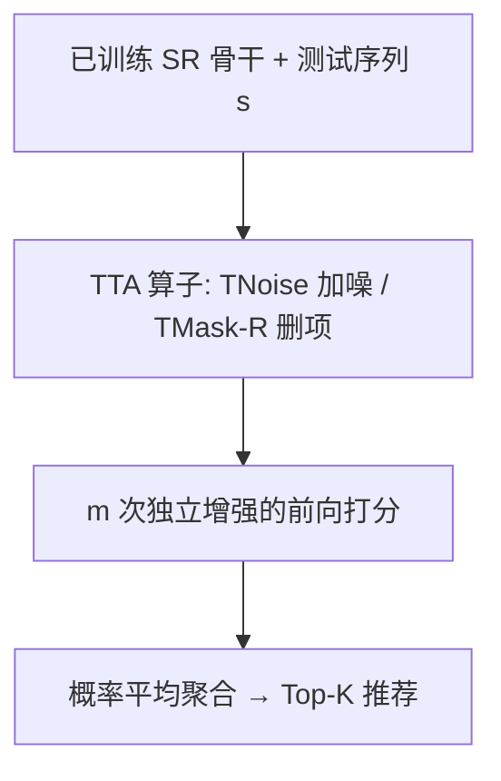

# Data Augmentation as Free Lunch: Exploring the Test-Time Augmentation for Sequential Recommendation (数据增强即免费午餐：探索序列推荐的测试时增强)

- **会议/期刊**: SIGIR 2025 (Full Paper)
- **作者与机构**: Yizhou Dang, Yuting Liu, Enneng Yang, Minhan Huang, Guibing Guo, Jianzhe Zhao, Xingwei Wang（东北大学软件学院 / 计算机学院）
- **推荐链路定位**: 重排（推理期输入增强 + 预测聚合，模型无关）
- **研究方向**: 序列与会话推荐 / 自监督对比学习与交互去噪
- **论文原文**: [https://arxiv.org/abs/2504.04843v3](https://arxiv.org/abs/2504.04843v3)
- **开源代码**: [https://github.com/KingGugu/TTA4SR](https://github.com/KingGugu/TTA4SR)

## TL;DR (1分钟核心速览)

现有序列推荐的数据增强几乎都在**训练期**进行，部署时需重训、改结构或加参数，对已训练好的大模型代价高昂。本文把增强搬到**推理期**（Test-Time Augmentation, TTA）：对测试序列做 $m$ 次增强后平均聚合预测概率。作者先实证发现 Mask/Substitute 有效（保留序列模式 + 适度扰动），但前者受未学习 mask token 干扰、后者需全库相似度检索。据此提出 **TNoise**（表征加均匀噪声）与 **TMask**（屏蔽/删除 mask 位置），零训练零参数。在 Beauty/Sports/Home/Yelp 四数据集、Leave-One-Out + Full-Ranking 协议下，TMask-R 相对最优基线平均再提升 5%–20%，推理仅增 0.1–1.9 分钟。

## Background & Motivation (背景与核心矛盾)

- **主流范式**: 序列推荐用 GRU4Rec/SASRec 等从历史序列学转移模式，但用户交互稀疏（稀疏度 99.9%+），故 CL4SRec、CoSeRec 等在**训练期**用 Crop/Mask/Reorder/Substitute/Insert 构造增强视图或对比学习信号。
- **前人局限**: ① 训练期增强部署需**重训模型**（CMRSI 在 Yelp 上重训耗时 5207 分钟）或改结构、加可学习参数；② 模型规模变大后该开销不可接受，且部分生成式增强（DiffASR、ASReP）绑定特定骨干。
- **核心洞察 (Key Insight)**: 作者实证发现，增强算子用于 TTA 时性能与其**增强后数据同原序列的相似度**强相关——Mask/Substitute 相似度最高（0.94–0.95）且效果最好，Crop/Windows 相似度最低（0.83）且常掉点。即"**保留原序列模式 + 施加适度扰动**"是 TTA 有效的关键；且用 GPT-4 识别关键交互后发现，**随机选择**恰好满足"少量关键交互 + 大量非关键交互"的理想条件。
- **本文切入点**: 既然 Mask/Substitute 已接近理想，只需修掉二者的工程缺陷（mask token 干扰、全库检索开销），即可得到更优的 TTA 算子。

## Method (核心方法设计)

### 1. 整体框架 (Overall Architecture)

模型完全复用已训练好的序列推荐骨干（GRU4Rec/SASRec/NARM/NextItNet/LightSANs/FMLP-Rec），**不重训、不改结构、不加参数**。推理时对每个测试序列 $\boldsymbol{s}$独立施加$m$次同一增强算子得到$\{\tilde{\boldsymbol{s}}_i\}_{i=1}^{m}$，分别前向得到打分分布，再按式 (8) 平均聚合后取 top-K：$\boldsymbol{v}^{*}=\text{AverageAgg}(\sum_{i=1}^{m}\text{Model}(\tilde{\boldsymbol{s}}_i))$。核心创新集中在"增强算子"这一环：TNoise 在 embedding 或隐状态上加均匀噪声，TMask 在 Look-Up 后置零或直接删除被选中位置。

### 2. 关键设计拆解 (Key Designs)

1. **TNoise（表征级均匀噪声，替代 Substitute 的检索开销）**：Substitute 需对每个被替换项在全库 $\mathcal{V}$上算相似度，复杂度$O(d|\mathcal{U}||\mathcal{V}|mn)$。TNoise 直接在 item embedding 序列$\boldsymbol{E}_u$（或编码器隐状态$\boldsymbol{H}_u$）上加均匀噪声：$\boldsymbol{E}'_u=\boldsymbol{E}_u+\boldsymbol{\epsilon},\ \boldsymbol{\epsilon}\in U(a,b)$，复杂度降为$O(d|\mathcal{U}|m)$。直觉：噪声天然不破坏序列顺序，且通过调节$(a,b)$可连续控制扰动强度，最优取$(1,0.5)$ 时增强数据相似度约 0.77，恰落在"适度扰动"区间。

2. **TMask（消除 mask token 干扰）**：原 Mask 用从未被交互过的特殊 token 占位，其 embedding 在 TTA 下**未被学习优化**却仍参与计算，构成干扰。两个变体：**TMask-B** 在 Look-Up 后将选中位置 embedding 置零，$\boldsymbol{e}'_{v_i}=\boldsymbol{0}$；**TMask-R** 更彻底，直接从序列中删除这些交互，$\boldsymbol{s}^a_u=\text{Aug}_{\text{TMask-R}}(\boldsymbol{s}_u)=[v_1,\dots,v_{|\boldsymbol{s}^a_u|}]$。删除既避免干扰，又让模型在推理期观察到被 mask 位置两侧的**高阶物品关系**，同时保留全局序列模式；操作位置仍随机选取，每序列删除$L\sigma$个（$\sigma\in(0,1)$）。

3. **训练目标、负采样与推理效率**：本文**无新增训练损失**——骨干沿用原训练目标（如 CE/BPR），TTA 仅在推理期生效，属"免负采样"的纯推理增强。推理开销：TNoise 与 TMask 均为 $O(d|\mathcal{U}|m)$，远低于 Substitute；实测 TMask-R 在 Beauty 上仅增 0.1 分钟，Yelp 上增 0.2–1.9 分钟，而 Substitute 在 Yelp 上需 76.5–113.1 分钟。

## Experimental Setup & Evaluation Protocol (实验设置与评估协议)

- **数据集与预处理**: 四个公开数据集，均做 `5-core` 过滤，最大序列长度 50：

| 数据集 | #Users | #Items | #Interactions | 稀疏度 | 场景说明 |
| :--- | :---: | :---: | :---: | :---: | :--- |
| Beauty | 22,363 | 12,101 | 198,502 | 99.92% | Amazon 美妆 |
| Sports | 35,958 | 18,357 | 296,337 | 99.95% | Amazon 运动户外 |
| Home | 66,519 | 28,237 | 551,682 | 99.97% | Amazon 家居 |
| Yelp | 213,170 | 94,304 | 3,277,392 | 99.98% | 本地商户点评 |

- **数据划分与防穿越 (Splitting Strategy)**: `Leave-One-Out`（最后一项测试、倒数第二项验证、其余训练）。
- **排名评测协议 (Ranking Protocol)**: 无偏 `Full-Ranking`（全库未交互物品排序），明确拒绝负采样排序以避免偏差；指标 H@K、N@K，$K\in\{5,10,20\}$。
- **对比基线与超参设置**: 基线含 6 个训练期算子（Crop/Reorder/Windows/Mask/Substitute/Insert）、组合算子 CMR/CMRSI、训练期对比学习 CL4SRec；骨干含 GRU4Rec/SASRec 及泛化实验的 NARM/NextItNet/LightSANs/FMLP-Rec。Embedding 维度 $d=64$，batch 256，Adam lr=1e-3，$m=10$，五次运行取均值。

## Key Experimental Results (实验关键数据)

### 1. 主实验对比 (Main Results)

以 SASRec 骨干为例（H@10 / N@10，Full-Ranking）：

| 方法 | Beauty H@10 | Beauty N@10 | Sports H@10 | Sports N@10 | Home H@10 | Home N@10 | Yelp H@10 | Yelp N@10 | 推理时间(Beauty/Yelp) |
| :--- | :---: | :---: | :---: | :---: | :---: | :---: | :---: | :---: | :---: |
| SASRec (Base) | 0.0584 | 0.0310 | 0.0317 | 0.0161 | 0.0160 | 0.0081 | 0.0253 | 0.0124 | 0.1 / 4.5 |
| + Mask | 0.0603 | 0.0317 | 0.0352 | 0.0181 | 0.0165 | 0.0084 | 0.0268 | 0.0131 | 0.1 / 6.3 |
| + Substitute | 0.0613 | 0.0329 | 0.0369 | 0.0195 | 0.0186 | 0.0096 | 0.0279 | 0.0136 | 0.7 / 113.1 |
| + CMR | 0.0563 | 0.0295 | 0.0332 | 0.0162 | 0.0167 | 0.0085 | 0.0256 | 0.0127 | 0.1 / 6.4 |
| + CMRSI | 0.0585 | 0.0308 | 0.0343 | 0.0175 | 0.0175 | 0.0090 | 0.0274 | 0.0134 | 0.7 / 109.8 |
| + TNoise (Ours) | 0.0653 | 0.0345 | 0.0422 | 0.0213 | 0.0195 | 0.0099 | 0.0293 | 0.0147 | 0.1 / 6.1 |
| + TMask-B (Ours) | 0.0584 | 0.0307 | 0.0355 | 0.0179 | 0.0161 | 0.0082 | 0.0264 | 0.0129 | 0.1 / 6.0 |
| **+ TMask-R (Ours)** | **0.0646** | **0.0344** | **0.0432** | **0.0225** | **0.0197** | **0.0101** | **0.0299** | **0.0146** | **0.1 / 6.4** |
| Improv. (vs Base) | +11.82% | +11.29% | +36.28% | +39.75% | +23.13% | +24.69% | +18.18% | +18.55% | — |

GRU4Rec 上 TMask-R 提升更显著：Sports H@10 从 0.0157→0.0274（+74.52%），Home H@10 从 0.0063→0.0109（+73.02%）。

### 2. 消融实验 (Ablation Study)

以 SASRec 在 Beauty/Sports 上 H@10 为例，对比不同增强位置选择策略（KF=优先改关键交互，NKF=优先改非关键，FR=固定比例）：

| 变体 | Beauty H@10 | Sports H@10 | 说明 |
| :--- | :---: | :---: | :--- |
| Base | 0.0584 | 0.0317 | 无增强 |
| + Mask（随机） | 0.0603 | 0.0352 | 随机选择 |
| + Mask-KF | 0.0537 | 0.0295 | 改关键交互，**低于 Base** |
| + Mask-NKF | 0.0574 | 0.0323 | 仅改非关键，增益微弱 |
| + Substitute（随机） | 0.0613 | 0.0369 | 随机选择 |
| + Substitute-KF | 0.0561 | 0.0300 | 显著掉点 |
| + Substitute-NKF | 0.0593 | 0.0326 | 增益有限 |
| + TMask-B | 0.0584 | 0.0355 | 置零，部分场景掉点 |
| + TMask-R | **0.0646** | **0.0432** | 删除，最优 |

### 3. 关键实验发现 (Key Findings)

1. **"适度扰动"是 TTA 的胜负手，且可量化**：增强数据与原序列相似度与性能呈倒 U 型——Mask/Substitute 相似度 0.94–0.95 最优，Crop/Windows 仅 0.83 常掉点；TNoise 在 $(a,b)=(1,0.5)$ 时相似度 0.77 达峰值，噪声过小（0.9999）或过大（0.7055）均退化，说明存在最优扰动区间而非"越强越好"。
2. **随机选择优于任何"智能"选择**：用 GPT-4 识别关键交互后，KF 变体在 Beauty 上把 SASRec 从 0.0584 打到 0.0537（低于 Base），NKF 几乎无增益；唯有随机选择同时满足"少量关键 + 大量非关键"，反超所有定向策略——这是一个反直觉但可复用的结论。
3. **TMask-R 是"性价比之王"，但 TNoise 依赖骨干**：TMask-R 在 4 骨干上平均提升 14.85%/30.80%/17.04%/18.89%，且推理仅增 0.1–1.9 分钟；而 TNoise 在 GRU4Rec 上几乎无增益（RNN 对噪声不敏感且噪声沿时间步累积），在 SASRec 上却提升 11.8%，说明加噪类 TTA 更适合全局注意力的 Transformer 骨干。

## Highlights & Limitations (亮点、对比与审稿批判)

- **与代表作对比 (vs. Prior Work)**: 相比 CL4SRec/CoSeRec 等训练期增强，本文**零重训、零参数、模型无关**，部署成本从数百至数千分钟重训降至分钟级推理；相比 CV 领域的 TTA 与图上的 TAG-CF，本文首次系统回答"哪些序列增强算子适合 TTA、为什么、如何改进"三连问，并给出可解释的相似度—扰动分析框架。
- **可迁移亮点**: ① "增强后相似度"可作为筛选任意 TTA 算子的低成本代理指标，无需逐个大搜；② TMask-R 的"推理期随机删项"技巧可直接插入任何已上线序列模型做免费涨点，尤其适合无法重训的大模型场景。
- **审稿级局限批判**: ① 性能仍普遍低于训练期对比学习 CL4SRec（如 SASRec/Beauty H@10 0.0646 vs 0.0721），TTA 更像"锦上添花"而非替代；② 推理需 $m=10$ 次前向，线上 QPS 敏感场景成本翻十倍，且 TNoise 对 RNN 骨干失效、TMask-B 偶发掉点，算子选择仍依赖人工试错，缺乏理论保证。

## Rating (四维评分)

- **方法创新性 (Novelty)**: ⭐⭐⭐⭐ （首次系统迁移 TTA 到序列推荐，TNoise/TMask 简洁但切中 mask token 未学习这一被忽视的工程痛点）
- **评估协议与实验扎实度 (Protocol & Experiments)**: ⭐⭐⭐⭐⭐ （四数据集 + 六骨干 + Full-Ranking 无偏协议 + 五次均值 + 推理耗时对比，实证链条完整）
- **写作与数学规范度 (Clarity & Rigor)**: ⭐⭐⭐⭐ （Q1→Q2→Q3 递进式叙事清晰，公式简洁；但缺理论支撑，作者自认留待未来）
- **工业落地与复现价值 (Industrial & Practical Value)**: ⭐⭐⭐⭐⭐ （零重训零参数、代码开源、分钟级部署开销，是难得的"免费午餐"型工程技巧）

