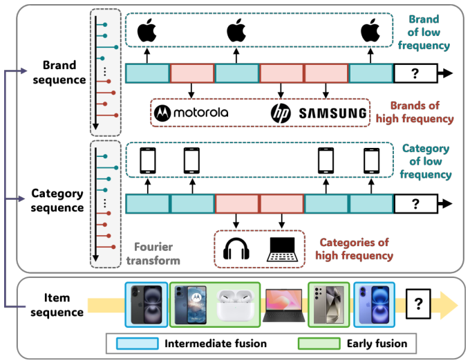
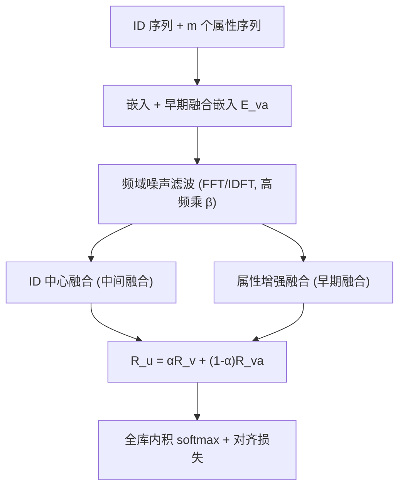
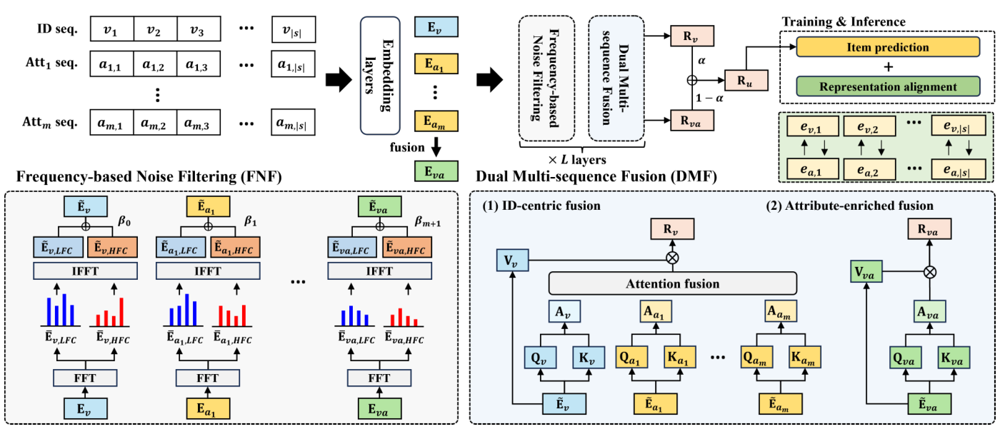

# DIFF: Dual Side-Information Filtering and Fusion for Sequential Recommendation (双重侧信息滤波与融合的序列推荐)

- **会议/期刊**: SIGIR 2025
- **作者与机构**: Hye-young Kim, Minjin Choi, Sunkyung Lee, Ilwoong Baek, Jongwuk Lee（成均馆大学 / 三星研究院）
- **推荐链路定位**: 召回（序列编码器）
- **研究方向**: 序列与会话推荐 / 多模态推荐（属性侧信息）
- **论文原文**: [https://arxiv.org/abs/2505.13974v1](https://arxiv.org/abs/2505.13974v1)
- **开源代码**: [https://github.com/HyeYoung1218/DIFF](https://github.com/HyeYoung1218/DIFF)

## TL;DR (1分钟核心速览)

侧信息融合序列推荐（SISR）存在两大痛点：物品序列中混入误点击/短期漂移等噪声信号，且现有中间融合仅用属性"指导"ID 注意力、从不把属性真正写进用户表征。DIFF 提出频域噪声滤波（对 ID、各属性、融合序列分别做 DFT 后压低高频分量）+ 双重多序列融合（ID 中心中间融合 + 属性增强早期融合，加权聚合），并用对比对齐损失防止信息入侵。在 Yelp/Beauty/Sports/Toys 四个数据集、Leave-One-Out + Full-Ranking 协议下，R@20 与 N@20 分别最高提升 14.1% 与 12.5%。

## Background & Motivation (背景与核心矛盾)

- **主流范式**: SISR 按融合位置分三派——早期融合（GRU4RecF/SASRecF 输入层拼接）、晚期融合（FDSA 分离注意力块）、中间融合（NOVA/DIF-SR/ASIF 用属性注意力权重引导 ID 的 Q/K）。
- **前人局限**: ① 所有方法把整条序列全量编码，误点击与短期意图漂移直接污染用户表征；DLFSRec 虽引入频域可学习滤波器，但只作用于多序列、忽略序列级去噪。② 中间融合只把属性用于算注意力分数，最终表征仍由 ID 的 value 矩阵聚合，属性中的跨属性协同信号被丢弃。
- **核心洞察 (Key Insight)**: 频域中低频分量对应长期稳定兴趣、高频分量对应短期波动噪声（图 1 中第四个物品信号不一致应被滤除）；且中间融合擅长"属性内"相关性、早期融合擅长"属性间"组合模式，二者互补而非替代。
- **本文切入点**: 对每条序列独立做频域滤波，再把早期与中间融合显式并联成"双重融合"，用对齐损失消解早期融合固有的信息入侵。

<figure class="paper-figure" markdown="span">
  <figcaption>图 1：(i) 侧信息集成序列推荐中的频率信号与 (ii) 融合类型。基于频率的噪声过滤移除了信号不一致的第四个物品。中间融合（蓝色）突出与关键信号对齐的物品，而早期融合（绿色）捕获更广泛的组合。</figcaption>
</figure>

## Method (核心方法设计)

### 1. 整体框架 (Overall Architecture)

输入用户序列的物品 ID 与 $m$个属性序列，先各自嵌入并额外构造早期融合嵌入$\mathbf{E}_{va}$；$L$层 Transformer 中每层并行执行两个组件：频域噪声滤波（对 ID、每个属性、融合序列分别 FFT→截断低频→IDFT→加权重组高频）与双重多序列融合（ID 中心融合输出$\mathbf{R}_v$、属性增强融合输出$\mathbf{R}_{va}$，按$\alpha$加权得$\mathbf{R}_u$）。训练时联合交叉熵推荐损失与 ID-属性对比对齐损失，推理取末位置表征与全库物品内积做 softmax。

<figure class="paper-figure" markdown="span">
  <figcaption>图 3：DIFF 概览。DIFF 通过 𝐿 层两个组件处理独立序列和早期融合序列：(i) 基于频率的噪声过滤和 (ii) 双重多序列融合。DIFF 生成充分整合物品属性的过滤后用户表示。带有表示对齐的多任务学习确保 ID-属性融合平滑进行。</figcaption>
</figure>

### 2. 关键设计拆解 (Key Designs)

1. **频域噪声滤波（Frequency-based Noise Filtering）**：痛点是把短期波动当兴趣。对每条序列做 DFT 后按前 $c$行切出低频$\bar{\mathbf{E}}_{LF}$与高频$\bar{\mathbf{E}}_{HF}$，IDFT 回时域后以可学习标量$\beta$缩放高频再相加：$\tilde{\mathbf{E}}_v=\tilde{\mathbf{E}}_{v,LF}+\beta_0\tilde{\mathbf{E}}_{v,HF}$，属性与融合序列同理各配$\beta_k$。直觉是低频承载稳定偏好、高频承载噪声，$\beta$ 被训练到极小值即自动完成"软去噪"，且对 ID/属性分别滤波避免了跨序列信号错配。

2. **双重多序列融合（Dual Multi-sequence Fusion）**：痛点单一融合视角受限。ID 中心融合把各属性注意力矩阵与 ID 注意力矩阵融合后只聚合 ID 的 value：$\mathbf{R}_v^h=\mathrm{softmax}\big(\mathrm{Fusion}(\mathbf{A}_v^h,\dots,\mathbf{A}_{a_m}^h)/\sqrt{d_h}\big)\mathbf{V}_v^h$，捕获属性内细粒度相关；属性增强融合直接对$\tilde{\mathbf{E}}_{va}$做自注意力$\mathbf{R}_{va}^h=\mathrm{softmax}(\mathbf{A}_{va}^h/\sqrt{d_h})\mathbf{V}_{va}^h$，显式建模跨属性组合。最终$\mathbf{R}_u=\alpha\mathbf{R}_v+(1-\alpha)\mathbf{R}_{va}$，让"精准聚焦"与"广泛覆盖"共存。

3. **训练目标、负采样与推理效率**：总损失 $\mathcal{L}=\mathcal{L}_{rec}+\lambda\mathcal{L}_{align}$，其中$\mathcal{L}_{align}$以属性融合嵌入的相等性构造 0/1 标签矩阵$\mathbf{Y}$，对$\mathrm{softmax}(\mathbf{E}_v\mathbf{E}_a^\top/\tau)$做双向对称对比，把 ID 与属性拉入同一语义空间以抑制信息入侵。训练采用全库 softmax 交叉熵（**免负采样**），推理仅需一次前向 + 全库内积，FFT 为$O(|s|\log|s|)$ 开销可忽略。

## Experimental Setup & Evaluation Protocol (实验设置与评估协议)

- **数据集与预处理**: 均采用 `5-core` 过滤，属性为 category/brand/position（Yelp 为 category/city/position）：

| 数据集 | #Users | #Items | #Interactions | 稀疏度 | 场景说明 |
| :--- | :---: | :---: | :---: | :---: | :--- |
| Yelp | 30,449 | 20,068 | 317,182 | 99.95% | 本地商户，重复交互多 |
| Beauty | 22,363 | 12,101 | 198,502 | 99.93% | Amazon 评论 |
| Sports | 35,598 | 18,357 | 296,337 | 99.95% | Amazon 评论 |
| Toys | 19,412 | 11,924 | 167,597 | 99.93% | Amazon 评论 |

- **数据划分与防穿越**: `Leave-One-Out`——末位测试、倒数第二位验证、其余训练；序列最大长度 50。
- **排名评测协议**: 无偏 `Full-Ranking`（全库未交互物品排序），且**不惩罚**历史已交互物品（作者指出惩罚会在 Yelp 这类重复交互数据集上造成偏差估计）；指标 R@{10,20}、N@{10,20}。
- **对比基线与超参设置**: SR 基线 SASRec/DuoRec/FMLPRec/BSARec，SISR 基线 GRU4RecF/SASRecF/S3-Rec/DLFSRec/FDSA/NOVA/DIF-SR/MSSR/ASIF；嵌入维度与 batch 均为 256，层数/头数 2，$c$取 3（Toys 取 5），$\alpha\in\{0.1,\dots,0.9\}$、$\lambda\in\{1,\dots,100\}$网格调参，5 次随机种子均值 + 配对 t 检验（$p<0.05$）。

## Key Experimental Results (实验关键数据)

### 1. 主实验对比 (Main Results)

| 数据集 | 指标 | SASRec | FMLPRec | DLFSRec | DIF-SR | MSSR | ASIF | **DIFF** | Improv. |
| :--- | :--- | :---: | :---: | :---: | :---: | :---: | :---: | :---: | :---: |
| Yelp | R@20 | 0.0875 | 0.1029 | 0.0857 | 0.0998 | 0.1040 | 0.1052 | **0.1200** | +14.1% |
| Yelp | N@20 | 0.0451 | 0.0506 | 0.0388 | 0.0493 | 0.0507 | 0.0510 | **0.0567** | +11.1% |
| Beauty | R@20 | 0.1191 | 0.1239 | 0.1217 | 0.1281 | 0.1256 | 0.1322 | **0.1347** | +1.9% |
| Beauty | N@20 | 0.0511 | 0.0522 | 0.0448 | 0.0542 | 0.0548 | 0.0564 | **0.0632** | +12.0% |
| Sports | R@20 | 0.0709 | 0.0743 | 0.0656 | 0.0784 | 0.0809 | 0.0827 | **0.0853** | +3.2% |
| Sports | N@20 | 0.0287 | 0.0295 | 0.0246 | 0.0314 | 0.0326 | 0.0333 | **0.0381** | +12.5% |
| Toys | R@20 | 0.1225 | 0.1302 | 0.1260 | 0.1379 | 0.1405 | 0.1393 | **0.1425** | +1.3% |
| Toys | N@20 | 0.0521 | 0.0541 | 0.0475 | 0.0597 | 0.0607 | 0.0593 | **0.0656** | +8.1% |

### 2. 消融实验 (Ablation Study)

| 配置 | Yelp R@20 | Beauty R@20 | Sports R@20 | Toys R@20 | 平均 N@20 |
| :--- | :---: | :---: | :---: | :---: | :---: |
| w/o FNF | 0.1045 | 0.1289 | 0.0843 | 0.1373 | 0.0516 |
| w/o IF | 0.1174 | 0.1290 | 0.0795 | 0.1357 | 0.0554 |
| w/o AF | 0.1185 | 0.1334 | 0.0851 | 0.1459 | 0.0519 |
| w/o RA | 0.1114 | 0.1300 | 0.0827 | 0.1357 | 0.0514 |
| **DIFF** | **0.1200** | **0.1347** | **0.0853** | **0.1420** | **0.0559** |

### 3. 关键实验发现 (Key Findings)

1. **频域滤波是最大增益源**：移除 FNF 后 Yelp R@20 从 0.1200 掉到 0.1045（-12.9%），且噪声注入实验中 25% 替换率下 DIFF 在 Yelp 仅降 21.4%，而 DIF-SR/MSSR/ASIF 降 26.6%–32.9%，证明高频抑制确实在过滤误点击而非简单平滑。
2. **两种融合互补而非冗余**：单独去掉 IF 或 AF 均使平均 N@20 从 0.0559 降至 0.0554/0.0519，其中 AF 缺失在 Beauty 上损失最大（N@20 0.0632→0.0576），说明跨属性组合信号对稀疏品类尤为关键；案例研究（图 9）显示 IF 高亮同品类强相关物品、AF 覆盖更多弱相关但多样的物品。
3. **长尾与短序列受益最明显**：Tail 组 Yelp 提升达 38.9%、Beauty 10.3%；长度 ≤5 的短序列组 R@20 在 Yelp/Beauty 分别提升 15.8%/10%，说明属性侧信息在交互稀疏时承担了主要信号来源，具备冷启动迁移潜力。

## Highlights & Limitations (亮点、对比与审稿批判)

- **与代表作对比 (vs. Prior Work)**: 相比 DIF-SR/ASIF 的纯中间融合，DIFF 首次把早期融合并联进来并显式对齐嵌入空间，绕开信息入侵；相比 DLFSRec 的分布式可学习滤波器，DIFF 的滤波是序列级、逐属性独立的，且不引入高斯分布假设；相比 FMLPRec/BSARec 的纯 ID 频域方法，DIFF 把频域去噪扩展到多序列侧信息场景。
- **可迁移亮点**: ① "低频=长期兴趣、高频=噪声"的可学习 $\beta$ 缩放是一种极轻量的序列去噪插件，可直接插到任意 Transformer 序列编码器的嵌入层前；② 用属性相等性构造标签矩阵做双向对比对齐，是低成本缓解多源嵌入空间错配的通用手段。
- **审稿级局限批判**: ① 频域截断点 $c$需按数据集手工调（3 或 5），缺乏自适应选择机制，对序列长度分布敏感；② 双重融合使每层注意力计算量约为单融合的$m+2$ 倍，论文未报告训练/推理时延与显存对比；③ 仅在 Amazon/Yelp 四个数据集验证，属性类型固定为类别型离散字段，未涉及文本/图像等连续侧信息。

## Rating (四维评分)

- **方法创新性 (Novelty)**: ⭐⭐⭐⭐ （频域逐序列去噪 + 早期/中间双重融合的组合思路清晰且互补性强，但单点技术均为已有模块的巧妙重组）
- **评估协议与实验扎实度 (Protocol & Experiments)**: ⭐⭐⭐⭐ （四数据集 Full-Ranking + 5 种子 t 检验 + 消融/长尾/短序列/噪声鲁棒性/超参/案例六重分析齐全，唯缺效率对比）
- **写作与数学规范度 (Clarity & Rigor)**: ⭐⭐⭐⭐ （融合分类三分法与公式推导条理清楚，$\beta$、$\alpha$、$\lambda$ 的作用均有实验佐证，符号略密）
- **工业落地与复现价值 (Industrial & Practical Value)**: ⭐⭐⭐⭐ （基于 RecBole 实现且代码开源，滤波为 $O(|s|\log|s|)$ 轻量算子，但多序列并行注意力的线上开销需实测）

