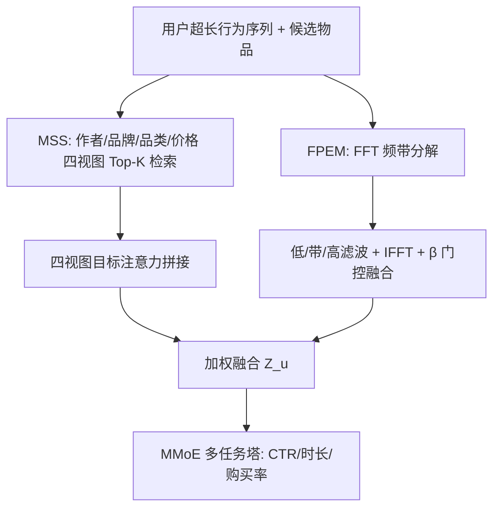
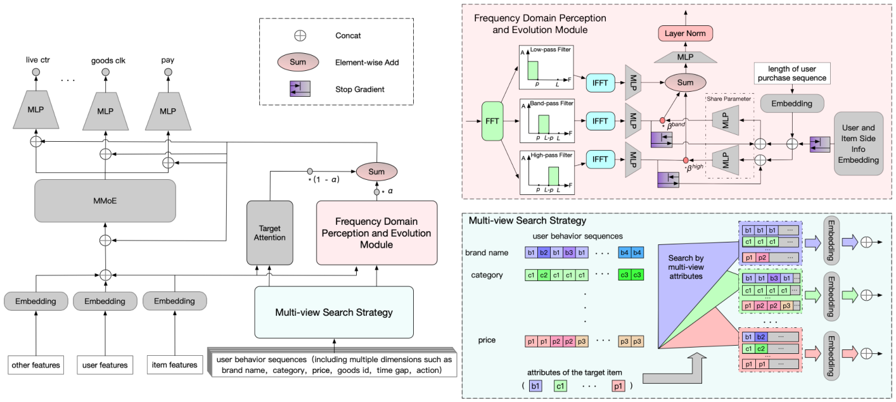

# FIM: Frequency-Aware Multi-View Interest Modeling for Local-Life Service Recommendation (频域感知多视图兴趣建模的本地生活服务推荐)

- **会议/期刊**: SIGIR 2025
- **作者与机构**: Guoquan Wang, Qiang Luo, Weisong Hu, Pengfei Yao, Wencong Zeng, Guorui Zhou, Kun Gai（快手科技）
- **推荐链路定位**: 精排（CTR/CVR 多任务预估）
- **研究方向**: 序列与会话推荐 / 时空轨迹与 POI 本地生活推荐
- **论文原文**: [https://arxiv.org/abs/2504.17814v3](https://arxiv.org/abs/2504.17814v3)
- **开源代码**: 暂未开源

## TL;DR (1分钟核心速览)

本地生活场景中用户的多类需求（餐饮日频、出行季频）周期混杂，且受节假日/大促扰动而动态漂移。本文提出 FIM：用多视图搜索（作者/品牌/品类/价格四视角）从超长行为序列中分离不同周期意图，再用 FFT 将子序列转入频域，以低/带/高通滤波 + 门控 β 融合 + 残差演化捕捉重复性与探索性偏好。在 Book/Taobao/Kuaishou 三数据集上 AUC 相对最优基线提升 0.86%–1.19%，Kuaishou 线上 A/B 的 GMV 提升 8.46%。

## Background & Motivation (背景与核心矛盾)

- **主流范式**: 长序列兴趣建模以 SIM/TWIN/QIN/ETA 为代表，采用「GSU 粗筛 + ESU 精算」两阶段目标注意力，粗筛普遍只按**品类**单视图匹配。
- **前人局限**: ① 本地生活用户需求周期各异（日频饮品 vs 季频出行），单品类视图无法把混杂在同一序列中的多周期意图拆开；② 频域序列推荐（FMLP-Rec/FEARec/BSARec）只把 FFT 当作**去噪工具**，忽略了本地生活场景中「周期性」本身才是核心信号，且未建模节假日/大促导致的周期漂移。
- **核心洞察 (Key Insight)**: 周期性行为在时域被噪声与多需求叠加所掩盖，但在频域中表现为可分离的频带——低频对应长期重复习惯，高频对应突发探索性消费（如母亲节买花、大促囤券）。
- **本文切入点**: 先用多视图搜索把「多周期需求」在时域上解耦成多条子序列，再对每条子序列做频带分解与门控融合，实现「先分离、再感知、后演化」。

## Method (核心方法设计)

### 1. 整体框架 (Overall Architecture)

输入为用户超长行为序列与候选物品；MSS 模块以候选物品的作者、品牌、品类、价格四个视角分别做 Top-K 相关性检索，得到 4 条短子序列，各自过目标注意力后拼接为时域兴趣向量 $\bar{H}_u$；FPEM 模块对序列嵌入做 FFT，切分为低/带/高三个频带，经 IFFT 回时域后用门控$\beta$抑制中高频噪声并残差融合，得到频域兴趣向量$\bar{f}_u$；二者按系数$\alpha$ 加权融合后送入 MMoE 多任务塔（点击率、观看时长、购买率），以 BCE 损失端到端训练。

<figure class="paper-figure" markdown="span">
  <figcaption>图2：所提出的FIM的流程。它包含三个主要组件：多视图搜索模块、频域感知与演化模块，以及结合MMoE的预测模块。</figcaption>
</figure>

### 2. 关键设计拆解 (Key Designs)

1. **多视图搜索策略 MSS（把混杂周期需求拆开）**：痛点在于 SIM 式单品类硬检索会漏掉「同价位不同品类」的周期行为。MSS 对第 $v$个视图（$v\in\{$作者, 品牌, 品类, 价格$\}$）计算相关性并取 Top-K：
$$r_i=\begin{cases}\mathrm{sign}(m_i^v,m_t^v) & \text{hard-search}\\ (\boldsymbol{W}_b e_i^v)\odot(\boldsymbol{W}_t e_t^v) & \text{soft-search}\end{cases}$$
四视图输出拼接后作为目标注意力的 key/value。直觉：价格视图刻画消费能力层级、品牌视图刻画品质偏好，多视角并集比单品类更能覆盖用户的潜在周期行为。

2. **频域感知与演化模块 FPEM（动态感知周期漂移）**：对序列嵌入做 FFT 得 $F_u=\mathcal{F}(E_u)$，用带通掩码$\mathrm{filter}(c)=\mathbb{I}[c\in[c_b,c_e)]$构造低通（$[0,p)$，长期重复习惯）、高通（$[L-p,L)$，突发探索消费）、带通（$[p,L-p)$，中间节奏）三路，IFFT 回时域后以目标注意力式门控抑制中高频噪声：
$$\beta_{band}=\sigma(\boldsymbol{W}_2\phi(\boldsymbol{W}_1 X_{band}+\boldsymbol{B}_1)+\boldsymbol{B}_2),\quad f_u^{fuse}=f_u^{low}+\beta_{band}f_u^{band}+\beta_{high}f_u^{high}$$
最终 $f_u=\mathrm{LayerNorm}(f_u^{fuse}+E_u)$。关键工程细节：门控输入$X$中用户/物品侧信息与序列长度的嵌入**只保留序列长度梯度回传**，避免同一特征在不同模块间梯度干扰。复杂度$O(I\log I+I D^2)$，低于 FEARec/BSARec 的$O(I^2 D+I D^2)$。

3. **训练目标与推理开销**：总损失为多任务 BCE 之和 $\mathcal{L}=-\sum_k[y_k\log\hat{y}_k+(1-y_k)\log(1-\hat{y}_k)]$；检索阶段为硬匹配/内积打分，无需负采样。线上部署额外时延 +11.245%，但 MSS 与 FPEM 合计带来 6.37% 的离线时间改善（相对基线）。

## Experimental Setup & Evaluation Protocol (实验设置与评估协议)

- **数据集与预处理**:

| 数据集 | #Users | #Items | #Interactions | 稀疏度/密度 | 特征/场景说明 |
| :--- | :---: | :---: | :---: | :---: | :--- |
| Book (Amazon) | 未披露 | 未披露 | 每用户 100 条（10 短期 + 90 长期） | — | 沿用 SIM 预处理，长序列兴趣建模 |
| Taobao | 未披露 | 未披露 | 2017.11.25–12.03 行为日志 | — | 点击为负、加购/收藏/购买为正 |
| Kuaishou | 10% 随机采样用户 | 百万级商品空间 | 2024.04.21–05.20 一个月日志 | — | 9 维属性（商品/作者/来源域/行为/品牌/品类/时间/价格/金额） |

- **数据划分与防穿越 (Splitting Strategy)**: Taobao 用**全局时间戳切分**（12.01 前训练、最后一天测试）；Kuaishou 前 23 天训练、后 7 天测试；Book 按用户序列位置切分（最近 10 条为短期、前 90 条为长期）。
- **排名评测协议 (Ranking Protocol)**: 采用**工业级 CTR 预估协议**，报告 AUC 与 GAUC（按用户加权平均 AUC），非 Full-Ranking 全库排序；未使用负采样排序评估。
- **对比基线与超参设置**: 基线含短序列（DIN/DIEN/Caser/SASRec）、长序列检索（SIM-Hard/SIM-Soft/ETA/QIN/TWIN）与频域 SOTA（BSARec）共 11 个；Embedding 维度 Taobao/Book 为 4、Kuaishou 为 16，学习率 0.01，batch 分别为 256/256/6144，$\alpha=0.5$；报告 5 次运行标准差。

## Key Experimental Results (实验关键数据)

### 1. 主实验对比 (Main Results)

| 数据集 | 指标 | DIN | DIEN | SASRec | BSARec | SIM-Hard | QIN | TWIN | **FIM-Soft** | Improv. |
| :--- | :---: | :---: | :---: | :---: | :---: | :---: | :---: | :---: | :---: | :---: |
| Book | AUC | 0.7331 | 0.7411 | 0.7324 | 0.7325 | 0.7331 | 0.7494 | 0.7479 | **0.7583** | +1.19% |
| Book | GAUC | 0.7108 | 0.7146 | 0.7128 | 0.7038 | 0.7069 | 0.7278 | 0.7259 | **0.7341** | +0.87% |
| Taobao | AUC | 0.7937 | 0.8010 | 0.7981 | 0.7963 | 0.7925 | 0.8036 | 0.8056 | **0.8130** | +0.92% |
| Taobao | GAUC | 0.6682 | 0.6805 | 0.6745 | 0.6767 | 0.6683 | 0.6884 | 0.6876 | **0.7004** | +1.74% |
| Kuaishou | AUC | 0.8888 | 0.8820 | 0.8900 | 0.8927 | 0.8930 | 0.8879 | 0.8862 | **0.9007**(Hard) | +0.86% |
| Kuaishou | GAUC | 0.6398 | 0.6405 | 0.6363 | 0.6487 | 0.6698 | 0.6476 | 0.6467 | **0.6944**(Hard) | +3.67% |

注：Kuaishou 上软检索类方法（SIM-Soft/ETA/QIN/TWIN）普遍劣于硬检索，因候选与用户空间巨大、软匹配难收敛，故 FIM-Hard 为最优。

### 2. 消融实验 (Ablation Study)

| 配置 | Param (M) | Time Improv. | AUC (%) | GAUC (%) |
| :--- | :---: | :---: | :---: | :---: |
| 无 MSS 无 FPEM（基线） | 35.41 | — | 88.58 | 64.70 |
| 仅 FPEM | 35.60 | +0.91% | 89.50 | 67.41 |
| 仅 MSS（四视图） | 36.76 | +5.25% | 90.01 | 67.54 |
| **MSS + FPEM（完整 FIM）** | 36.93 | +6.37% | **90.07** | **69.44** |

FPEM 即插即用验证（Table 3）：DIN/SIM/ETA/QIN/TWIN 接入 FPEM 后 AUC 全面 +0.15%~+0.65%、GAUC +0.18%~+1.67%，推理速度不降反升（SIM +2.91%、QIN +2.95%）。FPEM 内部设计（Table 4）：截断法优于 Butterworth 滤波（Book AUC +1.73%），$\beta$ 门控融合优于直接相加（Taobao AUC +0.68%）。

### 3. 关键实验发现 (Key Findings)

1. **多视图是主要增益来源，价格视图贡献最大**：仅加 MSS 即把 GAUC 从 64.70% 拉到 67.54%（+2.84pt），远超 FPEM 单独带来的 +2.71pt；单视图消融中价格视图 GAUC 达 65.95%，而作者视图仅 64.24%——同作者商品品类发散，价格才真正刻画消费能力层级。
2. **FPEM 的增益集中在 GAUC 而非 AUC**：完整模型相对仅 MSS 的 AUC 仅 +0.06pt，但 GAUC +1.90pt，说明频域周期信号主要改善**用户间排序一致性**（个性化区分度），而非全局判别力，这与「周期是用户个体属性」的直觉吻合。
3. **中高频必须被门控抑制而非直接保留**：截断位置 $p$ 在 Book 上取 5、Taobao 上取 2 时 AUC/GAUC 达峰后回落，直接融合高频（探索性噪声）会使 Taobao AUC 掉 0.68%，验证了「低频=重复习惯、高频=噪声主导」的频带先验。

## Highlights & Limitations (亮点、对比与审稿批判)

- **与代表作对比 (vs. Prior Work)**: 相比 SIM/TWIN/QIN 的「单品类检索 + 时域注意力」，FIM 把检索维度从 1 扩到 4 并在频域显式建模周期；相比 FEARec/BSARec 把 FFT 用于去噪/缓解过平滑，FIM 把频带作为**周期语义的载体**并引入门控演化，且复杂度从 $O(I^2D)$降至$O(I\log I)$。
- **可迁移亮点**: ① FPEM 是即插即用模块，可直接挂到任意长序列模型上且不增推理时延；② 「侧信息嵌入只回传序列长度梯度」的梯度隔离技巧，可推广到任何多模块共享特征输入的排序模型。
- **审稿级局限批判**: ① 频带截断位置 $p$ 为数据集相关超参（Book 取 5、Taobao 取 2），缺乏自适应频带选择机制，跨场景迁移需重新调参；② 线上时延增加 11.245% 且未报告与 TWIN 等高效检索方案在同延迟预算下的公平对比；③ 公共数据集（Book/Taobao）缺少本地生活属性（品牌/价格字段不全），多视图优势主要在工业数据上验证，外部可复现性受限。

## Rating (四维评分)

- **方法创新性 (Novelty)**: ⭐⭐⭐⭐ （将频域从「去噪工具」重构为「周期语义载体」，多视图检索 + 频带门控的组合在本地生活场景有明确物理直觉）
- **评估协议与实验扎实度 (Protocol & Experiments)**: ⭐⭐⭐⭐ （三数据集 + 11 基线 + 5 次运行方差 + 两周线上 A/B，但公共数据集缺本地生活属性、未做全库排序评估）
- **写作与数学规范度 (Clarity & Rigor)**: ⭐⭐⭐⭐ （公式与频带定义清晰、复杂度分析完整，但部分符号如 $X_{band}$ 的构造与梯度隔离描述略简）
- **工业落地与复现价值 (Industrial & Practical Value)**: ⭐⭐⭐⭐ （已在快手本地生活全量部署、GMV +8.46%，FPEM 即插即用且不增时延，但代码未开源、频带超参需逐场景调优）

