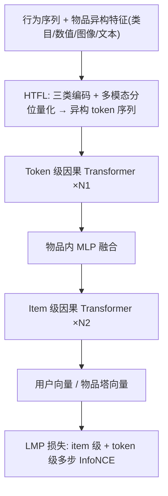
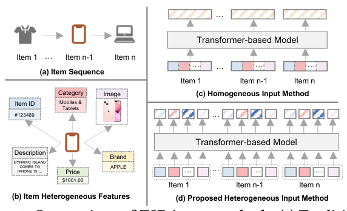
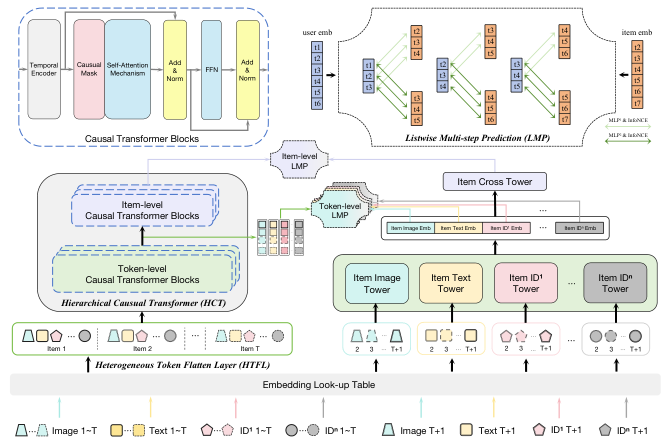

# HeterRec: Heterogeneous Information Transformer for Scalable Sequential Recommendation (面向可扩展序列推荐的异构信息 Transformer)

- **会议/期刊**: SIGIR 2025
- **作者与机构**: Hao Deng, Haibo Xing, Kanefumi Matsuyama, Jinxin Hu 等（阿里巴巴国际数字商业集团、Lazada、广州大学、武汉大学）
- **推荐链路定位**: 召回（双塔 EBR 用户侧建模）
- **研究方向**: 序列与会话推荐 / 生成式推荐（Token 化输入）
- **论文原文**: [https://arxiv.org/abs/2503.01469v3](https://arxiv.org/abs/2503.01469v3)
- **开源代码**: 暂未开源

## TL;DR (1分钟核心速览)

现有 Transformer 序列推荐（TSR）把物品的多模态/类别/数值特征拼接或经 MLP 聚合成**同质**物品向量序列，既丢失特征级细粒度模式，又使模型堆叠层数时收益饱和。HeterRec 借鉴 LLM 的 tokenization 思想，将每个物品拆成异构 token 集并按行为时序展平为异构序列，用 token 级 + item 级两层因果 Transformer 提取细粒度模式，并配以列表级多步预测（LMP）损失。在工业广告数据集与 Amazon Electronics 上，Full-Ranking 协议下 Recall@100 相对最优基线 HSTU 分别提升 3.81% 与 4.17%，线上 A/B 广告收入 +1.93%、CTCVR +1.63%。

## Background & Motivation (背景与核心矛盾)

- **主流范式**: TSR 先抽取物品的文本、图像、类目等异构特征，再经拼接或神经网络聚合为同质物品表征序列，交由 Transformer 建模用户兴趣。
- **前人局限**: 其一，拼接/聚合把多源特征压成单向量，Transformer 无法区分"同一物品内不同特征"与"跨物品同质特征"的交互信号，细粒度模式被抹平；其二，HSTU 等虽引入异构序列，却只纳入**用户侧**特征（关注作者、用户画像），**物品侧**关键异构特征仍被排除，导致模型扩容（堆层）时性能增益受限。
- **核心洞察 (Key Insight)**: 输入信息量决定模型容量上限；若输入仍是同质序列，单纯堆叠 Transformer 层无法兑现 LLM 式的 scaling 收益——问题出在输入设计而非骨干容量。
- **本文切入点**: 把物品当作"词"、把特征当作"子词 token"，用 tokenization 将同质序列改写为异构 token 序列，让 Transformer 在特征粒度上做因果建模。

## Method (核心方法设计)

### 1. 整体框架 (Overall Architecture)

用户行为序列 $S=\{(i_1,\mathbf{d}_1),\dots,(i_T,\mathbf{d}_T)\}$中每个物品$i_t$的异构特征集$\mathbf{d}_t=\{\mathbf{e}^1_t,\dots,\mathbf{e}^K_t\}$先经 HTFL 统一编码为同维度 token 并按时间顺序展平为异构序列$H_0=\{\mathbf{e}^1_1,\dots,\mathbf{e}^K_1,\dots,\mathbf{e}^1_T,\dots,\mathbf{e}^K_T\}$；随后$N_1$层 token 级因果 Transformer 在展平序列上捕捉三类细粒度交互，经 MLP 将每个物品的$K$个 token 融合为物品向量，再送入$N_2$ 层 item 级因果 Transformer 得到用户表征；物品塔用层级 MLP 由 token 级到 item 级生成物品向量，最终由 LMP 损失（item 级 + token 级多步 InfoNCE）监督，服务召回阶段的双塔内积检索。

<figure class="paper-figure" markdown="span">
  <figcaption>图1：TSR输入方法对比：(c) 传统的基于拼接的同质物品序列 vs. (d) 提出的异质token序列。</figcaption>
</figure>
<figure class="paper-figure" markdown="span">
  <figcaption>图2：我们提出的HeteroRec框架。</figcaption>
</figure>

### 2. 关键设计拆解 (Key Designs)

1. **异构 Token 展平层 HTFL（把特征变成可学习的 token）**：痛点在于多模态预训练表征与下游任务目标存在偏差，直接使用次优。做法是三类特征分治——类别特征查表 $\mathbf{E}_{id_j}\in\mathbb{R}^{N_{id_j}\times d_f}$；数值特征先分桶再查表；多模态特征将视觉表征$\mathbf{v}$均分为$Z$组、每组按$q$分位数量化为 token$t^k_v\in\mathbb{R}^{qd_v/Z}$，再经$\mathbf{E}_v\in\mathbb{R}^{qd_v/Z\times d_f/z}$ 映射后拼接。直觉：量化把连续预训练向量离散成"可训练子词"，既消除预训练-下游目标错配，又为 HTFL 提供更多可学习异构 token，是扩容增益的来源。
2. **层级因果 Transformer HCT（token 级 + item 级两级因果建模）**：token 级块在展平序列上同时建模"同物品异构特征交互""跨物品同质特征交互""跨物品异构特征交互"三类信号；item 级块再聚合为用户兴趣。两者共用带**可学习时间间隔偏置**的因果注意力：
$$\text{Attention}(Q,K,V)=\text{softmax}\!\left(\frac{QK^{\top}+P_{tg}}{\sqrt{d_k}}+M\right)V,\quad P_{tg}^{i,j}=\text{LookUp}(\text{TGB}(ts_j-ts_i),E_{tg})$$
其中 $M_{i,j}=0$当$i\ge j$、否则$-\infty$。同物品 token 共享同一时间间隔，掩码按物品粒度屏蔽未来。直觉：显式注入时间间隔弥补经典 TSR 对时间漂移不敏感的缺陷。
3. **列表级多步预测 LMP（把 MTP 从 item 级下沉到 token 级）**：第 1 步用标准 InfoNCE，第 $i>1$ 步仅在"前一步正样本 logit 已足够高"时才计入损失：
$$\mathcal{L}^{\text{item step }i}=\sum_{j\in B,t\in T}\mathbb{I}\!\left(e^{L^{j,t}_{i-1,pos}/\tau}>e^{L^{j,t}_{i,pos}/\tau}+\lambda_m\right)\cdot\frac{e^{L^{j,t}_{i,pos}/\tau}}{1+\sum_{k\neq j}e^{L^{j,t}_{i,neg}/\tau}}$$
总损失 $\mathcal{L}_{total}=\sum_i\left(\mathcal{L}^{\text{item step }i}+\sum_s\mathcal{L}^{\text{token }s\text{ step }i}\right)$。负采样采用 **in-batch 负采样**，无需额外负样本池；推理时物品塔离线预计算向量，在线仅跑用户塔，开销与标准双塔一致。

## Experimental Setup & Evaluation Protocol (实验设置与评估协议)

- **数据集与预处理**:

| 数据集 | #Users | #Items | #Interactions | 稀疏度/密度 | 特征/场景说明 |
| :--- | :---: | :---: | :---: | :---: | :--- |
| Industrial (东南亚电商广告) | 未披露 | 未披露 | 近 180 天点击/加购/转化三类行为 | 未披露 | 广告系统真实日志，含多模态与类目特征 |
| Amazon Electronics | 未披露 | 未披露 | 用户评论 + 完整元数据 | 未披露 | 文本用 Sentence-Transformers 抽取，图像取自公开视觉特征 |

- **数据划分与防穿越 (Splitting Strategy)**: 沿用 TSR 常规的按时间顺序划分（历史行为预测下一物品），工业集取近 180 天日志，序列最大长度 $T=256$。
- **排名评测协议 (Ranking Protocol)**: 召回阶段评测，报告 Recall@N 与 nDCG@N（$N\in\{50,100,200\}$），遵循 [24] 的评测设定；训练采用 in-batch 负采样。
- **对比基线与超参设置**: 基线为 SASRec、BERT4Rec、PinnerFormer、HSTU 四类代表方法；$N_1=N_2=2$，多步数$N_{step}=3$，margin$\lambda_m=1$。

## Key Experimental Results (实验关键数据)

### 1. 主实验对比 (Main Results)

| 方法 | 工业 R@50 | 工业 R@100 | 工业 nDCG@100 | Amazon R@50 | Amazon R@100 | Amazon nDCG@100 |
| :--- | :---: | :---: | :---: | :---: | :---: | :---: |
| SASRec | 12.08% | 14.58% | 9.04% | 15.12% | 25.86% | 15.36% |
| BERT4Rec | 11.53% | 14.71% | 9.86% | 16.88% | 27.50% | 17.98% |
| PinnerFormer | 12.57% | 15.82% | 10.76% | 19.65% | 29.50% | 18.50% |
| HSTU | 12.83% | 16.17% | 10.99% | 19.56% | 29.82% | 18.96% |
| **HeterRec** | **13.20%** | **16.78%** | **11.54%** | **20.40%** | **31.06%** | **20.02%** |
| Improv. | +2.84% | +3.81% | +5.00% | +4.29% | +4.17% | +5.59% |

### 2. 消融实验 (Ablation Study)

| 变体 (工业数据集) | R@50 | R@100 | nDCG@100 |
| :--- | :---: | :---: | :---: |
| HeterRec 完整 | **0.1320** | **0.1678** | **0.1154** |
| w/o HTFL（退回拼接） | 0.1265 | 0.1601 | 0.1108 |
| — w/o MFK（多模态不量化） | 0.1309 | 0.1664 | 0.1147 |
| w/o HCT（退回标准 Transformer） | 0.1285 | 0.1652 | 0.1129 |
| w/o LMP（退回 MTP） | 0.1293 | 0.1658 | 0.1134 |
| w/o token 级 LMP | 0.1310 | 0.1665 | 0.1136 |

### 3. 关键实验发现 (Key Findings)

1. **HTFL 是最大增益源**：移除后 R@100 从 0.1678 掉到 0.1601（-4.6%），跌幅超过移除 HCT（-1.5%）与 LMP（-1.2%），说明输入 token 化而非骨干结构才是性能瓶颈所在；其中多模态量化（MFK）单独贡献约 0.8% 的 R@100。
2. **LMP 的 token 级任务确有增量**：仅去掉 token 级 LMP 即损失 0.8% R@100，验证"把多步预测下沉到特征粒度"能提供更细的监督信号，而非单纯的多任务正则。
3. **扩容收益依赖 HTFL**：图 3 中 $(N_1,N_2)$ 从 (1,1) 增至 (6,6) 时，带 HTFL 的 HeterRec 持续上升，而无 HTFL 版本增益明显饱和——同质输入下堆层无法兑现 scaling，异构 token 序列才释放 Transformer 容量。

## Highlights & Limitations (亮点、对比与审稿批判)

- **与代表作对比 (vs. Prior Work)**: 相比 SASRec/BERT4Rec 的纯 ID 同质序列，HeterRec 把特征粒度纳入序列；相比 PinnerFormer 的 MTP，LMP 将多步预测同时施加于 item 与 token 两级并加门控；相比 HSTU 仅纳入用户侧异构信息，本文补齐了物品侧异构特征这一关键缺口。
- **可迁移亮点**: ① 多模态表征"分组 + 分位数量化 + 可训练查表"的轻量接入方式，可低成本迁移到任何需要融合预训练向量的召回模型；② 带门控条件 $\mathbb{I}(\cdot)$ 的多步损失，可复用于其他多步/多任务召回目标。
- **审稿级局限批判**: ① 数据集统计（用户数、物品数、稀疏度）与划分细节披露不足，Amazon 子集规模未给出，复现门槛偏高且无开源代码；② 序列展平后 token 数变为 $K$ 倍，token 级注意力的序列长度与显存开销同步放大，论文未给出训练/推理时延与吞吐的定量分析；③ 线上仅报告 10 天 A/B 的相对增益，缺少置信区间与长期留存指标。

## Rating (四维评分)

- **方法创新性 (Novelty)**: ⭐⭐⭐⭐ （把 LLM tokenization 范式系统性迁移到 TSR 输入侧，补齐物品侧异构特征缺口，思路清晰但组件多为已有技术的组合）
- **评估协议与实验扎实度 (Protocol & Experiments)**: ⭐⭐⭐ （两数据集 + 线上 A/B + 消融与扩容曲线较完整，但数据集统计与划分细节披露不足，基线仅 4 个）
- **写作与数学规范度 (Clarity & Rigor)**: ⭐⭐⭐⭐ （框架图与公式定义清楚，LMP 门控机制表述明确，但部分符号与复杂度分析略简）
- **工业落地与复现价值 (Industrial & Practical Value)**: ⭐⭐⭐⭐ （已在广告系统上线并带来 +1.93% 收入，双塔推理开销可控；扣分在于未开源、token 展平带来的训练成本未量化）

