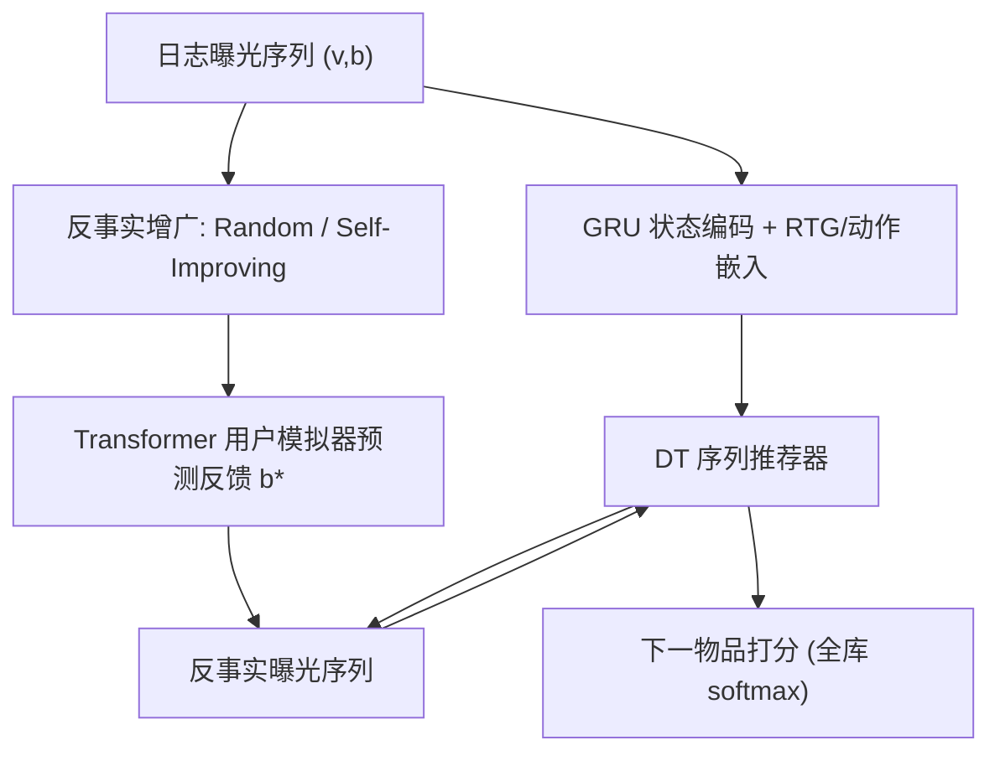
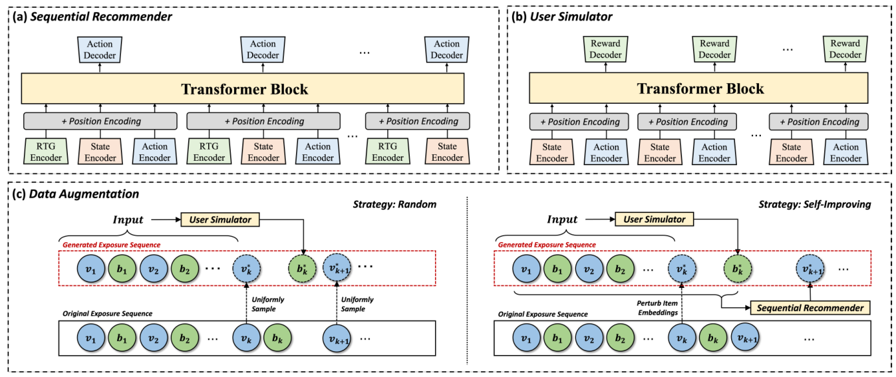

# Improving Sequential Recommenders through Counterfactual Augmentation of System Exposure (通过系统曝光的反事实增广改进序列推荐)

- **会议/期刊**: SIGIR 2025
- **作者与机构**: Ziqi Zhao, Jiyuan Yang, Zuming Yan, Liu Yang, Pengjie Ren, Zhumin Chen, Xin Xin (山东大学)；Zhaochun Ren, Maarten de Rijke (Leiden University / University of Amsterdam)；Zihan Wang (University of Amsterdam)
- **推荐链路定位**: 召回（序列召回/下一物品预测）
- **研究方向**: 序列与会话推荐 / 去偏与可信推荐
- **论文原文**: [https://arxiv.org/abs/2504.13482v1](https://arxiv.org/abs/2504.13482v1)
- **开源代码**: [https://github.com/ZiqiZhao1/CaseRec](https://github.com/ZiqiZhao1/CaseRec)

## TL;DR (1分钟核心速览)

现有序列推荐只吃"点击过的物品"，把海量"曝光未点击"记录当负样本丢弃，既浪费了序列相关性信号，又继承了历史策略的曝光偏差。CaseRec 把整条曝光序列（物品+反馈）喂给 Decision Transformer，用奖励条件化区分点击/未点击；再用 Random 与 Self-Improving 两种反事实替换策略生成新曝光序列，由 Transformer 用户模拟器打反馈标签，与原日志联合训练。在 ZhihuRec/Tenrec/KuaiRand 三数据集上，CaseRec-S 的 Recall@20 相对最强基线提升 87%–236%，并在无偏 KuaiRand-Random 上把 NDCG@20 从 0.0018 拉到 0.0099。

## Background & Motivation (背景与核心矛盾)

- **主流范式**: 序列推荐（GRU4Rec/SASRec/BERT4Rec/CORE/FEARec）以"用户点击序列"为输入做下一物品预测；少数工作（DRO）开始用全量曝光序列，但仅停留在对日志曝光做重加权或惩罚。
- **前人局限一**: 曝光未点击被一律视为负反馈，但图 1(a) 中阴影 $v_2$ 说明用户受时间/注意力限制只能点一个，未点击≠不感兴趣，直接当负样本会污染偏好建模。
- **前人局限二**: 即便用上全量曝光，训练分布仍被历史推荐策略锁死（exposure bias），IPS/RelMF/DRO 靠对"疑似过曝光"物品施加惩罚来纠偏，惩罚对象选错反而伤性能。
- **核心洞察 (Key Insight)**: 曝光序列的体量远大于交互序列（图 1(b)），且"不同用户反馈"天然对应不同奖励，正好契合 Decision Transformer 的 return-to-go 条件化建模；而未见过的兴趣只能靠"反事实曝光"去主动构造，而非靠重加权"修正"。
- **本文切入点**: 用 DT 吃全曝光序列 + 反事实增广生成"假想曝光轨迹"并由用户模拟器打标，把探索未见兴趣变成数据层面的增广问题。

## Method (核心方法设计)

### 1. 整体框架 (Overall Architecture)

输入是用户 $u$的$n$长曝光序列$S_u=(v_1,b_1,\dots,v_n,b_n)$，$b\in\{0,1\}$表示是否点击。CaseRec 先把物品嵌入与行为嵌入相加后过 GRU 得状态$s_t$，与 RTG 嵌入、动作嵌入拼接成轨迹$\tau_{rec}$，送入单向 Transformer 预测下一"高奖励动作"；同时用两条反事实增广路径（Random 均匀采样替换 / Self-Improving 嵌入扰动+自回归生成）产出新曝光序列，由 Transformer 用户模拟器预测其反馈$b^*$，最后把日志轨迹与增广轨迹混合训练 DT 推荐器，形成"训练—增广—再训练"的迭代闭环。

<figure class="paper-figure" markdown="span">
  <figcaption>图2：CaseRec 概览。(a) 基于 DT 的序列推荐器架构，以系统曝光为输入并生成推荐。细节见第3.2节。(b) 基于 transformer 的用户模拟器架构，预测给定物品的用户反馈。细节见第3.3.1节。(c) 反事实增强过程，展示两种策略：策略 Random 和策略 Self-Improving。细节见第3.3.2节。用户模拟器 (b) 用于模仿由</figcaption>
</figure>

### 2. 关键设计拆解 (Key Designs)

1. **DT 化的曝光序列建模与目标重构**：原版 DT 自回归预测"下一个动作"，但曝光序列里大量动作是未点击物品，直接照搬会造成训练/推理目标错位。CaseRec 把奖励按反馈二值化（$r_t=r_{int}$若$b_{t+1}=1$，否则$r_{uni}$），并把监督目标改为"下一个会被点击的物品"：
$$\bar{a}_t=v_k,\quad k=\min\{k\mid k>t\ \wedge\ b_k=1\}$$
损失为对该目标的全库交叉熵 $\mathcal{L}_{rec}=\frac{1}{T}\sum_t\sum_{i\in\mathcal{V}}Y_{ti}\log p_{ti}$。直觉是：让模型在"期望未来有交互"的 RTG 条件下生成动作，从而把未点击曝光当作上下文而非负标签。状态编码用物品嵌入与行为嵌入相加再进 GRU（$x_i=v_i+b_i$，$s_t=\mathrm{GRU}(x_t,s_{t-1})$），保证同一物品在"点/未点"两种语境下可区分。

2. **两种反事实增广策略**：Random 策略把序列中某物品 $v_k$替换为全库均匀采样物品$v_k^*$，模拟"完全随机曝光策略"，用于打散历史策略的分布锁定；Self-Improving 策略先对$v_k$嵌入加高斯噪声、取余弦相似度最高的物品作为$v_k^*$，再由当前推荐器自回归生成后续$h$ 步曝光，相当于在历史策略邻域内做定向探索。两者都只替换"物品"、反馈由模拟器补，因此增广序列在形式上与真实曝光序列同构，可直接复用同一训练目标。

3. **用户模拟器与训练/推理开销**：模拟器与推荐器共享状态/动作编码器结构，输出层接二分类 BCE 预测 $b^*$，为增广物品提供反馈标签；训练按 Algorithm 1 迭代：先用原始数据预训练推荐器，再按增广比例$\delta=|\mathcal{D}_{aug}|/|\mathcal{D}_{ori}|$生成增广集并混合再训练。负采样方面**不使用负采样**——训练与评测均为全库 softmax（Full-Ranking），推理时以$\gamma=1$、$\hat{R}_t=\sum_{k=t}^{T-1}r_k+r_{int}$ 设定 RTG 做自回归生成，额外开销主要来自增广阶段的模拟器前向。

## Experimental Setup & Evaluation Protocol (实验设置与评估协议)

- **数据集与预处理**: 三个含曝光（impression）日志的真实数据集，点击视为交互、未点击视为曝光未交互；沿用 DRO 的设置保留最近 50 个点击物品作为交互序列、最近 200 个曝光物品作为曝光序列，超长截断、不足补 padding token。

| 数据集 | 场景 | 关键特性 | 训练/验证/测试 |
| :--- | :--- | :--- | :---: |
| ZhihuRec | 问答（答案作为物品） | 含问题/答案/用户画像 | 8:1:1 |
| Tenrec | 视频 feed | 大规模物品空间 | 8:1:1 |
| KuaiRand-15policies | 短视频 | 历史策略收集的**有偏**日志 | 8:1:1 |
| KuaiRand-Random | 短视频 | 随机曝光收集的**无偏**日志 | 仅作验证/测试 |

- **数据划分与防穿越 (Splitting Strategy)**: 采用 8:1:1 比例划分 + 交叉验证，每实验重复 5 次取均值；去偏实验特殊设定为"有偏 KuaiRand-15policies 训练、无偏 KuaiRand-Random 验证/测试"，属于跨分布评估。
- **排名评测协议 (Ranking Protocol)**: 指标为 Recall@K 与 NDCG@K（$K\in\{5,10,20\}$）；推理输入统一用交互序列以对齐基线，训练侧使用全曝光序列；打分采用**全库 Full-Ranking**（式 14 为全库 softmax），无采样负例。
- **对比基线与超参设置**: 基线覆盖 RNN（GRU4Rec）、Transformer（SASRec/BERT4Rec/CORE/FEARec）、去偏（IPS/RelMF/DRO）、RL/DT（DT/SQN）四类；所有模型物品嵌入维度 $d=64$，CaseRec 设轨迹步$T=20$、状态步$L=10$、增广长度$h=10$、2 层 Transformer/8 头，Adam 优化，显著性以$p<0.01$ 标注。

## Key Experimental Results (实验关键数据)

### 1. 主实验对比 (Main Results)

三数据集核心指标（节选 Recall@20 与 NDCG@20，加粗为最优，`Improv.` 为 CaseRec-S 相对最强基线的相对提升）：

| 数据集 | 指标 | 最强基线 | CaseRec-R | CaseRec-S | Improv. |
| :--- | :--- | :---: | :---: | :---: | :---: |
| ZhihuRec | R@20 | 0.0445 (FEARec) | 0.1131 | **0.1470** | +230.3% |
| ZhihuRec | N@20 | 0.0167 (FEARec) | 0.0519 | **0.0672** | +302.4% |
| Tenrec | R@20 | 0.1709 (DRO) | 0.2172 | **0.2459** | +43.9% |
| Tenrec | N@20 | 0.0695 (DRO) | 0.0925 | **0.1099** | +58.1% |
| KuaiRand-15p | R@20 | 0.1718 (DRO) | 0.2948 | **0.3217** | +87.3% |
| KuaiRand-15p | N@20 | 0.0770 (DRO) | 0.1326 | **0.1579** | +105.1% |

去偏评估（有偏训练 → 无偏 KuaiRand-Random 测试）：

| 方法 | R@20 | N@20 |
| :--- | :---: | :---: |
| GRU4Rec | 0.0050 | 0.0018 |
| SASRec | 0.0052 | 0.0017 |
| IPS | 0.0040 | 0.0015 |
| DRO | 0.0046 | 0.0016 |
| CaseRec-R | **0.0229** | **0.0099** |
| CaseRec-S | 0.0224 | 0.0086 |

### 2. 消融实验 (Ablation Study)

Tenrec + Self-Improving 策略下的组件消融（图 5，趋势性结论）：

| 变体 | 说明 | 相对表现 |
| :--- | :--- | :--- |
| No-Aug | 仅用原始日志，无增广 | 最差 |
| No-Enc | 用状态序列物品嵌入均值替代 GRU 状态编码 | 优于 No-Aug，仍逊于完整模型 |
| No-Des | 保留原版 DT 自回归目标，不做目标重构 | 逊于完整模型 |
| CaseRec-S | 完整模型 | 最优 |

### 3. 关键实验发现 (Key Findings)

1. **增广是主要增益来源，且 Self-Improving 优于 Random**：主实验中 CaseRec-S 全面高于 CaseRec-R（如 KuaiRand-15p 的 R@20 为 0.3217 vs 0.2948），说明在历史策略邻域内定向探索比完全随机探索更高效；但去偏场景下 CaseRec-R 反超（N@20 0.0099 vs 0.0086），印证随机曝光模拟更能打散历史策略的分布锁定。
2. **增益随数据密度上升而放大**：KuaiRand-15policies 密度最高，相对 DRO 的 R@20 提升达 87.3%，作者归因于用户模拟器在稠密反馈下能更准确刻画兴趣、从而生成更高质量的增广序列；而 Tenrec 物品空间大、密度低，提升收窄至 43.9%。
3. **增广比例存在最优区间**：$\delta$从 0.2 增至 10 时性能先升后降（图 4），过大的$\delta$引入噪声；但无论$\delta$ 取何值，CaseRec 均高于最强基线，说明方法对超参不敏感、鲁棒性较好。

## Highlights & Limitations (亮点、对比与审稿批判)

- **与代表作对比 (vs. Prior Work)**: 与 SASRec/BERT4Rec 等只吃点击序列的模型相比，CaseRec 把曝光未点击作为带奖励的上下文而非负样本；与 DRO 相比，二者都用全曝光，但 DRO 靠对高曝光概率物品施加分布鲁棒惩罚，CaseRec 则通过反事实增广"造数据"探索未见兴趣，在无偏测试上 N@20 高出约 6 倍；与 SQN 等 RL 序列模型相比，CaseRec 用 DT 的 RTG 条件化替代 Q 学习，避免在线探索伤害用户体验。
- **可迁移亮点**: (i) "把曝光未点击当带奖励上下文 + 重构监督目标为下一高奖励动作"这一目标改写可直接迁移到任意序列召回模型；(ii) 用轻量用户模拟器为增广样本打伪标签的 model-based 增广范式，可迁移到冷启动与跨域序列迁移场景。
- **审稿级局限批判**: (i) 增广阶段需对每条序列做 $h$步自回归生成 + 模拟器前向，训练开销随$\delta$ 线性增长，论文未给出训练时长/显存对比；(ii) 用户模拟器本身在日志分布上训练，其伪标签在分布外物品上可靠性缺乏校准分析，且仅建模二值反馈，多行为（观看时长、购买）场景的扩展性待验证。

## Rating (四维评分)

- **方法创新性 (Novelty)**: ⭐⭐⭐⭐ （首次把 DT 的奖励条件化与反事实曝光增广结合，目标重构与双增广策略设计有明确动机，但各组件均为已有技术的组合式创新）
- **评估协议与实验扎实度 (Protocol & Experiments)**: ⭐⭐⭐⭐ （三数据集 + 全库排序 + 5 次重复 + $p<0.01$ 显著性 + 无偏跨分布评估较完整，但缺训练开销与模拟器校准分析）
- **写作与数学规范度 (Clarity & Rigor)**: ⭐⭐⭐⭐ （轨迹/状态/奖励符号定义清晰、Algorithm 1 完整，但 RTG 在推理阶段的设定偏工程化、缺理论论证）
- **工业落地与复现价值 (Industrial & Practical Value)**: ⭐⭐⭐⭐ （代码开源、仅需曝光日志即可落地，增广离线完成不干扰线上，但增广计算成本与模拟器偏差是上线前需评估的风险）

