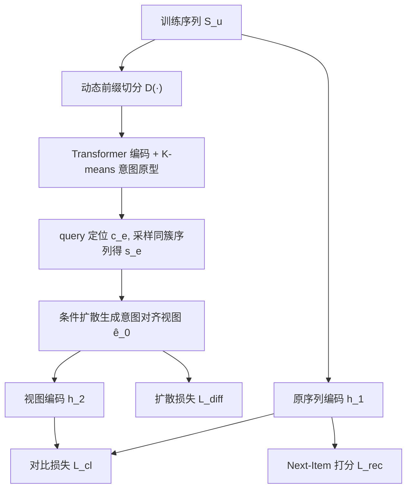
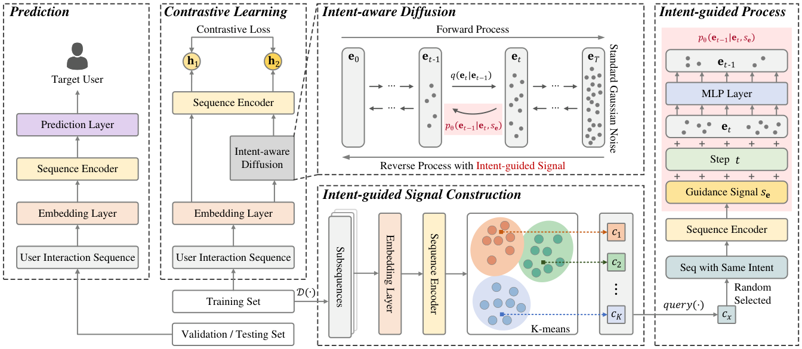

# Intent-aware Diffusion with Contrastive Learning for Sequential Recommendation (意图感知扩散与对比学习的序列推荐)

- **会议/期刊**: SIGIR 2025
- **作者与机构**: Yuanpeng Qu, Hajime Nobuhara（University of Tsukuba）
- **推荐链路定位**: 召回（序列 Next-Item 预测）
- **研究方向**: 序列与会话推荐 / 自监督对比学习与交互去噪
- **论文原文**: [https://arxiv.org/abs/2504.16077v1](https://arxiv.org/abs/2504.16077v1)
- **开源代码**: [https://github.com/qyp9909/InDiRec](https://github.com/qyp9909/InDiRec)

## TL;DR (1分钟核心速览)

现有序列推荐对比学习依赖随机数据增强（裁剪/替换/掩码）构造正视图，但随机操作会破坏序列中隐含的购买意图（如"组装电脑"的键盘、鼠标、显示器可能被裁散），导致对比学习对齐到无关特征。本文提出 InDiRec：先用动态前缀切分 + K-means 聚类得到意图原型，再以目标序列所属原型检索同意图序列作为条件信号，驱动条件扩散模型生成"同意图"正视图，最后与原始序列做意图感知对比学习。在 5 个公开数据集、Leave-One-Out + Full-Ranking 协议下，HR 平均提升 13.17%、NDCG 平均提升 20.68%。

## Background & Motivation (背景与核心矛盾)

- **主流范式**: 序列推荐对比学习分三派——数据级（CL4SRec 的裁剪/替换/掩码）、模型级（DuoRec 的神经元 Dropout）、Mixup 级（MCLRec），核心都是"从同一序列造两个视图再拉近"。
- **前人局限**: ① 随机增强无约束，可能把同一意图下的非连续物品（如分次购买的显示器与键盘）裁散，视图语义漂移；② ICLRec/IOCRec 虽引入意图聚类，但意图仅用于对比损失加权，并未用于"生成"视图，仍无法保证增强视图与原序列意图一致。
- **核心洞察 (Key Insight)**: 意图是抽象隐变量、无显式标签，但可由子序列表征聚类近似物化；扩散模型的条件生成可控性强，若把"意图原型"作为条件，就能采样出语义一致而非随机扰动的正视图。
- **本文切入点**: 把"数据增强"从启发式随机算子替换为"意图条件扩散生成"，让正样本对在意图层面天然对齐。

## Method (核心方法设计)

### 1. 整体框架 (Overall Architecture)

训练序列先经动态增量前缀切分 $D(\cdot)$得到大量重叠子序列，用 Transformer 编码后 K-means 聚成$K$个意图原型；对目标序列，先查其所属原型$c_e$，从该簇随机取一条同意图序列编码为引导信号$s_e$；以$s_e$为条件训练/采样条件扩散模型，得到意图对齐视图$\hat{e}_0$；原始序列与生成视图分别编码为$h_1,h_2$ 做对比学习，并与推荐交叉熵、扩散损失联合优化。推理阶段不跑扩散采样，仅用原序列编码打分。

<figure class="paper-figure" markdown="span">
  <figcaption>图2：我们的InDiRec概览。InDiRec首先对训练序列进行意图引导的信号构建，其中𝑐𝑥表示意图原型。然后通过由𝑠e引导的意图感知扩散生成正增强视图。最后，视图和原始序列被编码为h1和h2，并通过对比学习进行优化。</figcaption>
</figure>

### 2. 关键设计拆解 (Key Designs)

1. **意图引导信号构建（动态前缀切分 + K-means 原型）**：痛点是非连续物品共享意图却分散在不同时间步。用 $D(\cdot)$把序列切成窗口$[m,n]=[4,50]$的重叠前缀子序列，编码后对全训练集子序列表征做 K-means：$\min_{\{c_j\}}\sum_{i}\min_j\|\mathbf{h}_i-c_j\|^2$，得到$K$个意图原型；任意序列用$query(\mathbf{h}')=\arg\min_j\|\mathbf{h}'-c_j\|$ 定位意图。直觉：重叠前缀让"跨时段同意图"物品在某个子序列中必然共现，聚类中心即意图的软标签。

2. **意图感知条件扩散（Intent-aware Diffusion）**：痛点是无条件/随机增强不可控。前向过程同 DDPM 加噪 $q(e_t|e_{t-1})=\mathcal{N}(e_t;\sqrt{1-\beta_t}e_{t-1},\beta_t I)$；反向过程把$s_e$注入均值预测$p_\theta(e_{t-1}|e_t,s_e)=\mathcal{N}(e_{t-1};\mu_\theta(e_t,s_e,t),\Sigma_\theta)$，训练目标简化为$\mathcal{L}^{diff}_t=\mathbb{E}\|e_0-f_\theta(e_t,s_e,t)\|^2$。生成时采用 classifier-free guidance：$\hat{f}_\theta=(1+\omega)f_\theta(e_t,s_e,t)-\omega f_\theta(e_t,\xi,t)$，$\omega$控制意图引导强度。直觉：$s_e$把去噪轨迹"拉向"同意图流形，$\omega$ 过大则多样性坍缩、过小则退化为无条件生成。

3. **意图感知对比学习与联合优化**：负样本集合 $\eta$显式剔除与锚点同意图簇的样本以缓解假阴性：$\mathcal{L}_c(z_1,z_2)=-\log\frac{\exp(sim(z_1,z_2)/\tau)}{\exp(sim(z_1,z_2)/\tau)+\sum_{z\in\eta}\exp(sim(z_1,z)/\tau)}$。总损失$\mathcal{L}=\mathcal{L}_{rec}+\gamma\mathcal{L}_{cl}+\lambda\mathcal{L}_{diff}$，$\mathcal{L}_{rec}$ 为全库 softmax 交叉熵（无负采样）。扩散仅在训练期做分布学习与采样，推理零额外开销。

## Experimental Setup & Evaluation Protocol (实验设置与评估协议)

- **数据集与预处理**: 按 [42,46] 过滤，保留交互数 $\geq 5$ 的用户，按时间排序：

| 数据集 | #Users | #Items | #Interactions | 稀疏度 | 场景说明 |
| :--- | :---: | :---: | :---: | :---: | :--- |
| Beauty | 22,363 | 12,101 | 198,502 | 99.93% | Amazon 美妆 |
| Sports | 35,598 | 18,357 | 296,337 | 99.95% | Amazon 运动 |
| Toys | 19,412 | 11,924 | 167,597 | 99.93% | Amazon 玩具 |
| Video | 31,013 | 23,715 | 289,305 | 99.96% | Amazon 视频 |
| ML-1M | 6,041 | 3,417 | 999,611 | 95.16% | 电影评分（稠密） |

- **数据划分与防穿越**: `Leave-One-Out`——最后两个物品分别作验证/测试，其余训练。
- **排名评测协议**: 无偏 `Full-Ranking`（对全库未交互物品排序，不做负采样），报告 HR@{5,20} 与 NDCG@{5,20}。
- **对比基线与超参**: 13 个基线覆盖四类——通用（BPR-MF/GRU4Rec/SASRec/BERT4Rec）、对比学习（CL4SRec/ICLRec/IOCRec/MCLRec/DuoRec）、扩散（DiffuASR/DreamRec/CaDiRec/DiffuRec）。InDiRec 用 2 层自注意力、$d=64$、batch 256、lr 0.001、Adam；$\tau=1.0$，$m=4$，$n=50$，$p=0.1$；$\lambda,\gamma\in\{0.2,\dots,1.0\}$，$K\in\{32,\dots,1024\}$，$T\in\{10,\dots,500\}$，$\omega\in\{0,\dots,5\}$；配对 t 检验$p<0.05$。

## Key Experimental Results (实验关键数据)

### 1. 主实验对比 (Main Results)

| 数据集 | 指标 | SASRec | CL4SRec | ICLRec | DuoRec | DiffuRec | CaDiRec | **InDiRec** | Improv. |
| :--- | :--- | :---: | :---: | :---: | :---: | :---: | :---: | :---: | :---: |
| Beauty | HR@20 | 0.0884 | 0.0997 | 0.1063 | 0.1205 | 0.1109 | 0.1026 | **0.1303** | 8.13% |
| Beauty | ND@20 | 0.0382 | 0.0420 | 0.0484 | 0.0535 | 0.0554 | 0.0463 | **0.0662** | 19.49% |
| Sports | HR@20 | 0.0493 | 0.0546 | 0.0579 | 0.0717 | 0.0587 | 0.0622 | **0.0787** | 9.15% |
| Sports | ND@20 | 0.0216 | 0.0232 | 0.0256 | 0.0315 | 0.0281 | 0.0273 | **0.0383** | 21.59% |
| Toys | HR@20 | 0.0932 | 0.1285 | 0.1081 | 0.1275 | 0.0982 | 0.1149 | **0.1339** | 4.86% |
| Toys | ND@20 | 0.0389 | 0.0563 | 0.0535 | 0.0579 | 0.0534 | 0.0507 | **0.0707** | 22.11% |
| Video | HR@20 | 0.1426 | 0.1624 | 0.1382 | 0.1647 | 0.1423 | 0.1367 | **0.1705** | 3.52% |
| Video | ND@20 | 0.0570 | 0.0757 | 0.0601 | 0.0760 | 0.0639 | 0.0590 | **0.0788** | 3.68% |
| ML-1M | HR@20 | 0.2689 | 0.3154 | 0.3413 | 0.3698 | 0.3533 | 0.3283 | **0.4443** | 20.21% |
| ML-1M | ND@20 | 0.1143 | 0.1353 | 0.1518 | 0.1813 | 0.1574 | 0.1492 | **0.2300** | 26.90% |

### 2. 消融实验 (Ablation Study)

| 数据集 | 指标 | w/o $D(\cdot)$| w/o IGS | w/o$\mathcal{L}_{diff}$| w/o$\mathcal{L}_{cl}$ | InDiRec |
| :--- | :--- | :---: | :---: | :---: | :---: | :---: |
| Beauty | ND@20 | 0.0474 | 0.0650 | 0.0487 | 0.0651 | **0.0662** |
| Sports | ND@20 | 0.0313 | 0.0370 | 0.0359 | 0.0377 | **0.0383** |
| Toys | ND@20 | 0.0534 | 0.0690 | 0.0668 | 0.0704 | **0.0707** |
| Video | ND@20 | 0.0614 | 0.0783 | 0.0751 | 0.0755 | **0.0788** |
| ML-1M | ND@20 | 0.0647 | 0.2242 | 0.2239 | 0.2199 | **0.2300** |

### 3. 关键实验发现 (Key Findings)

1. **前缀切分是最大单点贡献**：把 $D(\cdot)$ 换成随机增强后 ML-1M 的 ND@20 从 0.2300 暴跌至 0.0647（-71.9%），远超其他消融项，说明"重叠前缀 + 聚类"是意图物化的地基，随机增强在稠密数据上破坏语义最严重。
2. **意图引导信号与扩散生成缺一不可**：去掉 IGS（$\omega=-1$）与去掉$\mathcal{L}_{diff}$分别使 Beauty ND@20 降至 0.0650/0.0487，后者跌幅更大，证明"条件扩散生成"本身比"引导强度"更关键；而$\mathcal{L}_{cl}$ 移除仅小幅下降（0.0651），说明对比学习是增益项而非主引擎。
3. **稀疏与噪声鲁棒性**：在最短交互组（长度 5）上 InDiRec 仍全面领先且衰减更缓；注入 20% 随机噪声时性能保持最优，而 DiffuRec/CaDiRec 在噪声 >15% 后因扩散对噪声敏感而跌幅加剧，验证意图条件约束了生成不确定性。

## Highlights & Limitations (亮点、对比与审稿批判)

- **与代表作对比 (vs. Prior Work)**: 与 CL4SRec/DuoRec 的本质区别是"增强算子从随机变为生成"；与 ICLRec/IOCRec 的区别是意图从"损失加权"升级为"生成条件"；与 CaDiRec 的区别是条件来自意图原型而非上下文物品，且扩散只在训练期使用、推理零开销。
- **可迁移亮点**: ① "聚类原型作条件信号 + classifier-free guidance"可迁移到任何需要可控数据增强的自监督推荐；② 负样本按意图簇剔除假阴性，可直接嵌入现有 InfoNCE 框架。
- **审稿级局限批判**: ① 意图原型数 $K$与扩散步数$T$需逐数据集网格搜索（Beauty$K=32$vs ML-1M$K=1024$），超参敏感且调优成本高；② 仅建模单行为（购买）序列，未验证点击/加购等多行为意图演化；③ 训练期需$T$ 步扩散采样，训练开销显著高于纯对比学习基线，论文未给出训练时长对比。

## Rating (四维评分)

- **方法创新性 (Novelty)**: ⭐⭐⭐⭐ （首次将意图原型作为条件扩散的引导信号生成对比正视图，思路清晰但组件均为已有技术的组合创新）
- **评估协议与实验扎实度 (Protocol & Experiments)**: ⭐⭐⭐⭐ （5 数据集 + Full-Ranking + 13 基线 + 消融/鲁棒性/超参/可视化齐全，但缺训练开销与线上验证）
- **写作与数学规范度 (Clarity & Rigor)**: ⭐⭐⭐⭐ （扩散推导完整、符号统一，但意图原型与对比负样本剔除的细节描述略简）
- **工业落地与复现价值 (Industrial & Practical Value)**: ⭐⭐⭐⭐ （代码开源、推理零额外开销，但训练期扩散采样成本与 $K/T$ 调参是落地门槛）

