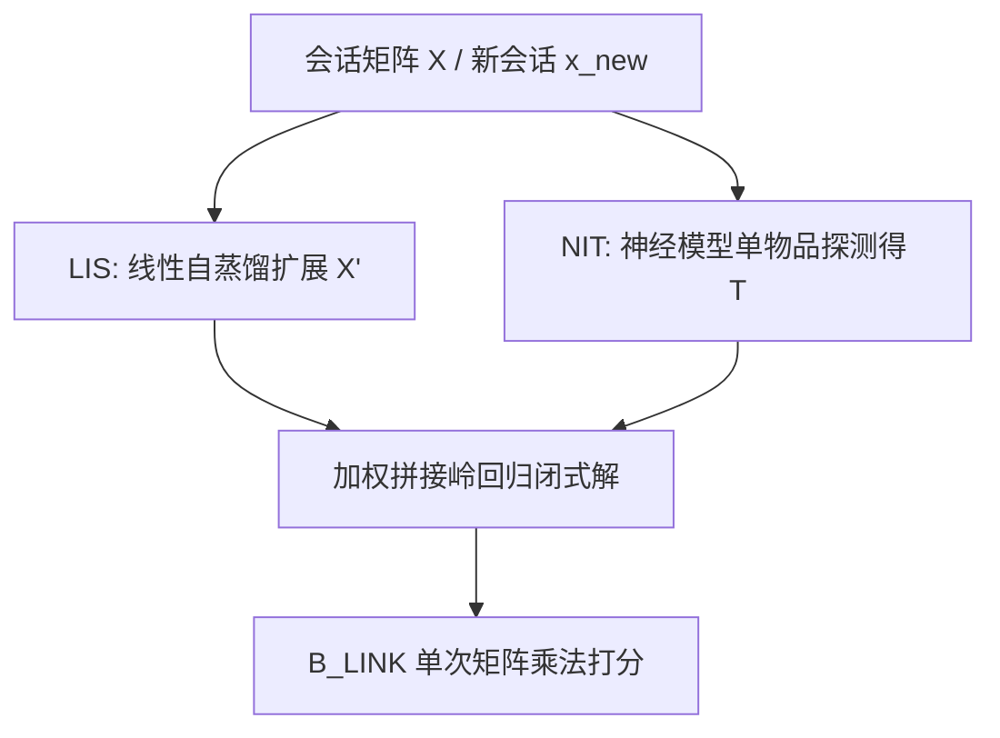
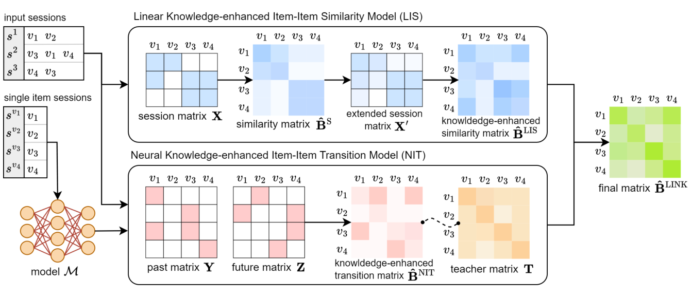

# Linear Item-Item Model with Neural Knowledge for Session-based Recommendation (融合神经知识的线性物品-物品会话推荐模型)

- **会议/期刊**: SIGIR 2025
- **作者与机构**: Minjin Choi (Samsung Research), Sunkyung Lee, Seongmin Park, Jongwuk Lee (Sungkyunkwan University)
- **推荐链路定位**: 召回（会话级 Next-Item 全库排序）
- **研究方向**: 序列与会话推荐 / 知识蒸馏与轻量化
- **论文原文**: [https://arxiv.org/abs/2504.15057v1](https://arxiv.org/abs/2504.15057v1)
- **开源代码**: [https://github.com/jin530/LINK](https://github.com/jin530/LINK)

## TL;DR (1分钟核心速览)

会话推荐长期分裂为两条路线：神经模型（GNN/Transformer）擅长建模复杂序列转移但推理昂贵，线性物品-物品模型（SLIST/SWalk）推理仅一次矩阵乘法却只能捕捉共现。本文通过实证分析发现二者知识互补且与物品流行度强相关：线性模型在长尾物品上更强，神经模型在头部物品上更强。LINK 将神经模型的转移知识蒸馏为物品-物品矩阵正则项，并与线性自蒸馏相似度统一为一个岭回归闭式解。在 6 个会话数据集上，相对最强线性基线 R@20 最高提升 14.78%、M@20 提升 11.04%，同时推理 FLOPs 比神经模型少最多 813 倍。

## Background & Motivation (背景与核心矛盾)

- **主流范式**: 神经 SBR（GRU4Rec、SR-GNN、CORE、MSGIFSR）以序列编码器建模物品间复杂转移依赖；线性 SBR（SLIM/EASE、SLIST、SWalk）学习单一物品-物品相似度矩阵，推理只需一次稀疏矩阵乘法。
- **前人局限**: (i) 线性模型虽能通过数据增广或随机游走引入序列信息，但仍无法刻画依赖整个会话上下文的动态转移；(ii) 已有工作仅做性能对比或简单集成，从未系统分析两种范式"各自学到了什么知识"，因而缺乏原理性的融合方案。
- **核心洞察 (Key Insight)**: 图 1 在 Diginetica 上的实证显示，线性模型（SLIST）在低流行度物品对上能学到强协同信号（解析解在稀疏交互下仍稳健），神经模型（CORE）则在流行物品对上凭借充足样本发挥表达力；二者知识呈互补而非替代关系。
- **本文切入点**: 既然知识差异与流行度相关，就把"共现相似"交给线性自蒸馏、"复杂转移"交给神经蒸馏，二者统一进同一个线性闭式解框架，兼顾精度与效率。

## Method (核心方法设计)

### 1. 整体框架 (Overall Architecture)

LINK 以会话二值矩阵 $\mathbf{X}\in\{0,1\}^{m\times n}$为输入，分两路构造"教师知识"：LIS 用已训练的线性相似度矩阵$\hat{\mathbf{B}}_S$扩展会话向量得到$\mathbf{X}'$，实现跨会话高阶共现的自蒸馏；NIT 用现成神经模型对单物品会话的预测构造物品-物品转移矩阵$\mathbf{T}$，作为正则项注入线性转移学习。两路目标经权重$\alpha$拼接后，通过一次岭回归闭式解得到最终矩阵$\hat{\mathbf{B}}_{\text{LINK}}$。推理时仅需将按位置衰减加权的稀疏会话向量与$\hat{\mathbf{B}}_{\text{LINK}}$ 相乘即可完成全库打分。

<figure class="paper-figure" markdown="span">
  <figcaption>图2：LINK的整体训练框架，由线性知识增强物品-物品相似度模型（LIS）和神经知识增强物品-物品转移模型（NIT）组成。</figcaption>
</figure>

### 2. 关键设计拆解 (Key Designs)

1. **LIS：线性知识自蒸馏（跨会话高阶共现）**：原始 SLIST 只捕捉会话内共现，会话间关系缺失。LINK 用已训练矩阵扩展会话向量 $\mathbf{X}'=\beta\mathbf{X}\hat{\mathbf{B}}_S+(1-\beta)\mathbf{X}$，再以$\mathbf{X}'$同时作输入与重建目标重解岭回归。直觉上$\mathbf{X}\hat{\mathbf{B}}_S$相当于沿物品图传播一步，使$i_1$–$i_2$–$i_3$ 这类不共现但经共享物品连通的物品对获得隐式关联，等价于 born-again 网络式的等规模自蒸馏。

2. **NIT：神经知识蒸馏为矩阵正则（模型无关转移注入）**：传统 KD 要求师生同构同输入，而神经模型吃变长序列、线性模型优化固定矩阵，无法直接对齐。LINK 改为"探测式"提取：对每个单物品会话 $[v_i]$查询神经模型 logits$\pi_i$，经温度 softmax 得到教师矩阵
$$\mathbf{T}_{i,j}=\frac{\exp(\pi_{ij}/\tau)}{\sum_{k=1}^{n}\exp(\pi_{ik}/\tau)},\quad \pi_i=\mathcal{M}([v_i])$$
再将 NIT 目标中的 $\lambda\|\mathbf{B}\|_F^2$替换为$\lambda\|\mathbf{T}-\mathbf{B}\|_F^2$，闭式解变为$\hat{\mathbf{B}}_{\text{NIT}}=(\tilde{\mathbf{Y}}^\top\tilde{\mathbf{Y}}+\lambda\mathbf{I})^{-1}(\tilde{\mathbf{Y}}^\top\tilde{\mathbf{Z}}+\lambda\mathbf{T})$。这样任意神经架构的转移知识都能以"软标签先验"形式注入，且不破坏线性结构。

3. **统一聚合、训练目标与推理效率**：最终目标为
$$\hat{\mathbf{B}}_{\text{LINK}}=\arg\min_{\mathbf{B}}\ \alpha\|\tilde{\mathbf{X}}'-\tilde{\mathbf{X}}'\mathbf{B}\|_F^2+(1-\alpha)\|\tilde{\mathbf{Z}}-\tilde{\mathbf{Y}}\mathbf{B}\|_F^2+\lambda\|\mathbf{T}-\mathbf{B}\|_F^2$$
通过行拼接 $\tilde{\mathbf{Y}}'=[\sqrt{\alpha}\tilde{\mathbf{X}}';\sqrt{1-\alpha}\tilde{\mathbf{Y}}]$化为标准岭回归一次求解，复杂度随物品数而非会话数增长。训练无需负采样（回归式目标天然全库建模）；推理时按$w_{\text{inf}}(i,s)=\exp(-(|s|-p(i,s))/\delta_{\text{inf}})$ 对会话内物品做位置衰减加权，稀疏向量乘矩阵即可，FLOPs 与神经模型相差两个数量级以上。

## Experimental Setup & Evaluation Protocol (实验设置与评估协议)

- **数据集与预处理**: 6 个会话数据集 + 4 个序列推荐数据集，统一过滤单物品会话与出现少于 5 次的物品（`5-core` 风格）：

| 数据集 | #Users(Sessions) | #Items | #Interactions | AvgLen | 场景说明 |
| :--- | :---: | :---: | :---: | :---: | :--- |
| Diginetica | 204,532 | 42,862 | 786,582 | 4.12 | 电商搜索日志 |
| Retailrocket | 321,032 | 51,428 | 871,637 | 6.40 | 电商行为 |
| Yoochoose | 470,477 | 19,690 | 1,434,349 | 4.64 | 电商点击流 |
| Tmall | 66,909 | 37,367 | 427,797 | 10.62 | 电商长会话 |
| Dressipi | 943,658 | 18,059 | 4,305,641 | 6.47 | 时尚电商 |
| LastFM | 325,543 | 38,616 | 3,510,163 | 8.16 | 音乐流媒体 |
| Beauty/Toys/Sports/Yelp | 22,363/19,412/29,858/30,494 | 12,101/11,924/18,357/20,061 | 198,502/167,597/296,337/317,078 | 8.9/8.6/8.3/10.4 | 序列推荐基准 |

- **数据划分与防穿越 (Splitting Strategy)**: 会话数据集按时间顺序 `8:1:1` 切分为训练/验证/测试；序列推荐数据集采用 `Leave-One-Out` 划分。
- **排名评测协议 (Ranking Protocol)**: 会话任务采用迭代揭示（iterative revealing）协议 + 无偏 `Full-Ranking` 全库排序，指标 R@20 / M@20；序列任务额外报告 N@20。
- **对比基线与超参设置**: 2 个线性基线（SLIST、SWalk）+ 14 个神经基线（GRU4Rec、NARM、STAMP、SASRec、SR-GNN、NISER+、GC-SAN、LESSR、GCE-GNN、SGNN-HN、DSAN、CORE、MSGIFSR、SCL），序列任务另比 DuoRec/FEARec/BSARec。嵌入维度 $d=100$，最大长度 50，batch 512，Adam lr=0.001；$\alpha,\beta$以 0.1 步长在$[0,1]$搜索，$\lambda\in\{10^{-1},\dots,10^4\}$，$\tau\in\{0.01,\dots,1.0\}$，$\delta$以 2 倍步长在$[2^{-3},2^3]$ 搜索；神经基线结果取 5 个随机种子均值。

## Key Experimental Results (实验关键数据)

### 1. 主实验对比 (Main Results)

会话推荐主结果（R@20 / M@20，节选代表性基线）：

| Model | Diginetica | Retailrocket | Yoochoose | Tmall | Dressipi | LastFM |
| :--- | :---: | :---: | :---: | :---: | :---: | :---: |
| GRU4Rec | 47.19/15.73 | 57.79/34.87 | 61.16/27.19 | 33.87/23.37 | 35.33/13.74 | 20.88/7.21 |
| SR-GNN | 48.41/16.45 | 58.72/35.49 | 62.10/28.17 | 34.78/24.82 | 35.62/14.14 | 21.45/8.63 |
| NISER+ | 50.80/17.91 | 60.70/37.95 | 63.33/29.02 | 40.17/29.16 | 37.97/15.13 | 22.15/8.64 |
| GCE-GNN | 50.46/17.71 | 60.42/35.70 | 63.31/28.95 | 36.25/26.73 | 37.23/14.97 | 22.75/8.35 |
| DSAN | 51.64/18.32 | 61.00/38.76 | 63.44/29.08 | 42.87/30.94 | 37.19/14.86 | 22.49/7.92 |
| CORE | 52.87/18.59 | 62.00/38.17 | 64.57/28.35 | 44.88/31.49 | 38.33/15.70 | 22.82/8.16 |
| MSGIFSR | 52.54/19.06 | 62.67/39.08 | 64.81/30.41 | **53.07**/29.20 | 40.33/16.11 | 25.00/10.17 |
| SLIST (线性) | 49.81/18.45 | 60.10/37.69 | 63.32/28.30 | 47.43/28.93 | 40.20/16.13 | 24.63/7.73 |
| SWalk (线性) | 51.19/18.76 | 61.31/38.79 | 63.72/27.61 | 48.77/29.52 | 39.80/16.19 | 24.84/7.70 |
| **LINK (Ours)** | **53.62/19.22** | **62.74/38.97** | **64.90/28.82** | **55.98/32.78** | **41.39/16.38** | **25.14/7.97** |
| Gain vs 最佳线性 (%) | +4.75/+2.45 | +2.33/+0.46 | +1.85/+1.84 | +14.78/+11.04 | +2.96/+1.17 | +1.21/+3.10 |

序列推荐（节选 R@20 / M@20 / N@20）：LINK 在 Beauty 12.52/4.44/6.20、Toys 13.15/5.46/7.16、Sports 8.17/2.87/4.03、Yelp 11.67/4.01/5.69，相对 SLIST 提升 14.95%–29.48%（R@20），排序敏感指标 M@20/N@20 相对 BSARec 平均提升 39.35%/21.53%。

### 2. 消融实验 (Ablation Study)

| 配置 | Diginetica R@20 | Diginetica M@20 | Retailrocket R@20 | Retailrocket M@20 |
| :--- | :---: | :---: | :---: | :---: |
| 仅 LIS（无 NIT） | 50.02 | 18.33 | 60.18 | 37.46 |
| 仅 NIT（CORE 教师） | 53.57 | 19.20 | 62.66 | 38.91 |
| 仅 NIT（MSGIFSR 教师） | 52.09 | 18.87 | 61.03 | 38.11 |
| 仅 NIT（SCL 教师） | 52.16 | 19.01 | 61.19 | 38.64 |
| LIS + NIT（CORE） | **53.60** | **19.21** | **62.74** | **38.97** |
| 无 LIS 无 NIT（≈SLIST） | 49.81 | 18.45 | 60.10 | 37.69 |

### 3. 关键实验发现 (Key Findings)

1. **NIT 是主要增益来源，LIS 提供稳定补充**：单独加入 NIT 使 Diginetica R@20 从 49.81 升至 53.57（+7.55%），单独 LIS 仅 +0.42%；两者叠加后与仅 NIT 基本持平，说明神经转移知识覆盖了大部分收益，而 LIS 的跨会话共现扩展在长会话数据集（Tmall +14.78%）上贡献更明显。
2. **教师模型选择存在"架构对齐"效应**：同为 NIT，CORE 作教师（53.60）显著优于 MSGIFSR（52.27）与 SCL（52.57），作者归因于 CORE 结构较简单、与线性模型更易对齐——这提示蒸馏收益不仅取决于教师精度，还取决于师生归纳偏置的兼容性。
3. **精度-效率帕累托显著改善且长尾更稳**：LINK 推理 FLOPs 比神经模型少最多 813 倍（Yoochoose），训练比 MSGIFSR 快最多 953 倍（Dressipi）；在 Tail 物品（后 80% 流行度）上 LINK 超越所有基线最多 2.72%，Head/Tail 相对其他线性模型分别提升 3.68%/6.92%，验证了"线性管长尾、神经管头部"的融合假设。

## Highlights & Limitations (亮点、对比与审稿批判)

- **与代表作对比 (vs. Prior Work)**: 相比 SLIST/SWalk 仅靠数据增广或随机游走注入序列信息，LINK 首次把神经模型的转移知识以矩阵正则形式注入线性框架；相比传统 KD（TiMiRec 等）要求师生同构，LINK 的"单物品探测"使蒸馏对任意神经架构模型无关；相比 CORE/MSGIFSR 等纯神经方案，LINK 在精度持平或更优的同时把推理压缩到单次稀疏矩阵乘法。
- **可迁移亮点**: (i) "用单物品输入探测教师模型、把输出 softmax 成物品-物品矩阵"是一种极轻量的跨架构知识提取技巧，可迁移到任何需要把序列模型能力下沉到召回矩阵的场景；(ii) 把多个岭回归目标按行拼接成单一闭式解的做法，可用于多源先验（协同 + 内容 + 蒸馏）的统一融合。
- **审稿级局限批判**: (i) 依赖一个预训练神经教师，教师训练成本未计入端到端开销，且教师质量与架构对齐性对结果影响明显（消融中教师间差距达 1.5 个点），实际部署需额外维护教师模型；(ii) 线性矩阵参数量为 $O(n^2)$，在物品数达百万级的工业场景下闭式解求逆与存储成本会显著上升，论文仅在 2 万–5 万物品规模上验证，缺少大规模可扩展性实验。

## Rating (四维评分)

- **方法创新性 (Novelty)**: ⭐⭐⭐⭐ （以实证揭示线性/神经知识在流行度维度上的互补性，并用"单物品探测 + 矩阵正则"巧妙绕开师生异构鸿沟，思路简洁且有解释力）
- **评估协议与实验扎实度 (Protocol & Experiments)**: ⭐⭐⭐⭐ （6 会话 + 4 序列数据集、Full-Ranking 无偏协议、5 种子均值、完整消融与效率/长尾分析，唯缺显著性检验与大规模场景验证）
- **写作与数学规范度 (Clarity & Rigor)**: ⭐⭐⭐⭐ （闭式解推导完整，并将 LIS/NIT 统一解释为 KD 框架下的特例，符号清晰；部分超参敏感性分析略简）
- **工业落地与复现价值 (Industrial & Practical Value)**: ⭐⭐⭐⭐⭐ （代码开源、推理仅一次稀疏矩阵乘法、FLOPs 降低 813 倍、训练快至 953 倍，对召回侧轻量化落地极具吸引力）

