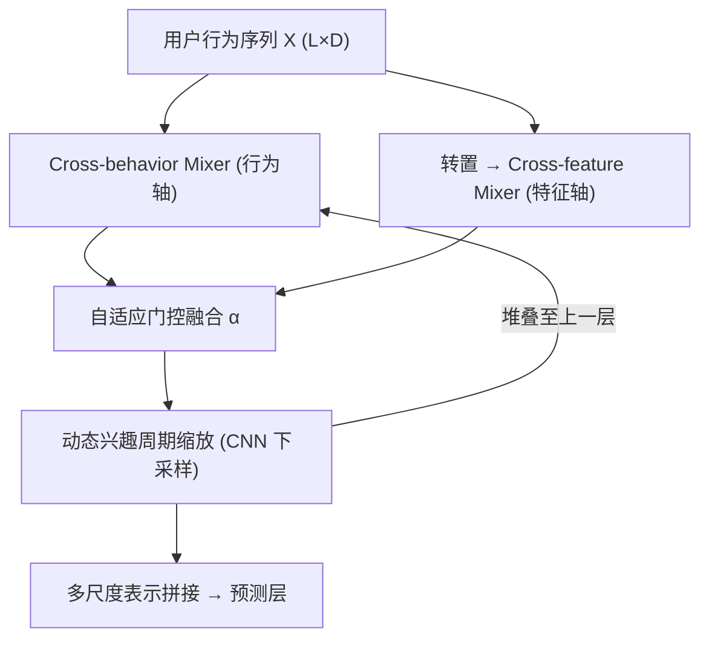
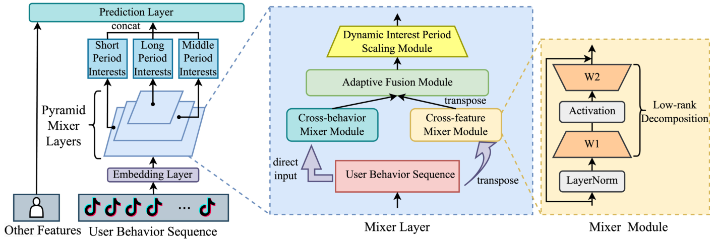
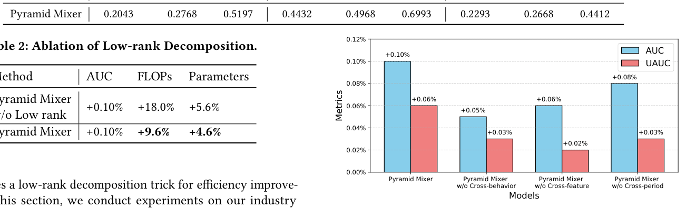

# Pyramid Mixer: Multi-dimensional Multi-period Interest Modeling for Sequential Recommendation (金字塔 Mixer：面向序列推荐的多维多周期兴趣建模)

- **会议/期刊**: SIGIR 2025 (短论文, 5 页)
- **作者与机构**: Zhen Gong, Zhifang Fan, Hui Lu, Qiwei Chen (通讯), Chenbin Zhang, Lin Guan, Yuchao Zheng, Feng Zhang, Xiao Yang, Zuotao Liu — 字节跳动 (抖音)
- **推荐链路定位**: 精排 (排序模型内嵌序列兴趣建模模块)
- **研究方向**: 序列与会话推荐 / CTR 特征交叉
- **论文原文**: [https://arxiv.org/abs/2506.16942v1](https://arxiv.org/abs/2506.16942v1)
- **开源代码**: 暂未开源

## TL;DR (1分钟核心速览)

现有序列推荐几乎被 self-attention 垄断，只建模「行为-行为」关系，忽略了每条行为内部 ID 与侧信息的特征交叉，且 $O(n^2)$ 复杂度难以在工业严格算力约束下扩展。本文提出 Pyramid Mixer：用纯 MLP 的 cross-behavior / cross-feature 双 Mixer 并行混合，再以金字塔式逐层下采样实现跨周期兴趣建模，并用低秩分解压缩参数。在 ML-100K/1M、Beauty 三个公开集上 HR@10 全面超越 SASRec 与 MLP4Rec（Beauty HR@10 0.4412 vs 0.4326），抖音线上 A/B 停留时长 +0.106%、活跃天数 +0.0113%。

## Background & Motivation (背景与核心矛盾)

- **主流范式**: SASRec/BERT4Rec 以 self-attention 捕捉序列内行为间依赖，FMLP-Rec/MLP4Rec 尝试用全 MLP 替代注意力以降复杂度。
- **前人局限**: ① 注意力类方法只做「行为级」token 混合，同一行为内 item ID、播放时长、作者/类目等特征从未被显式交叉；② MLP4Rec 虽做三向融合，但采用级联结构，效率低且未刻画多时间尺度兴趣。
- **核心洞察 (Key Insight)**: 用户兴趣天然是「多维 × 多周期」的——短期细节兴趣与长期稳定偏好共存，而 MLP-Mixer 的 token-mixing / channel-mixing 双轴结构恰好与「跨行为 / 跨特征」两个维度同构，且复杂度线性。
- **本文切入点**: 把 Mixer 的两个混合轴重新解释为行为轴与特征轴，再用金字塔层级把序列逐层压缩，一次性覆盖三个维度的兴趣建模。

## Method (核心方法设计)

### 1. 整体框架 (Overall Architecture)

输入为用户行为序列嵌入 $X\in\mathbb{R}^{L\times D}$（$L$为序列长，$D$ 为特征维）。每个 Mixer Layer 内并行两路：cross-behavior Mixer 在行为轴混合（不转置），cross-feature Mixer 先转置再在特征轴混合；两路输出经自适应门控融合后，由动态兴趣周期缩放模块（卷积下采样）把序列压到更短尺度，送入上一层。底层保留细粒度短期行为，顶层聚合长期兴趣，最终多层多尺度表示共同进入预测层。训练端为工业排序目标（Finish 等），推理端仅增加线性开销。

<figure class="paper-figure" markdown="span">
  <figcaption>图2：Pyramid Mixer 模型架构。</figcaption>
</figure>

### 2. 关键设计拆解 (Key Designs)

1. **双轴 Mixer 与自适应融合（补上特征交叉的缺口）**：痛点在于注意力只混合行为 token、特征维被冻结。每个 Mixer 模块为「LayerNorm → 升维 $W_1$→ 激活 → 降维$W_2$ → 残差」：
$$Y_i = X_i + W_2\,\sigma\big(W_1\,\mathrm{LayerNorm}(X_i)\big)$$
两路输出用样本级门控加权，$\alpha_i=\Sigma(\mathrm{Linear}(X_i))$，$Z_i=\alpha_i Y_i^{beh}+(1-\alpha_i)Y_i^{feat}$。直觉：不同用户对「看什么」与「什么属性吸引我」的依赖程度不同，门控让模型按用户自适应分配两轴权重，而非固定相加。

2. **金字塔多尺度跨周期建模（让模型同时看见短期与长期）**：单层 Mixer 只有单一感受野，无法区分日级与季级兴趣。每层融合后接卷积下采样 $O_i=\mathrm{CNN}(Z_i)$，$O_i\in\mathbb{R}^{L'\times D}$且$L'<L$，逐层把序列长度折半。底层保留逐条行为细节（短期兴趣），顶层在压缩序列上做混合等价于跨更长时段的兴趣聚合，形成多感受野金字塔。

3. **低秩分解与训练/推理开销**：序列推荐普遍过参数化，故令 $W_1\in\mathbb{R}^{D\times D'}$、$W_2\in\mathbb{R}^{D'\times D}$且$D'<D$，先把序列投影到少量潜在兴趣再升回原维做残差。总损失为工业多目标排序损失（以 Finish 为主目标）。负采样沿用精排的曝光样本内负例，无需额外构造；推理仅增加线性 FLOPs，可在线部署。

## Experimental Setup & Evaluation Protocol (实验设置与评估协议)

- **数据集与预处理**: 公开集沿用 MLP4Rec/FMLP-Rec 的预处理流程；工业集为抖音大规模线上数据（未披露统计量）。

| 数据集 | #Users | #Items | #Interactions | 稀疏度/密度 | 特征/场景说明 |
| :--- | :---: | :---: | :---: | :---: | :--- |
| MovieLens-100K | 943 | 1,682 | 100,000 | 6.30% | 电影评分，含类型/时间戳 |
| MovieLens-1M | 6,040 | 3,706 | 1,000,209 | 4.47% | 电影评分，规模更大 |
| Beauty (Amazon) | 22,363 | 12,101 | 198,502 | 0.073% | 美妆评论，极稀疏，检验可扩展性 |
| 工业数据集 (抖音) | 未披露 | 未披露 | 未披露 | — | 短视频排序，AUC/UAUC 评估 |

- **数据划分与防穿越 (Splitting Strategy)**: 公开集遵循前人序列推荐的 `Leave-One-Out` 式划分（最后一项测试、倒数第二项验证），工业集为线上真实时间流训练/评估。
- **排名评测协议 (Ranking Protocol)**: 公开集采用 `Full-Ranking (全库未交互物品排序)`，指标 HR@10 / NDCG@10 / MRR@10；工业离线用 AUC 与 UAUC（用户级 AUC），效率用 FLOPs 与参数量。
- **对比基线与超参设置**: 基线含 PopRec、BPR、FPMC、GRU4Rec、SASRec、BERT4Rec、FMLP-Rec、MLP-Mixer、MLP4Rec 共 9 个；激活函数取 Swish/GELU，低秩隐宽 $D'<D$；线上 A/B 以抖音主推荐场景为实验桶。

## Key Experimental Results (实验关键数据)

### 1. 主实验对比 (Main Results)

| 模型 | ML-100K HR@10 | ML-100K NDCG@10 | ML-1M HR@10 | ML-1M NDCG@10 | Beauty HR@10 | Beauty NDCG@10 | Beauty MRR@10 |
| :--- | :---: | :---: | :---: | :---: | :---: | :---: | :---: |
| GRU4Rec | 0.4758 | 0.2550 | 0.6709 | 0.4658 | 0.3417 | 0.2050 | 0.1632 |
| SASRec | 0.4920 | 0.2612 | 0.6697 | 0.4720 | 0.3874 | 0.2447 | 0.2009 |
| BERT4Rec | 0.5061 | 0.2568 | 0.6593 | 0.4572 | 0.3135 | 0.1738 | 0.1313 |
| FMLP-Rec | 0.5070 | 0.2574 | 0.6606 | 0.4570 | 0.3336 | 0.1891 | 0.1449 |
| MLP-Mixer | 0.4920 | 0.2671 | 0.6871 | 0.4770 | 0.4065 | 0.2556 | 0.2089 |
| MLP4Rec | 0.5118 | 0.2747 | 0.6919 | 0.4938 | 0.4326 | 0.2654 | 0.2139 |
| **Pyramid Mixer** | **0.5197** | **0.2768** | **0.6993** | **0.4968** | **0.4412** | **0.2668** | **0.2293** |
| Improv.% (vs 最强基线) | +1.54% | +0.76% | +1.07% | +0.61% | +1.99% | +0.53% | +7.20% |

### 2. 消融实验 (Ablation Study)

工业数据集上以 Finish 目标的 AUC / UAUC 增量衡量（图 3），低秩分解效率见表 2：

| 配置 | AUC 增量 | UAUC 增量 | FLOPs 增量 | 参数增量 |
| :--- | :---: | :---: | :---: | :---: |
| 完整 Pyramid Mixer | +0.10% | +0.06% | +9.6% | +4.6% |
| w/o Cross-behavior | +0.05% | +0.03% | — | — |
| w/o Cross-feature | +0.06% | +0.02% | — | — |
| w/o Cross-period (去多层堆叠) | +0.08% | +0.03% | — | — |
| w/o Low-rank (完整宽度) | +0.10% | — | +18.0% | +5.6% |

<figure class="paper-figure" markdown="span">
  <figcaption>图3：用户序列交叉模块的消融实验。</figcaption>
</figure>

### 3. 关键实验发现 (Key Findings)

1. **跨特征交叉是最大增益来源**：去掉 cross-feature 后 UAUC 增量从 +0.06% 掉到 +0.02%（降幅 2/3），说明「同一行为内 ID 与侧信息混合」比行为间建模更稀缺，直接印证了作者对注意力范式盲区的判断。
2. **金字塔跨周期建模不可省**：去掉多层堆叠后 AUC 增量由 +0.10% 降至 +0.08%，且该模块几乎不增加参数，是性价比最高的结构改动；数据集越大收益越明显（Beauty 上 HR@10 相对 MLP4Rec +1.99%，远高于 ML-100K 的 +1.54%）。
3. **低秩分解是纯效率红利**：AUC 完全不变（+0.10%），但 FLOPs 增量从 +18.0% 砍到 +9.6%、参数增量从 +5.6% 降到 +4.6%，等于用一半的算力换同等精度，这是其能上线抖音的前提。

## Highlights & Limitations (亮点、对比与审稿批判)

- **与代表作对比 (vs. Prior Work)**: 相比 SASRec/BERT4Rec，本文把建模轴从单一行为轴扩展到行为+特征双轴，复杂度由 $O(n^2)$ 降为线性；相比 MLP4Rec 的级联三向融合，本文用并行双 Mixer + 门控融合避免了级联的串行开销；相比 MLP-Mixer 原版，本文额外引入金字塔下采样与低秩分解，把通用视觉架构改造为可感知多周期的推荐结构。
- **可迁移亮点**: ① 「转置后做特征轴混合」这一 trick 可直接插入任何序列精排模型作为轻量特征交叉旁路；② 用卷积下采样构造多尺度序列表示，可低成本替换 Transformer 的层次化堆叠。
- **审稿级局限批判**: ① 公开集实验仅报告 HR/NDCG/MRR@10，未给出全排名下的统计显著性检验，且 ML-100K 规模过小，增益幅度（+0.76% NDCG）接近噪声；② 线上收益以停留时长、活跃天数等替代指标衡量，绝对提升量级（+0.106%）极小，缺少与基线模型的线上对照桶说明；③ 金字塔层数与下采样率等关键超参未做敏感性分析，工业集统计量亦未披露，复现性受限。

## Rating (四维评分)

- **方法创新性 (Novelty)**: ⭐⭐⭐ （把 MLP-Mixer 双轴重解释为行为/特征轴并叠加金字塔，思路清晰但属架构重组式创新，理论分析偏弱）
- **评估协议与实验扎实度 (Protocol & Experiments)**: ⭐⭐⭐ （公开集全库排序 + 工业 A/B 双轨验证较完整，但缺显著性检验、超参敏感性与基线线上对照）
- **写作与数学规范度 (Clarity & Rigor)**: ⭐⭐⭐ （公式简洁、结构图清楚，但 5 页短文对低秩维度选择与复杂度推导交代不足，式 (1) 中 $W_1/W_2$ 维度描述有笔误）
- **工业落地与复现价值 (Industrial & Practical Value)**: ⭐⭐⭐⭐ （已在抖音主场景上线并有正向 A/B，线性复杂度 + 低秩压缩使其工程价值突出，可惜未开源）

