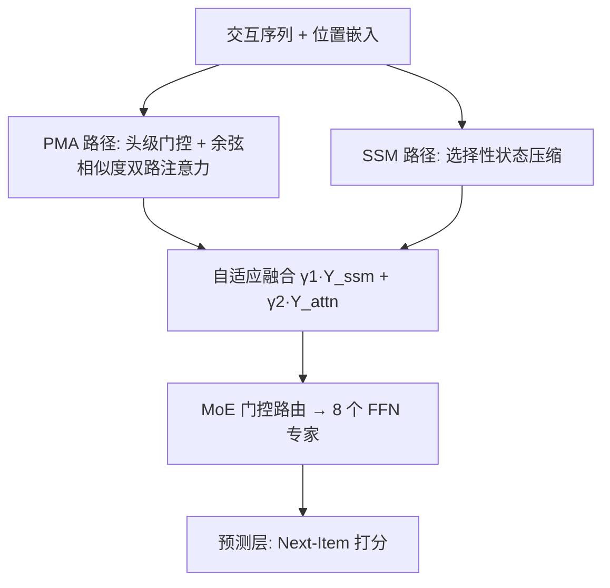
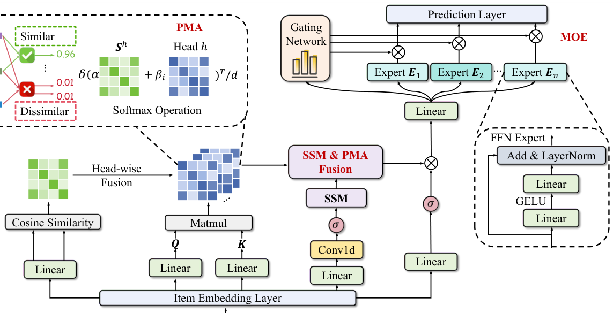

# STAR-Rec: Making Peace with Length Variance and Pattern Diversity in Sequential Recommendation (与序列长度方差和行为模式多样性握手言和)

- **会议/期刊**: SIGIR 2025
- **作者与机构**: Maolin Wang, Sheng Zhang, Wanyu Wang, Xiangyu Zhao (香港城市大学)；Ruocheng Guo (独立)；Xuetao Wei (南方科技大学)；Zitao Liu (暨南大学)；Hongzhi Yin (昆士兰大学)；Yi Chang (吉林大学)
- **推荐链路定位**: 召回（Next-Item 序列建模）
- **研究方向**: 序列与会话推荐 / CTR 特征交叉（注意力算子改造）
- **论文原文**: [https://arxiv.org/abs/2505.03484v1](https://arxiv.org/abs/2505.03484v1)
- **开源代码**: [https://github.com/Applied-Machine-Learning-Lab/Star-Rec](https://github.com/Applied-Machine-Learning-Lab/Star-Rec)

## TL;DR (1分钟核心速览)

现有序列推荐模型在**序列长度剧烈波动**（新用户仅数次交互 vs. 活跃用户数百次）与**行为模式多样**（同类目聚焦浏览 vs. 跨类目探索）两类真实分布下普遍失效：Transformer 二次复杂度且对所有位置一视同仁，纯 SSM 在短序列上状态估计不稳。STAR-Rec 提出偏好感知多头注意力 (PMA) 与选择性 SSM 双路径，通过 softmax 自适应权重融合，再叠加序列级 MoE 路由不同行为模式。在 4 个真实数据集、Leave-One-Out 全库排序协议下，Recall@10 相对 SOTA 提升 0.35%–2.15%，且训练效率优于 Mamba4Rec。

## Background & Motivation (背景与核心矛盾)

- **主流范式**: 序列推荐经历 RNN → Self-Attention (SASRec/BERT4Rec) → 线性注意力 (LinRec/LightSANs) → SSM (Mamba4Rec/ECHO/SIGMA) 的演进，核心诉求是在长程依赖建模与线性复杂度之间取平衡。
- **前人局限**: ① Transformer 类对所有历史位置等权处理，无法区分"同类目聚焦"与"跨类目探索"两种截然不同的行为模式，且二次复杂度难以扩展；② 纯 SSM 依赖状态压缩，在短序列（新用户/稀疏交互）上状态估计不稳定，且单一状态表示无法承载多兴趣。
- **核心洞察 (Key Insight)**: 作者从算子层面证明 SSM 的递推展开可写成张量形式 $\mathbf{M}_{d,t,k}=\mathbf{C}_{t,:}\bar{\mathbf{P}}_{t,d,:,:}\cdots\bar{\mathbf{P}}_{k,d,:,:}\bar{\mathbf{Q}}_{t,:,d}$，即 **SSM 本质是"每个特征维度各有一套注意力掩码"的隐式注意力**，与 PMA 的"每个头一套注意力"在计算模式上同构，因此二者可被拼接进同一矩阵乘法框架并做头级加权。
- **本文切入点**: 既然同构，就不必二选一——用 PMA 补 SSM 缺失的静态物品相似性信号，用 SSM 补 PMA 的长程时序压缩能力，再用 MoE 在序列级做模式分流。

## Method (核心方法设计)

### 1. 整体框架 (Overall Architecture)

输入为用户交互序列，经物品嵌入 + 位置嵌入得到 $\mathbf{E}^{(embed)}\in\mathbb{R}^{N\times d}$。随后进入统一建模块：**PMA 路径**通过头级门控生成偏好感知表示并计算余弦相似度矩阵，与标准 QK 注意力加权融合；**SSM 路径**以线性复杂度压缩时序动态；两路输出经 softmax 归一化的$\gamma_1,\gamma_2$做头级拼接融合。融合表示送入 **MoE 层**，由门控网络$\mathbf{G}_i=\mathrm{Softmax}(\mathrm{Linear}_g(\mathbf{Y}))_i$ 将不同行为模式路由至 8 个 FFN 专家，加权求和后接预测层输出下一物品概率。训练用 BCE 预测损失 + 专家多样性正则，单层结构即可收敛。

<figure class="paper-figure" markdown="span">
  <figcaption>图1：STAR-Rec架构概览。该模型由以下部分组成：(1) 用于初始表示的项目嵌入层；(2) 统一建模模块，通过自适应融合机制结合用于偏好聚合的偏好感知多头注意力（PMA）和用于时间动态的状态空间模型（SSM）；(3) 用于专门模式识别和预测的混合专家层。</figcaption>
</figure>

### 2. 关键设计拆解 (Key Designs)

1. **偏好感知多头注意力 PMA（补上 SSM 丢失的静态物品关系）**：传统注意力只建模全局 QK 关系，忽略用户偏好驱动的物品相似性。PMA 先做头级门控 $\mathbf{X}^h_m=\mathbf{X}_{raw}\odot\sigma(\mathbf{X}_{raw}\mathbf{W}^h_g+\mathbf{b}^h_g)$筛出偏好相关特征，再算余弦相似度矩阵$\mathbf{S}^h=\mathrm{CosSim}(\mathbf{X}_{raw},\mathbf{X}^h_m)$并做阈值截断（低于$\tau_h$ 置 0.01），最终注意力为
$$\mathbf{A}^h_{attn}=\mathrm{Softmax}\!\left(\frac{w^h_1\mathbf{Q}^h_{attn}\mathbf{K}_h^{\top}+w^h_2\mathbf{S}^h}{\sqrt{D_k}}\right)$$
其中 $w^h_1,w^h_2$经 softmax 自适应学习。直觉：QK 项捕捉时序偏好演化，$\mathbf{S}^h$ 项提供与时间无关的物品关联先验，短序列下后者成为主导信号，从而缓解 SSM 的状态不稳。

2. **SSM–PMA 自适应融合（把两条路径压进一次矩阵乘法）**：将 SSM 输出按式 (2) 写成 $\mathbf{Y}_{ssm}=\mathrm{Concat}(\mathbf{M}_{1,:,:}\mathbf{X}_{L(1)},\dots,\mathbf{M}_{D,:,:}\mathbf{X}_{L(D)})$，与 PMA 的$\mathbf{Y}^h_{attn}$ 拼接后统一为
$$\mathbf{Y}_{final}=\Big[\underbrace{\hat{\mathbf{Y}}^{(:,1)}_{ssm},\dots,\hat{\mathbf{Y}}^{(:,D)}_{ssm}}_{\text{Long-range heads (SSM)}},\underbrace{\mathbf{Y}^1_{attn},\dots,\mathbf{Y}^H_{attn}}_{\text{Preference Heads (PMA)}}\Big]\cdot\mathrm{diag}(\gamma_1\mathbf{I};\gamma_2\mathbf{W}_O)$$
$\gamma_1,\gamma_2$由 softmax 归一化学习。物理直觉：SSM 头数等于特征维度$D$（每维一套时序掩码），PMA 头数为$H$，二者在"多头拼接 + 输出投影"这一计算范式上完全同构，融合不引入额外结构开销。

3. **序列级 MoE 与训练目标**：针对单条序列内部"聚焦浏览 / 广泛探索"模式交替的问题，用 $n=8$个 FFN 专家$\mathbf{E}_i(\mathbf{Y})=\mathrm{Linear}_2(\mathrm{GELU}(\mathrm{Linear}_1(\mathbf{Y})))$ 做模式特化，门控动态路由。总损失
$$\mathcal{L}=\mathcal{L}_{pred}+\lambda\mathcal{L}_{div},\quad \mathcal{L}_{div}=\left\|\frac{\mathbf{G}^{\top}\mathbf{G}}{B}-\frac{\mathbf{I}_n}{n}\right\|^2_F$$
$\mathcal{L}_{pred}$为 BCE（隐式反馈二分类），$\mathcal{L}_{div}$ 惩罚门控权重冗余以促成专家分化。负采样采用标准隐式反馈负例构造（每正例配负例），推理为全库打分排序，无额外解码开销。

## Experimental Setup & Evaluation Protocol (实验设置与评估协议)

- **数据集与预处理**: 四个公开数据集，未做 k-core 显式过滤（ML-1M 天然每用户 ≥20 条）：

| 数据集 | #Users | #Items | #Interactions | 平均长度 | 稀疏度 |
| :--- | :---: | :---: | :---: | :---: | :---: |
| ML-1M | 6,041 | 3,707 | 1,000,209 | 165.60 | 95.53% |
| Beauty | 22,364 | 12,102 | 198,502 | 8.88 | 99.93% |
| Baby | 19,445 | 7,050 | 160,792 | 8.27 | 99.88% |
| Video Games | 24,304 | 10,673 | 231,780 | 9.54 | 99.91% |

- **数据划分与防穿越**: `Leave-One-Out` 策略——按时间排序后，倒数第二条作验证集、最后一条作测试集，其余为训练集。
- **排名评测协议**: 全库未交互物品排序（Full-Ranking），报告 Recall@10 / MRR@10 / NDCG@10。
- **对比基线与超参设置**: 9 个基线覆盖 RNN (GRU4Rec)、Transformer (BERT4Rec/SASRec)、线性注意力 (LinRec/LightSANs)、MLP (SMLP4Rec)、SSM 系 (Mamba4Rec/ECHO/SIGMA)。隐藏维 ML-1M 取 128、Amazon 取 64；PMA 4 头、SSM 核 4、MoE 8 专家、Mamba 1 层（状态维 32、扩展因子 2）；最大序列长 ML-1M 200 / Amazon 50；Adam lr=0.001，batch=2048；50 个随机种子，显著性 $p<0.05$。

## Key Experimental Results (实验关键数据)

### 1. 主实验对比 (Main Results)

| 模型 | ML-1M R@10 | ML-1M N@10 | Beauty R@10 | Beauty N@10 | Baby R@10 | Baby N@10 | VG R@10 | VG N@10 |
| :--- | :---: | :---: | :---: | :---: | :---: | :---: | :---: | :---: |
| GRU4Rec | 0.6954 | 0.4748 | 0.3851 | 0.2351 | 0.2530 | 0.1440 | 0.6028 | 0.3660 |
| SASRec | 0.7205 | 0.4958 | 0.4332 | 0.2798 | 0.2710 | 0.1600 | 0.6459 | 0.4128 |
| LightSANs | 0.7195 | 0.5003 | 0.4406 | 0.2840 | 0.2720 | 0.1610 | 0.6488 | 0.4142 |
| SMLP4Rec | 0.6753 | 0.4558 | 0.4457 | 0.2891 | 0.2845 | 0.1670 | 0.6480 | 0.4195 |
| Mamba4Rec | 0.7238 | 0.5054 | 0.4233 | 0.2689 | 0.2535 | 0.1423 | 0.6488 | 0.4123 |
| ECHO | 0.7215 | 0.4993 | 0.4470 | 0.2870 | 0.2840 | 0.1665 | 0.6470 | 0.4170 |
| SIGMA | 0.7235 | 0.5020 | 0.4490 | 0.2915 | 0.2890 | 0.1690 | 0.6525 | 0.4215 |
| **STAR-Rec** | **0.7260** | **0.5060** | **0.4560** | **0.2960** | **0.2952** | **0.1726** | **0.6609** | **0.4266** |
| Improv. | +0.35% | +0.80% | +1.56% | +1.54% | +2.15% | +2.13% | +1.29% | +1.21% |

### 2. 消融实验 (Ablation Study)

Beauty 数据集，逐组件移除（原文图 4 数值）：

| 变体 | Recall@10 | MRR@10 | NDCG@10 |
| :--- | :---: | :---: | :---: |
| STAR-Rec (完整) | 0.4560 | 0.2484 | 0.2960 |
| w/o MoE | — | — | 0.2783 |
| w/o PMA | — | 0.2313 | — |
| w/o SSM | — | — | 0.2795 |

**短序列鲁棒性（RQ2，Beauty 截断至最大长度 5/10/20）**：长度 5 时 STAR-Rec Recall@10 = 0.4470，显著高于 SASRec 0.4185 与 SIGMA 0.4255；长度 10 时 0.4515 vs. SIGMA 0.4395，优势在信息极度受限下反而扩大。

**效率（RQ5，Beauty）**：STAR-Rec 推理 368ms/批、训练 4.2s/epoch，优于 Mamba4Rec（353ms / 4.7s）之外的多数基线，训练速度全场最快。

### 3. 关键实验发现 (Key Findings)

1. **PMA 是最大贡献项**：移除后 MRR@10 从 0.2484 跌至 0.2313（-6.9%），跌幅超过移除 MoE（NDCG@10 -6.0%）与 SSM（-5.6%），说明静态物品相似性信号在电商短序列场景中比纯时序建模更关键。
2. **增益与序列长度负相关**：Amazon 三数据集（平均长度 8–10）提升 1.20%–2.15%，而 ML-1M（平均长度 165）仅 0.35%–0.80%；结合长度截断实验（长度 5 时领先 SIGMA 5.1%），证实模型收益主要来自对短序列/稀疏交互的补偿，而非长程建模本身。
3. **深度不增反降**：单层 Recall@10 = 0.4560，2/3/4 层依次降至 0.4525/0.4412/0.4325，说明单层已充分编码时序信息，堆叠层带来优化困难与梯度问题——这也解释了其训练效率优势。

## Highlights & Limitations (亮点、对比与审稿批判)

- **与代表作对比 (vs. Prior Work)**: 相比 SASRec，STAR-Rec 用 SSM 路径把复杂度从二次降到线性并引入相似性先验；相比 Mamba4Rec，补上了短序列状态不稳的短板（Beauty 上 Recall@10 0.4560 vs. 0.4233，+7.7%）；相比 SIGMA，不做频域滤波与翻转门控等复杂改造，而是以"同构算子拼接"这一更简洁的方式实现双路径融合，参数量与训练开销更低。
- **可迁移亮点**: ① "SSM 展开为逐维注意力掩码"的张量视角，可直接用于设计 SSM 与注意力的混合层，无需重写 kernel；② 头级 softmax 权重 $\gamma_1,\gamma_2$ 的自适应融合是轻量即插即用模块，可移植到多模态或多行为序列融合。
- **审稿级局限批判**: ① 主实验仅报告 @10 单一截断，未给 @20/@50 与统计方差，且 ML-1M 上 0.35% 的提升在 50 种子下是否稳健存疑；② 未与 LLM4Rec / 生成式检索类方法对比，也未在工业级千万级物品库上验证 Full-Ranking 的实际延迟；③ MoE 的 8 专家与 $\lambda$ 取值缺乏敏感性分析，专家分化是否真实发生（路由熵）未做可视化验证。

## Rating (四维评分)

- **方法创新性 (Novelty)**: ⭐⭐⭐⭐ （SSM 与注意力的同构性证明有理论价值，但双路径融合 + MoE 的组合范式在序列推荐中已非首创）
- **评估协议与实验扎实度 (Protocol & Experiments)**: ⭐⭐⭐⭐ （4 数据集 + 9 基线 + 50 种子显著性检验齐全，但仅报 @10、缺长尾分桶与路由分析）
- **写作与数学规范度 (Clarity & Rigor)**: ⭐⭐⭐ （核心公式清晰，但 3.1.3 与 3.1.4 小节编号错位、部分符号如 $\mathbf{X}$与$\mathbf{X}_{raw}$ 混用，影响可读性）
- **工业落地与复现价值 (Industrial & Practical Value)**: ⭐⭐⭐⭐ （代码开源、单层结构训练最快 4.2s/epoch、线性复杂度易部署，但 MoE 显存与多专家推理开销需线上验证）

