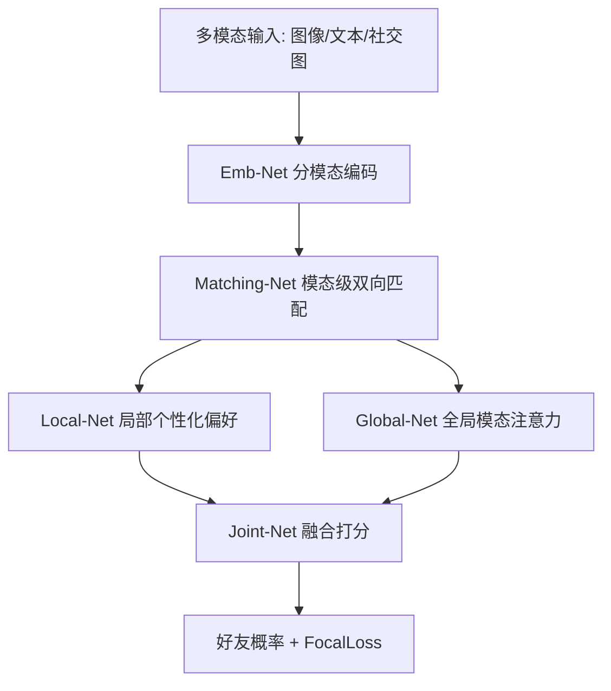

# FROG: Effective Friend Recommendation in Online Games via Modality-aware User Preferences (基于模态感知用户偏好的在线游戏高效好友推荐)

- **会议/期刊**: SIGIR 2025
- **作者与机构**: Qiwei Wang, Dandan Lin, Wenqing Lin, Ziming Wu（腾讯 / 深圳市计算科学研究院）
- **推荐链路定位**: 召回（好友候选打分）
- **研究方向**: 社交与群组推荐 / 多模态推荐
- **论文原文**: [论文原文链接](https://arxiv.org/abs/2504.09428v3)
- **开源代码**: 暂未开源（正文提及 GitHub 地址但未提供可验证仓库）

## TL;DR (1分钟核心速览)

在线游戏好友推荐需要同时融合图像、文本、社交图等多模态特征与好友图高阶结构，但现有方法要么忽略高阶拓扑邻近，要么只在个体 embedding 层面聚合而丢失用户对之间的模态级相关性，要么缺少局部+全局的模态偏好建模。FROG 提出端到端模型：Matching-Net 做模态级双向成对匹配，Local-Net 与 Global-Net 分别从单样本与全体样本决策平面刻画个性化模态注意力。在腾讯两个真实数据集上，HR@10 相对次优提升 3.70%/15.81%，NDCG@20 提升 3.70%/14.59%；线上 A/B 的 accRate 与 intRate 分别提升 33.3% 与 25.5%。

## Background & Motivation (背景与核心矛盾)

- **主流范式**: 好友推荐分三类——基于拓扑邻近（Personalized PageRank、三元闭包、Katz 中心性）、基于排序学习（BPR+DNN）、基于图嵌入/GNN（GraphSAGE、GrafRank、EBR）；通用 CTR 模型（FM、DeepFM、AutoInt）也常被直接迁移。
- **前人局限**: (1) 邻近法与排序法完全忽略多模态信号（头像、昵称、游戏等级）；(2) GrafRank 虽融合多模态与拓扑，但只更新个体用户 embedding，无法刻画用户对之间的模态级相关性；(3) 所有方法都缺少对"每个用户对各模态注意力不同"的局部+全局联合建模。
- **核心洞察 (Key Insight)**: 好友决策本质是**成对 (pairwise)** 问题——"u 想加 v"与"v 想加 u"并不对称；且头像卡通风格、游戏等级相近等模态信号对接受率影响显著，需在模态粒度上做双向匹配。
- **本文切入点**: 用 Matching-Net 在模态级学习非对称双向相关性，再用 Local-Net（单样本 MLP）与 Global-Net（全体共享决策平面）双路融合模态偏好。

## Method (核心方法设计)

### 1. 整体框架 (Overall Architecture)

输入用户 $u,v$的多模态数据$X_u,X_v$，Emb-Net 按模态类型分别编码（图像用 EfficientNet+MoCo 两阶段预训练、文本用 Transformer 编码器、社交图用 GraphSAGE 取$K=2$跳邻域），拼接为模态级表示$M_u,M_v$。Matching-Net 对每个模态计算双向相关性向量并做 Hadamard 积得到成对相似度嵌入$E^i_{u,v}$；Local-Net 用 MLP 从拼接的成对嵌入中提取局部个性化偏好，Global-Net 用共享决策平面$\mathbf{A}$做全局模态注意力；Joint-Net 融合两路输出经两层非线性得到好友概率$\hat{y}_{u,v}$，以 FocalLoss 端到端训练。

### 2. 关键设计拆解 (Key Designs)

1. **Matching-Net 模态级双向匹配**：痛点是用欧氏距离/内积算相似度是对称的，无法表达"u 对 v 的兴趣 ≠ v 对 u 的兴趣"。作者为每个模态引入两组可学习相关性向量 $R^i_{v\to u},R^i_{u\to v}$，先算注意力$C^i_{u,v}=P^i_u M^i_u Q^i_u$，经$\tanh$得亲和矩阵$G^i_{u,v}=\tanh((C^i_{u,v})^\top C^i_{u,v})$，再行列均值池化得双向相关性，最终$E^i_{u,v}=M^i_u\circ R^i_{v\to u}+M^i_v\circ R^i_{u\to v}$。Hadamard 积让每个维度独立加权，物理直觉是"按对方偏好维度选择性放大自身特征"。

2. **Global-Net 全局模态注意力**：Local-Net 只看单个训练样本，无法学到"图像整体比文本更重要"这类跨全体用户的模态权重。Global-Net 引入可训练向量 $\mathbf{A}\in\mathbb{R}^{1\times d}$作为全局样本决策平面，将拼接的成对嵌入投影到该平面上：$p^{global}_{u,v}=(\varsigma_{1\le i\le t}(E^i_{u,v}))^\top\mathbf{A}$。$\mathbf{A}$ 被所有训练样本共享，等价于一个全局 key 的注意力，使模型能捕获全体用户层面的模态重要性排序。

3. **训练目标、负采样与推理效率**：采用 FocalLoss 处理"同一用户多次接受/拒绝推荐"的难易样本不均衡：$\mathcal{L}=-\alpha(1-\hat{y})^\gamma\log\hat{y}\cdot y-(1-\alpha)\hat{y}^\gamma\log(1-\hat{y})\cdot(1-y)$。训练/验证集对每个正样本随机采 3 个负样本（1:3），测试集用全量候选。单对推理复杂度$O(\sum_i T_i+td^2+(td)^2h+td+(h+d)^2)$，其中$t$为模态数、$h$ 为 Local-Net 隐层维度，线上每 12 小时全量重建模型。

## Experimental Setup & Evaluation Protocol (实验设置与评估协议)

- **数据集与预处理**: 腾讯两款在线游戏真实好友发送行为，正样本为"用户对推荐对象发出好友请求"，负样本为"未发送"。

| 数据集 | #Training | #Validation | #Testing | #Total | 场景说明 |
| :--- | :---: | :---: | :---: | :---: | :--- |
| Game1 | 697,979 | 174,495 | 3,210,833 | 4,083,307 | 腾讯游戏 A |
| Game2 | 1,085,124 | 271,281 | 8,986,352 | 10,342,757 | 腾讯游戏 B（更大规模） |

- **数据划分与防穿越 (Splitting Strategy)**: 先取连续 7 天好友记录，每用户 80% 历史作训练、20% 作验证；**再取随后 1 天全部记录作测试集**，属于严格时间切分，避免未来信息泄漏。
- **排名评测协议 (Ranking Protocol)**: 测试阶段对候选用户做排序评测，报告 HR@{5,10,20} 与 NDCG@{5,10,20}；训练/验证负采样比 1:3，测试为全候选排序。每个实验重复 5 次取均值。
- **对比基线与超参设置**: 11 个基线覆盖 LR、MLP、FM、DeepFM、AutoInt、AutoFIS+DeepFM、DMF、GraphSAGE+Max/Mean、GrafRank、EBR；Adam 优化器，学习率 0.001，最大 50 epoch，batch size 1024，激活函数分别为 softmax/ReLU/Sigmoid；所有方法共享同一 Emb-Net 多模态嵌入与训练策略以保证公平。

## Key Experimental Results (实验关键数据)

### 1. 主实验对比 (Main Results)

| Model | Game1 HR@10 | Game1 NDCG@10 | Game1 NDCG@20 | Game2 HR@10 | Game2 NDCG@10 | Game2 NDCG@20 |
| :--- | :---: | :---: | :---: | :---: | :---: | :---: |
| LR | 0.2382 | 0.2663 | 0.2777 | 0.0189 | 0.0131 | 0.0210 |
| FM | 0.2404 | 0.2661 | 0.2769 | 0.0163 | 0.0111 | 0.0188 |
| DeepFM | 0.2401 | 0.2666 | 0.2781 | 0.0169 | 0.0126 | 0.0208 |
| AutoInt | 0.2405 | 0.2669 | 0.2782 | 0.0212 | 0.0155 | 0.0237 |
| GraphSAGE+Mean | 0.2404 | 0.2667 | 0.2779 | 0.0199 | 0.0148 | 0.0225 |
| GrafRank | 0.2400 | 0.2659 | 0.2778 | 0.0204 | 0.0151 | 0.0235 |
| EBR | 0.2406 | 0.2668 | 0.2781 | 0.0204 | 0.0149 | 0.0235 |
| **FROG** | **0.2495** | **0.2715** | **0.2885** | **0.0245** | **0.0171** | **0.0271** |
| Improv. | +3.70% | +1.57% | +3.70% | +15.81% | +10.32% | +14.59% |

### 2. 消融实验 (Ablation Study)

Game1 数据集上移除各模块（括号内为相对完整模型的下降幅度）：

| 变体 | HR@5 | NDCG@5 | HR@10 | NDCG@10 | HR@20 | NDCG@20 |
| :--- | :---: | :---: | :---: | :---: | :---: | :---: |
| w/o Matching-Net | 0.2129 (-2.3%) | 0.2587 (-1.9%) | 0.2415 (-3.31%) | 0.2669 (-1.72%) | 0.2487 (-3.82%) | 0.2787 (-3.52%) |
| w/o Local-Net | 0.2113 (-3.1%) | 0.2553 (-3.3%) | 0.2395 (-4.18%) | 0.2657 (-2.18%) | 0.2471 (-4.49%) | 0.2774 (-4.00%) |
| w/o Global-Net | 0.2127 (-2.4%) | 0.2572 (-2.5%) | 0.2407 (-3.66%) | 0.2673 (-1.57%) | 0.2489 (-3.74%) | 0.2777 (-3.89%) |
| **FROG** | **0.2179** | **0.2637** | **0.2495** | **0.2715** | **0.2582** | **0.2885** |

### 3. 关键实验发现 (Key Findings)

1. **模态级成对匹配是最大增益来源**：Game2 上 FROG 相对 AutoInt 的 HR@10 提升 15.81%，而 AutoInt 已能显式建模特征交叉，说明单纯特征交叉无法替代"用户对之间非对称模态相关性"的建模；Game1 提升幅度较小（3.70%），暗示小规模数据下模态信号区分度更弱。
2. **Local-Net 与 Global-Net 缺一不可且互补**：消融显示移除 Local-Net 在 HR@20 上下降 4.49%（最大），移除 Global-Net 下降 3.74%，二者分别贡献局部单样本判别与全局模态重要性排序，联合使用才达到最优。
3. **线上收益远超离线**：A/B 测试中 FROG 的 accRate 达 57.14%（AutoInt 42.86%，+33.3%），intRate 达 62.51%（AutoInt 50.01%，+25.5%），说明离线 HR/NDCG 的小幅提升在真实曝光-接受链路上被显著放大，验证了模态感知匹配对用户真实决策的价值。

## Highlights & Limitations (亮点、对比与审稿批判)

- **与代表作对比 (vs. Prior Work)**: 相比 GrafRank（模态特定聚合但缺全局偏好、只更新个体 embedding），FROG 增加了模态级双向成对匹配与全局决策平面；相比 AutoInt（纯特征交叉、无高阶拓扑），FROG 通过 GraphSAGE 注入 $K=2$ 跳结构邻近；相比 EBR（图感知 embedding 但无多模态），FROG 完整融合图像/文本/图三类模态。
- **可迁移亮点**: (1) 双向相关性向量 + Hadamard 积的非对称匹配算子可直接迁移到社交推荐、招聘匹配等成对任务；(2) 共享决策平面 $\mathbf{A}$ 的全局注意力是一种极轻量的"全局模态重要性"注入方式，几乎不增加推理开销。
- **审稿级局限批判**: (1) 图像编码器依赖离线两阶段预训练（EfficientNet+MoCo），线上每 12 小时全量重建模型，工程成本与特征新鲜度之间存在张力，论文未报告推理延迟；(2) 离线评测仅用 HR/NDCG 且负采样比固定 1:3，缺少对负采样比例与冷启动用户的敏感性分析，线上 A/B 也仅对比 AutoInt 单一基线。

## Rating (四维评分)

- **方法创新性 (Novelty)**: ⭐⭐⭐⭐ （模态级双向非对称匹配 + 全局决策平面注意力组合新颖，但各组件本身均为成熟算子的巧妙拼接）
- **评估协议与实验扎实度 (Protocol & Experiments)**: ⭐⭐⭐⭐ （两个大规模真实数据集 + 严格时间切分 + 11 个基线 + 线上 15 天 A/B，但缺负采样与冷启动敏感性分析）
- **写作与数学规范度 (Clarity & Rigor)**: ⭐⭐⭐⭐ （公式与复杂度证明完整，但部分符号排版有噪声、Matching-Net 注意力维度定义略含糊）
- **工业落地与复现价值 (Industrial & Practical Value)**: ⭐⭐⭐⭐ （腾讯线上部署验证、复杂度可控，但代码未实际开源、图像预训练流程复现门槛较高）

