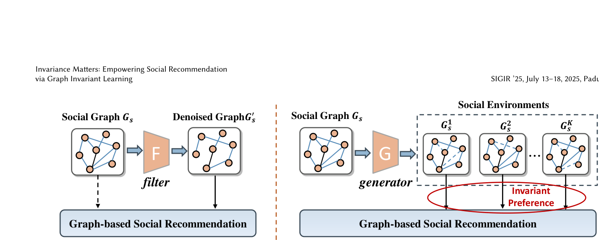
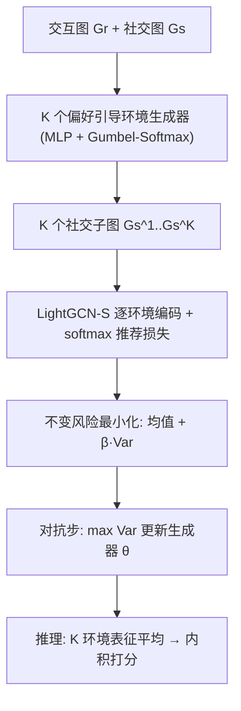
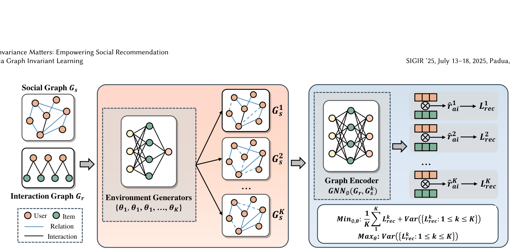

# Invariance Matters: Empowering Social Recommendation via Graph Invariant Learning (不变性至上：以图不变学习赋能社交推荐)

- **会议/期刊**: SIGIR 2025
- **作者与机构**: Yonghui Yang, Le Wu (通讯), Yuxin Liao, Zhuangzhuang He, Pengyang Shao, Richang Hong, Meng Wang；合肥工业大学大数据知识工程重点实验室 / 合肥综合性国家科学中心数据空间研究院
- **推荐链路定位**: 召回（图嵌入召回，LightGCN-S 骨干）
- **研究方向**: 社交与群组推荐 / 自监督对比学习与交互去噪
- **论文原文**: [https://arxiv.org/abs/2504.10432v2](https://arxiv.org/abs/2504.10432v2)
- **开源代码**: [https://github.com/yimutianyang/SIGIR2025-SGIL](https://github.com/yimutianyang/SIGIR2025-SGIL)

## TL;DR (1分钟核心速览)

社交图天然含任务无关噪声，但"哪条边是噪声"没有 ground truth，现有过滤式去噪（GBSR/ShaRe/GDMSR）本质是在无标签下猜边、易误删。本文换范式：不删边，而是用 $K$ 个偏好引导的边丢弃生成器模拟多个噪声社交环境，在环境间做不变风险最小化（IRM）逼出跨环境稳定的用户偏好，并用对抗训练最大化环境间风险方差以扩大环境多样性。三个数据集 Full-Ranking 协议下，NDCG@20 较最强基线 GBSR 提升 5.39%–8.70%，较骨干 LightGCN-S 提升 17.58%–32.01%。

## Background & Motivation (背景与核心矛盾)

- **主流范式**: 图社交推荐（DiffNet++/SocialLGN/LightGCN-S）把用户-物品交互图与用户-用户社交图拼成异构图做 GCN 传播，用高阶社交影响缓解交互稀疏。
- **前人局限**: ① 直接聚合全部社交边并不稳定——Douban-Book 上所有图社交方法（GraphRec/DiffNet++/SocialLGN）反而低于纯 CF 的 LightGCN，说明社交边可带来负迁移；② 过滤式去噪（ESRF 对抗生成邻居、GDMSR 偏好引导剪枝、ShaRe 图重写、GBSR 信息瓶颈）都依赖"识别噪声边"，但无标签可验证，剪枝阈值/置信度本身不可靠，且剪掉的边不可恢复。
- **核心洞察 (Key Insight)**: 若某部分用户偏好能在**各种噪声分布下都保持预测能力**，它才对应真正任务相关的社交结构；因此不必知道哪条边是噪声，只需保证"跨环境不变性"即可隐式逼近充分且不变的社会子图（Assumption 1：充分性 $y=f(\mathcal{G}_I)+\epsilon$与不变性$p(y|\mathcal{G}_I,e)=p(y|\mathcal{G}_I,e')$）。
- **本文切入点**: 把社交去噪重构成图 OOD 泛化问题——用环境模拟 + 不变风险最小化替代边过滤。

<figure class="paper-figure" markdown="span">
  <figcaption>图1：现有基于过滤的社交去噪方法与本文提出的基于不变性的方法的示意图。我们不是过滤输入社交图中的噪声部分，而是鼓励学习跨环境中不变且充分的用户偏好。</figcaption>
</figure>

## Method (核心方法设计)

### 1. 整体框架 (Overall Architecture)

输入交互图 $\mathcal{G}_r$与社交图$\mathcal{G}_s$，先用 LightGCN-S 编码得到用户/物品表征；再由$K$个独立 MLP 生成器依据用户偏好相似度输出每条社交边的保留概率，经 Gumbel-Softmax 重参数化采样出$K$个社交子图（即$K$个噪声环境）；每个环境各自拼异构图、跑 GCN、算 softmax 推荐损失$\mathcal{L}^k_{rec}$；最后以"均值风险 +$\beta\cdot$风险方差"做不变优化，同时用对抗步最大化方差以逼生成器产出更分散的噪声分布。推理时对$K$ 个环境的用户/物品表征取平均后内积打分。

<figure class="paper-figure" markdown="span">
  <figcaption>图2：本文提出的SGIL框架概览，包含两个精心设计的模块。(1) 环境模拟：旨在生成多个社交环境；(2) 不变偏好学习：目标是在不同环境间获得不变的用户偏好。</figcaption>
</figure>

### 2. 关键设计拆解 (Key Designs)

1. **偏好引导的多环境生成器（Environment Simulation）**：痛点是无标签无法定位噪声边，故改为"造分布"。第 $k$个环境按边保留概率采样$\mathbf{S}^k=\{s_{ab}\odot\rho^k_{ab}\}$，其中$\rho^k_{ab}\sim \mathrm{Bern}(w^k_{ab})+\epsilon$，$w^k_{ab}=g^k_\theta(\mathbf{e}_a,\mathbf{e}_b)$由两层 MLP 从用户偏好表征算出，$\epsilon=0.5$保证已观测边置信度高于未观测边；离散采样用 Gumbel-Softmax 松弛$\mathrm{Bern}(w_{ab})=\mathrm{sigmoid}((\log(\delta/(1-\delta))+w_{ab})/t)$，$t=0.2$。直觉：不同生成器参数$\theta^k$ 天然对应不同"噪声假设"，把不可知的噪声空间变成可枚举的环境集合。

2. **环境级 ERM 的分布对齐改写**：直接对单点 $(a,i)$做 BPR 式对齐无法保证不变性（交互非 IID）。作者把损失改为按用户对齐整条交互分布$\mathcal{L}^k_{rec}=\sum_{a}\mathcal{L}(\sigma(f^k_\phi(a,V)),\mathbf{R}_a)$，并由贝叶斯推导出密度比$p(a,i|r{=}1)/p(a,i|r{=}0)=C\exp(f^k_\phi(a,i))$，代入 batch 内 softmax 得
$$\mathcal{L}^k_{rec}=-\frac{1}{|\mathcal{D}|}\sum_{(a,i)\in\mathcal{D}}\frac{\exp(\langle \boldsymbol{p}^k_a,\boldsymbol{q}^k_i\rangle/\tau)}{\sum_{j\in\mathcal{I}_b}\exp(\langle \boldsymbol{p}^k_a,\boldsymbol{q}^k_j\rangle/\tau)}$$
即"每用户一个 softmax 列表"，使跨环境对齐发生在偏好分布层面而非单点分数层面。

3. **不变性目标 + 对抗环境探索**：总目标 $\min_{\phi,\theta}\frac{1}{K}\sum_k \mathcal{L}^k_{rec}+\beta\,\mathrm{Var}(\{\mathcal{L}^k_{rec}\})$，第一项保充分性、第二项保不变性；再用$\max_\theta \mathrm{Var}(\{\mathcal{L}^k_{rec}\})$让生成器主动寻找"最难一致"的噪声分布。为稳定对抗，探索步每$T$个 batch 执行一次（Douban/Yelp$T{=}20$，Epinions$T{=}3$）。训练负采样为 in-batch softmax（非 BPR 采样），推理为全库内积排序；额外开销仅$K$个$2d\times d$ MLP，总训练时间约为 LightGCN-S 的 1–3 倍。

## Experimental Setup & Evaluation Protocol (实验设置与评估协议)

- **数据集与预处理**: 沿用 GBSR 的三数据集设定，随机抽 80% 交互作训练、20% 作测试（比例划分，非 Leave-One-Out）。

| 数据集 | #Users | #Items | #Interactions | 交互密度 | 社交边数 / 关系密度 |
| :--- | :---: | :---: | :---: | :---: | :--- |
| Douban-Book | 13,024 | 22,347 | 792,062 | 0.048% | 169,150 / 0.268% |
| Yelp | 19,593 | 21,266 | 450,884 | 0.034% | 864,157 / 0.206% |
| Epinions | 18,202 | 47,449 | 298,173 | 0.035% | 381,559 / 0.115% |

- **数据划分与防穿越 (Splitting Strategy)**: 随机 80/20 比例划分；另构造半合成数据集（按比例 $\sigma$ 注入虚假社交边）用于噪声鲁棒性测试。
- **排名评测协议 (Ranking Protocol)**: 无偏 `Full-Ranking`（全部未交互物品为候选），指标 Recall@10/20、NDCG@10/20。
- **对比基线与超参设置**: 图社交类 GraphRec、DiffNet++、SocialLGN、LightGCN-S；去噪类 ESRF、GDMSR、SEPT、ShaRe、GBSR（均统一架在 LightGCN-S 骨干上）。$d=64$，GCN 层$L=3$，$\tau=0.2$，$\epsilon=0.5$，Adam lr=1e-3，batch=2048，$p<0.05$ 显著性。

## Key Experimental Results (实验关键数据)

### 1. 主实验对比 (Main Results)

| 模型 | Douban R@20 | Douban N@20 | Yelp R@20 | Yelp N@20 | Epinions R@20 | Epinions N@20 |
| :--- | :---: | :---: | :---: | :---: | :---: | :---: |
| LightGCN | 0.1526 | 0.1283 | 0.1081 | 0.0623 | 0.0675 | 0.0385 |
| DiffNet++ | 0.1489 | 0.1270 | 0.1114 | 0.0640 | 0.0727 | 0.0406 |
| LightGCN-S | 0.1506 | 0.1281 | 0.1126 | 0.0651 | 0.0716 | 0.0417 |
| SEPT | 0.1592 | 0.1382 | 0.1176 | 0.0682 | 0.0724 | 0.0416 |
| ShaRe | 0.1544 | 0.1325 | 0.1138 | 0.0658 | 0.0771 | 0.0438 |
| GBSR | 0.1694 | 0.1523 | 0.1243 | 0.0724 | 0.0793 | 0.0464 |
| **SGIL** | **0.1809** | **0.1627** | **0.1323** | **0.0787** | **0.0844** | **0.0489** |
| Improv. (vs GBSR) | +6.79% | +6.83% | +6.44% | +8.70% | +6.43% | +5.39% |

### 2. 消融实验 (Ablation Study)

| 变体 | Douban N@20 | Yelp N@20 | Epinions N@20 | 说明 |
| :--- | :---: | :---: | :---: | :--- |
| SGIL-w/o EG | 0.1495 | 0.0713 | 0.0417 | 去掉环境生成器，退化为 LightGCN-S+ERM |
| SGIL-w/o IL | 0.1562 | 0.0735 | 0.0436 | 去掉不变性正则，仅用多环境均值表征 |
| SGIL-w/o EE | 0.1626 | 0.0773 | 0.0487 | 去掉对抗环境探索 |
| **SGIL** | **0.1627** | **0.0787** | **0.0489** | 完整模型 |

### 3. 关键实验发现 (Key Findings)

1. **环境模拟是最大贡献项**：去掉 EG 后 NDCG@20 从 0.1627 掉到 0.1495（Douban，−8.1%），甚至低于 GBSR 的 0.1523，说明"多环境"本身比"不变性正则"更关键——没有环境多样性，IRM 项无从谈起。
2. **噪声越重优势越大**：在半合成数据上注入噪声比 $\sigma=2.0$时，SGIL 相对骨干提升约 28%，且随$\sigma$ 增大各去噪方法相对骨干的增益单调上升，验证不变性范式对高噪声分布的外推能力优于边过滤。
3. **稀疏用户受益更多**：按交互量分 Low/Medium/High 三组，SGIL 在 Low 组相对骨干的提升幅度最大，符合"长尾用户更依赖社交信号、因而更需稳定社交结构"的假设；参数上 $K=4$在三数据集一致最优，$\beta$ 最优值分别为 0.15/0.05/0.10，说明不变性权重需按数据噪声强度调节。

## Highlights & Limitations (亮点、对比与审稿批判)

- **与代表作对比 (vs. Prior Work)**: 与 GBSR（信息瓶颈剪枝，需保留"最小充分"子图）本质不同——SGIL 不删任何边，而是让所有边在概率意义上参与多个环境，靠跨环境一致性自动压低噪声边的影响；与 ShaRe（对比学习重写图）相比，SGIL 的监督信号来自风险方差而非增广视图一致性，且对抗步使环境分布可学习而非固定增广策略；与 ESRF（对抗生成邻居）相比，ESRF 的对抗目标是"生成更难的邻居再过滤"，SGIL 的对抗目标是"生成更分散的环境以扩大不变性约束的覆盖"。
- **可迁移亮点**: ① "每用户 softmax 列表损失 + 密度比推导"可迁移到任何需要分布级对齐而非点级对齐的推荐场景；② 跨 batch 的对抗探索调度（每 $T$ 步一次）是稳定 IRM 类对抗训练的实用技巧。
- **审稿级局限批判**: ① 训练开销为骨干的 1–3 倍且需 $K$倍前向，$K$与$\beta$ 需逐数据集网格搜索，工业部署成本不可忽视；② 环境生成器仅基于用户偏好相似度构造边丢弃分布，噪声假设仍偏窄（未覆盖"恶意/机器人社交边"等结构性噪声），且 80/20 随机划分未做时间切分，存在未来交互泄漏风险，离线增益到线上的转化缺乏 A/B 验证。

## Rating (四维评分)

- **方法创新性 (Novelty)**: ⭐⭐⭐⭐ （把社交去噪从"无标签剪边"重构为图不变学习，范式转换清晰，且有 IRM 理论假设支撑）
- **评估协议与实验扎实度 (Protocol & Experiments)**: ⭐⭐⭐⭐ （三数据集 + 半合成噪声 + 稀疏分桶 + 参数敏感性齐全，Full-Ranking 无偏，但缺时间切分与线上验证）
- **写作与数学规范度 (Clarity & Rigor)**: ⭐⭐⭐⭐ （密度比推导与 ERM 改写链条完整，复杂度分析到位；部分符号如 $\epsilon$ 兼作偏置与噪声略有歧义）
- **工业落地与复现价值 (Industrial & Practical Value)**: ⭐⭐⭐⭐ （代码已开源、即插即用于 LightGCN-S 骨干，但 $K$ 倍训练开销与超参搜索成本限制大规模直接上线）

