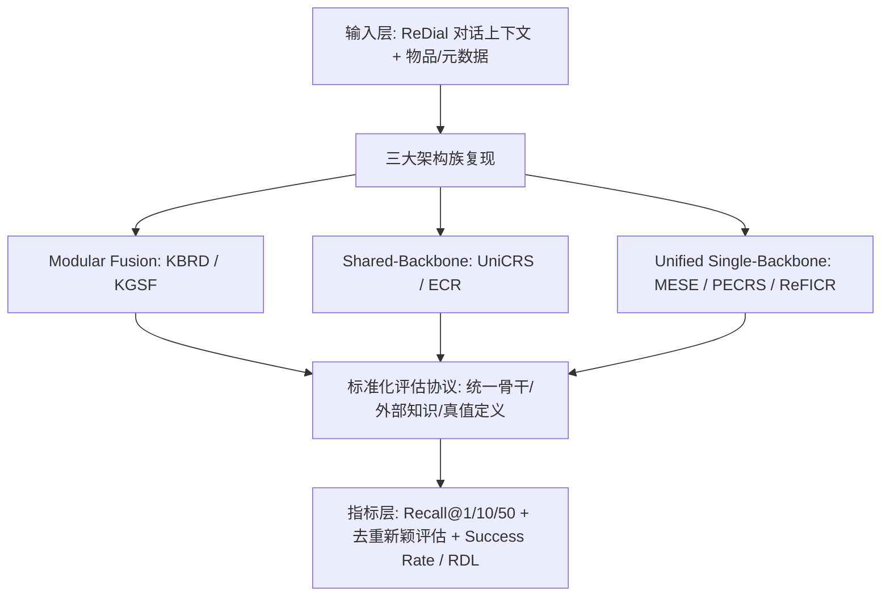
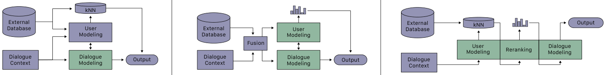
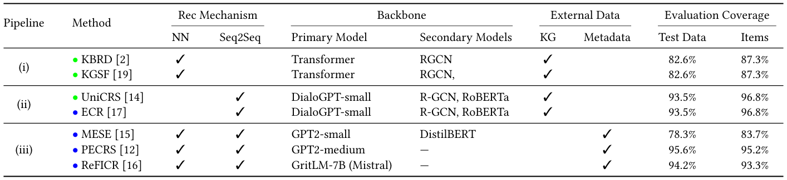
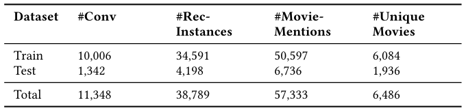
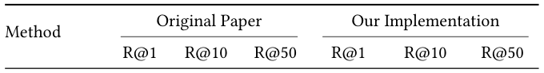
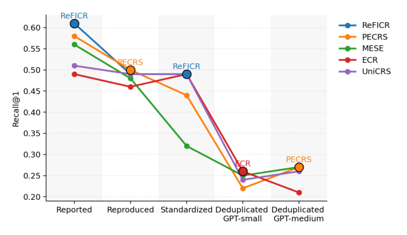
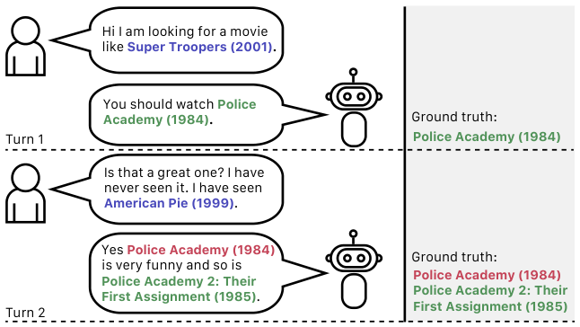

# A Standardized Re-evaluation of Conversational Recommender Systems on the ReDial Dataset (ReDial 数据集上对话推荐系统的标准化重评估)

- **会议/期刊**: SIGIR 2026 (第 49 届国际 ACM SIGIR 会议，2026 年 7 月 20–24 日，墨尔本)
- **推荐链路定位**: 端到端生成式 (End-to-End Generative) / 对话式推荐排序 (Conversational Ranking)
- **研究方向**: 对话推荐与智能体仿真 (主) / 去偏公平与工业评测基准 (次)
- **论文原文**: [https://arxiv.org/abs/2605.13053v2](https://arxiv.org/abs/2605.13053v2)
- **开源代码**: [https://github.com/iai-group/redial-reproducibility](https://github.com/iai-group/redial-reproducibility)

## TL;DR (核心速览)

本文针对对话推荐系统 (CRS) 在 ReDial 基准上"预处理各异、真值定义不一、LLM 骨干混杂"导致结果不可比的核心痛点，系统复现了 3 大架构族共 7 个代表性方法（KBRD/KGSF/UniCRS/ECR/MESE/PECRS/ReFICR），并在统一 LLM 骨干、外部知识与真值定义下重评估。发现：Recall@1 存在"粒度鸿沟"（超半数方法偏差 >10%），约 50% 报告准确率来自"重复捷径"，增益多由 LLM 容量而非架构创新驱动；引入 Success Rate 与 RDL 用户效用指标后，传统 Recall 显著高估真实对话效用。

## Background & Motivation (背景与动机)

- **领域背景与主流范式**: 对话推荐系统 (CRS) 通过自然语言交互建模用户偏好并推荐物品。ReDial 是引用超 600 次的最广泛使用基准，采用人-人众包对话（seeker 陈述偏好，recommender 给出推荐），每条 recommender 轮次构成一个独立评估实例。当前主流范式已从早期 Seq2Seq 响应生成转向以 LLM 为骨干的端到端统一建模。
- **现有方法局限 (Limitations of Prior Work)**:
  1. **真值定义不一致**：ground-truth 物品常通过从对话中抽取电影提及并与外部电影库交叉引用构建，导致各论文测试集不同，直接比较困难。
  2. **混杂因素未控制**：性能增益常被单独归因于所提方法，但对比基线往往使用更小或前 LLM 时代的模型；LLM 骨干容量与外部知识源（KG/metadata）的使用成为混淆变量。
  3. **重复捷径 (Repetition Shortcut)**：He et al. [6] 指出数据集中同一物品在多轮被重复推荐，ReDial 测试集中 11.83% 的评估轮次其真值物品已出现在对话上下文中，朴素"推荐上下文中最后提及物品"即可获得竞争性结果，但多数论文仍沿用未去重的非真实设定。
- **核心挑战 (Key Challenge)**: 为什么简单的增加模型深度或换更大 LLM 无法解决？因为问题不在建模能力，而在**评估协议本身失真**——静态离线 Recall 指标与真实用户满意度相关性差（Bernard & Balog [1]），且实现细节（checkpoint 选择、预处理、run 选择）对细粒度指标影响巨大，使得"声称的进步"难以区分是真实建模创新还是实验条件不均（呼应 Ferrari Dacrema et al. [4] 的担忧）。
- **核心洞察与切入点 (Key Insight)**: 作者通过控制三个关键变量——(1) 底层 LLM 骨干、(2) 外部知识使用、(3) 真值物品定义（特别是仅考虑新提及物品的设定）——构建统一二维分类法（架构维度 × 成熟度维度：established vs. contemporary SOTA），从而将"根本建模创新"带来的增益与"更现代骨干/不同评估协议"带来的增益解耦。

## Problem Formulation & Method (问题定义与方法架构)

### 1. 符号定义与输入表征 (Notations & Input Representations)

- 用户集（seeker）与推荐物品集（电影）来自 ReDial；每条 recommender 轮次为一个评估实例。
- 输入：该轮次之前的全部对话上下文 $C = \{u_1, r_1, \dots, u_t\}$（合并同一说话人连续轮次后的 utterance 序列）。
- 输出：对该轮次 ground-truth 电影集合 $\mathcal{G}_t$ 的排序/推荐。
- 真值定义：$\mathcal{G}_t$ 为人类 recommender 在该轮提及的电影；本文额外定义"新颖真值" $\mathcal{G}^{\text{novel}}_t = \mathcal{G}_t \setminus \text{items}(C)$，即剔除上下文中已出现的物品，用于消除重复捷径。
- 外部辅助：知识图谱（DBPedia、ConceptNet）与物品元数据（metadata），依方法而异。

### 2. 整体流水线 (Overall Architecture)

本文并非提出新模型，而是构建**标准化重评估流水线**：统一数据预处理 → 按三大架构族复现 7 个方法 → 在受控条件下（统一 LLM 骨干 / 外部知识 / 真值定义）重跑 → 对比原文报告值与复现值 → 引入用户效用指标再评估。

图 3 展示了现代 CRS 的三类常用流水线：绿色为使用 LLM 的组件。(左) Modular Fusion（KBRD、KGSF）用分离的用户建模与对话建模组件，推荐器输出与建模组件输出融合；(中) Shared-Backbone（UniCRS、ECR）用同一骨干经专门多阶段训练同时做推荐与响应生成，主要通过软提示嵌入适配；(右) Unified Single-Backbone（MESE、PECRS、ReFICR）用真正统一的单模型负责用户建模、候选排序与响应生成，并以多任务联合损失端到端训练。

<figure class="paper-figure" markdown="span">
  <figcaption>图 3</figcaption>
</figure>

### 3. 核心模块设计与数学原理 (Key Designs & Formulations)

**(1) 二维分类法与七方法选择**。作者沿两个维度组织方法：(i) 架构维度——Modular Fusion（KBRD [2]、KGSF [19]）、Shared-Backbone（UniCRS [14]、ECR [17]）、Unified Single-Backbone（MESE [15]、PECRS [12]、ReFICR [16]）；(ii) 成熟度维度——established 基线 vs. contemporary SOTA。表 2 给出各方法的推荐机制、骨干、外部数据与评估覆盖率（Test Data / Items 两个可复现性约束列）。

<figure class="paper-figure" markdown="span">
  <figcaption>表 2</figcaption>
</figure>

**(2) 重复捷径的量化与去重评估**。设评估轮次集合为 $\mathcal{T}$，定义重复率 $\rho = \frac{1}{|\mathcal{T}|}\sum_{t\in\mathcal{T}} \mathbb{1}[\mathcal{G}_t \cap \text{items}(C_t) \neq \varnothing]$，原文报告 ReDial 测试集 $\rho = 11.83\%$。去重评估将真值替换为 $\mathcal{G}^{\text{novel}}_t$，从而度量模型在"提供新推荐"而非"复述上下文"上的真实能力。物理直觉：若模型仅靠复制上下文即可命中真值，则 Recall 被系统性高估，且该捷径在真实交互中无价值（用户已知的物品无需再推荐）。

**(3) 用户效用指标**。引入两个新颖的用户中心指标：
- **Success Rate (SR)**：对话中成功推荐（命中新颖真值）的比例/成功率；
- **RDL (Reward-per-Dialogue-Length)**：单位对话长度的奖励，衡量交互效率——即用更少轮次达成成功推荐的能力。
这两个指标将"准确率"与"交互成本"耦合，纠正传统 Recall 只看命中不看效率的偏差。

### 4. 训练目标、负采样与推理复杂度 (Optimization, Negative Sampling & Complexity)

- **损失函数**: 本文为复现研究，不提出新损失；各方法沿用原论文目标——KBRD/KGSF 用 KG 嵌入相似度匹配（BPR 类排序损失），UniCRS/ECR 用序列到序列生成损失（ECR 额外加入情感对齐），MESE/PECRS 用多任务联合损失（推荐 + 响应生成），ReFICR 用对比损失 (contrastive loss) 做稠密检索对齐。原文未统一报告各方法温度系数 $\tau$ 等细节。
- **训练负采样策略**: 原文未系统报告各方法的负采样细节；ReFICR 作为检索式方法采用对比学习框架（负例构造依赖其原实现）。本文重点不在负采样理论。
- **时间与空间复杂度**: 原文明确指出运行时是可复现性的实际约束——MESE 与 PECRS 实现为**顺序（非批处理）训练/推理**，显著增加训练与推理时间，使超参搜索与消融在常规硬件上不可行。其余方法复杂度原文未逐一报告具体 ms/request 或峰值显存。

## Experimental Setup & Evaluation Protocol (实验设置与评估协议)

- **数据集统计与预处理**: 使用 ReDial 基准，统计如表 1。预处理统一流程：合并同一说话人连续轮次为单条 utterance；丢弃无先前对话上下文的推荐轮次；过滤无法链接到方法所需外部电影库的电影。

<figure class="paper-figure" markdown="span">
  <figcaption>表 1</figcaption>
</figure>

| 数据集 (Dataset) | 对话数 (#Conv) | 推荐实例数 (#Rec-Instances) | 电影提及数 (#Movie-Mentions) | 唯一电影数 (#Unique Movies) | 模态/辅助特征说明 |
| :--- | :---: | :---: | :---: | :---: | :--- |
| Train | 10,006 | 34,591 | 50,597 | 6,084 | 对话文本 + 电影 ID + KG/metadata（依方法） |
| Test | 1,342 | 4,198 | 6,736 | 1,936 | 同上 |
| Total | 11,348 | 38,789 | 57,333 | 6,486 | — |

- **数据划分方式 (Splitting Strategy)**: 沿用 ReDial 官方 Train/Test 划分（非时间戳切分，非冷启动划分）。各方法使用作者发布的预处理数据（KBRD、KGSF、UniCRS、ECR）或运行其仓库预处理脚本（MESE、PECRS、ReFICR）。**数据泄露风险**：由于真值物品可能已出现在对话上下文中（11.83% 轮次），存在"重复捷径"型信息泄露，本文正是通过去重评估来消除该风险。
- **排名评测协议 (Ranking Protocol)**: 采用 **Full-Ranking（全库排序）** 语义——对候选电影全集排序并计算 Recall@K（K=1/10/50），而非采样负例排序。评估覆盖率为方法相关（表 2：Test Data 覆盖率 78.3%–95.6%，Items 覆盖率 83.7%–96.8%），这是跨方法比较的重要混杂来源。
- **评价指标与显著性检验**: 指标包括 Recall@1/10/50、Success Rate、RDL。原文**未报告**多随机种子方差或配对显著性检验（如 $p<0.05$）；作者指出 R@1 在不同训练 epoch 间振荡较大，checkpoint/run 选择对 R@1 报告尤为关键，但无法验证原论文的 run 选择流程。

## Key Experimental Results (核心实验结果)

### 1. 主实验对比 (Main Results)

表 3 对比原文报告值与本文复现值（颜色：绿 ≤5%，橙 >5% 且 ≤10%，红 >10%）。整体上高 cutoff（R@10、R@50）复现稳定，R@1 偏差显著。

<figure class="paper-figure" markdown="span">
  <figcaption>表 3</figcaption>
</figure>

| 方法 | 指标 | 原文报告 | 本文复现 | 相对偏差 |
| :--- | :--- | :---: | :---: | :---: |
| KBRD [2] | R@1 / R@10 / R@50 | 0.030 / 0.163 / 0.338 | 0.036↑ / 0.176↑ / 0.334↓ | 20.0% / 8.0% / 1.2% |
| KGSF [19] | R@1 / R@10 / R@50 | 0.039 / 0.183 / 0.378 | 0.034↓ / 0.179↓ / 0.365↓ | 12.8% / 2.2% / 3.4% |
| UniCRS [14] | R@1 / R@10 / R@50 | 0.051 / 0.224 / 0.428 | 0.049↓ / 0.213↓ / 0.421↓ | ≤4.9%（全部） |
| ECR [17] | R@1 / R@10 / R@50 | 0.049 / 0.220 / 0.428 | 0.046↓ / 0.217↓ / 0.426↓ | 6.1% / ≤1.4% / ≤1.4% |
| MESE [15] | R@1 / R@10 / R@50 | 0.056 / 0.256 / 0.455 | 0.048↓ / 0.243↓ / 0.452↓ | 14.3% / 5.1% / 0.7% |
| PECRS [12] | R@1 / R@10 / R@50 | 0.058 / 0.225 / 0.416 | 0.050↓ / 0.211↓ / 0.401↓ | 13.8% / 6.2% / 3.6% |
| ReFICR [16] | R@1 / R@10 / R@50 | 0.061 / 0.305 / 0.532 | 0.049↓ / 0.280↓ / 0.522↓ | 19.7% / 8.2% / 1.9% |

关键结论：仅 UniCRS 在三个 cutoff 上偏差均 ≤4.9%；ECR 在 R@10/R@50 上接近（≤1.4%）但 R@1 偏差 6.1%；两个最早期的 KG 方法（KBRD、KGSF）偏差最大（R@1 分别 20.0%、12.8%）。**超过一半的复现模型在 R@1 上偏离报告值 >10%**，构成"粒度鸿沟"。

图 1 直观展示 Recall@1 在不同评估设定下的变化：第一列为原论文报告结果，其余列为统一标准化设定下的结果，排序变化凸显方法比较对评估设置的敏感性。

<figure class="paper-figure" markdown="span">
  <figcaption>图 1</figcaption>
</figure>

### 2. 消融实验与控制变量分析 (Ablation Study)

本文为复现/重评估研究，**未做传统模块消融**，而是做**控制变量分析**：
- **LLM 骨干容量**：架构比较对 LLM 骨干选择敏感，报告增益不能总归因于架构设计本身，性能提升常更多由 LLM 骨干容量驱动。
- **外部知识使用**：KG/metadata 的使用是混杂因素，需在统一条件下隔离其影响。
- **真值定义**：去重（仅新颖物品）后，即便最强 SOTA 模型也出现显著性能下降；重复捷径贡献约 50% 的报告准确率。
- **评估覆盖率**：表 2 显示各方法可评估的测试实例比例与可推荐物品比例不同（如 MESE 仅 78.3% Test Data / 83.7% Items），直接影响可比性。

### 3. 稀疏度/冷启动分桶与超参敏感度 (Sparsity Buckets & Hyperparameters)

- **用户/物品交互频次分桶表现**: 原文未报告长尾/冷启动分桶分析。
- **关键超参数敏感度**: 原文未系统报告温度系数、损失权重等超参敏感度；但指出 R@1 随训练 epoch 振荡大，checkpoint 选择对细粒度指标影响显著。
- **线上 A/B 测试结果**: 原文仅包含离线实验，**未报告**线上 A/B 测试。

## Highlights, Limitations & Critiques (亮点、局限与审稿级批判)

- **核心亮点与可迁移性**:
  1. **标准化重评估范式**极具迁移价值：控制 LLM 骨干、外部知识、真值定义三变量的思路可推广到序列推荐、生成式推荐等其他子领域的基准复现。
  2. **重复捷径去重评估**与 **Success Rate / RDL 用户效用指标**可直接迁移到任何对话/交互式推荐评测，纠正 Recall 高估问题。
  3. **完整开源流水线**（含 legacy 模型的批处理扩展与标准数据划分）显著提升社区可复现性。
- **局限性与审稿视角批判 (Critical Limitations)**:
  1. **单一数据集**：仅基于 ReDial，结论（如 50% 重复捷径占比、粒度鸿沟幅度）能否外推到 INSPIRED、GoRecDial、TG-ReDial 等未验证。
  2. **统计严谨性不足**：未报告多随机种子方差与配对显著性检验，R@1 的振荡使"偏差 >10%"的判定本身可能受 run 选择影响；作者亦承认无法验证原论文 run 选择流程。
  3. **评估覆盖率不齐**：各方法可评估测试实例与物品比例不同（78.3%–95.6%），跨方法比较仍存在残余混杂，标准化并未完全消除。
  4. **复现工程受限**：MESE/PECRS 顺序非批处理实现导致超参搜索与消融不可行，可能使复现值未达各方法最优，偏差归因需谨慎。
  5. **未涉及响应生成质量**：因 LLM 生成文本的 human evaluation 成本高，本文仅聚焦推荐任务，未评估对话流畅性/信息量等生成维度。

## Rating (四维评分)

- **方法创新性 (Novelty)**: ⭐⭐⭐（非新模型，但标准化评估框架与效用指标具方法论贡献）
- **评估协议与实验扎实度 (Protocol & Experiments)**: ⭐⭐⭐⭐（三变量控制严谨、七方法全覆盖，但缺显著性检验与多数据集）
- **写作与数学规范度 (Clarity & Rigor)**: ⭐⭐⭐⭐（分类法清晰、结论明确，数学形式化较简）
- **工业落地与复现价值 (Industrial & Practical Value)**: ⭐⭐⭐⭐⭐（完整开源流水线 + 去捷径评估协议，对社区基准建设价值极高）

## 论文图表

<figure class="paper-figure" markdown="span">
  <figcaption>图 2</figcaption>
</figure>

