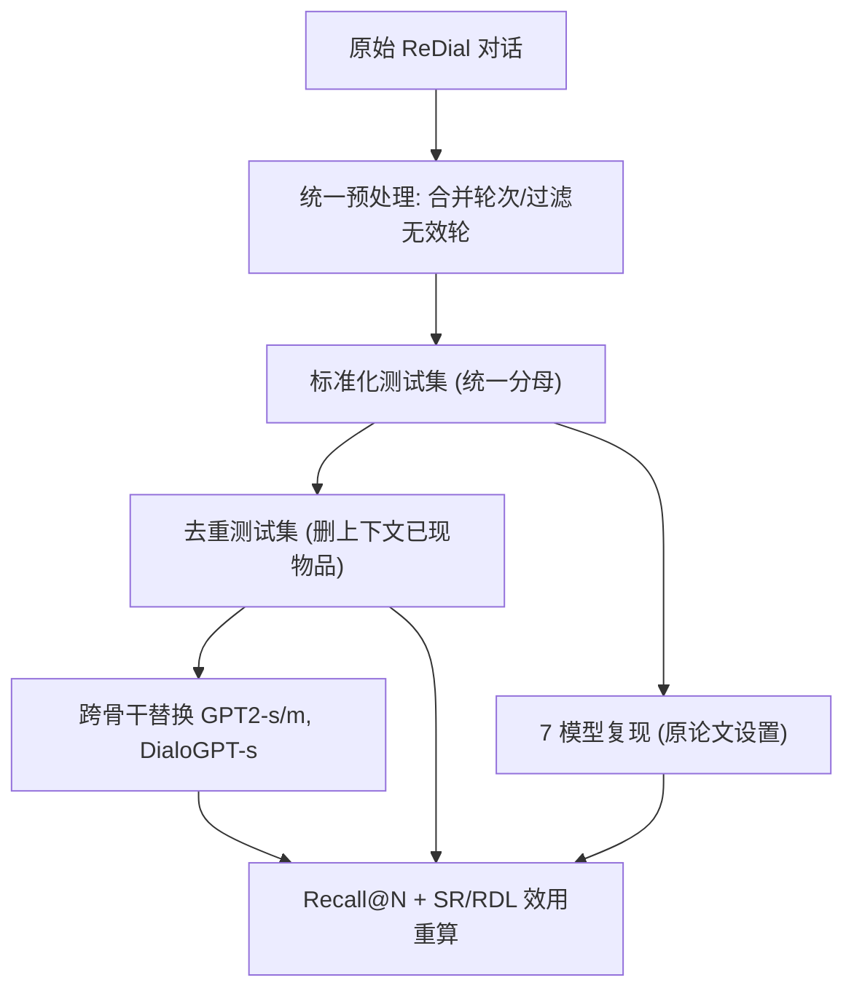

# A Standardized Re-evaluation of Conversational Recommender Systems on the ReDial Dataset (ReDial 对话推荐系统的标准化再评估)

- **会议/期刊**: SIGIR 2026
- **作者与机构**: Ivica Kostric, Krisztian Balog（University of Stavanger）
- **推荐链路定位**: 重排 / 对话式端到端推荐（评测与基准方向）
- **研究方向**: 对话推荐与智能体仿真 / 去偏公平与工业评测基准
- **论文原文**: [论文原文链接](https://arxiv.org/abs/2605.13053v2)
- **开源代码**: [开源代码仓库链接](https://github.com/iai-group/redial-reproducibility)

## TL;DR (1分钟核心速览)

ReDial 是 CRS 领域被引 600+ 的事实标准，但各论文在 ground-truth 定义、预处理、LLM 骨干与外部知识上各行其是，导致结果不可比。本文沿"架构族 × 成熟度"两维选出 7 个代表模型（KBRD/KGSF/UniCRS/ECR/MESE/PECRS/ReFICR），在统一数据划分、统一去重协议与统一骨干下重训重评。核心发现：R@50 全部可复现（≤5% 偏差），但 R@1 有 5/7 模型偏差超 10%；去重后多数模型 R@1 近乎腰斩（约 50% 精度来自"重复已提及物品"的捷径）；GPT2-small→medium 的骨干升级收益常超过架构创新本身；Recall 与用户效用（SR/RDL）显著脱钩。

## Background & Motivation (背景与核心矛盾)

- **主流范式**: 端到端 CRS 以 ReDial 为唯一大规模人-人对话基准，方法演化出三条流水线：模块化融合（KBRD/KGSF，用户建模与对话建模分离后融合）、共享骨干（UniCRS/ECR，同一骨干分阶段训练、软提示适配）、统一单骨干（MESE/PECRS/ReFICR，单模型多任务联合损失端到端）。
- **前人局限一（评测不可比）**: ground-truth 由对话中提及电影经外部库（DBPedia 等）映射得到，各方法过滤规则不同，测试集规模与物品覆盖从 78.3% 到 95.6% 不等，直接横比失真。
- **前人局限二（捷径污染）**: ReDial 中 11.83% 的评测轮其 ground-truth 物品已在前文出现，模型只需"复读上文"即可得分；He et al. 早已指出，但多数后续工作（含 PECRS/ReFICR/ECR）仍未去重。
- **核心洞察 (Key Insight)**: 性能提升可能来自三个混淆变量——更强的 LLM 骨干、外部知识、以及宽松的 ground-truth 定义——而非架构本身。必须把三者逐一控制住，才能判断"进步"是真是幻。
- **本文切入点**: 不做新模型，而是构建受控实验台：统一预处理与划分、引入去重测试集、跨骨干替换、并补上用户效用指标，用"复现 + 复算"两阶段审计整个子领域。

## Method (核心方法设计)

### 1. 整体框架 (Overall Architecture)

本文的"方法"是一套评测协议而非打分模型。流程为：先对原始 ReDial 做统一扁平化（合并同说话人连续话语、剔除无上下文或无推荐的轮次），得到标准化测试集；再对每个方法按其外部库映射物品，映射失败的物品从上下文中移除但**保留在 ground-truth 中并赋唯一负 ID（如 -101）**，从而保证各方法在同一分母上被同等惩罚；随后生成去重版本（删除上下文中已出现的 ground-truth 物品）；最后在"报告值 / 标准化 / 去重"三档设置下，分别做复现、跨骨干替换与效用指标重算。

### 2. 关键设计拆解 (Key Designs)

1. **统一分母的负 ID 惩罚机制**：痛点是各方法物品覆盖率不同（83.7%–96.8%），若各自删样本则分母不可比。本文的做法是把无法映射的物品保留在 ground-truth 中并赋予负 ID，模型永远无法命中，等价于对所有方法施加同一惩罚项。直觉上，这把"数据过滤差异"从分子转移到分母，使 Recall 成为跨方法可比的量。

2. **去重测试集与 Naive 基线（重复捷径的量化探针）**：构造去重集 $\mathcal{T}_{\text{dedup}} = \{(c, i) \in \mathcal{T} : i \notin \text{items}(c)\}$，并引入"按提及逆序复读上下文物品"的 Naive 基线。该基线在未去重集上 R@1=0.043，逼近最强模型 0.049 的 88%，去重后归零——这一对照直接证明原协议下的大部分精度是"低成本正确"。

3. **跨骨干受控替换与效用指标**：固定架构、只换骨干（GPT2-small / GPT2-medium / DialoGPT-small），把架构增益与容量增益解耦；同时用 Success Rate 与 Reward-per-Dialogue-Length 替代单一 Recall：
$$\text{RDL} = \frac{1}{|\mathcal{D}|}\sum_{d \in \mathcal{D}} \frac{1}{L_d}\sum_{t=1}^{L_d} r_t,\quad r_t \in \{1.0,\ 0.5,\ 0\}$$
其中喜欢为 1.0、已看过但相关为 0.5，并按对话轮数 $L_d$ 归一，显式惩罚"靠多轮堆砌换命中"的行为。

## Experimental Setup & Evaluation Protocol (实验设置与评估协议)

- **数据集与预处理**: 仅 ReDial，统一 `合并同说话人连续轮次 + 剔除无上下文/无推荐轮次`，不做 5-core 过滤。

| 数据集 | #Conv | #Rec-Instances | #Movie-Mentions | #Unique Movies | 说明 |
| :--- | :---: | :---: | :---: | :---: | :--- |
| ReDial Train | 10,006 | 34,591 | 50,597 | 6,084 | 人-人对话，物品显式标注 |
| ReDial Test | 1,342 | 4,198 | 6,736 | 1,936 | 每轮 recommender 话语为一个评测实例 |

- **数据划分与防穿越 (Splitting Strategy)**: 沿用官方 Train/Test 划分，不重划；防穿越靠"仅用前序上下文"构造输入，并对上下文已现物品做去重标记。
- **排名评测协议 (Ranking Protocol)**: 全库排序（对方法可推荐的物品全集打分），报告 R@1/R@10/R@50；同时报告去重版与未去重版两套结果。复现阶段优先用作者 checkpoint（ECR、ReFICR），KBRD/KGSF 用 CRSLab 实现，其余按官方代码重训。
- **对比基线与超参设置**: 7 个模型分三族；骨干统一为 GPT2-family 以支持替换；另设 Naive 逆序复读基线。未报告显著性检验，以相对偏差阈值（5%/10%）作为复现判定标准。

## Key Experimental Results (实验关键数据)

### 1. 主实验对比 (Main Results)

复现值 vs 原文报告值（R@1 为核心争议指标）：

| 方法 | 原文 R@1 | 复现 R@1 | 偏差 | 原文 R@50 | 复现 R@50 | 偏差 |
| :--- | :---: | :---: | :---: | :---: | :---: | :---: |
| KBRD | 0.030 | **0.036** | +20.0% | 0.338 | 0.334 | -1.2% |
| KGSF | 0.039 | 0.034 | -12.8% | 0.378 | 0.365 | -3.4% |
| UniCRS | 0.051 | 0.049 | -4.9% | 0.428 | 0.421 | -1.6% |
| ECR | 0.049 | 0.046 | -6.1% | 0.428 | 0.426 | -0.5% |
| MESE | 0.056 | 0.048 | -14.3% | 0.455 | 0.452 | -0.7% |
| PECRS | 0.058 | 0.050 | -13.8% | 0.416 | 0.401 | -3.6% |
| ReFICR | **0.061** | 0.049 | -19.7% | **0.532** | 0.522 | -1.9% |

标准化 + 去重后的重排（关键对照）：

| 方法 | 未去重 R@1 | 去重 R@1 | 去重 R@10 | 去重 R@50 |
| :--- | :---: | :---: | :---: | :---: |
| KBRD | 0.033 | 0.017 | 0.148 | 0.300 |
| KGSF | 0.032 | 0.016 | 0.147 | 0.327 |
| UniCRS | 0.049 | 0.024 | 0.180 | 0.335 |
| ECR | 0.049 | **0.026** | 0.181 | 0.337 |
| MESE | 0.032 | 0.025 | 0.159 | 0.361 |
| PECRS | 0.044 | 0.022 | 0.143 | 0.341 |
| ReFICR | 0.049 | 0.018 | **0.213** | **0.465** |
| Naive | 0.043 | 0.000 | 0.000 | 0.000 |

### 2. 消融实验 (Ablation Study)

以"控制变量"形式呈现的消融（去重集，R@1 / R@50）：

| 配置 | UniCRS | ECR | MESE | PECRS |
| :--- | :---: | :---: | :---: | :---: |
| GPT2-small | 0.021 / 0.315 | 0.019 / 0.315 | **0.025** / 0.361 | 0.022 / 0.341 |
| GPT2-medium | **0.026** / 0.321 | 0.021 / 0.330 | **0.027** / **0.371** | **0.027** / 0.362 |
| DialoGPT-small | 0.024 / **0.335** | **0.026** / **0.337** | 0.016 / 0.312 | 0.017 / 0.345 |
| 效用 SR / RDL（去重） | 0.048 / 0.030 | **0.063** / 0.033 | 0.051 / 0.043 | 0.052 / **0.047** |

### 3. 关键实验发现 (Key Findings)

1. **粒度鸿沟真实存在**：R@50 上 7/7 模型复现偏差 ≤5%，但 R@1 上 5/7 超 10%（KBRD +20.0%、ReFICR -19.7%）。原因是 R@1 随 epoch 剧烈震荡而 R@10/50 单调上升，checkpoint 选择策略足以改变排名——细粒度榜单不具备跨论文可比性。
2. **重复捷径贡献约一半精度**：去重后 UniCRS 0.049→0.024、ECR 0.049→0.026、ReFICR 0.049→0.018（-63.3%）；Naive 基线未去重时 R@1=0.043，达到最强模型的 88%，去重后归零。更关键的是排名翻转：ReFICR 从并列第一跌至仅略高于 2019 年的 KBRD，而 ECR/MESE 上位——说明"新 SOTA"的优势主要在高召回广度而非精确新颖推荐。
3. **骨干容量常压过架构创新，且 Recall 与效用脱钩**：GPT2-small→medium 给 UniCRS/PECRS 带来 23.8%/22.7% 的 R@1 相对增益，量级不低于架构差异；DialoGPT 对统一单骨干族反而有害（MESE R@50 0.361→0.312），提示对话预训练目标与多任务联合损失冲突。效用侧，未去重时 UniCRS/ECR/ReFICR 的 R@1 同为 0.049，但 RDL 分别为 0.041/0.041/0.074；PECRS 以更低 R@1（0.044）取得更高 RDL（0.053），证明 Recall 无法代理交互效率。

## Highlights & Limitations (亮点、对比与审稿批判)

- **与代表作对比 (vs. Prior Work)**: 与 He et al. 的重复推荐分析相比，本文把"捷径"从定性观察升级为可量化的协议组件（去重集 + Naive 探针 + 负 ID 统一分母）；与 Ferrari Dacrema 等的推荐系统复现批判相比，本文额外引入跨骨干替换，把"架构 vs 容量"的混淆显式拆开；与 Bernard & Balog 的效用指标工作相比，本文首次在统一受控条件下把 SR/RDL 与 Recall 并置对照。
- **可迁移亮点**: ①"负 ID 保留在 ground-truth"是解决跨方法物品覆盖率不一致的通用技巧，可直接用于任何带外部知识库映射的推荐基准；②"逆序复读上下文"这一零成本探针基线，适合作为序列/对话推荐的健全性检查项。
- **审稿级局限批判**: ①仅覆盖 ReDial 单数据集与电影单域，结论对 INSPIRED、GoRecDial 等多域对话基准的外推性未知；②骨干替换实验限于 GPT2 家族，ReFICR（GritLM-7B）与 KG 族被排除，且所有骨干均晚于 ReDial 发布，存在数据污染风险（作者承认但未量化）；③未做显著性检验，以相对偏差阈值判定复现成败，阈值选择本身带主观性；④效用指标 SR/RDL 仍基于离线标注的"喜欢/看过"，并非真实在线用户反馈。

## Rating (四维评分)

- **方法创新性 (Novelty)**: ⭐⭐⭐ （无新模型，但"去重协议 + 负 ID 统一分母 + 跨骨干解耦"三件套构成了可复用的评测方法论创新）
- **评估协议与实验扎实度 (Protocol & Experiments)**: ⭐⭐⭐⭐⭐ （7 模型 × 3 设置 × 3 骨干 × 2 类指标，控制变量极为彻底，且公开完整流水线与批处理加速）
- **写作与数学规范度 (Clarity & Rigor)**: ⭐⭐⭐⭐ （分类体系清晰、结论克制，但公式层面较薄，RDL 等指标仅给定义未给推导与敏感性分析）
- **工业落地与复现价值 (Industrial & Practical Value)**: ⭐⭐⭐⭐⭐ （直接给出可运行的标准化基准与 20× 推理加速，对 CRS 论文投稿与线上选型的评测规范有立竿见影的约束价值）
