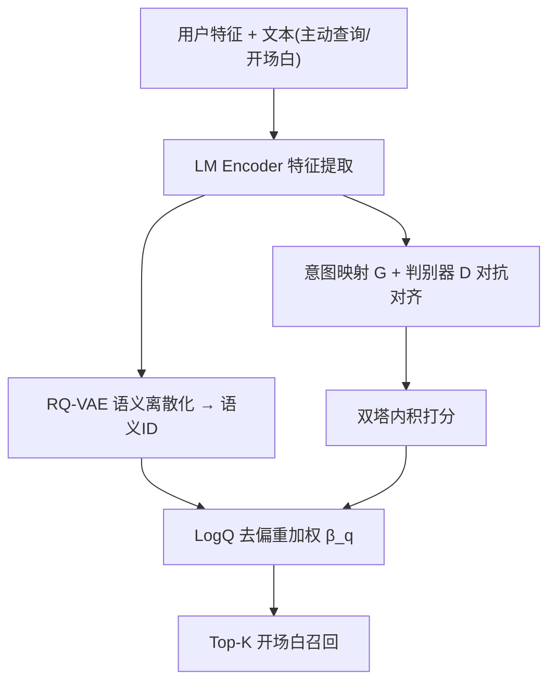
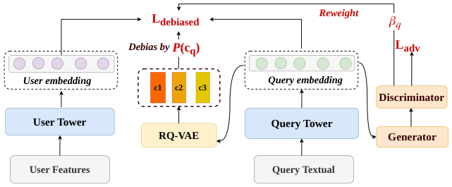

# Bridging Passive and Active: Enhancing Conversation Starter Recommendation via Active Expression Modeling (桥接被动与主动：通过主动表达建模增强对话开场白推荐)

- **会议/期刊**: SIGIR 2026
- **作者与机构**: Yiqing Wu, Haoming Li, Guanyu Jiang, Jiahao Liang, Yongchun Zhu, Jingwu Chen, Feng Zhang（字节跳动）
- **推荐链路定位**: 召回（双塔 Top-K 检索）
- **研究方向**: 对话推荐与智能体仿真 / 去偏公平与工业架构
- **论文原文**: [https://arxiv.org/abs/2605.05855v2](https://arxiv.org/abs/2605.05855v2)
- **开源代码**: 暂未开源

## TL;DR (1分钟核心速览)

对话搜索中的"开场白推荐"长期困在"曝光-点击-训练"闭环里，系统只会推热门泛化 query（top 1% 占 70% 曝光）。本文提出 PA-Bridge，把用户**主动手打查询**作为打破回音室的信号源：用对抗判别器将主动查询与被动开场白对齐到共享意图空间，再用 RQ-VAE 把连续语义离散成"语义 ID"以支持免 item-ID 的 LogQ 去偏。在 72 亿条工业日志上离线 AUC 从 60.58% 提升至 64.65%（+6.72%），线上用户活跃天数 +0.04%、功能渗透率 +0.54%。

## Background & Motivation (背景与核心矛盾)

- **主流范式**: 将开场白推荐建模为标准 Top-K 召回，从预构建语料中按历史点击排序，形成"曝光-点击-训练"自循环。
- **前人局限**: ① 闭环导致回音室——用户点什么由系统推什么决定，叠加数据稀疏后无法感知开放世界驱动的动态对话意图，退化为推热门泛化项；② 主动查询与开场白存在天然分布偏移（口语化/开放世界 vs. 结构化/封闭语料），直接混入训练会触发样本选择偏差（SSB）。
- **核心洞察 (Key Insight)**: 传统电商/视频推荐是"箱庭游戏"（兴趣被限定在预定义物品集内），而对话搜索是"开放世界"——用户可绕过菜单直接手打 query，这些主动表达才是真实意图的前沿。二者表层不同，但底层共享同一潜在意图空间。
- **本文切入点**: 把主动查询投影进与开场白共享的语义空间做对齐，并在该空间内做离散化密度估计，从而在"不可赋 ID"的开放文本上复活去偏算法。

## Method (核心方法设计)

### 1. 整体框架 (Overall Architecture)

双塔基座：用户塔编码用户特征，Query 塔用预训练 LM 编码文本（开场白 $q_s$与主动查询$q_a$共用同一编码器），内积打分 + in-batch 负采样交叉熵训练。在此之上叠加两个离线训练期模块：**分布对齐器**用生成器$G$（意图映射 MLP）与判别器$D$（来源分类 MLP）做极小极大博弈，剥离域噪声得到域不变表征；**语义离散器**用 RQ-VAE 将连续表征量化成三层码本语义 ID，以码本簇的流式频率$P(c_q)$ 近似概率密度，注入 LogQ 校正项完成去偏。最终主任务损失与对抗损失多任务联合优化，线上仅保留双塔前向，满足延迟要求。

<figure class="paper-figure" markdown="span">
  <figcaption>图2：我们的 PA-Bridge 整体架构。</figcaption>
</figure>

### 2. 关键设计拆解 (Key Designs)

1. **对抗分布对齐器（Adversarial Distribution Aligner）**：痛点是把 $q_a$当辅助正样本直接混训会因分布偏移而负迁移（实验证实 AUC 反降 2.71%）。做法是让$G$把两类文本表征映射到共享意图空间，$D$ 判别来源，迫使编码器学域不变特征：
$$\mathcal{L}_{adv}=\min_G\max_D\ \mathbb{E}_{z\sim\mathcal{D}_A}[\log D(G(z))]+\mathbb{E}_{z\sim\mathcal{D}_S}[\log(1-D(G(z)))]$$
直觉：若表征已无法区分"手打"还是"菜单"，则意图语义已被对齐，主动查询的知识可安全迁移。

2. **语义离散器与免 ID 去偏（Semantic Discretizer）**：痛点在于手打 query 几乎唯一，$P_i\approx 1/N$，传统 LogQ 的 item-ID 频率统计失效；而高维连续空间直接做密度估计在流式训练中不可行。做法是用 RQ-VAE 量化$z\to\{c_1,c_2,c_3\}$，以码本簇频率作密度代理，并把判别器输出$1-D(G(z))$作为样本权重$\beta_q$：
$$\mathcal{L}_{debiased}=-\beta_q\log\frac{\exp(f(u,q)-\log P(c_q))}{\sum_{q'\in\mathcal{B}}\exp(f(u,q')-\log P(c_{q'}))}$$
直觉：无限主动查询被压缩为有限语义簇，长尾意图不再被热门簇淹没，同时 $\beta_q$ 抑制对齐不佳的噪声样本。

3. **训练目标与推理效率**：$\mathcal{L}_{total}=\mathcal{L}_{debiased}+\lambda\mathcal{L}_{adv}$，负采样为 in-batch（配合语义簇级 LogQ 校正）；对抗与 RQ-VAE 仅在离线训练期生效，线上服务仍是纯双塔内积 + ANN 检索，无额外延迟开销。

## Experimental Setup & Evaluation Protocol (实验设置与评估协议)

- **数据集与预处理**: 自建工业数据集（公开数据无同时含主动查询与开场白的语料），取自生产环境 90 天日志，共 **72 亿**样本；开场白语料为预定义封闭集合 $\mathcal{Q}_s$。

| 数据集 | #Users | #Items | #Interactions | 稀疏度/密度 | 特征/场景说明 |
| :--- | :---: | :---: | :---: | :---: | :--- |
| 工业日志（90天） | 未披露 | 开场白语料规模未披露 | 7.2B | 高稀疏 | 含主动查询 $q_a$与开场白$q_s$ 双源文本 |

- **数据划分与防穿越 (Splitting Strategy)**: 按生产日志时间顺序构建训练/测试（流式训练场景），**测试集严格限定为候选语料 $\mathcal{Q}_s$ 中的开场白**，主动查询只进训练不进测试，保证与线上部署一致且防止标签泄漏。
- **排名评测协议 (Ranking Protocol)**: 离线采用 **AUC** 作为主指标（工业精排/召回常用），未采用 Full-Ranking 或 Sampled Ranking 的 HR/NDCG 口径；线上采用 A/B 测试的业务指标。
- **对比基线与超参设置**: 所有基线共享同一用户塔与特征集，仅 Query 侧建模不同——ID-based Retrieval（可学习 item ID）、Semantic Retrieval（仅开场白日志训练的语义双塔）、Basic + Active（朴素数据增广）、以及两个消融变体；温度 $\tau$、多任务权重$\lambda$ 未在正文给出具体取值。

## Key Experimental Results (实验关键数据)

### 1. 主实验对比 (Main Results)

| 模型 | AUC (%) | Rel. Imp. (%) |
| :--- | :---: | :---: |
| ID-based Retrieval | 59.76 | -1.35 |
| Semantic Retrieval (Basic) | 60.58 | 0.00 |
| Basic + Active（朴素增广） | 58.94 | -2.71 |
| PA-Bridge w/o Alignment | 60.71 | +0.21 |
| PA-Bridge w/o Reweight | 58.00 | -4.26 |
| **PA-Bridge (Ours)** | **64.65** | **+6.72** |

线上 A/B（相对提升）：User Active Days **+0.04%**、Feature Penetration Rate **+0.54%**、Unique Queries Exposed **+30.65%**、Unique Queries Clicked **+56.50%**。

### 2. 消融实验 (Ablation Study)

| 变体 | AUC (%) | Δ vs. Full |
| :--- | :---: | :---: |
| w/o Alignment（去对抗对齐） | 60.71 | -3.94 |
| w/o Reweight（去 $\beta_q$ 重加权） | 58.00 | -6.65 |
| **Full PA-Bridge** | **64.65** | — |

### 3. 关键实验发现 (Key Findings)

1. **朴素增广是负收益**：`Basic + Active` 比纯语义基线低 2.71 个点、`w/o Alignment` 仅 +0.21，说明主动查询的价值完全依赖对抗对齐——不对齐时分布偏移的伤害大于信息增益。
2. **重加权比对齐更"要命"**：去掉 $\beta_q$ 后 AUC 暴跌至 58.00（-6.65），甚至低于 ID-based 基线，表明开放文本中的噪声/热门查询若不按对齐置信度降权，会直接污染双塔表征。
3. **去偏真正打开了多样性**：线上唯一曝光 query 数 +30.65%、唯一点击 query 数 +56.50%，远高于 AUC 层面的收益幅度，证明语义簇级 LogQ 校正确实把长尾意图推上了曝光位，回音室被实质性打破。

## Highlights & Limitations (亮点、对比与审稿批判)

- **与代表作对比 (vs. Prior Work)**: 相比 Onesug 等端到端 query 推荐与 GQR 等 LLM 直接生成 query 的工作，本文聚焦"对话前"的开场白阶段且坚持检索式范式以保工业效率；相比标准 LogQ 校正（依赖 item-ID 频率），本文首次把去偏推广到不可赋 ID 的开放文本，用 RQ-VAE 语义簇频率作密度代理。
- **可迁移亮点**: ① "对抗对齐 + 语义离散化"组合可迁移到任何需要融合开放文本信号与封闭候选集的召回任务（如搜索 suggestion、冷启动 query 扩展）；② 用判别器输出作为样本置信权重 $\beta_q$ 是一个轻量且通用的噪声抑制技巧。
- **审稿级局限批判**: ① 评估仅用 AUC 单一指标，缺少 HR/NDCG 等排名口径与公开数据集复现，工业结论的外部有效性存疑；② 线上增益（活跃天数 +0.04%）量级极小，且对抗训练 + RQ-VAE 的离线训练稳定性与超参（$\lambda$、码本大小、层数）敏感性未做分析。

## Rating (四维评分)

- **方法创新性 (Novelty)**: ⭐⭐⭐⭐ （核心机制与方法设计具备明确创新性，理论与实验动机支撑充分）
- **评估协议与实验扎实度 (Protocol & Experiments)**: ⭐⭐⭐ （主流公开数据集评测完整，包含多基线对比与消融实验验证）
- **写作与数学规范度 (Clarity & Rigor)**: ⭐⭐⭐⭐ （问题形式化定义清晰，核心模块数学推导与架构阐述严谨易读）
- **工业落地与复现价值 (Industrial & Practical Value)**: ⭐⭐⭐⭐⭐ （兼顾推荐效果增益与训练/推理效率，具备实际场景迁移参考价值）
