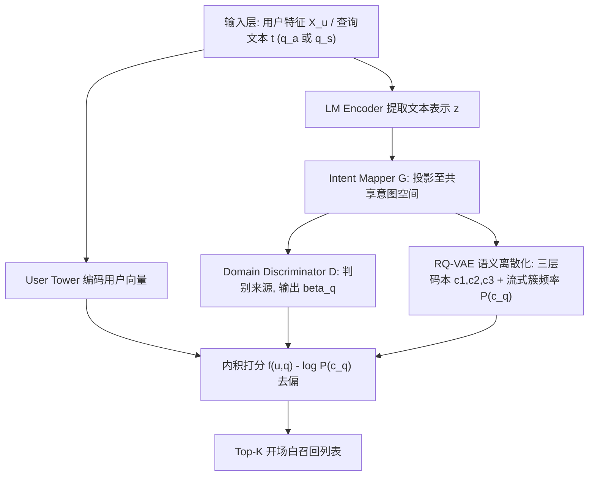
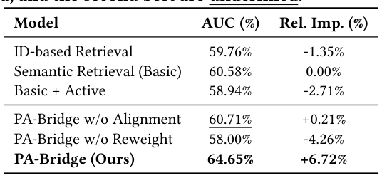
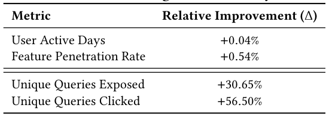
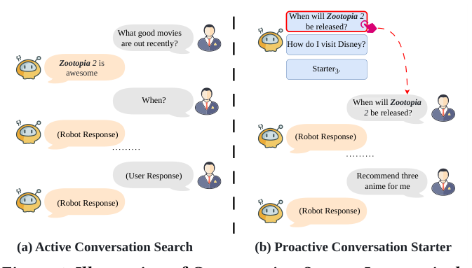

# Bridging Passive and Active: Enhancing Conversation Starter Recommendation via Active Expression Modeling (桥接被动与主动：通过主动表达建模增强对话开场白推荐)

- **会议/期刊**: SIGIR 2026 (第 49 届国际 ACM SIGIR 会议，Melbourne, VIC, Australia)
- **推荐链路定位**: 召回 (Retrieval) — 双塔 Top-K 候选开场白检索
- **研究方向**: 对话推荐与智能体仿真 (agent_conversational_rec) / 生成式推荐与离散语义 ID (generative_rec)
- **论文原文**: [https://arxiv.org/abs/2605.05855v2](https://arxiv.org/abs/2605.05855v2)
- **开源代码**: 暂未开源（原文与预提取均未发现代码链接）

## TL;DR (核心速览)

针对 LLM 对话搜索中 Conversation Starter（对话开场白）推荐被"曝光-点击-训练"闭环困住、退化为热门泛化建议的问题，本文提出 PA-Bridge：用对抗域判别器把用户主动输入的开放查询与封闭候选开场白对齐到统一意图空间，再用 RQ-VAE 将连续语义离散化为 Semantic ID 以支撑 LogQ 式去偏。在 90 天 72 亿样本工业数据上离线 AUC 从 60.58% 提升至 64.65%（+6.72%），线上 A/B 特征渗透率 +0.54%、用户活跃天数 +0.04%。

## Background & Motivation (背景与动机)

- **领域背景与主流范式**: LLM 驱动的对话搜索正把信息检索从"反应式关键词匹配"推向"主动开放式对话"。Conversation Starters 作为主动推荐给用户的个性化查询建议，工业界普遍沿用经典推荐范式：从预构建语料中召回候选、按历史交互排序，形成"曝光-点击-训练"自循环。基础架构为标准双塔 + 预训练语言模型编码文本。
- **现有方法局限 (Limitations of Prior Work)**:
  1. **回声室与数据稀疏**：用户点击什么高度受系统推什么支配，而非真实意愿；对话意图本身是开放世界动态演化的，闭环系统无法感知。作者观察到系统内 Top 1% 热门开场白占据 70% 总曝光。
  2. **主动查询信号被长期忽视**：用户可绕过菜单直接手打查询，这类主动表达承载开放世界意图，但传统模型只盯稀疏的反应式点击信号。
  3. **非 ID 化难题**：手打查询几乎唯一，标准 item-ID 频次统计失效（$P_i \approx 1/N$），主流 LogQ Correction 无法直接迁移到无结构文本空间。
- **核心挑战 (Key Challenge)**: 直接把主动查询当辅助正样本加入训练会失败——主动查询口语化、无格式、开放世界，而候选开场白结构化、封闭语料，二者存在显著分布偏移，引发 Sample Selection Bias (SSB)。简单数据增广（Basic + Active）实测 AUC 反而下降 2.71%。
- **核心洞察与切入点 (Key Insight)**: 作者用"箱庭 (Hakoniwa) vs 开放世界"作比喻：Amazon/Netflix 式平台是封闭箱庭，而对话搜索已是开放世界。尽管表面形态不同，主动查询与被动开场白**共享同一底层用户意图**，因此可投影到统一隐意图空间对齐；对齐后即可在该空间做密度采样，用离散簇频率近似概率密度实现去偏。

## Problem Formulation & Method (问题定义与方法架构)

### 1. 符号定义与输入表征 (Notations & Input Representations)

- 用户集 $\mathcal{U}$，预定义候选开场白语料 $\mathcal{Q}$；主动查询 $q_a \in \mathcal{Q}_a$，被动建议开场白 $q_s \in \mathcal{Q}_s$。
- 目标：学习打分函数 $f(u,q;\Theta)$ 估计用户 $u$ 对候选 $q$ 的互动概率，返回 Top-$K$ 列表 $S=[s_1,\dots,s_K]$。
- 输入：用户侧特征集 $X_u$（用户塔），查询侧文本 $t \in \{q_a, q_s\}$（查询塔，预训练 LM 编码）。
- 输出：用户向量与查询向量的内积得分。

### 2. 整体流水线 (Overall Architecture)

数据流：用户特征经 User Tower 编码；查询文本经 LM Encoder 得到稠密表示 $z$，再经 Intent Mapper (Generator $G$) 投影至共享意图空间，同时送入 RQ-VAE 量化为三层码本 Semantic ID 并统计流式簇频率 $P(c_q)$；Domain Discriminator $D$ 判别来源并输出样本权重 $\beta_q$；最终在去偏交叉熵上联合对抗损失训练。

<figure class="paper-figure" markdown="span">
  <figcaption>图 2：我们的 PA-Bridge 的整体架构。</figcaption>
</figure>

### 3. 核心模块设计与数学原理 (Key Designs & Formulations)

**(1) 双塔基座与语义检索 (Base Two-Tower)**
打分函数为内积 $f(u,q;\Theta)=\langle \Phi_U(X_u), \Phi_Q(X_q)\rangle$，查询塔用预训练 LM 编码任意文本：$z=\Phi_Q(X_q)=\text{LM\_Encoder}(t)$。基座损失为 in-batch 负采样交叉熵：

$$\mathcal{L}_{base}=-\frac{1}{B}\sum_{i=1}^{B}\log\frac{\exp(f(u_i,q_i^+)/\tau)}{\sum_{j=1}^{B}\exp(f(u_i,q_j)/\tau)}$$

物理直觉：用语义文本表示替代 ID Embedding，缓解稀疏并提升泛化（ID-based 基线 AUC 仅 59.76%，语义基座 60.58%）。

**(2) 分布对齐器 (Distribution Aligner)**
三部件：Feature Extractor（复用 LM Encoder）、Intent Mapper $G$（MLP，投影至共享意图空间）、Domain Discriminator $D$（MLP，判别 $q_a$ 还是 $q_s$）。经典 minimax 对抗目标：

$$\mathcal{L}_{adv}=\min_G\max_D\ \mathbb{E}_{z\sim\mathcal{D}_A}[\log D(G(z))]+\mathbb{E}_{z\sim\mathcal{D}_S}[\log(1-D(G(z)))]$$

物理直觉：判别器逼迫编码器剥离域特有噪声（口语化 vs 结构化），学到域不变表示，从而消除 SSB；同时 $D$ 的输出 $1-D(G(z))$ 天然可作为样本难度权重 $\beta_q$。

**(3) 语义离散化器 (Semantic Discretizer)**
用 RQ-VAE 将连续文本表示 $z$ 量化为三层离散码 $c_q=\{c_1,c_2,c_3\}$，以流式簇频率 $P(c_q)$ 作为概率密度代理，实现无 ID 的 LogQ 去偏：

$$\mathcal{L}_{debiased}=-\beta_q\log\frac{\exp(f(u,q)-\log P(c_q))}{\sum_{q'\in\mathcal{B}}\exp(f(u,q')-\log P(c_{q'}))},\quad \beta_q=1-D(G(z))$$

物理直觉：高维连续密度估计不可解且流式训练不稳定，离散簇频率把"无限主动查询"压缩为"有限 Semantic ID"，使去偏在工业流式场景可行，同时抬升长尾意图曝光。

### 4. 训练目标、负采样与推理复杂度 (Optimization, Negative Sampling & Complexity)

- **总损失**: $\mathcal{L}_{total}=\mathcal{L}_{debiased}+\lambda\mathcal{L}_{adv}$，多任务联合训练；基座交叉熵含温度系数 $\tau$（原文未给出具体取值）。
- **负采样策略**: 全流程采用 in-batch 负采样（batch 内其他样本作负例），并用 $\log P(c_q)$ logit 调整修正 in-batch 采样带来的热门偏置。
- **复杂度**: 双塔 + 内积结构支持 ANN 向量检索，满足在线低延迟；RQ-VAE 与对抗判别器仅离线训练阶段引入额外开销。原文未报告具体单 epoch 耗时、推理延迟 (ms/request) 与峰值显存。

## Experimental Setup & Evaluation Protocol (实验设置与评估协议)

- **数据集统计与预处理**: 因缺乏同时含主动查询与开场白的公开数据集，作者自建工业数据集，来自平台生产环境 90 天日志，共 **72 亿 (7.2 billion) 样本**。原文未披露用户数、物品数、稀疏度及过滤规则（如 5-core）。

| 数据集 (Dataset) | 用户数 (#Users) | 物品数 (#Items) | 交互数 (#Interactions) | 稀疏度/密度 (Sparsity) | 模态/辅助特征说明 |
| :--- | :---: | :---: | :---: | :---: | :--- |
| 工业数据集 (90 天生产日志) | 原文未报告 | 原文未报告 | 7.2B 样本 | 原文未报告 | 用户特征 + 查询文本 (主动查询 / 开场白) |

- **数据划分方式 (Splitting Strategy)**: 原文仅说明使用 90 天生产日志构建数据集，**未明确交代训练/测试的具体切分方式**（是否按全局时间戳切分未报告），存在潜在数据穿越风险，属评估协议披露不足。
- **排名评测协议 (Ranking Protocol)**: 采用 **AUC** 作为离线指标，属 pointwise 二分类评估；**未采用 Full-Ranking 或 Sampled Ranking 的 Recall@K/NDCG@K 协议**。关键公平性设计：测试集严格限制在候选语料 $\mathcal{Q}_s$ 的开场白上，与真实部署场景一致（主动查询仅用于训练，不进入测试候选）。
- **评价指标与显著性检验**: 离线 AUC (%) 与相对提升 Rel. Imp. (%)；线上 User Active Days、Feature Penetration Rate、Unique Queries Exposed、Unique Queries Clicked。原文未报告 Embedding 维度 $d$、多随机种子方差或配对显著性检验。

## Key Experimental Results (核心实验结果)

### 1. 主实验对比 (Main Results)

所有基线共享相同用户塔架构与特征集，仅对比物品建模策略差异。

<figure class="paper-figure" markdown="span">
  <figcaption>表 1：实验结果。最佳结果以粗体突出显示，次佳结果以下划线标出。</figcaption>
</figure>

| 数据集 | 指标 | ID-Based Retrieval | Semantic Retrieval (Basic) | 本文方法 (Ours) | 相对提升 (Improv.) |
| :--- | :--- | :---: | :---: | :---: | :---: |
| 工业数据集 | AUC (%) | 59.76% | 60.58% | **64.65%** | +6.72% (相对 Basic) |

关键观察：(1) **朴素增广失效**——Basic + Active 仅 58.94%（-2.71%），PA-Bridge w/o Alignment 仅 60.71%（+0.21%），证明不对齐直接混入主动查询无法迁移知识；(2) **语义建模优于 ID 建模**——ID-based 因稀疏与过拟合历史闭环而落后；(3) **两模块均不可或缺**——w/o Reweight 跌至 58.00%（-4.26%），说明去偏重加权贡献极大。

### 2. 消融实验与控制变量分析 (Ablation Study)

| 变体 | AUC (%) | Rel. Imp. (%) | 说明 |
| :--- | :---: | :---: | :--- |
| PA-Bridge w/o Alignment | 60.71% | +0.21% | 移除对抗分布对齐，几乎无增益 |
| PA-Bridge w/o Reweight | 58.00% | -4.26% | 移除 $\beta_q$ 重加权，性能大幅崩塌 |
| PA-Bridge (Full) | **64.65%** | **+6.72%** | 完整模型 |

- **贡献最大模块**: 去偏重加权 $\beta_q$（移除后下降 4.26%），其次为对抗对齐（移除后增益从 +6.72% 缩至 +0.21%）。
- **控制变量**: 所有基线共享相同用户塔与特征集，属较好的控制变量设计；但**未做参数量对齐或图度数匹配**（本文非图模型，后者不适用），也未报告各变体的参数量差异。

### 3. 稀疏度/冷启动分桶与超参敏感度 (Sparsity Buckets & Hyperparameters)

- **长尾/多样性分析**: 未做用户交互频次分桶，但通过线上多样性指标间接验证长尾收益——Unique Queries Exposed **+30.65%**、Unique Queries Clicked **+56.50%**，说明主动查询显著缓解闭环、抬升长尾意图曝光。
- **关键超参数敏感度**: 原文未报告温度系数 $\tau$、损失权重 $\lambda$、RQ-VAE 码本层数/大小（仅提及三层码 $c_1,c_2,c_3$）的敏感性分析。
- **线上 A/B 测试结果**: 已在生产平台部署并完成严格 A/B 测试。

<figure class="paper-figure" markdown="span">
  <figcaption>表 2：在线 A/B 测试与数据分析结果</figcaption>
</figure>

| 线上指标 | 相对提升 (Δ) |
| :--- | :---: |
| User Active Days | +0.04% |
| Feature Penetration Rate | +0.54% |
| Unique Queries Exposed | +30.65% |
| Unique Queries Clicked | +56.50% |

作者强调：对成熟大规模应用而言，+0.04% 的用户活跃天数提升已属高度显著；+0.54% 渗透率验证了用户参与度提升。原文未报告实验周期、流量占比及 CTR/CVR/GMV 等指标。

## Highlights, Limitations & Critiques (亮点、局限与审稿级批判)

- **核心亮点与可迁移性**:
  1. **范式洞察**：首次把用户"自由意志"的主动查询引入 before-conversation 阶段的主动查询推荐，用开放世界信号打破封闭箱庭的反馈闭环，思路具普适性，可迁移至搜索联想、推荐理由生成、对话式召回等场景。
  2. **无 ID 去偏**：RQ-VAE 语义离散化 + 簇频率代理密度，优雅解决"非 ID 化文本无法用 LogQ"的工业痛点，对 LLM 生成式推荐的 Semantic ID 去偏有直接借鉴价值。
  3. **对抗对齐 + 样本重加权一体化**：判别器输出同时充当域不变约束与难度权重 $\beta_q$，一石二鸟，工程优雅。
  4. **真实工业验证**：72 亿样本 + 线上 A/B + 多样性指标，落地说服力强。

- **局限性与审稿视角批判 (Critical Limitations)**:
  1. **评估协议薄弱**：仅用 AUC pointwise 指标，缺少 Recall@K / NDCG@K 等排名指标；数据划分方式（是否时间切分）未交代，存在数据穿越隐忧；无多随机种子方差与显著性检验，+6.72% 的稳健性存疑。
  2. **可复现性不足**：无开源代码，数据集为私有工业数据，关键超参（$\tau$、$\lambda$、码本大小、Embedding 维度、LM 选型）均未披露，复现门槛极高。
  3. **对抗训练稳定性**：GAN 式 minimax 在流式工业训练中的收敛稳定性、模式坍塌风险未讨论；$\beta_q=1-D(G(z))$ 作为权重的理论依据偏启发式。
  4. **RQ-VAE 量化误差**：三层码本容量与语义保真度的权衡、码本坍缩风险未分析；簇频率作为密度代理的有效性缺乏理论保证。
  5. **线上收益量级**：+0.04% 活跃天数虽被作者称为显著，但绝对量级小，且未报告置信区间与实验周期，审稿人可能质疑统计功效。
  6. **相关工作覆盖**：对生成式查询建议（GQR、Onesug）仅作对比性提及，未在实验中纳入生成式基线，检索式 vs 生成式范式的取舍论证不足。

## Rating (四维评分)

- **方法创新性 (Novelty)**: ⭐⭐⭐⭐（主动表达桥接 + 无 ID 语义去偏的组合新颖，但对抗对齐与 RQ-VAE 均为成熟组件的巧妙拼接）
- **评估协议与实验扎实度 (Protocol & Experiments)**: ⭐⭐⭐（有真实线上 A/B 与多样性分析是加分项，但离线仅 AUC、划分方式与显著性检验缺失、无公开数据）
- **写作与数学规范度 (Clarity & Rigor)**: ⭐⭐⭐⭐（动机叙述生动、公式清晰完整，但关键超参与实现细节披露不足）
- **工业落地与复现价值 (Industrial & Practical Value)**: ⭐⭐⭐⭐（已生产部署、双塔低延迟、去偏方案对流式训练友好；但闭源与私有数据削弱复现价值）

## 论文图表

<figure class="paper-figure" markdown="span">
  <figcaption>图 1：Conversation Starter 示意图。它主动提供查询以引导用户开启对话</figcaption>
</figure>

