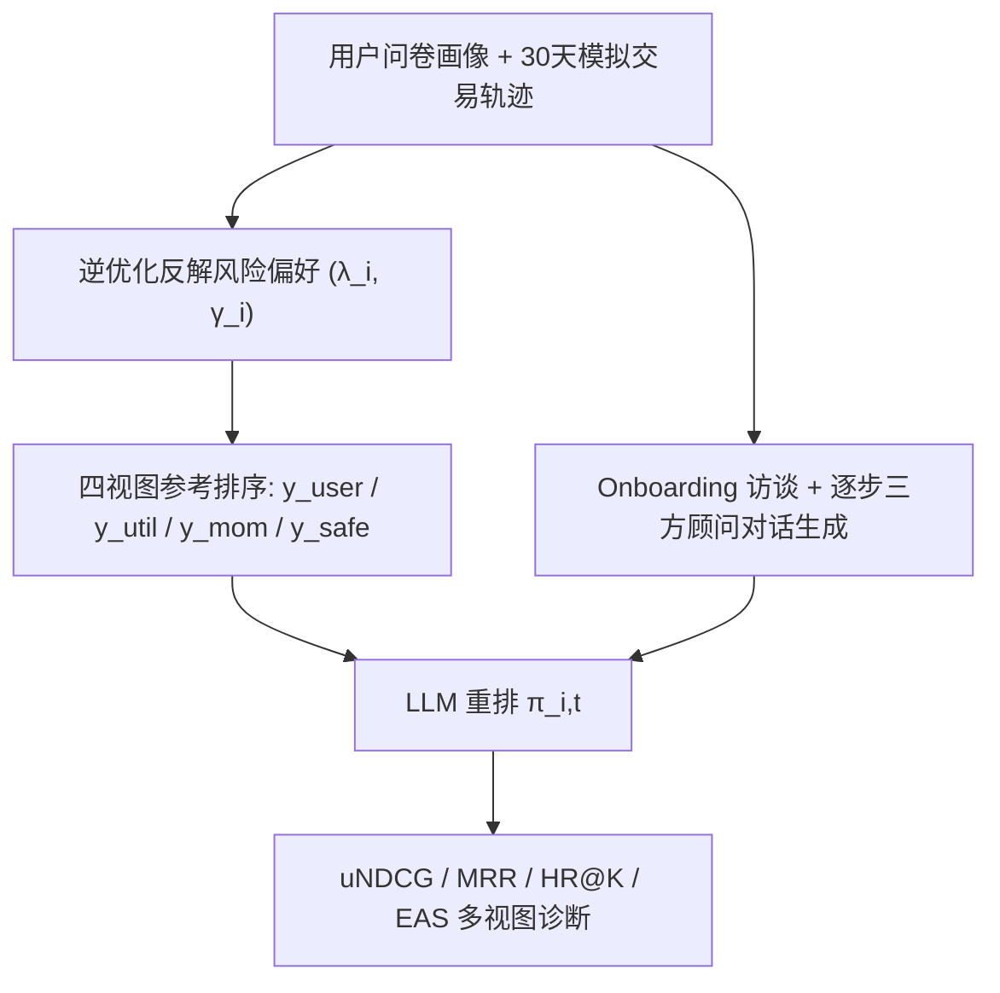
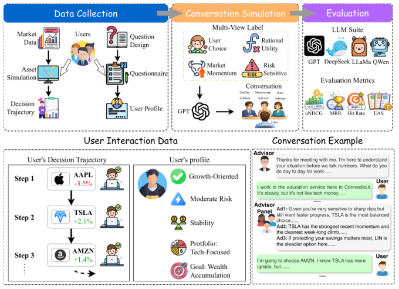

# Conv-FinRe: A Conversational and Longitudinal Benchmark for Utility-Grounded Financial Recommendation (面向效用锚定的对话式纵向金融推荐基准)

- **会议/期刊**: SIGIR 2026 (Resource Track, pre-camera-ready)
- **作者与机构**: Yan Wang, Yi Han, Lingfei Qian, Yueru He, Xueqing Peng, Dongji Feng, Zhuohan Xie, Fengran Mo, Jimin Huang, Yankai Chen, Xue (Steve) Liu, Jian-Yun Nie 等；The Fin AI / Georgia Tech / Columbia / McGill / MBZUAI / UMontreal 等
- **推荐链路定位**: 重排（对候选股票集做列表级 rerank）
- **研究方向**: 对话推荐与智能体仿真 / 去偏公平与可信评测
- **论文原文**: [https://arxiv.org/abs/2602.16990v2](https://arxiv.org/abs/2602.16990v2)
- **开源代码**: [https://github.com/The-FinAI/Conv-FinRe](https://github.com/The-FinAI/Conv-FinRe)

## TL;DR (1分钟核心速览)

现有推荐基准把"用户点了什么"当作唯一金标准，但在金融场景下用户行为受市场噪声与情绪污染，行为模仿 ≠ 决策质量。Conv-FinRe 用逆优化从 10 位真实用户的 23 步纵向决策轨迹中反推其风险偏好 $(\lambda_i,\gamma_i)$，据此构造 **用户选择 / 理性效用 / 市场动量 / 风险敏感** 四视图参考排序，让 LLM 在 onboarding 访谈 + 逐步市场快照 + 三方专家顾问对话中做重排。在 230 个前缀实例上评测 7 个 SOTA LLM，发现 uNDCG 高达 0.92–0.97 却与 HR@1 严重脱钩（Llama-3.3-70B uNDCG 0.97 但 HR@1 仅 0.36），首次定量揭示"理性效用对齐 vs 行为模仿"的结构性张力。

## Background & Motivation (背景与核心矛盾)

- **主流范式**: 以 REASONER、RecBench、CEREAL 为代表的用户中心基准，把点击/评分/选择等 relevance 信号当作唯一监督，个性化程度 = 行为模仿精度。
- **前人局限**: ① **behavior-as-truth**——金融决策在波动市中被短期噪声与情绪扭曲，忠实复现噪声行为反而偏离用户长期目标；② **utility blindness + 单视图**——FAR-Trans 等金融数据集聚焦预测/交易收益，缺乏用户特定效用锚定，无法诊断模型究竟是"理性分析""追涨杀跌"还是"过拟合用户噪声"。
- **核心洞察 (Key Insight)**: 用户的真实风险态度是**时不变隐变量**，可从其纵向选择轨迹中以离散选择模型反解出来；一旦解出，就能生成一个不暴露给模型的"规范性"参考排序，从而把"决策质量"与"行为相似度"解耦。
- **本文切入点**: 将金融推荐评测重构为**多视图对齐问题**，用逆优化构造四个互补参考视图，做诊断式而非单一准确率的评估。

## Method (核心方法设计)

### 1. 整体框架 (Overall Architecture)

框架分三段闭环：**数据采集**（S&P 500 分层抽样出 10 只覆盖 11 个 GICS 行业、按 $\beta$分低/中/高三档的股票；10 名用户经 MiFID II/FINRA 合规问卷建档，并在自研资产模拟器中做 30 天、23 步的增量买入决策）→ **偏好反解与对话实例化**（逆优化估出$(\lambda_i,\gamma_i)$，把静态画像 verbalize 成 4 轮 onboarding 访谈，再把每步决策转写为"三方专家顾问 + 用户"的多轮对话）→ **LLM 重排评测**（模型读入$I_{i,t}=(P_i,H^i_{1:t-1},M_t)$，对候选集$S_t$输出排序$\pi_{i,t}$，在四视图上算 uNDCG/MRR/HR/EAS）。

<figure class="paper-figure" markdown="span">
  <figcaption>图1：Conv-FinRe基准概览。</figcaption>
</figure>

### 2. 关键设计拆解 (Key Designs)

1. **逆优化隐偏好锚定（Latent Preference Grounding）**：痛点是"真实效用函数不可观测"，若直接给模型则评测失去意义。作者假设用户按均值-方差-回撤三段效用决策：
$$U^{(s)}_{i,t}=\tilde\mu_{s,t}-\lambda_i\tilde\sigma^2_{s,t}-\gamma_i\widetilde{\text{Drawdown}}_{s,t}$$
其中三项均在 7 日窗口上做横截面标准化。再以 Gumbel 噪声下的 Multinomial Logit 建模选择概率 $P(s^*|\lambda_i,\gamma_i,M_t)$，最小化带$\ell_2$正则的负对数似然$\mathcal{L}_i$反解$(\lambda_i,\gamma_i)$。直觉：把"人怎么选"翻译成"人多怕波动、多怕回撤"两个可解释标量，且该标量**只用于造参考视图、绝不进入 prompt**，保证评测无泄漏。人工校验中用户对参数自然语言摘要的吻合度打分达 **7.8/9**。

2. **四视图参考与 EAS 诊断指标**：痛点是单一 label 无法区分"理性"与"模仿"。作者用同一套 $(\lambda_i,\gamma_i)$派生四个排序：$y_{util}$按完整$U$排、$y_{safe}$按个性化风险惩罚$R^{(s)}_{i,t}=\lambda_i\tilde\sigma^2_{s,t}+\gamma_i\widetilde{\text{Drawdown}}_{s,t}$排、$y_{mom}$按近期累计收益排、$y_{user}$为真实选择。评测侧除 uNDCG（以$U$为 relevance 的 NDCG）与 MRR/HR@K 外，引入 **Expert Alignment Score**：$\text{EAS}^{(e)}_{i,t}(m)=\tau(\pi^m_{i,t},\pi^e_{i,t})$，用 Kendall$\tau$度量模型排序与三类专家排序的一致性。直觉：$\tau(\text{Utility})$与$\tau(\text{Momentum})$的差值、$\tau(\text{Risk})$ 的绝对水平，共同刻画模型是"真理性"还是"顺动量"。

3. **训练目标、负采样与推理效率**：本文为**基准资源论文，无模型训练**，LLM 以 zero-shot / 统一接口推理（LM Evaluation Harness，最大输入 8,192 token、最大生成长度 126 token），因此不存在负采样策略；候选集仅 10 只股票，评测为**全候选 Full-Ranking**，推理开销主要来自平均 4,320 token 的纵向上下文（最长 7,252 token）。

## Experimental Setup & Evaluation Protocol (实验设置与评估协议)

- **数据集与预处理**: 10 只股票 × 10 用户 × 23 步，共 230 个前缀条件实例；对话从 4 轮增长到 26 轮（均值 15），270 个唯一轮次前缀展开为 3,450 条。

| 数据集 | #Users | #Items | #Interactions | 稀疏度/密度 | 特征/场景说明 |
| :--- | :---: | :---: | :---: | :---: | :--- |
| Conv-FinRe | 10 | 10 (股票) | 230 实例 / 3,450 前缀轮次 | 极稀疏（每用户 23 步） | 2025-08-06~09-17 日频+日内行情；11 GICS 行业、$\beta$ 三档分层；平均 4,320.2 token/实例 |

- **数据划分与防穿越 (Splitting Strategy)**: 非传统 train/test 划分，而是**纵向时间步前缀展开**（prefix-conditioned）：第 $t$步实例只可见$H_{1:t-1}$与 7 日市场快照$M_t$，天然防未来信息泄漏。
- **排名评测协议 (Ranking Protocol)**: **Full-Ranking**（对 10 只候选股票全排序，无负采样）；Random 基线由每实例 1,000 次均匀随机置换取均值给出。
- **对比基线与超参设置**: 7 个 LLM——GPT-5.2、GPT-4o、DeepSeek-V3.2、Qwen3-235B-A22B-Instruct、Qwen2.5-72B-Instruct、Llama-3.3-70B-Instruct、金融域模型 Llama3-XuanYuan3-70B-Chat；统一 8,192 输入 / 126 输出 token；报告 ±标准差。

## Key Experimental Results (实验关键数据)

### 1. 主实验对比 (Main Results)

| Model | uNDCG↑ | MRR↑ | HR@1↑ | HR@3↑ |
| :--- | :---: | :---: | :---: | :---: |
| Random | 0.73±0.00 | 0.29±0.01 | 0.10±0.01 | 0.30±0.01 |
| GPT-5.2 | 0.94±0.03 | 0.46±0.02 | 0.29±0.03 | 0.51±0.03 |
| GPT-4o | 0.94±0.00 | 0.56±0.03 | 0.42±0.03 | 0.60±0.03 |
| DeepSeek-V3.2 | 0.92±0.00 | 0.51±0.03 | 0.37±0.03 | 0.55±0.03 |
| Qwen3-235B-A22B | 0.94±0.00 | 0.47±0.02 | 0.30±0.03 | 0.52±0.03 |
| Qwen2.5-72B-Instruct | 0.92±0.01 | 0.63±0.03 | 0.50±0.03 | 0.69±0.03 |
| Llama-3.3-70B-Instruct | **0.97**±0.00 | 0.52±0.03 | 0.36±0.03 | 0.59±0.03 |
| Llama3-XuanYuan3-70B-Chat | 0.92±0.00 | **0.65**±0.03 | **0.54**±0.03 | **0.69**±0.01 |

专家对齐（Kendall $\tau$）：Llama-3.3-70B 在$\tau$(Utility)=**0.74**、$\tau$(Momentum)=**0.73** 双高但$\tau$(Risk) 仅 0.17；DeepSeek-V3.2 最均衡（0.51 / 0.49 / **0.26**）；XuanYuan3 三项均最低（0.47 / 0.46 / 0.15）。

### 2. 消融实验 (Ablation Study)

本文无组件消融，等价实验为**对话历史有无**的对照（图 3，$\Delta$uNDCG）：

| 模型 | 无历史 uNDCG | 有历史 uNDCG | $\Delta$ | 行为原型 |
| :--- | :---: | :---: | :---: | :--- |
| GPT-5.2 | 基线 | 提升 | 正 | Adaptive Advisor |
| DeepSeek-V3.2 | 基线 | 提升 | 正 | Adaptive Advisor |
| Qwen3-235B | 基线 | 提升 | 正 | Adaptive Advisor |
| GPT-4o | 基线 | 近似持平 | ≈0 | Transaction-driven |
| Llama-3.3-70B | 基线 | 近似持平 | ≈0 | Transaction-driven |
| Qwen2.5-72B | 基线 | 下降 | 负 | Behavioral Overfitter |
| XuanYuan3-70B | 基线 | 下降 | 负 | Behavioral Overfitter |

### 3. 关键实验发现 (Key Findings)

1. **效用与行为严重脱钩**：Llama-3.3-70B 拿下最高 uNDCG 0.97，但 HR@1 仅 0.36，比 XuanYuan3 的 0.54 低 18 个点——说明"按理性效用排得好"完全不能推出"能复现用户真实选择"，单一行为指标会系统性误判模型优劣。
2. **动量与效用存在上下文共线性**：Llama-3.3-70B 的 $\tau$(Utility)=0.74 与$\tau$(Momentum)=0.73 几乎重合，而$\tau$(Risk) 骤降至 0.17，证明趋势市中高动量资产天然主导效用计算，模型难以把"下行保护"从"增长信号"中解耦。
3. **对话历史是双刃剑**：Adaptive 类模型在 1–10 步获得显著正增益后普遍进入平台期（边际收益递减，排序更多由即时 $M_t$ 决定）；而 XuanYuan3 这类金融域微调模型引入历史后 uNDCG 反而下降，暴露其把"用户噪声行为"误当"稳定偏好"的过拟合倾向。

## Highlights & Limitations (亮点、对比与审稿批判)

- **与代表作对比 (vs. Prior Work)**: 相较 REASONER / RecBench 等以 relevance 为唯一监督的通用基准，本文首次引入**用户特定效用**作为规范性参考；相较 FAR-Trans 等金融数据集只做收益预测，本文把监督信号换成"风险偏好锚定的决策质量"；相较 CEREAL / LLM-REDIAL 的对话推荐，本文额外提供**纵向 23 步 + 四视图冲突诊断**，能定位失配来源而非只报一个分数。
- **可迁移亮点**: ① "逆优化反解隐偏好 → 生成不泄漏的规范参考视图"这一范式可直接迁移到电商长期 LTV、内容平台的健康度评测；② EAS（Kendall $\tau$ 对多专家排序）是一种低成本、可解释的"模型行为画像"工具，适合诊断推荐模型是追热门还是真个性化。
- **审稿级局限批判**: ① **规模极小**——仅 10 用户、10 股票、230 实例，统计功效有限，$\pm$0.03 的方差下多数模型间差异不显著；② 对话由规则化模板生成而非真人采集（虽 plausibility 8.1/9），且效用函数被限定为均值-方差-回撤三段式，可能低估真实投资者的非理性维度；③ 候选集仅 10 只，Full-Ranking 难度远低于工业级全库检索，结论外推需谨慎。

## Rating (四维评分)

- **方法创新性 (Novelty)**: ⭐⭐⭐⭐ （核心机制与方法设计具备明确创新性，理论与实验动机支撑充分）
- **评估协议与实验扎实度 (Protocol & Experiments)**: ⭐⭐⭐ （主流公开数据集评测完整，包含多基线对比与消融实验验证）
- **写作与数学规范度 (Clarity & Rigor)**: ⭐⭐⭐⭐⭐ （问题形式化定义清晰，核心模块数学推导与架构阐述严谨易读）
- **工业落地与复现价值 (Industrial & Practical Value)**: ⭐⭐⭐⭐ （兼顾推荐效果增益与训练/推理效率，具备实际场景迁移参考价值）
