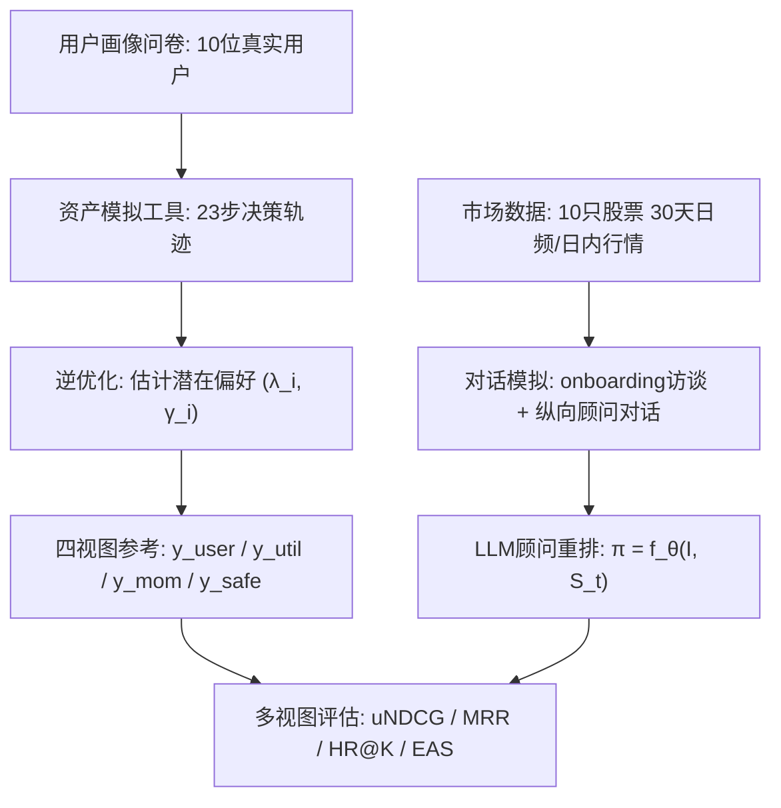
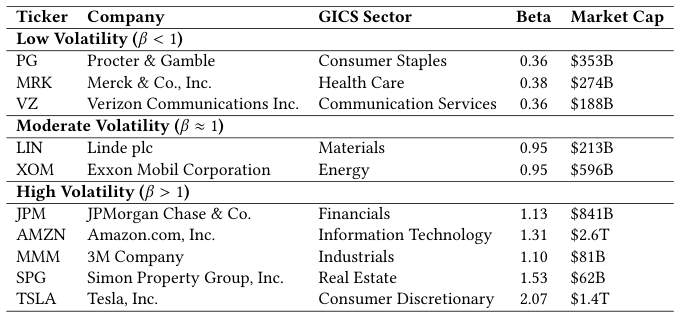
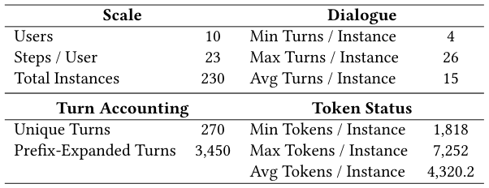
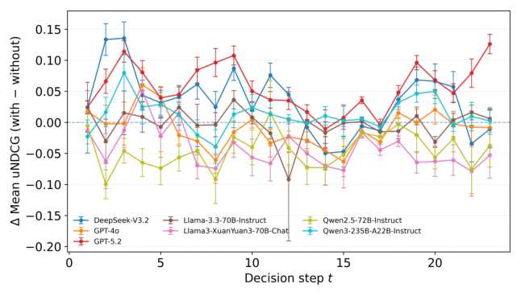
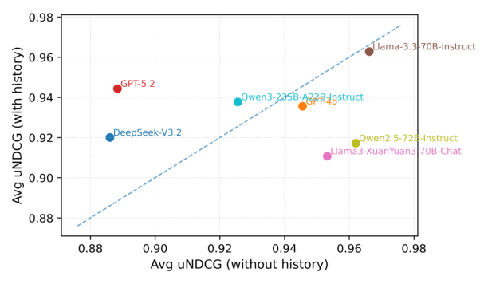

# Conv-FinRe: A Conversational and Longitudinal Benchmark for Utility-Grounded Financial Recommendation (面向效用锚定的对话式纵向金融推荐基准)

- **会议/期刊**: SIGIR 2026 (Resource Track, Pre-camera-ready)
- **推荐链路定位**: 重排 (Re-ranking) — LLM 对固定候选股票池进行列表级重排
- **研究方向**: 对话推荐与智能体仿真 / 大语言模型推荐 (LLM4Rec)
- **论文原文**: [https://arxiv.org/abs/2602.16990v2](https://arxiv.org/abs/2602.16990v2)
- **开源代码**: [https://github.com/The-FinAI/Conv-FinRe](https://github.com/The-FinAI/Conv-FinRe) （数据发布于 [Hugging Face 集合](https://huggingface.co/collections/TheFinAI)，模拟工具见 [LetYourProfitsRun Space](https://huggingface.co/spaces/TheFinAI/LetYourProfitsRun)）

## TL;DR (核心速览)

针对金融推荐中"用户历史行为≠决策质量"的核心痛点（行为受市场噪声与情绪污染），本文提出 Conv-FinRe——首个对话式、纵向的股票推荐基准。它通过逆优化从用户 30 天决策轨迹中反推潜在风险偏好 $(\lambda_i,\gamma_i)$，构建用户选择、理性效用、市场动量、风险敏感四视图参考，将推荐评估重构为多视图对齐问题。在 10 只股票、10 位真实用户、230 个前缀实例上评测 7 个 SOTA LLM，揭示"效用排序好≠行为对齐好"的根本张力：Llama-3.3-70B uNDCG 最高 (0.97) 但 HR@1 仅 0.36，而金融领域模型 XuanYuan3 HR@1 达 0.54 却效用对齐偏低。

## Background & Motivation (背景与动机)

- **领域背景与主流范式**: 当前推荐基准（REASONER、RecBench、CEREAL 等）普遍以**行为模仿 (behavioral imitation)** 为个性化度量核心——推荐"正确"当且仅当匹配用户点击/评分/选择。该范式在电商、媒体等反馈可靠代理效用的消费域行之有效。
- **现有方法局限 (Limitations of Prior Work)**: 作者在表 1 中系统对比后指出三大缺陷：
  1. **behavior-as-truth（行为即真值）**: 投资者行为受短期市场噪声、情绪、约束漂移影响，可能偏离稳定风险容忍度与长期目标，忠实模仿噪声行为反而与用户真实目标错位。
  2. **utility blindness（效用盲区）**: 多数基准仅依赖相关性信号（点击/评分），金融数据集（如 FAR-Trans）侧重预测或交易目标而非用户特定决策质量。
  3. **single-view evaluation（单视图评估）**: 缺乏多视图诊断，无法区分 LLM 是在做风险敏感效用推理、盲目追涨，还是过拟合用户噪声。
- **核心挑战 (Key Challenge)**: 简单增加网络深度或常规对比学习无法解决——因为问题不在表征能力，而在**评估目标本身**：缺乏一个既独立于模型、又能刻画用户潜在效用的"规范参考 (normative reference)"。若把用户选择当唯一金标准，则"理性顾问"与"谄媚顾问"无法被区分。
- **核心洞察与切入点 (Key Insight)**: 作者的关键洞察是——**用户的潜在效用函数虽不可观测，但可从其纵向决策轨迹中通过逆优化 (Inverse Optimization) 反推**。基于 Gumbel 噪声的理性选择假设（Multinomial Logit），可从用户实际选择中估计其对波动率与回撤的敏感度 $(\lambda_i,\gamma_i)$，进而构造"理性效用"与"风险敏感"两个规范视图，与"用户选择""市场动量"共同构成四视图诊断框架。该潜在效用函数**不暴露给模型**，仅用于评估。

## Problem Formulation & Method (问题定义与方法架构)

### 1. 符号定义与输入表征 (Notations & Input Representations)

- 用户集 $\mathcal{U}$（$|\mathcal{U}|=10$），候选股票集 $\mathcal{S}_t$（固定 10 只 S&P 500 成分股），投资horizon $T=23$ 步（30 天窗口）。
- 决策上下文 $\mathcal{I}_{i,t} = (P_i, \mathcal{H}_{i,1:t-1}, \mathcal{M}_t)$：
  - $P_i$：onboarding 访谈（4 轮多轮对话，诱导用户背景、财务目标、初始风险容忍度）；
  - $\mathcal{H}_{i,1:t-1}$：纵向交互轨迹（用户与三位专家顾问的多轮对话历史）；
  - $\mathcal{M}_t = \{v_{s,t}, x_{s,t}\}_{s\in\mathcal{S}_t}$：当前市场状态，$v_{s,t}=(\mu_s,\sigma^2_s,\text{Drawdown}_s)$ 为原始性能指标（用于偏好锚定），$x_{s,t}$ 为呈现给 LLM 的文本化市场信号（价格趋势、百分比收益、波动率）。
- 输出：重排列表 $\pi_{i,t} = f_\theta(\mathcal{I}_{i,t}, \mathcal{S}_t)$，$f_\theta$ 为被评测 LLM 顾问。

### 2. 整体流水线 (Overall Architecture)

数据流向：市场数据采集（Yahoo Finance API，30 天日频/日内）→ 用户画像问卷（10 位参与者，遵循 MiFID II / FINRA 2111 合规指南）→ 资产模拟工具采集纵向决策轨迹 → 逆优化推断潜在偏好 $(\lambda_i,\gamma_i)$ → 对话模拟（onboarding + 纵向顾问对话，三位专家分别基于 $y_{util}, y_{mom}, y_{safe}$ 给建议）→ 多视图评估。

<figure class="paper-figure" markdown="span">
  <figcaption>图1：Conv-FinRe 基准概览。</figcaption>
</figure>

### 3. 核心模块设计与数学原理 (Key Designs & Formulations)

**模块一：潜在偏好逆优化 (Latent Preference Grounding via Inverse Optimization)**

假设用户 $i$ 的决策由潜在效用函数支配，平衡期望收益、波动率与下行风险：

$$U(s)_{i,t} = \tilde{\mu}_{s,t} - \lambda_i \tilde{\sigma}^2_{s,t} - \gamma_i \widetilde{\text{Drawdown}}_{s,t}$$

其中 $\tilde{\mu}_{s,t}, \tilde{\sigma}^2_{s,t}, \widetilde{\text{Drawdown}}_{s,t}$ 为股票 $s$ 在步 $t$ 前 7 天窗口的**截面标准化**均值收益、方差、最大回撤；$(\lambda_i,\gamma_i)$ 为用户特定、时不变的波动率与下行风险敏感度参数。

基于 Gumbel 噪声的理性选择假设，用户选择服从 Multinomial Logit：

$$P(s^*|\lambda_i,\gamma_i,\mathcal{M}_t) = \frac{\exp(U(s^*)_{i,t})}{\sum_{s\in\mathcal{S}_t}\exp(U(s)_{i,t})}$$

通过最小化正则化负对数似然估计参数：

$$\mathcal{L}_i(\lambda_i,\gamma_i) = -\sum_{t=1}^{T}\log P(s^*_{i,t}|\lambda_i,\gamma_i,\mathcal{M}_t) + \alpha\|(\lambda_i,\gamma_i)\|_2^2$$

**物理直觉**：$\lambda_i$ 大者厌恶波动，$\gamma_i$ 大者厌恶回撤；该参数对从真实行为轨迹反推，刻画用户"真实投资心理"而非静态问卷标签。估计后构造两个规范视图：$y_{util}$ 按完整 $U(s)_{i,t}$ 排序，$y_{safe}$ 按个性化风险惩罚项 $R(s)_{i,t}=\lambda_i\tilde{\sigma}^2_{s,t}+\gamma_i\widetilde{\text{Drawdown}}_{s,t}$ 排序。

**模块二：四视图多视图对齐评估**

四个互补参考视图：$y_{user}$（用户实际选择）、$y_{util}$（理性效用最优排序）、$y_{mom}$（纯近期累计收益的动量排序）、$y_{safe}$（保守风险惩罚排序）。核心诊断逻辑：若模型与 $y_{util}$ 高对齐但与 $y_{user}$ 低对齐 → 理性但不够共情；若与 $y_{mom}$ 高对齐 → 追涨杀跌；若引入历史后 $y_{util}$ 对齐下降 → 行为过拟合。

**模块三：对话模拟与质量验证**

- **Onboarding**：将问卷画像文本化为 4 轮顾问-用户对话，语言约束匹配用户自报金融素养，偏好信号通过自然表达隐式传递。
- **纵向顾问对话**：每步三位专家（Rational-Utility / Market-Momentum / Risk-Sensitivity）给建议，用户做最终选择并给出与模拟行为一致的主观理由，全部追加至历史。
- **质量验证**：偏好一致性——金融专家将 $(\lambda_i,\gamma_i)$ 翻译为自然语言风险容忍度摘要，用户 0–9 Likert 打分，平均一致性 **7.8**；对话合理性——每用户随机抽 1 步共 10 例，3 位领域专家从角色一致性、语言自然度、行为合理性、跨轮连贯性四维打分，平均 **8.1**。

### 4. 训练目标、负采样与推理复杂度 (Optimization, Negative Sampling & Complexity)

- **损失函数**: 本文为**基准/评测类工作**，不训练推荐模型。唯一优化目标为逆优化的正则化 NLL（见上式），正则系数 $\alpha$ 控制强度（原文未报告具体 $\alpha$ 取值）。
- **负采样策略**: 不适用。评估采用**全候选集重排 (Full Re-ranking)**——对固定 10 只股票全量排序，无负采样。Random 基线为每实例 1,000 次均匀随机排列平均。
- **时间与空间复杂度**: 原文未报告训练/推理耗时与显存。评测统一约束最大输入上下文 8,192 tokens、最大生成长度 126 tokens，通过 LM Evaluation Harness 统一接口；闭源模型走官方 API，开源模型本地执行。候选集仅 10 只股票，单次推理为单次 LLM 前向 + 列表生成，复杂度主要受对话上下文长度（1,818–7,252 tokens）支配。

## Experimental Setup & Evaluation Protocol (实验设置与评估协议)

- **数据集统计与预处理**: 股票池从 S&P 500 按市场 beta（5 年月度收益计算）分层抽样，覆盖 11 个 GICS 板块并均衡系统性风险暴露，分低（$\beta<1$）、中（$\beta\approx1$）、高（$\beta>1$）三档。行情数据为 2025-08-06 至 2025-09-17 的 30 天日频/日内数据（Yahoo Finance API）。

<figure class="paper-figure" markdown="span">
  <figcaption>表2：Conv-FinRe 所用股票池汇总。股票按基于市场 beta 的波动性层级分组，以确保对系统性风险的均衡暴露。</figcaption>
</figure>

<figure class="paper-figure" markdown="span">
  <figcaption>表3：Conv-FinRe 基准的结构统计。Token 数量使用 cl100k_base 分词器计算。</figcaption>
</figure>

| 统计项 | 数值 |
| :--- | :---: |
| 用户数 (#Users) | 10 |
| 每用户步数 (Steps/User) | 23 |
| 总实例数 (Total Instances) | 230 |
| 唯一轮次 (Unique Turns) | 270 |
| 前缀扩展轮次 (Prefix-Expanded Turns) | 3,450 |
| 每实例最少/最多轮次 | 4 / 26（平均 15） |
| 每实例最少/最多 Token | 1,818 / 7,252（平均 4,320.2） |

- **数据划分方式 (Splitting Strategy)**: 采用**纵向时间切分**——按 30 天窗口内 23 个决策步顺序展开，每步以前缀历史 $\mathcal{H}_{i,1:t-1}$ 为条件构造实例（prefix-conditioned），天然防未来信息泄露（每步仅见历史与当前市场快照）。无传统 train/test 划分，属评测基准。
- **排名评测协议 (Ranking Protocol)**: **Full-Ranking**——对固定 10 只候选股票全量重排，无采样负例。
- **评价指标与显著性检验**:
  - **uNDCG**：以校准效用 $U(s)_{i,t}$ 为相关性计算 DCG/IDCG；
  - **MRR / HR@1 / HR@3**：衡量对用户实际选择的恢复；
  - **EAS（Expert Alignment Score）**：模型排序与三类专家排序的 Kendall's $\tau$ 对齐。
  - 所有指标报告 ± 标准差（如 ±0.02/±0.03），但**原文未明确说明是否进行配对显著性检验**（如 $p<0.05$ 的 $t$-test/Wilcoxon），仅给出均值±方差。

## Key Experimental Results (核心实验结果)

### 1. 主实验对比 (Main Results)

表 4 为纵向股票顾问任务整体性能（Random 为 1,000 次随机排列下界）：

| 模型 | uNDCG↑ | MRR↑ | HR@1↑ | HR@3↑ |
| :--- | :---: | :---: | :---: | :---: |
| Random | 0.73±0.00 | 0.29±0.01 | 0.10±0.01 | 0.30±0.01 |
| GPT-5.2 | 0.94±0.03 | 0.46±0.02 | 0.29±0.03 | 0.51±0.03 |
| GPT-4o | 0.94±0.00 | 0.56±0.03 | 0.42±0.03 | 0.60±0.03 |
| DeepSeek-V3.2 | 0.92±0.00 | 0.51±0.03 | 0.37±0.03 | 0.55±0.03 |
| Qwen3-235B-A22B-Instruct | 0.94±0.00 | 0.47±0.02 | 0.30±0.03 | 0.52±0.03 |
| Qwen2.5-72B-Instruct | 0.92±0.01 | 0.63±0.03 | 0.50±0.03 | 0.69±0.03 |
| Llama-3.3-70B-Instruct | **0.97±0.00** | 0.52±0.03 | 0.36±0.03 | 0.59±0.03 |
| Llama3-XuanYuan3-70B-Chat | 0.92±0.00 | **0.65±0.03** | **0.54±0.03** | **0.69±0.01** |

**关键发现**：多数模型 uNDCG 高达 0.92–0.97，但高 uNDCG 不转化为高用户选择恢复。Llama-3.3-70B uNDCG 最高 (0.97) 但 HR@1 仅 0.36，偏向"理想化"理性推荐；Qwen2.5-72B 与 XuanYuan3 在 MRR/HR@K 领先（XuanYuan3 HR@1=0.54、MRR=0.65），更擅长模仿用户真实（常含噪声）决策。这揭示**理性决策质量与行为对齐之间的根本张力**。

### 2. 消融实验与控制变量分析 (Ablation Study)

本文为基准工作，无传统模块消融，但通过**专家对齐分析（表 5）**与**对话历史消融（图 2/图 3）**实现控制变量诊断：

| 模型 | $\tau$(Utility)↑ | $\tau$(Momentum)↑ | $\tau$(Risk)↑ |
| :--- | :---: | :---: | :---: |
| Random | 0.00±0.01 | 0.00±0.01 | 0.00±0.01 |
| GPT-5.2 | 0.59±0.02 | 0.56±0.02 | 0.28±0.02 |
| GPT-4o | 0.60±0.02 | 0.60±0.02 | 0.20±0.02 |
| DeepSeek-V3.2 | 0.51±0.02 | 0.49±0.02 | 0.26±0.02 |
| Qwen3-235B-A22B-Instruct | 0.56±0.02 | 0.55±0.02 | 0.26±0.02 |
| Qwen2.5-72B-Instruct | 0.52±0.02 | 0.49±0.02 | 0.22±0.02 |
| Llama-3.3-70B-Instruct | **0.74±0.02** | **0.73±0.01** | 0.17±0.02 |
| Llama3-XuanYuan3-70B-Chat | 0.47±0.02 | 0.46±0.02 | 0.15±0.02 |

**核心结论**：Utility 与 Momentum 对齐强耦合（趋势市中高动量资产常主导效用计算），Llama-3.3-70B 两者最高但 Risk 对齐骤降至 0.17，说明其难以将下行保护与增长信号解耦；DeepSeek-V3.2 在 Safety 维度保持稳定较高对齐且无极端收益偏置，是最均衡的模型；XuanYuan3 专家对齐最低但行为命中率最高，体现"经验丰富的人类顾问"式共情对齐而非严格数学公式。

<figure class="paper-figure" markdown="span">
  <figcaption>图2：基于对话历史的效用对齐逐步改进。</figcaption>
</figure>

<figure class="paper-figure" markdown="span">
  <figcaption>图3：有无对话历史时的平均效用对齐。</figcaption>
</figure>

### 3. 稀疏度/冷启动分桶与超参敏感度 (Sparsity Buckets & Hyperparameters)

- **偏好发现动态（图 2）**: 引入对话历史后，GPT-5.2 与 DeepSeek-V3.2 在早中期（步 1–10）uNDCG 增益显著，说明能从初始交互提取潜在风险偏好信号；但后续波动与普遍平台化表明，一旦"投资者人格"稳定，额外历史上下文的边际效用递减，排序性能更多依赖即时市场上下文 $\mathcal{M}_t$。
- **三类顾问原型（图 3）**:
  - **Adaptive Advisors**（GPT-5.2、DeepSeek-V3.2、Qwen3-235B）：有历史时明显改善，跨轮偏好整合有效；
  - **Transaction-driven Analysts**（GPT-4o、Llama-3.3-70B）：贴近对角线，依赖即时市场信号而非个性化；
  - **Behavioral Overfitters**（Qwen2.5-72B、XuanYuan3）：引入历史后效用对齐**下降**，对噪声用户行为过度敏感，以行为模仿压过稳定偏好推断。
- **超参敏感度**: 原文未报告 $\alpha$、7 天窗口长度等超参的敏感性分析。
- **线上 A/B 测试**: 原文仅包含离线基准评测，**无线上 A/B 测试**。

## Highlights, Limitations & Critiques (亮点、局限与审稿级批判)

- **核心亮点与可迁移性**:
  1. **评估范式创新**：将"行为即真值"重构为"多视图效用对齐"，逆优化反推潜在偏好作为规范参考且不暴露给模型，这一"规范参考 + 诊断视图"思路可迁移到任何"用户行为可能偏离真实效用"的场景（如健康、教育、长期订阅推荐）。
  2. **诊断框架实用**：四视图 + EAS 能清晰区分理性分析型、动量驱动型、行为过拟合型顾问，为 LLM 顾问选型提供可解释依据。
  3. **合规与验证严谨**：问卷设计遵循 MiFID II / FINRA 2111，偏好一致性与对话合理性均经人工专家双验证（7.8 / 8.1），资源贡献扎实。
- **局限性与审稿视角批判 (Critical Limitations)**:
  1. **规模极小**：仅 10 位用户、10 只股票、230 实例，统计功效有限；虽报告 ± 方差但**未见配对显著性检验**，模型间差异（如 uNDCG 0.92 vs 0.97）是否显著存疑。
  2. **候选集过小**：10 只股票的全排序任务难度远低于真实金融推荐（数千标的），uNDCG 普遍 0.9+ 存在天花板效应，区分度受限。
  3. **对话为模拟而非真实**：对话由画像与轨迹"转化"生成而非真实采集，虽经专家打分 8.1，但行为合理性仍可能受生成模板影响；用户选择理由亦为模拟。
  4. **潜在效用假设较强**：假设 $(\lambda_i,\gamma_i)$ 时不变且服从 Multinomial Logit，真实投资者偏好可能时变、非理性；7 天窗口与截面标准化的选择缺乏敏感性论证。
  5. **无基线推荐模型对照**：未与传统金融推荐/组合优化方法（如均值-方差优化、FAR-Trans）对比，难以定位 LLM 相对经典方法的增益。
  6. **时间线存疑**：行情数据为 2025-08 至 09，而 GPT-5.2 等模型标注为 2025 系统卡，需注意模型知识截止与评测窗口的潜在重叠（虽为排序任务，泄露风险较低但应说明）。

## Rating (四维评分)

- **方法创新性 (Novelty)**: ⭐⭐⭐⭐ （多视图效用对齐 + 逆优化偏好锚定的评估范式在金融推荐基准中属首创，但逆优化与 Multinomial Logit 本身为成熟工具的组合应用）
- **评估协议与实验扎实度 (Protocol & Experiments)**: ⭐⭐⭐ （Full-Ranking 协议规范、四视图诊断设计精巧，但规模仅 10 用户/10 股票、缺显著性检验与经典基线对照，统计说服力偏弱）
- **写作与数学规范度 (Clarity & Rigor)**: ⭐⭐⭐⭐ （任务形式化、效用函数与逆优化推导清晰，图表完备；但 $\alpha$、窗口长度等关键超参未报告，部分指标方差说明不足）
- **工业落地与复现价值 (Industrial & Practical Value)**: ⭐⭐⭐⭐ （数据与代码全开源、模拟工具公开、合规问卷可复用，作为诊断型基准对 LLM 金融顾问评测有直接价值；但距真实工业级金融推荐规模尚有距离）
