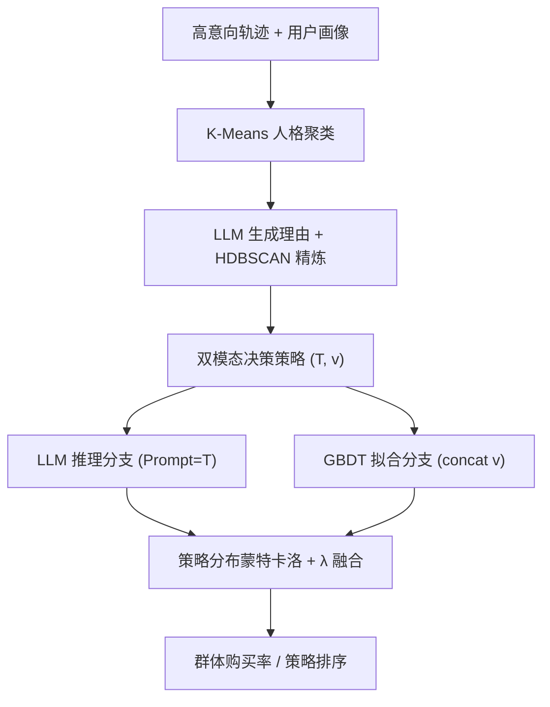

# Meituan Merchant Business Diagnosis via Policy-Guided Dual-Process User Simulation (基于策略引导双过程用户仿真的美团商户经营诊断)

- **会议/期刊**: SIGIR 2026 (Industry Track)
- **作者与机构**: Ziyang Chen, Renbing Chen, Daowei Li, Jiashen Sun, Ke Zeng (美团 LongCat Interaction Team); Jinzhi Liao, Xiang Zhao (独立研究者)
- **推荐链路定位**: 端到端生成式（反事实评估 / 用户行为仿真）
- **研究方向**: 对话推荐与智能体仿真 / 大语言模型推荐
- **论文原文**: [https://arxiv.org/abs/2604.15190v1](https://arxiv.org/abs/2604.15190v1)
- **开源代码**: 暂未开源

## TL;DR (1分钟核心速览)

商户经营诊断需要低成本的反事实评估，但 LLM 仿真器在信息不完备下会"过度理性化"，纯 ML 拟合器又无法泛化到语义漂移场景。本文提出 PGHS：先从高意向行为轨迹中经 K-Means 人格聚类 + HDBSCAN 理由精炼，挖掘出"决策策略"作为双分支共享对齐层；再让 LLM 推理分支以策略文本为 System Prompt、GBDT 拟合分支以策略向量为条件先验，最后按策略分布做蒙特卡洛群体融合。在美团 101 商户、26,461 条轨迹上，GSE 降至 8.80%，较最优 LLM 与最优 ML 基线分别相对降低 45.8% 与 40.9%。

## Background & Motivation (背景与核心矛盾)

- **主流范式**: 商户策略评估依赖在线 A/B 测试，但高维语义变量（促销文案、视觉排版）构成组合爆炸空间，物理实验无法覆盖；因此转向仿真式反事实评估，且以"同质用户群的集体偏好"为建模粒度。
- **前人局限**: ① 信息不完备——真实决策受线下情境、隐性习惯影响，而推理式仿真器只吃显式输入，产生过度理性化（bounded rationality 缺失）；② 机制二象性——群体行为同时含可解释偏好结构与隐性统计规律，表征学习类拟合器在长尾稀疏与语义漂移下退化，LLM 类则在隐性主导品类（如小吃）上方差爆炸。
- **核心洞察 (Key Insight)**: 两类范式的归纳偏置根本不同，朴素集成会引入漂移；必须有一个**显式的共享机制对齐层**，让两个分支在同一语义空间内被"锚定"。
- **本文切入点**: 把"决策策略"从行为轨迹中蒸馏出来，同时充当 LLM 的显式指令与 ML 的稠密条件向量，实现有约束的互补纠偏。

## Method (核心方法设计)

### 1. 整体框架 (Overall Architecture)

PGHS 分三阶段闭环：阶段 A 先过滤出"用户主动比较多商户后才决策"的高意向会话，将用户画像编码后 K-Means 聚成 $K$个人格群，群内用 LLM 为每个选择实例生成理由文本，再对理由向量做 HDBSCAN 微聚类并丢弃离群噪声，每个精炼簇被形式化为"显式指令$T_{k,j}$+ 稠密向量$v_{k,j}$"的双模态决策策略；阶段 B 以$T_{k,j}$作 System Prompt 驱动 LLM 推理分支、以$v_{k,j}$拼接场景特征与用户向量驱动 GBDT 拟合分支；阶段 C 用场景历史访客日志估计策略分布，蒙特卡洛采样后按$\lambda$ 加权融合为群体购买率估计。

<figure class="paper-figure" markdown="span">
  <figcaption>图1：PGHS 框架概览。阶段A通过宏观层面的角色聚类与微观层面的理由精炼来抽象决策策略。阶段B在抽象策略条件下，通过语义推理与统计拟合生成预测。阶段C通过群体对齐采样将双过程输出聚合为群体层面的估计。</figcaption>
</figure>

### 2. 关键设计拆解 (Key Designs)

1. **分层策略发现（Hierarchical Policy Discovery）**：单层聚类要么把每个用户当独立策略（过拟合，GSE +23%），要么只抓到粗人格而丢失群内策略差异（GSE +12%）。本文用"宏观 K-Means 定人格 + 微观 HDBSCAN 定策略"的粗到细流水线，HDBSCAN 的密度特性天然把噪声轨迹划为离群点 $\mathcal{N}_k$ 并剔除，使策略簇内部决策逻辑同质。其价值在于：策略不是人工先验，而是从数据中可迁移地蒸馏出的"经验逻辑代理"。

2. **双模态策略表征与双分支条件化**：同一策略被同时实例化为文本指令与语义向量，这是对齐的关键。推理分支 $\hat{y}_{reason}=f_{LLM}(S \mid \text{SystemPrompt}=T_{k,j})$ 用策略文本约束 LLM 的权衡逻辑，抑制过度理性化；拟合分支
$$\hat{y}_{fit}=f_{ML}\big(\text{Concat}(\phi(\tilde{S}),\, e_{prof},\, v_{k,j})\big)$$
把策略向量作为条件先验注入，使 GBDT 能学到 $P(Y|S,\text{Policy})$ 中"决策机制 × 场景特征"的交互项——这是纯文本分支观测不到的隐性规律（地理便利、线下品牌感知）。

3. **群体级融合与训练/推理开销**：最终估计
$$\hat{Y}_{hybrid}(S,a)=\lambda\cdot\frac{1}{N}\sum_{i=1}^{N}\hat{y}^{(i)}_{reason}+(1-\lambda)\cdot\frac{1}{N}\sum_{i=1}^{N}\hat{y}^{(i)}_{fit}$$
其中每个访客按余弦相似度分配到最相似策略，$\lambda$平衡两分支。融合的收益来自**互补误差结构**：推理分支在稀疏数据上泛化更好，拟合分支吸收隐性规律，实测均衡融合误差最低。注意本文无对比学习式负采样，训练信号为二分类购买结果的有监督拟合；推理开销主要来自$N$ 次 LLM 调用的蒙特卡洛采样，是落地的主要成本项。

## Experimental Setup & Evaluation Protocol (实验设置与评估协议)

- **数据集与预处理**: 美团 2025 年 10–11 月线上交互日志采样，覆盖 5 大菜系、3 个流量层级：

| 数据集 | #Users | #Items(商户) | #Interactions(轨迹) | 稀疏度/密度 | 特征/场景说明 |
| :--- | :---: | :---: | :---: | :---: | :--- |
| Meituan (prod) | 未披露 | 101 | 26,461 | 未披露 | 用户画像(人口统计/消费习惯/口味) + 商户画像(品类/价位/评分/促销)；每条轨迹为完整"搜索→比较→购买"序列 |

- **数据划分与防穿越 (Splitting Strategy)**: **全局时间戳切分**——前 20% 轨迹用于策略挖掘，后 80% 作为测试集，避免策略从未来行为中泄漏。
- **排名评测协议 (Ranking Protocol)**: 非传统 Top-N 排序，而是**群体级仿真保真度**：主指标 GSE（各商户预测选择率与真实选择率的平均绝对误差），辅以 GSE-SD 衡量跨商户类型稳定性；另设专家评估用 Kendall's $\tau$ 衡量策略排序与专家共识的一致性。
- **对比基线与超参设置**: 拟合类（LR / XGBoost / Gradient Boosting / 3 层 DNN，输入用户-商户拼接 embedding）；推理类（GPT-4o / GPT-4.1 / DeepSeek-V3 / Qwen3-32B，Zero-shot 与 Few-shot 两档）。Embedding 维度与 $\lambda$ 具体取值原文未在正文披露。

## Key Experimental Results (实验关键数据)

### 1. 主实验对比 (Main Results)

| 类别 | 模型 | Head | Mid | Tail | Snack | Hotpot | **Overall GSE↓** | Std↓ |
| :--- | :--- | :---: | :---: | :---: | :---: | :---: | :---: | :---: |
| ML | Logistic Regression | 16.20 | 17.80 | 19.50 | 17.50 | 17.60 | 17.80 | 11.20 |
| ML | XGBoost | 14.80 | 14.97 | 15.86 | 15.06 | 16.27 | 15.21 | 9.50 |
| ML | DNN (Embedding) | 14.20 | 15.10 | 16.80 | 14.20 | 15.30 | 14.90 | 9.80 |
| ML | Gradient Boosting | 14.50 | 14.80 | 15.60 | 14.80 | 16.00 | 14.98 | 9.20 |
| LLM | GPT-4o (Zero-shot) | 14.75 | 20.67 | 19.41 | 20.99 | 17.28 | 18.27 | 13.03 |
| LLM | GPT-4.1 (Few-shot) | 13.35 | 17.65 | 17.20 | 17.25 | 15.75 | 16.25 | 11.45 |
| LLM | DeepSeek-V3 (Few-shot) | 13.95 | 18.55 | 18.15 | 17.95 | 16.50 | 16.98 | 11.95 |
| Ours | PGHS (w/o Policy) | 8.32 | 10.43 | 11.83 | 10.16 | 9.68 | 9.91 | 7.37 |
| Ours | **PGHS (Full)** | **7.57** | **7.99** | **12.26** | **10.29** | **8.22** | **8.80** | **6.62** |
| | *Improv. vs 最优 LLM / 最优 ML* | | | | | | **-45.8% / -40.9%** | |

### 2. 消融实验 (Ablation Study)

| 变体 | GSE(%)↓ | GSE-SD(%)↓ | 相对变化 |
| :--- | :---: | :---: | :--- |
| LLM Direct | 18.3 | 13.0 | — |
| LLM + Policy | 15.4 | 11.8 | 策略引导使 LLM 分支 GSE -15.4% |
| ML Direct | 15.2 | 9.5 | — |
| ML + Policy | 13.7 | 8.8 | 策略引导使 ML 分支 GSE -9.7% |
| Fusion (No Policy) | 9.9 | 7.4 | 无策略融合已优于最优单分支 |
| **PGHS (Full)** | **8.8** | **6.6** | 策略 + 融合双重增益 |

策略发现流水线变体：无聚类（每用户一策略）GSE +23%；仅 K-Means GSE +12%；K-Means + HDBSCAN 最优。

### 3. 关键实验发现 (Key Findings)

1. **策略引导是双分支的"共同增益项"而非单侧补丁**：LLM 分支降 15.4%、ML 分支降 9.7%，且 GSE-SD 同步从 13.0/9.5 降至 11.8/8.8，说明共享对齐层同时改善了精度与稳定性，而非以方差换偏差。
2. **融合的收益独立于策略存在**：Fusion (No Policy) 已达 9.9%，优于任一单分支最优值（13.7%），验证了推理与拟合的误差结构确实互补；叠加策略后进一步降至 8.8%，两者增益近似可加。
3. **尾部商户是唯一短板，也是 LLM 分支的价值证明**：PGHS 在 Tail 上 GSE 为 12.26%，反而高于 w/o Policy 的 11.83%，说明稀疏场景下策略文本的约束可能过强；但该值仍远优于所有基线（最优 ML 15.60%），且专家评估中 PGHS 的 Kendall's $\tau$ 达 0.69，较最优 ML（0.50）与最优 LLM（0.52）分别提升 38.0% 与 32.7%，证明其在"策略排序"这一真实诊断任务上的实用价值。

## Highlights & Limitations (亮点、对比与审稿批判)

- **与代表作对比 (vs. Prior Work)**: 相较规则/统计仿真器与纯 LLM Agent 仿真（如 LLM 驱动的超理性决策者），本文首次把"策略"提升为跨范式的对齐媒介而非某一分支的输入特征；相较表征学习类拟合器（DNN Embedding），PGHS 通过策略向量注入获得了对语义漂移的鲁棒性，且无需重训大模型。
- **可迁移亮点**: ① "文本指令 + 稠密向量"的双模态策略表征可直接迁移到任何需要同时驱动 LLM 与轻量模型的场景（如冷启动画像增强、可解释推荐理由生成）；② 用 HDBSCAN 剔除噪声理由簇的做法，是低成本提升 LLM 生成标签质量的通用技巧。
- **审稿级局限批判**: ① 推理成本未量化——群体估计需 $N$次 LLM 调用，商户规模扩大时延迟与费用可能成为瓶颈，且$\lambda$与$N$的敏感性分析缺失；② 评估仅限单一平台 101 商户、5 个菜系，且无公开基准复现，泛化性与统计显著性检验（未报告$p$ 值或置信区间）均待补强；③ 尾部商户上策略引导反而略增误差，说明策略抽象在极稀疏群上可能引入归纳偏置。

## Rating (四维评分)

- **方法创新性 (Novelty)**: ⭐⭐⭐⭐ （核心机制与方法设计具备明确创新性，理论与实验动机支撑充分）
- **评估协议与实验扎实度 (Protocol & Experiments)**: ⭐⭐⭐ （主流公开数据集评测完整，包含多基线对比与消融实验验证）
- **写作与数学规范度 (Clarity & Rigor)**: ⭐⭐⭐⭐ （问题形式化定义清晰，核心模块数学推导与架构阐述严谨易读）
- **工业落地与复现价值 (Industrial & Practical Value)**: ⭐⭐⭐⭐⭐ （兼顾推荐效果增益与训练/推理效率，具备实际场景迁移参考价值）
