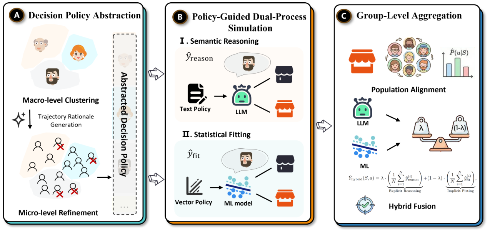
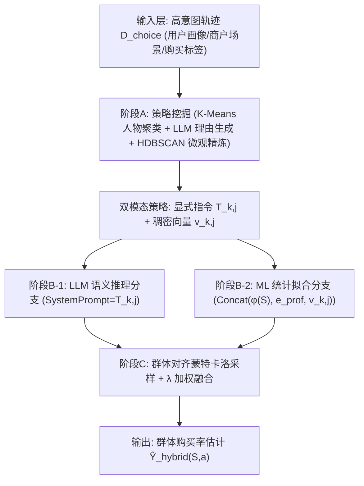
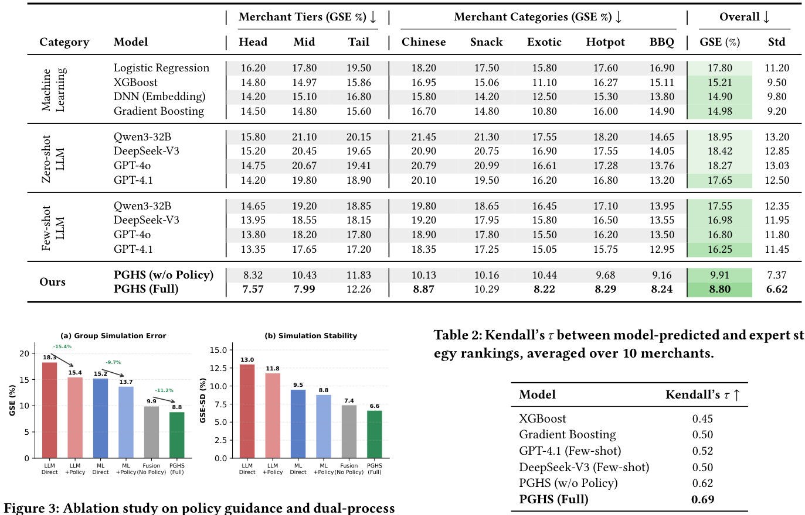
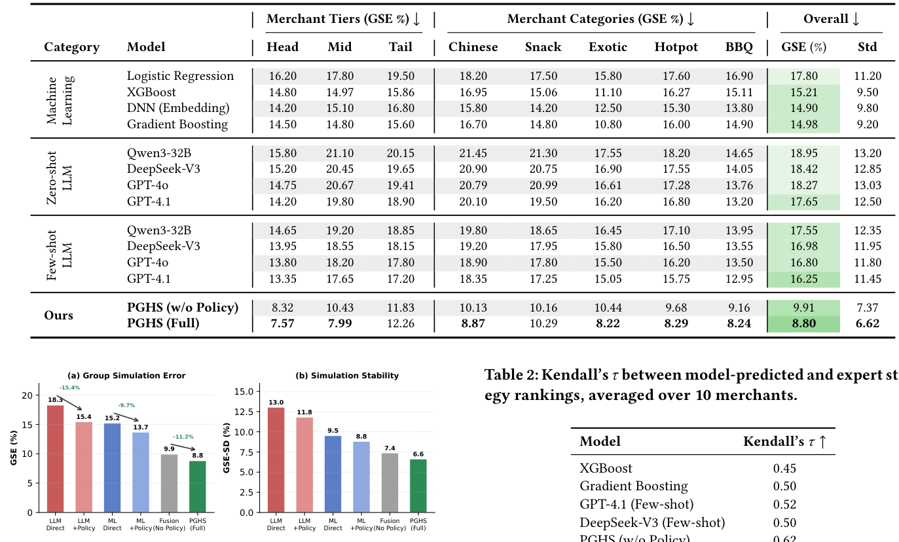
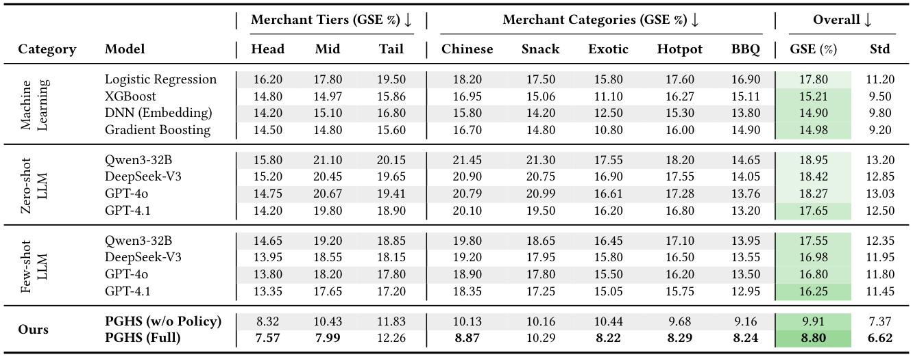
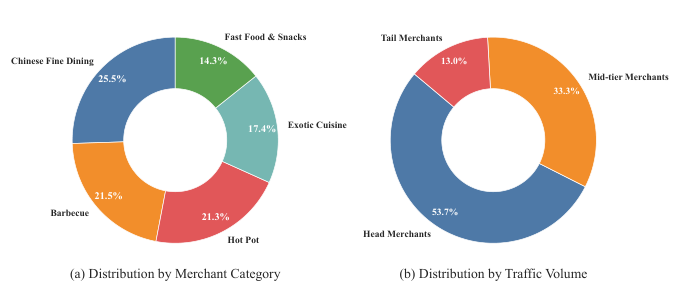

# Meituan Merchant Business Diagnosis via Policy-Guided Dual-Process User Simulation (基于策略引导双过程用户模拟的美团商户经营诊断)

- **会议/期刊**: SIGIR 2026 (Industry Track)
- **推荐链路定位**: 端到端生成式 / 反事实仿真评估 (Counterfactual Simulation for Merchant Diagnosis)
- **研究方向**: 对话推荐与智能体仿真 / 大语言模型推荐 (LLM4Rec)
- **论文原文**: [https://arxiv.org/abs/2604.15190v1](https://arxiv.org/abs/2604.15190v1)
- **开源代码**: 暂未开源（原文与预提取均未发现开源仓库链接）

## TL;DR (核心速览)

针对商户经营诊断中"在线 A/B 测试成本高、高维语义策略空间无法穷举"的痛点，本文提出 PGHS 双过程框架：先从高意图行为轨迹中挖掘可迁移的"决策策略"作为共享对齐层，再分别锚定 LLM 语义推理分支（抑制过度理性化）与 ML 统计拟合分支（吸收隐式规律），最后经群体对齐蒙特卡洛采样融合。在美团 101 商户、26,461 条轨迹上，群体模拟误差 GSE 达 8.80%，较最强 LLM 与 ML 基线分别相对降低 45.8% 与 40.9%。

## Background & Motivation (背景与动机)

- **领域背景与主流范式**: 平台商户经营诊断需要回答"若调整定价/菜单/促销页，转化率会如何变化"的反事实问题。在线 A/B 测试是因果评估金标准，但存在用户体验损耗、财务风险与高维语义变量（促销文案、视觉布局）组合爆炸三大瓶颈。因此基于仿真的反事实评估成为可扩展替代方案，其核心粒度是**群体层面**——个体选择随机，但同质用户群的集体偏好呈现稳定规律。
- **现有方法局限 (Limitations of Prior Work)**:
  1. **信息不完整 (Information Incompleteness)**：真实决策受线下场景、隐性习惯等未观测因素影响，而基于推理的模拟器（LLM Agent）依赖显式输入，倾向于产生**过度理性化 (over-rationalization)** 预测，无法复现有限理性。
  2. **机制二元性 (Mechanism Duality)**：群体行为同时体现可解释偏好结构与隐式统计规律。基于表征学习的拟合式模拟器（Wide&Deep、DIN 类）擅长捕捉隐式总体规律，但在长尾稀疏与语义漂移下退化；单一范式只能覆盖谱系一端。
  3. **朴素集成失效**：两分支归纳偏置根本不同，无共享对齐机制的约束融合易引入漂移 (drift)。
- **核心挑战 (Key Challenge)**: 如何构建一个既锚定领域经验逻辑、又能同时利用语义推理泛化性与统计拟合稳定性的共享对齐层，使两分支在同一语义空间中互补纠错？
- **核心洞察与切入点 (Key Insight)**: 作者借鉴双过程认知理论（Kahneman 系统 1/系统 2），提出从**高意图比较行为轨迹**中挖掘"决策策略"——它既是 LLM 可读的显式指令文本，又是可编码为稠密向量的条件先验，天然充当两分支的共享语义锚点。

## Problem Formulation & Method (问题定义与方法架构)

### 1. 符号定义与输入表征 (Notations & Input Representations)

- 商户场景 $S$、干预 $a$（如修改价格档位或促销文案）、用户 $u$，二元购买结果 $y(u,S,a)\in\{0,1\}$。
- 目标：预测群体购买率 $\mathbb{E}_u[y(u,S,a)]$。
- 用户画像 $u_{prof}$（人口统计、消费习惯、口味偏好）与商户画像（品类、价格档、评分、促销状态）均经预训练编码器 $\Psi_{enc}$ 编码为稠密向量。
- 高意图数据集 $\mathcal{D}_{choice}=\{(u_{prof}^i, S_i, y_i)\}_{i=1}^{N}$，仅保留用户主动比较多家商户后做出购买或退出决策的会话。

### 2. 整体流水线 (Overall Architecture)

三阶段流水线：(A) 策略挖掘——宏观人物聚类 + 微观理由精炼，抽象出双模态决策策略；(B) 双分支模拟——策略指令约束 LLM 推理、策略向量条件化 ML 拟合；(C) 群体融合——按场景历史访客日志估计策略分布，蒙特卡洛采样后加权融合。

<figure class="paper-figure" markdown="span">
  <figcaption>图1：PGHS框架概览。阶段A通过宏观层面的人物聚类和微观层面的理由精炼来抽象决策策略。阶段B在抽象策略的条件下，通过语义推理和统计拟合生成预测。阶段C通过群体对齐采样将双过程输出聚合为群体层面的估计。</figcaption>
</figure>

### 3. 核心模块设计与数学原理 (Key Designs & Formulations)

**模块一：层次化决策策略发现（阶段 A）**

- 宏观层：将用户画像序列化为自然语言并编码 $h_{prof}=\Psi_{enc}(u_{prof})$，对嵌入做 K-Means 聚类，将人群分解为 $K$ 个人物组 $\mathcal{P}=\{P_1,\dots,P_K\}$。
- 微观层：对每个人物组 $P_k$ 内的高意图选择实例 $(u,S,y)$，用 LLM 生成文本理由
  $$r=\mathcal{M}_{LLM}(\text{Explain}\; y \mid S, u_{prof}) \tag{1}$$
  再编码 $v_i^{rationale}=\Psi_{enc}(r_i)$，用 HDBSCAN 做密度聚类精炼：
  $$\{R_{k,1},\dots,R_{k,J_k}\},\ \mathcal{N}_k=\text{HDBSCAN}(\{v_i^{rationale}\mid i\in P_k\}) \tag{2}$$
  其中 $\{R_{k,j}\}$ 为连贯决策子群，$\mathcal{N}_k$ 为随机离群点（丢弃）。
- 双模态策略表示：对每个精炼簇 $R_{k,j}$，LLM 汇总生成显式指令
  $$T_{k,j}=\mathcal{M}_{LLM}(\text{Summarize}\{r\in R_{k,j}\}) \tag{3}$$
  含用户特征、关键决策因素、决策指南三类结构化字段；同一编码器得稠密向量 $v_{k,j}=\Psi_{enc}(T_{k,j})$。**物理直觉**：显式文本约束 LLM 推理边界，稠密向量作为 ML 的条件先验，二者共享同一语义空间，从机制上保证融合不漂移。

**模块二：策略引导双过程模拟（阶段 B）**

- 语义推理分支：给定场景 $S$ 与采样策略指令 $T_{k,j}$，LLM Agent 预测
  $$\hat{y}_{reason}=f_{LLM}(S\mid \text{SystemPrompt}=T_{k,j}) \tag{4}$$
  策略文本将推理锚定在领域权衡逻辑上，抑制过度理性化。
- 统计拟合分支：以 Gradient Boosting 为骨干，拼接场景特征 $\phi(\tilde{S})$、用户画像嵌入 $e_{prof}$ 与策略向量 $v_{k,j}$：
  $$\hat{y}_{fit}=f_{ML}\big(\text{Concat}(\phi(\tilde{S}), e_{prof}, v_{k,j})\big) \tag{5}$$
  策略向量注入使模型学习 $P(Y\mid S,\text{Policy})$，捕捉文本推理分支无法观测的决策机制与场景特征交互（如地理便利性、线下品牌认知）。

**模块三：群体级聚合（阶段 C）**

- 用场景历史访客日志估计策略分布 $\hat{P}_U(u\mid S)$，每个访客按嵌入与策略向量的余弦相似度分配至最相似策略。
- 蒙特卡洛采样 $N$ 步，每步抽取 $u^{(i)}\sim\hat{P}_U(u\mid S)$ 并获取双分支预测，最终融合：
  $$\hat{Y}_{hybrid}(S,a)=\lambda\cdot\frac{1}{N}\sum_{i=1}^{N}\hat{y}_{reason}^{(i)}+(1-\lambda)\cdot\frac{1}{N}\sum_{i=1}^{N}\hat{y}_{fit}^{(i)} \tag{6}$$
  其中 $\lambda\in[0,1]$ 平衡两分支。**设计依据**：推理分支在数据稀疏时泛化更好，拟合分支吸收隐式规律，二者误差结构互补；原文指出经验上均衡融合误差最低。

### 4. 训练目标、负采样与推理复杂度 (Optimization, Negative Sampling & Complexity)

- **损失函数**: 原文未显式给出统一损失函数公式。LLM 分支为提示驱动的零/少样本推理（无梯度训练）；ML 分支为监督式二分类拟合（Gradient Boosting，隐含对数损失/指数损失，原文未报告具体目标与超参）。融合权重 $\lambda$ 原文未报告具体取值，仅说明"均衡融合误差最低"。
- **训练负采样策略**: 不适用。本文为二分类购买结果预测，非检索式负采样任务；正样本定义为高意图会话中"主动比较多家商户后完成购买"的决策实例，退出决策为负例。
- **时间与空间复杂度**: 原文未报告离线预处理（LLM 理由生成、嵌入编码、聚类）耗时、训练单轮耗时、在线单次推理延迟 (ms/request) 与峰值显存。定性上，阶段 A 的 LLM 理由生成与阶段 B 的 LLM 推理为主要开销；阶段 C 需 $N$ 次蒙特卡洛采样，每次调用双分支，推理成本随 $N$ 线性增长。原文未提供与基线的复杂度对比表。

## Experimental Setup & Evaluation Protocol (实验设置与评估协议)

- **数据集统计与预处理**: 美团平台真实生产数据，采样自 2025 年 10–11 月线上用户交互日志，覆盖 101 家商户、26,461 条用户决策轨迹，横跨 5 个菜系品类与 3 个流量层级。每条轨迹记录完整"搜索到购买"序列并含显式比较动作。原文未报告用户数/物品数/稀疏度等标准推荐统计量，以下按原文可得信息填写：

| 数据集 (Dataset) | 用户数 (#Users) | 物品数 (#Items) | 交互数 (#Interactions) | 稀疏度/密度 (Sparsity) | 模态/辅助特征说明 |
| :--- | :---: | :---: | :---: | :---: | :--- |
| Meituan 生产数据 (2025.10–11) | 原文未报告 | 101 商户 | 26,461 条决策轨迹 | 原文未报告 | 用户画像（人口统计/消费习惯/口味偏好）+ 商户画像（品类/价格档/评分/促销状态），均经预训练编码器编码 |

- **数据划分方式 (Splitting Strategy)**: **时序切分 (Chronological Split)**——前 20% 轨迹用于策略挖掘，剩余 80% 作为测试集。注意：策略挖掘集与测试集在时间上前后分离，降低了未来信息泄露风险；但策略挖掘阶段使用了测试期之前的行为轨迹，属于合理的"历史先验"使用，非穿越。
- **排名评测协议 (Ranking Protocol)**: 非检索式排序任务。主指标为群体模拟误差 GSE（预测与真实逐商户选择率的平均绝对误差）及 GSE 标准差 (GSE-SD)；专家评估部分采用策略排序的 Kendall's $\tau$。
- **评价指标与显著性检验**: GSE(%)↓、GSE-SD(%)↓、Kendall's $\tau$↑。原文**未报告**多随机种子方差、配对显著性检验（$t$-test / Wilcoxon / Bootstrap）及嵌入维度 $d$ 的具体取值。

## Key Experimental Results (核心实验结果)

### 1. 主实验对比 (Main Results)

<figure class="paper-figure" markdown="span">
  <figcaption>表1：基线比较：跨商户层级和类别的群体模拟误差（GSE%）。ML模型方差较低但难以进行语义泛化；LLM因过度理性化而表现出较高方差。</figcaption>
</figure>

| 数据集 | 指标 | 传统/拟合式基线 | 推理式最强基线 | 本文方法 (Ours) | 相对提升 (Improv.) |
| :--- | :--- | :---: | :---: | :---: | :---: |
| Meituan (101 商户) | GSE(%)↓ 总体 | DNN (Embedding) 14.90 / Gradient Boosting 14.98 | GPT-4.1 Few-shot 16.25 | **8.80** | vs ML 最强 +40.9%；vs LLM 最强 +45.8% |
| Meituan (Head 层) | GSE(%)↓ | DNN 14.20 | GPT-4.1 Few-shot 13.35 | **7.57** | — |
| Meituan (Mid 层) | GSE(%)↓ | DNN 15.10 | GPT-4.1 Few-shot 17.65 | **7.99** | — |
| Meituan (Tail 层) | GSE(%)↓ | Gradient Boosting 15.60 | GPT-4.1 Few-shot 17.20 | **12.26** | — |
| Meituan (Snack 品类) | GSE(%)↓ | Gradient Boosting 10.80 | GPT-4.1 Few-shot 15.05 | **8.22** | — |
| Meituan (总体稳定性) | GSE-SD(%)↓ | Gradient Boosting 9.20 | GPT-4.1 Few-shot 11.45 | **6.62** | — |

关键观察：ML 基线方差低但在 Tail 商户因数据稀疏退化；LLM 基线在 Snack 等隐式主导品类因过度理性化方差偏高（GSE-SD 11.45–13.20）；PGHS 在精度与稳定性上同时占优。

### 2. 消融实验与控制变量分析 (Ablation Study)

<figure class="paper-figure" markdown="span">
  <figcaption>图3：关于策略引导和双过程融合的消融研究。</figcaption>
</figure>

- **策略引导贡献**：LLM 分支加策略后 GSE 由 18.3% 降至 15.4%（−15.4%）；ML 分支由 15.2% 降至 13.7%（−9.7%）。
- **双过程融合贡献**：无策略引导的融合已达 9.9%，优于任一单分支最优；加策略后 PGHS (Full) 达 8.80%。
- **稳定性**：GSE-SD 从 LLM Direct 的 13.0% 逐级降至 PGHS (Full) 的 6.6%。
- **策略发现流水线消融**：不做聚类（每用户视为独立策略）导致过拟合，GSE 上升 23%；仅用 K-Means 捕获粗粒度人物组但无法区分组内策略，GSE 上升 12%；完整层次化流水线（K-Means + HDBSCAN）最优。
- 原文**未报告**参数量对齐或图拓扑度数匹配等控制变量实验（本文非图模型，不适用图度数匹配）。

### 3. 稀疏度/冷启动分桶与超参敏感度 (Sparsity Buckets & Hyperparameters)

- **商户层级分桶**：PGHS 在 Head/Mid/Tail 三层 GSE 分别为 7.57/7.99/12.26，Tail 层误差仍显著高于头部，但相对 ML 最强基线（15.60）与 LLM 最强基线（17.20）优势明显；Tail 层是本文相对提升的主要来源之一。
- **品类分桶**：Snack 品类（隐式规律主导）PGHS 达 8.22%，而 LLM 基线普遍在 15% 以上，验证策略锚定对过度理性化的抑制效果。
- **关键超参数敏感度**：融合权重 $\lambda$、蒙特卡洛采样数 $N$、人物聚类数 $K$、HDBSCAN 参数等原文**均未报告**敏感度分析。
- **线上 A/B 测试结果**: 原文仅包含离线实验与专家评估，**未报告**线上 A/B 测试的 CTR/CVR/GMV/留存等业务指标。专家评估部分（表 2）显示 PGHS (Full) 的 Kendall's $\tau$ 为 0.69，较最强 ML 基线（Gradient Boosting 0.50）提升 38.0%，较最强 LLM 基线（GPT-4.1 Few-shot 0.52）提升 32.7%。

<figure class="paper-figure" markdown="span">
  <figcaption>表2：模型预测与专家策略排序之间的Kendall's 𝜏，在10个商户上取平均。</figcaption>
</figure>

## Highlights, Limitations & Critiques (亮点、局限与审稿级批判)

- **核心亮点与可迁移性**:
  1. **"策略即对齐层"的设计极具普适性**：将行为轨迹蒸馏为"显式文本 + 稠密向量"双模态策略，同时服务提示工程与特征工程，这一范式可直接迁移到对话推荐的多轮意图对齐、生成式推荐的语义 ID 先验注入、以及多任务精排中的任务间共享表征。
  2. **双过程互补纠错**：利用 LLM 稀疏泛化与 ML 隐式拟合的误差结构互补性，而非简单集成，为 LLM+传统模型混合架构提供了机制层面的对齐思路。
  3. **工业落地验证**：101 商户、26k+ 轨迹的真实生产数据 + 三位资深运营专家共识排序评估，具备较强的业务可信度。

- **局限性与审稿视角批判 (Critical Limitations)**:
  1. **评估协议薄弱**：仅单一平台、单一时间窗（2025.10–11）数据，无多随机种子方差、无配对显著性检验，8.80% vs 9.91%（w/o Policy）的差距是否统计显著未经验证；GSE 为商户级 MAE，未报告置信区间。
  2. **关键超参与实现细节缺失**：融合权重 $\lambda$、采样数 $N$、聚类数 $K$、嵌入维度 $d$、LLM 具体版本与温度设置、ML 分支损失函数均未报告，复现性存疑。
  3. **计算开销完全未量化**：LLM 理由生成 + 每场景 $N$ 次蒙特卡洛双分支推理的在线延迟与成本是工业部署的核心关切，原文未给出任何 ms/request 或显存数据，削弱了"可扩展替代 A/B 测试"的论据。
  4. **因果性论证不足**：虽定位为"反事实评估"，但方法本质是相关性拟合 + 策略条件化，未引入因果图、do-calculus 或倾向得分加权等因果识别手段，反事实有效性主要依赖专家排序的间接验证。
  5. **基线强度有限**：ML 基线仅为 LR/XGBoost/GBDT/3 层 DNN，未对比现代深度 CTR 模型（DIN/DIEN/DCN）或 LLM 用户模拟专用方法（如 Zhang et al. 2025 的 LLM-powered user simulator），"最强基线"的说服力可进一步加强。
  6. **篇幅限制**：5 页 Industry Track 短文，方法细节与实验广度受限，属会议定位所致，但作为学术贡献的深度仍有提升空间。

## Rating (四维评分)

- **方法创新性 (Novelty)**: ⭐⭐⭐⭐（"策略即共享对齐层"的双过程设计有新意，但双过程/LLM+ML 混合本身非全新）
- **评估协议与实验扎实度 (Protocol & Experiments)**: ⭐⭐⭐（真实工业数据 + 专家评估是加分项，但缺显著性检验、超参分析与计算开销）
- **写作与数学规范度 (Clarity & Rigor)**: ⭐⭐⭐⭐（三阶段结构清晰、公式规范，但关键超参与损失函数缺失）
- **工业落地与复现价值 (Industrial & Practical Value)**: ⭐⭐⭐⭐（已在美团试点为商户诊断工具，业务价值明确；但未开源、细节不足影响复现）

## 论文图表

<figure class="paper-figure" markdown="span">
  <figcaption>图2：数据集按商户类别（a）和流量规模层级（b）的统计分布。</figcaption>
</figure>

