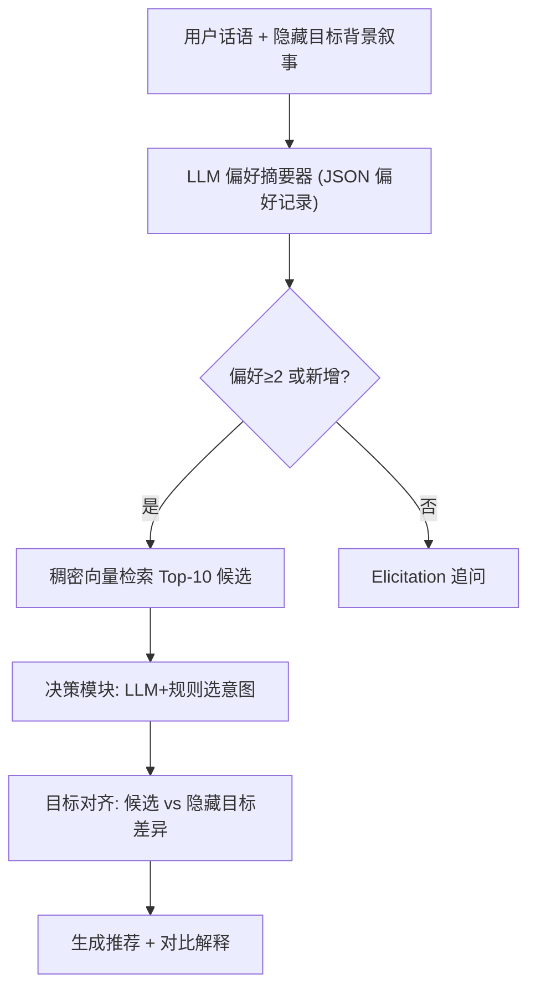

# RecQuest: Towards Estimating User Domain Knowledge in Conversational Recommender Systems (面向对话推荐系统的用户领域知识估计)

- **会议/期刊**: SIGIR 2026 (ICTIR Track)
- **作者与机构**: Ivica Kostric, Krisztian Balog (University of Stavanger), Ujwal Gadiraju (TU Delft)
- **推荐链路定位**: 对话交互层（偏好引导策略的前置模块）
- **研究方向**: 对话推荐与智能体仿真 / 大语言模型推荐
- **论文原文**: [https://arxiv.org/abs/2512.13173v2](https://arxiv.org/abs/2512.13173v2)
- **开源代码**: [https://github.com/iai-group/crs-knowledge](https://github.com/iai-group/crs-knowledge)

## TL;DR (1分钟核心速览)

现有 CRS 默认用户是"专家"，对新手造成低效交互；而要让系统自适应，必须先估计用户领域知识，但估计又依赖定制化引导——形成"鸡生蛋"死锁。本文提出新任务"从对话记录直接估计用户领域知识"，设计游戏化采集协议 RecQuest（隐藏目标物品 + 背景叙事 + 目标感知 CRS 引导），采集 515 段对话、10,688 条 utterance，覆盖 5 个品类。关键发现：自评知识不可靠（自评新手成功率 44.4% 反超自评专家 36.4%，呈 Dunning–Kruger 效应），客观问卷才是可信 ground truth；LLM 估计任务仍困难，最优微调 ModernBERT 准确率仅 0.524。

## Background & Motivation (背景与核心矛盾)

- **主流范式**: 属性式 CRS 做槽位填充式偏好引导，生成式 CRS 端到端生成推荐与解释；二者均假设用户能清晰理解属性并映射到偏好。
- **前人局限**: ① 现有 CRS 数据集（ReDial、INSPIRED、MG-ShopDial 等）采用开放式协议，用户只谈自己熟悉的属性，对话集中于热门物品与常识特征，几乎不暴露"新手如何探索陌生特征"的信号；② 开放式协议下用户常不加审视地接受推荐，交互浅、无需领域知识即可完成任务，专家/新手行为差异被抹平。
- **核心洞察 (Key Insight)**: 知识信号只在"信息缺口"被强制暴露时才出现——若给用户一个只能靠叙事描述、无法直接命名的隐藏目标物品，用户就必须用自己掌握的词汇反复试探、追问、修正，从而自然泄露其领域知识水平（图 1 中新手说"拍鸟要长焦"，专家说"防抖、低光性能、快速对焦"）。
- **本文切入点**: 用 game-with-a-purpose 协议制造信息缺口，先解决"数据从哪来"，再解决"ground truth 怎么定"，最后验证"LLM 能否从对话估计知识"。

## Method (核心方法设计)

### 1. 整体框架 (Overall Architecture)

RecQuest 是一个目标感知的混合式 CRS：每轮先由 LLM 偏好摘要器把用户话语合并进结构化 JSON 偏好记录；当偏好条目 ≥2 或新增约束时触发稠密向量检索；决策模块以 LLM + 规则混合策略在 redirect / answer / recommend / elicit 四类意图中选择；推荐意图需同时满足"有候选、偏好有新增、已陈述 ≥3 条偏好"三条规则，否则回退到 elicit 继续追问。推荐响应经"候选选择 → 目标对齐（对比隐藏目标找差异）→ 自然语言生成"三步产出带对比解释的推荐。若单轮出现 ≥3 条偏好，系统强制要求用户先排序重要性，以此拉长多轮交互、逼出渐进式约束细化。

### 2. 关键设计拆解 (Key Designs)

1. **游戏化采集协议（制造信息缺口）**：痛点在于开放式协议下知识无关紧要 $\to$ 给每位参与者随机分配一个隐藏目标物品，仅以背景叙事呈现（短版 5 条隐式特征约束 / 长版 10 条），要求其在 15 分钟内通过对话找出该物品，成功者获 £1 奖金。物品池经 k-means 聚类从 1k–200k 原始商品压缩到每域 50 件高区分度物品。直觉：目标导向 + 金钱激励使"能否用专业词汇精准约束"直接决定成败，知识因此成为可观测变量。

2. **客观知识 ground truth 的建立（RQ2）**：痛点在于自评噪声大 $\to$每域构造 30 条事实陈述，采用 certainty-in-knowledge 五级量表（Definitely True / Probably True / I don't know / Probably False / Definitely False），同时捕获正确率与置信度，并经人类专家校验。以任务成功率做外部效度检验：客观分组下专家 40.4% > 新手 35.9%，自评分组下却反转（新手 44.4% > 专家 36.4%），据此弃用自评，改用客观分数分位数定义 Novice（$\le$20th）与 Expert（$\ge$ 80th）。

3. **LLM 知识估计的三种提示范式与训练目标**：痛点在于知识线索分散在多轮、单句几乎无显式证据 $\to$设计 holistic（全对话一次性判断）、evidence-based（先抽取用户自创的领域短语再据此判断）、incremental（逐轮更新，且约束估计值单调不降：$k_t = \max(k_{t-1}, f(h_{<t}, u_t))$，以稳定性换贝叶斯最优性）三种变体，各配 zero-shot / few-shot（每类 1 个同域示例）。监督侧用 QLoRA 微调 4bit Llama-3-8B-Instruct 与 ModernBERT-large 做三分类，学习率$2e^{-5}$、10 epochs，310 条训练 / 205 条测试，无负采样概念（分类任务）。

## Experimental Setup & Evaluation Protocol (实验设置与评估协议)

- **数据集与预处理**: 5 个品类（自行车、数码相机、笔记本、跑鞋、智能手表），物品来自 Amazon Review Dataset，经嵌入 + k-means 聚类去重后每域保留 50 件；参与者来自 Prolific（美/欧、英语母语、approval $\ge$95%、历史提交$\ge$ 1000），每人仅参与一次。

| 数据集(域) | #Dialogues | #Utterances | 平均轮数 | 平均偏好数 | 平均推荐数 | 成功率 |
| :--- | :---: | :---: | :---: | :---: | :---: | :---: |
| Bicycle | 79 | 1522 | 9.53±4.71 | 10.00±4.83 | 3.19±1.35 | 67.9% |
| Digital Camera | 79 | 1687 | 10.35±4.42 | 10.76±5.23 | 3.42±1.72 | 29.1% |
| Laptop | 98 | 2179 | 10.00±4.86 | 10.47±4.51 | 3.60±1.27 | 29.6% |
| Running Shoes | 179 | 3636 | 10.07±5.37 | 9.90±5.54 | 3.52±1.43 | 37.1% |
| Smartwatch | 80 | 1665 | 10.18±3.63 | 9.61±4.08 | 3.45±1.19 | 37.5% |
| **Total** | **515** | **10688** | **10.21±4.81** | **10.10±5.03** | **3.46±1.41** | **39.3%** |

- **数据划分与防穿越**: 监督模型采用 310/205 的对话级划分（约 60/40），未见原文报告分层或时间切分细节；提示式方法无需训练集，few-shot 示例按域匹配且每类各一，存在轻微示例泄漏风险。
- **排名评测协议**: 非排序任务，采用三分类 Accuracy 与 Macro-F1 双指标；Macro-F1 用于抵消类别不均衡（Novice/Expert 各取 20% 分位，Intermediate 占多数）。
- **对比基线与超参设置**: 提示基线 GPT-4.1-mini-2025-04-14 与 Meta-Llama-3.3-70B（zero/few-shot × 三种范式）；监督基线 Llama-3-8B-Instruct (QLoRA) 与 ModernBERT-large。原文未报告显著性检验。

## Key Experimental Results (实验关键数据)

### 1. 主实验对比 (Main Results)

| 方法 | 范式 | Accuracy | Macro-F1 |
| :--- | :--- | :---: | :---: |
| GPT-4.1 zero-shot | Holistic | 0.305 | 0.296 |
| GPT-4.1 few-shot | Holistic | 0.378 | 0.363 |
| LLaMA 3.3 zero-shot | Holistic | 0.354 | 0.354 |
| LLaMA 3.3 few-shot | Holistic | **0.490** | 0.357 |
| GPT-4.1 few-shot | Evidence-based | 0.417 | 0.379 |
| LLaMA 3.3 zero-shot | Evidence-based | 0.417 | **0.382** |
| LLaMA 3.3 few-shot | Evidence-based | 0.213 | 0.154 |
| Llama 3-8B (SFT) | Supervised | 0.519 | 0.286 |
| **ModernBERT-large (SFT)** | Supervised | **0.524** | 0.353 |

### 2. 消融实验 (Ablation Study)

原文未设传统模块消融，但提供了等价于"范式 × 示例 × 模型"的三维对照，可视为提示策略消融：

| 消融维度 | 设置 | Accuracy 变化 | Macro-F1 变化 |
| :--- | :--- | :---: | :---: |
| 提示范式 | Holistic → Incremental (LLaMA z-s) | 0.354 → 0.364 | 0.354 → 0.347 |
| 提示范式 | Holistic → Evidence-based (LLaMA z-s) | 0.354 → 0.417 | 0.354 → 0.382 |
| 示例数量 | zero-shot → few-shot (GPT-4.1, Holistic) | 0.305 → 0.378 | 0.296 → 0.363 |
| 示例数量 | zero-shot → few-shot (LLaMA, Evidence) | 0.417 → 0.213 | 0.382 → 0.154 |
| 监督 vs 提示 | LLaMA z-s Evidence → ModernBERT | 0.417 → 0.524 | 0.382 → 0.353 |

### 3. 关键实验发现 (Key Findings)

1. **自评知识是伪信号，客观测试才可信**：自评分组下"新手"成功率 44.4% 反超"专家" 36.4%，而客观分组下专家 40.4% > 新手 35.9%，方向完全反转，直接印证 Dunning–Kruger 式校准偏差；这解释了为何此前基于自评的 CRS 自适应研究难以复现收益。
2. **少样本示例是双刃剑，且与模型强相关**：GPT-4.1 加 few-shot 在 holistic 下从 0.305 升至 0.378（+24%），但 LLaMA 3.3 在 evidence-based 下从 0.417 崩至 0.213（Macro-F1 从 0.382 跌至 0.154），说明示例会诱导开源模型过度模仿示例措辞而非真实证据。
3. **准确率与类别均衡存在结构性权衡**：ModernBERT 以 0.524 取得最高 Accuracy，但混淆矩阵显示其把大量样本压向 Intermediate 类，Novice/Expert 召回严重受损（Macro-F1 仅 0.353）；零样本 LLaMA 准确率略低但错误多落在相邻类别，Macro-F1 反而更高（0.382），更适合需要区分两端极值的自适应场景。

## Highlights & Limitations (亮点、对比与审稿批判)

- **与代表作对比 (vs. Prior Work)**: 相比 ReDial / INSPIRED 的开放式双人对话，RecQuest 用隐藏目标制造信息缺口，使知识成为任务成败的决定变量；相比 MG-ShopDial 的 coached 协议，本文显式控制并测量知识水平而非仅追求自然度；相比 Kostric et al. 的 usage-oriented 引导策略（只服务低知识用户），本文补上了"先估计、再适配"的前半环。
- **可迁移亮点**: ① "隐藏目标 + 背景叙事"是低成本 elicitation 信号放大技巧，可迁移到冷启动偏好采集与主动学习式问卷设计；② 用"下游任务成功率"反向校验标注方案可信度（而非只看相关性），是用户建模类工作值得复用的 ground truth 验证范式。
- **审稿级局限批判**: ① 数据规模仅 515 段对话、205 条测试集，且成功率整体仅 39.3%、跨域波动 29.1%–67.9%，分类器性能置信区间宽，0.524 的准确率难以支撑"可用"结论；② 作者自认的核心混淆未解决——话语差异可能源于健谈度、语言能力、人格特质而非领域知识，全文未做任何混淆变量控制或消融；③ 系统每轮多次调用 GPT-4.1-mini，在线部署成本与延迟未评估，且 incremental 范式的"单调不降"约束是工程妥协而非理论推导。

## Rating (四维评分)

- **方法创新性 (Novelty)**: ⭐⭐⭐⭐ （首次形式化"从对话估计领域知识"任务，GWAP 协议设计巧妙，但技术贡献以数据与实证为主，算法层面较薄）
- **评估协议与实验扎实度 (Protocol & Experiments)**: ⭐⭐⭐ （客观问卷 + 成功率外部校验很扎实，但样本量小、无显著性检验、无混淆变量控制，监督划分细节缺失）
- **写作与数学规范度 (Clarity & Rigor)**: ⭐⭐⭐⭐ （RQ1–RQ4 组织清晰、图表与提示模板完整公开，但全文几乎无形式化定义，公式层面近乎空白）
- **工业落地与复现价值 (Industrial & Practical Value)**: ⭐⭐⭐⭐ （代码、协议、提示、数据集全开源，采集流程可直接复用；但每轮多次 LLM 调用与 50 件小物品池限制了真实场景直接部署）

