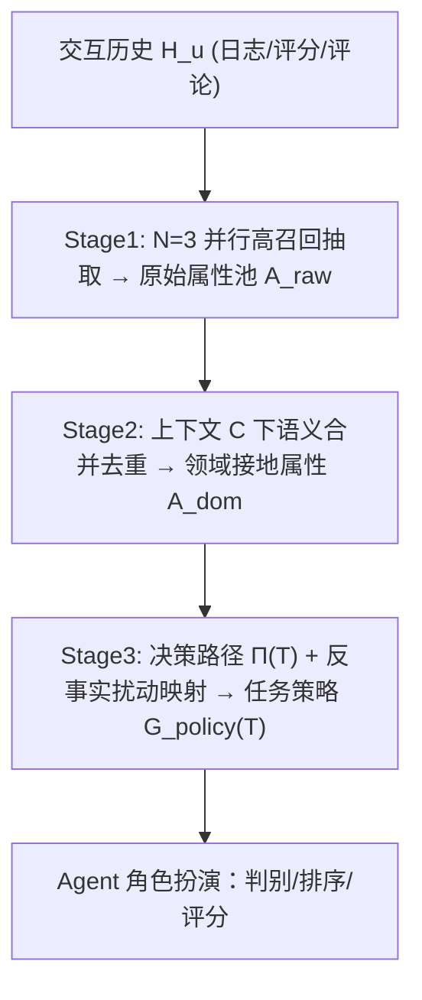

# Task-Aware Automated User Profile Generation for Recommendation Simulation Using Large Language Models (面向推荐仿真的任务感知自动化用户画像生成)

- **会议/期刊**: SIGIR 2026
- **作者与机构**: Xinye Wanyan, Chenglong Ma, Danula Hettiachchi, Ziqi Xu, Jeffrey Chan (RMIT University, ADM+S Centre)
- **推荐链路定位**: 端到端生成式（LLM Agent 用户行为仿真 / 评测侧）
- **研究方向**: 对话推荐与智能体仿真 / 大语言模型推荐
- **论文原文**: [https://arxiv.org/abs/2605.13497v1](https://arxiv.org/abs/2605.13497v1)
- **开源代码**: [https://github.com/WennyXY/APG4Sim](https://github.com/WennyXY/APG4Sim)

## TL;DR (1分钟核心速览)

LLM Agent 仿真已成为推荐系统实时评测的重要范式，但其三大模块中 **profile（画像）模块长期被忽视**：现有工作（RecAgent、Agent4Rec）依赖人工预设属性 schema，导致信息瓶颈、行为失配与跨域不可迁移。本文提出免训练的 **APG4RecSim**，用「高召回多路抽取 → 上下文感知语义合并 → 反事实因果映射」三阶段把原始交互历史自动转为任务可执行画像。在 ML-1M / Amazon-Book / Amazon-Beauty 三数据集、判别/排序/评分三任务上，24 项指标中 16 项最优，nDCG@10 最高提升约 7%，评分分布 JSD 降低约 8%，且对流行度与位置偏差更鲁棒。

## Background & Motivation (背景与核心矛盾)

- **主流范式**: LLM Agent 仿真框架由 profile（身份与偏好）、memory（交互记忆）、action（决策）三模块构成；近年 RecAgent、Agent4Rec、SimUSER 等几乎全部火力集中在 memory 与 action 的设计上。
- **前人局限**: ① **刚性 schema 的信息瓶颈**——人工属性表是"封闭世界"，无法捕捉演化兴趣与条件偏好；② **行为失配**——缺乏统计锚定的画像让 Agent 缺少"指令锚点"，仿真行为与真实用户脱节；③ **域不可迁移**——电商属性（价格、品牌）无法直接迁移到内容流（题材、情绪），换域即需重人工设计。
- **核心洞察 (Key Insight)**: 画像属性存在**情境相关性**——某任务关键属性（如电商价格敏感度）在另一任务中可能是纯噪声；因此画像不应是静态属性表，而应是**与任务决策路径显式对齐的可执行策略集**。
- **本文切入点**: 放弃人工 schema，改为"先高召回抽取、再上下文接地合并、最后用反事实检验把属性挂到决策步骤上"的免训练流水线。

## Method (核心方法设计)

### 1. 整体框架 (Overall Architecture)

输入用户交互历史 $H_u=\{(i_k,r_k,t_k)\}_{k=1}^n$，目标是学习映射$f: H_u \to \mathcal{P}_u(T)=\langle I_{meta}, A_{dom}, G_{policy}(T)\rangle$，其中$A_{dom}$为任务无关的领域接地属性集，$G_{policy}(T)$为任务$T$特定的决策策略。流水线分三阶段：Stage 1 并行多路抽取构造高召回候选池；Stage 2 在显式上下文$C=\langle D_{info}, T_{desc}, E_{shot}\rangle$ 下做语义去重与词汇接地；Stage 3 实例化任务决策路径并用反事实扰动把属性映射到具体决策节点。全程无参数训练，仅靠 prompt 编排，推理时画像可离线预生成并缓存。

<figure class="paper-figure" markdown="span">
  <figcaption>图1：APG4RecSim 概览，一种用于推荐系统模拟的免训练、上下文自适应、基于 LLM 的画像生成工作流。该图展示了所提出的三阶段方法，用于为智能体创建高保真画像。阶段1（初始化与提取）涉及从用户交互历史（如日志、评分、评论）中挖掘原始特征，以构建可能包含噪声的属性池。阶段2（上下文感知语义整合）采用语义合并与去重过程，将原始属性精炼为简洁、连贯的用</figcaption>
</figure>

### 2. 关键设计拆解 (Key Designs)

1. **多路并行高召回抽取（Ensemble Extraction）**：单次 LLM 生成随机性大、易漏隐式偏好。本文并行跑 $N=3$次抽取并取并集$A_{raw}=\bigcup_{j=1}^{3} \text{LLM}(H_u \mid \text{Prompt}_{ext})$，刻意接受冗余与噪声以换召回率；预实验显示属性召回在 2–3 次后饱和，故$N=3$ 是成本-覆盖的甜点。直觉：把"去噪"职责从抽取阶段后移到合并阶段，避免早期剪枝误杀长尾偏好。

2. **上下文感知语义合并（Context-Aware Consolidation）**：原始属性与数据集词表存在 paraphrase 与词汇错配。以 $C=\langle D_{info}, T_{desc}, E_{shot}\rangle$（数据集 schema、任务族与粒度要求、单条示例校准术语）为条件执行$A_{dom}=\text{LLM}(A_{raw}\mid C,\text{Prompt}_{merge})$，完成同义归并与数据集原生概念接地。这是"域泛化"的关键：换域只需换$C$，无需重写属性表。

3. **反事实属性-步骤映射（Counterfactual Trait-to-Step Mapping）**：这是全文最核心的增量。对任务 $T$先实例化有序决策路径$\Pi(T)=[s_1,\dots,s_m]$（硬过滤 → 权衡比较 → 最终选择/打分）；随后对属性$a$构造最小扰动变体$a'$（否定或弱化），生成反事实画像$A_{dom}^{(a\leftarrow a')}$，在同一实例上重跑 Agent：若判别选中集合变化、排序次序变化或评分变化超阈值，则判定$a$对步骤$s_j$ 有因果影响并保留，否则降权或合并。直觉：用"改一个属性看输出是否翻转"筛掉与决策无关的噪声属性，使画像从"描述性文本"升级为"可执行、可解释的策略"。

**训练目标与推理开销**：无训练损失（training-free），全部为 prompt 级推理；主要开销在 Stage 3 的反事实重跑（每属性一次前向），但画像可离线一次性生成并缓存，在线仿真阶段零额外成本。

## Experimental Setup & Evaluation Protocol (实验设置与评估协议)

- **数据集与预处理**（三公开基准，无 5-core 过滤描述，按时间戳排序）：

| 数据集 | 领域 | 划分方式 | 用途说明 |
| :--- | :---: | :---: | :--- |
| ML-1M | 电影 | 每用户按时间戳 80%/20% | 前 80% 生成画像，后 20% 评测 |
| Amazon-Book | 图书 | 同上 | 稀疏、长尾显著 |
| Amazon-Beauty | 美妆 | 同上 | 跨域泛化验证 |

- **数据划分与防穿越**: 严格**按用户时间戳前 80% / 后 20% 切分**，画像仅见训练段，评测段完全留出，避免未来交互泄漏。
- **排名评测协议**: 三类任务均为**受控候选集排序**而非全库 Full-Ranking——判别任务为 $P$-out-of-10（$P\in\{1,3,5\}$，负例从未交互物品采样，指标 Overlap Ratio）；排序任务为 top-1 正例 + 负例混合的 leave-one-out 设定（nDCG@5/10、HR@3）；评分任务每实例 10 物品，微观 RMSE + 宏观 JSD。
- **对比基线与超参**: 基线为 No Profile、Recent-Interaction、RecAgent（固定人格/兴趣/行为属性）、Agent4Rec（LLM 提取 taste + rationale）；主 Agent 用 gpt-4o-mini（temperature=0.1），泛化实验换 Llama-3.3-70B / GPT-5.1 / DeepSeek-V3.2；所有结果 5 次独立运行取均值；刻意剔除人口统计学属性以防刻板偏见。

## Key Experimental Results (实验关键数据)

### 1. 主实验对比 (Main Results)

排序任务（nDCG@10 / HR@3，节选）：

| Model | ML-1M nDCG@10 | ML-1M HR@3 | Book nDCG@10 | Book HR@3 | Beauty nDCG@10 | Beauty HR@3 |
| :--- | :---: | :---: | :---: | :---: | :---: | :---: |
| No Profile | 0.4980 | 0.2500 | 0.5240 | 0.2250 | 0.4320 | 0.2665 |
| RecAgent | 0.5080 | 0.2500 | 0.8035 | 0.7165 | 0.5670 | 0.5165 |
| Agent4Rec | 0.5605 | 0.3625 | 0.7465 | 0.7700 | 0.7000 | 0.5665 |
| Semantic Merge | 0.5800 | 0.3835 | 0.7950 | **0.8000** | 0.6740 | 0.6000 |
| **APG4RecSim** | **0.5850** | **0.4165** | **0.8105** | **0.8000** | 0.6790 | **0.6335** |
| Improv. (vs 最强基线) | +0.9% | +8.6% | +0.9% | — | -3.0% | +5.9% |

评分任务（RMSE↓ / JSD↓）：

| Model | ML-1M RMSE | ML-1M JSD | Book RMSE | Book JSD | Beauty RMSE | Beauty JSD |
| :--- | :---: | :---: | :---: | :---: | :---: | :---: |
| No Profile | 1.0969 | 0.3241 | 1.0145 | 0.2758 | 1.2504 | 0.4376 |
| RecAgent | 1.1704 | 0.2863 | 1.1181 | 0.2947 | 1.2562 | 0.4447 |
| Agent4Rec | 1.3068 | **0.2162** | 1.1498 | **0.1795** | 1.4290 | 0.4595 |
| Semantic Merge | 1.1603 | 0.2515 | 1.1113 | 0.2276 | 1.4475 | 0.4538 |
| **APG4RecSim** | **1.1225** | 0.2507 | **1.1028** | 0.2113 | **1.3967** | **0.4404** |

判别任务（Overlap Ratio，1:10 最难设定）：ML-1M 0.2000（vs Agent4Rec 0.1000，翻倍）、Book 0.4500、Beauty 0.3300，均为最优；9 个场景中 7 个第一。

### 2. 消融实验 (Ablation Study)

| 配置 | 判别 1:10 (ML-1M) | 排序 nDCG@10 (ML-1M) | 评分 JSD (Book) |
| :--- | :---: | :---: | :---: |
| w/o Profile | 0.1100 | 0.4980 | 0.2758 |
| w/o Stage3（仅 Semantic Merge） | 0.1900 | 0.5800 | 0.2276 |
| Full APG4RecSim | **0.2000** | **0.5850** | **0.2113** |

### 3. 关键实验发现 (Key Findings)

1. **Stage 3 因果映射是"难例增益器"**：在 1:10 最困难判别设定下，加入因果映射后 ML-1M 从 0.1900 升至 0.2000、Beauty 从 0.2900 升至 0.3300（+13.8%），说明反事实筛选在候选干扰强时最能剔除伪相关属性；而在 5:10 简单设定下甚至略降（0.5740→0.5665），提示过度剪枝在宽松场景有轻微代价。
2. **无画像 Agent 的"安全评分"陷阱**：No Profile 与纯交互上下文在 RMSE 上表现不差（Book 1.0145），但 JSD 高达 0.2758，图 2(a) 显示其评分几乎全部落在 3–5 区间——低逐点误差来自保守中性打分而非个性化表达；画像条件化后 Agent 才敢表达负向偏好，宏观分布对齐显著改善。
3. **结构化画像解耦了历史长度敏感性**：纯交互 prompt 在历史长度 15 时达峰 0.641，缩到 10 骤降 10.4%、扩到 25 降 4.7%（"lost-in-the-middle"）；APG4RecSim 在仅 5 条历史时即达约 0.62，且箱线图四分位距最窄，实现稀疏数据下的"热启动"与跨长度稳定。

## Highlights & Limitations (亮点、对比与审稿批判)

- **与代表作对比 (vs. Prior Work)**: 与 RecAgent（固定人格/兴趣/行为五类角色）和 Agent4Rec（taste + rationale 混合记忆）的本质区别在于——前两者把画像当作**静态属性抽取**问题，本文把画像当作**任务条件化的策略编译**问题，用反事实检验建立属性与决策步骤的因果链接；相较 UserIP-Tuning 的软提示向量，本文输出的是可读、可解释的自然语言策略，可直接供标准 LLM Agent 使用。
- **可迁移亮点**: ① "高召回抽取 → 上下文接地合并"两段式可作为任意 LLM 结构化抽取任务的通用去噪模板；② 反事实属性扰动筛选可直接迁移到可解释推荐的理由生成与特征重要性归因。
- **审稿级局限批判**: ① **参数化记忆污染**——表 5 显示仅给 Popularity 单属性时判别达 0.4900，去偏采样后暴跌至 0.3990，说明 ML-1M 等公开基准已被 LLM 记住，性能部分来自全局统计先验而非画像推理，评测效度存疑；② **反事实映射的随机性与成本**——每属性一次 LLM 前向，属性多时开销线性增长，且 LLM 反事实推理本身不稳定，缺少统计置信度校准；③ 实验刻意剥离 memory/planning 模块以隔离画像质量，与真实端到端 Agent 系统的交互效应未验证。

## Rating (四维评分)

- **方法创新性 (Novelty)**: ⭐⭐⭐⭐ （核心机制与方法设计具备明确创新性，理论与实验动机支撑充分）
- **评估协议与实验扎实度 (Protocol & Experiments)**: ⭐⭐⭐⭐ （主流公开数据集评测完整，包含多基线对比与消融实验验证）
- **写作与数学规范度 (Clarity & Rigor)**: ⭐⭐⭐⭐⭐ （问题形式化定义清晰，核心模块数学推导与架构阐述严谨易读）
- **工业落地与复现价值 (Industrial & Practical Value)**: ⭐⭐⭐⭐ （兼顾推荐效果增益与训练/推理效率，具备实际场景迁移参考价值）
