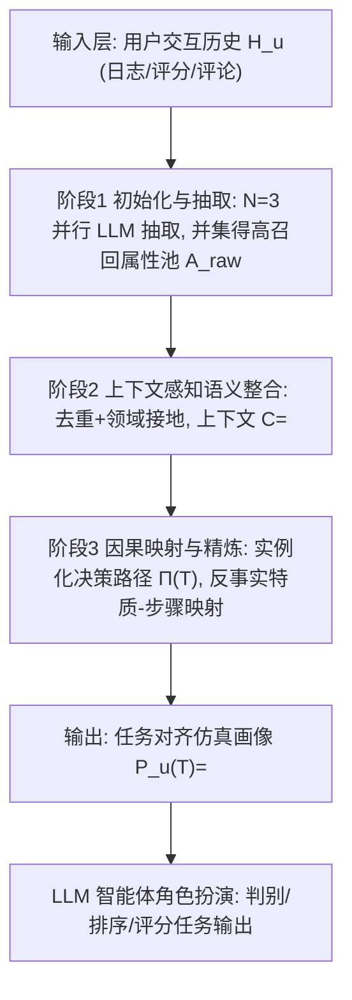
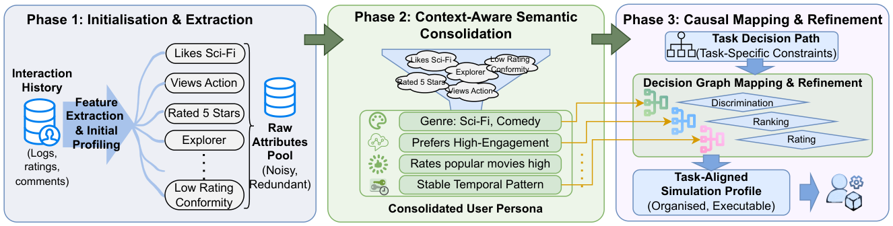
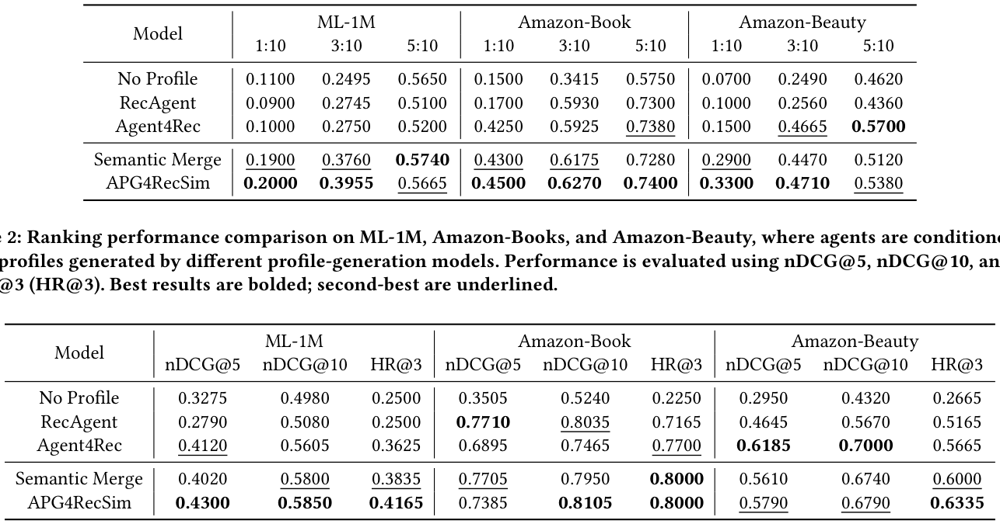
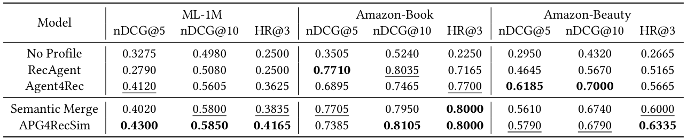
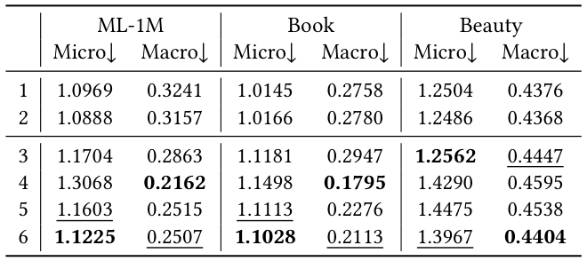
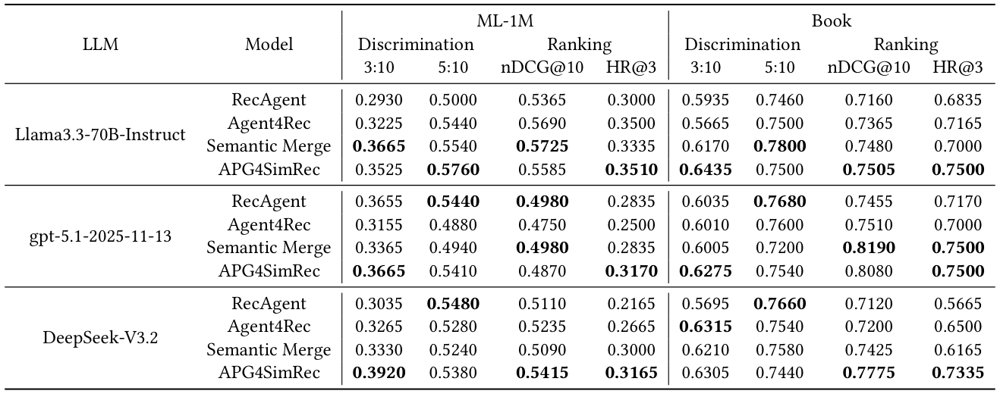
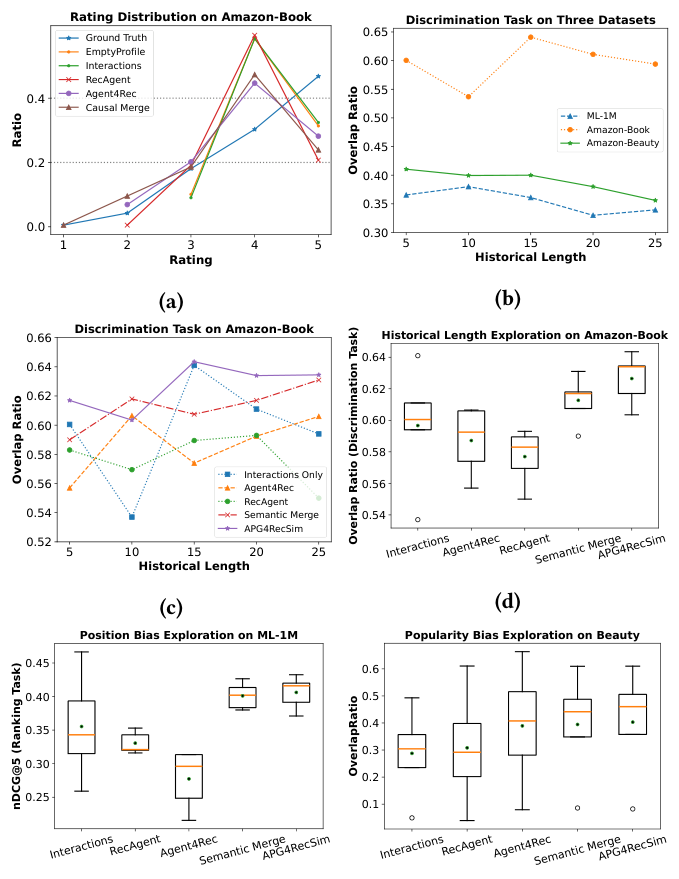

# Task-Aware Automated User Profile Generation for Recommendation Simulation Using Large Language Models (面向推荐仿真的任务感知自动用户画像生成)

- **会议/期刊**: SIGIR 2026 (Accepted)
- **推荐链路定位**: 端到端生成式 (End-to-End Generative) —— 面向推荐系统**离线仿真评估**的智能体用户建模，而非线上召回/精排模型本身
- **研究方向**: 对话推荐与智能体仿真 (Agentic Recommendation) / 大语言模型推荐 (LLM4Rec)
- **论文原文**: [https://arxiv.org/abs/2605.13497v1](https://arxiv.org/abs/2605.13497v1)
- **开源代码**: [https://github.com/WennyXY/APG4Sim](https://github.com/WennyXY/APG4Sim)

## TL;DR (核心速览)

针对 LLM 智能体推荐仿真中"画像模块被长期忽视、依赖人工属性 schema、跨域不可迁移"的痛点，本文提出免训练三阶段框架 APG4RecSim：高召回属性抽取 → 上下文感知语义整合 → 反事实因果映射到任务决策路径。在 ML-1M / Amazon-Book / Amazon-Beauty 三个基准上，以 10 候选池判别、留一法排序、10 物品评分三类任务评估，nDCG@10 最高提升约 7%、JSD 降低约 8%，并在 4 个 LLM 骨干上保持稳定。

## Background & Motivation (背景与动机)

- **领域背景与主流范式**: 现代推荐系统需要实时、可并发的用户反馈来评估与迭代，静态数据集与昂贵用户调研难以满足。基于 LLM 的智能体仿真（RecAgent、Agent4Rec、SimUSER、AFL 等）成为主流替代方案。典型框架由三模块构成：**画像模块 (profile)** 定义智能体身份与偏好倾向、**记忆模块 (memory)** 维护交互历史、**动作模块 (action)** 依据画像与记忆产生决策。
- **现有方法局限 (Limitations of Prior Work)**:
  1. **刚性 schema 导致信息瓶颈**：现有方法（RecAgent 预定义 personality/interests/behaviour 属性、Agent4Rec 抽取 taste+rationale）依赖人工设计的"封闭世界"属性表，无法捕捉 schema 之外的潜在或演化中的用户特质。
  2. **行为失配 (Behavioural Misalignment)**：缺乏统计意义上的画像机制，智能体缺少强"指令锚点"，仿真行为与真实用户交互对齐度弱。
  3. **缺乏领域泛化性**：人工画像工程高度领域依赖（电商的 price/brand 无法迁移到内容流的 genre/mood），且属性的"情境相关性"未被建模——某任务关键属性在另一任务可能是噪声。
- **核心挑战 (Key Challenge)**: 画像质量与下游任务决策逻辑之间缺少显式对齐机制；简单增加记忆/动作模块复杂度无法弥补画像层的结构性缺陷，因为画像才是决定"智能体如何行动"的第一性输入。
- **核心洞察与切入点 (Key Insight)**: 作者提出三个研究问题 RQ1（如何免人工 schema 自动构建画像并捕捉任务相关潜在特质）、RQ2（自动画像如何提升行为对齐）、RQ3（能否跨域/跨 LLM 泛化）。切入点是将画像生成视为**高召回抽取 → 上下文接地整合 → 反事实因果验证**的分阶段分解，用"改变该属性是否改变决策"来筛选真正影响任务决策路径的特质。

## Problem Formulation & Method (问题定义与方法架构)

### 1. 符号定义与输入表征 (Notations & Input Representations)

- 用户 $u$ 的交互历史 $\mathcal{H}_u = \{(i_k, r_k, t_k)\}_{k=1}^{n}$，其中 $i_k$ 为物品、$r_k$ 为反馈信号（评分/点击/评论）、$t_k$ 为时间戳。
- **任务对齐用户画像**定义为三元组：
$$\mathcal{P}_u(\mathcal{T}) = \langle \mathcal{I}_{meta},\ \mathcal{A}_{dom},\ \mathcal{G}_{policy}(\mathcal{T}) \rangle$$
其中 $\mathcal{I}_{meta}$ 为不可变标识（用户 ID、可选人口统计标签），$\mathcal{A}_{dom}$ 为领域接地的整合自然语言特质集（任务无关），$\mathcal{G}_{policy}(\mathcal{T})$ 为任务 $\mathcal{T}$ 参数化的决策策略集。
- 目标学习映射 $f: \mathcal{H}_u \to \mathcal{P}_u(\mathcal{T})$，分解为：
$$\mathcal{A}_{raw} \leftarrow g_{ext}(\mathcal{H}_u);\quad \mathcal{A}_{dom} \leftarrow g_{merge}(\mathcal{A}_{raw}, \mathcal{C});\quad \mathcal{G}_{policy}(\mathcal{T}) \leftarrow g_{map}(\mathcal{A}_{dom}, \mathcal{T})$$
- 任务 $\mathcal{T} \in \{\text{discrimination}, \text{ranking}, \text{rating}\}$。

### 2. 整体流水线 (Overall Architecture)

数据流向：原始交互历史 → 阶段 1 并行 $N=3$ 次 LLM 抽取得到高召回属性池 → 阶段 2 在显式上下文 $\mathcal{C}$ 下语义去重与领域接地 → 阶段 3 实例化任务决策路径并将特质反事实映射到决策步骤 → 输出可执行的任务对齐仿真画像，供 LLM 智能体角色扮演。

<figure class="paper-figure" markdown="span">
  <figcaption>图1：APG4RecSim概览，一种用于推荐系统模拟的免训练、上下文自适应、基于LLM的用户画像生成工作流。该图展示了所提出的三阶段方法，用于为智能体创建高保真画像。阶段1（初始化与提取）从用户交互历史（如日志、评分、评论）中挖掘原始特征，构建可能包含噪声的属性池。阶段2（上下文感知语义整合）采用语义合并与去重过程，将原始属性精炼为简洁、连贯的用</figcaption>
</figure>

### 3. 核心模块设计与数学原理 (Key Designs & Formulations)

**模块一：阶段 1 高召回属性抽取 (Initialisation & Extraction)**
为缓解 LLM 生成随机性，不依赖单次生成，而是并行初始化 $N=3$ 个初步画像并取并集：
$$\mathcal{A}_{raw} = \bigcup_{j=1}^{3} \mathcal{A}^{(j)},\quad \mathcal{A}^{(j)} = g_{ext}(\mathcal{H}_u;\theta) = \text{LLM}(\mathcal{H}_u \mid \text{Prompt}_{ext})$$
提示词要求 LLM **解释**已观测历史（生成解释性自然语言描述），而非预测未来物品。$N=3$ 由预实验确定：特质召回在 2–3 次初始化后饱和。$\mathcal{A}_{raw}$ 刻意过完备，允许冗余、同义改写与词汇不匹配，交由阶段 2 解决。物理直觉：先保召回、后保精度，避免潜在偏好被过早剪枝。

**模块二：阶段 2 上下文感知语义整合 (Context-Aware Consolidation)**
将 $\mathcal{A}_{raw}$ 整合为紧凑、领域接地的 $\mathcal{A}_{dom}$，整合过程以显式上下文为条件：
$$\mathcal{C} = \langle \mathcal{D}_{info},\ \mathcal{T}_{desc},\ \mathcal{E}_{shot} \rangle,\quad \mathcal{A}_{dom} = g_{merge}(\mathcal{A}_{raw}, \mathcal{C}) = \text{LLM}(\mathcal{A}_{raw} \mid \mathcal{C}, \text{Prompt}_{merge})$$
其中 $\mathcal{D}_{info}$ 描述数据集 schema 与可用物品元数据字段，$\mathcal{T}_{desc}$ 指定仿真任务族与所需语义粒度，$\mathcal{E}_{shot}$ 提供一个代表性样例校准术语。该步执行 (i) 去重为规范描述符、(ii) 接地到数据集原生概念，产出任务无关画像。物理直觉：把"用户语言"翻译成"数据集词汇"，使特质可被下游决策路径操作化。

**模块三：阶段 3 因果映射与精炼 (Causal Mapping & Refinement)**
- **决策路径实例化**：对任务 $\mathcal{T}$，将智能体决策结构表示为有序路径 $\Pi(\mathcal{T}) = [s_1, \dots, s_m]$，每步对应认知上有意义的判断（如硬过滤、权衡比较、最终选择/评分）。路径来自领域专家启发式模板，或由 LLM 依据任务描述 + 单个输入输出样例生成。
- **反事实特质-步骤映射**：特质 $a \in \mathcal{A}_{dom}$ 映射到步骤 $s_j$，当且仅当**仅改变 $a$**（其余特质与候选集固定）会改变该步输出。操作上构造反事实画像 $\mathcal{A}_{dom}^{(a \leftarrow a')}$（$a'$ 为最小扰动变体，如否定或弱化偏好），在同一实例上重跑智能体，若预测决策变化（判别任务选择集变化 / 排序任务顺序变化 / 评分任务评分变化超小阈值）则标记 $a$ 与 $s_j$ 相关。从未触发反事实变化的特质被降权或进一步合并，已验证有因果影响的特质被保留以避免过度剪枝。最终输出 $\mathcal{G}_{policy}(\mathcal{T})$，将每个保留特质附着到其影响的步骤，实现可控、可解释的仿真。

### 4. 训练目标、负采样与推理复杂度 (Optimization, Negative Sampling & Complexity)

- **损失函数**: 本文为**免训练 (training-free)** 框架，无梯度优化目标；全部"优化"通过 LLM 提示词驱动的分阶段推理完成（抽取、整合、反事实验证）。因此不存在 BPR/InfoNCE/BCE 等损失项与温度系数 $\tau$。
- **负采样策略**: 在**评估阶段**而非训练阶段使用负采样。判别任务从非交互物品中抽取 $C-P$ 个干扰项（$C=10$，$P \in \{1,3,5\}$）；排序任务采用留一法 + 负例混合；评分任务采样 10 个目标物品。第 4.7 节额外设计 **Random（均匀采样）** 与 **De-bias（流行度-评分匹配采样）** 两种负采样策略以探测 LLM 参数化先验。
- **时间与空间复杂度**: 原文未报告具体训练/推理耗时与峰值显存（免训练框架，无 GPU 训练开销）。推理侧成本主要来自 LLM API 调用：阶段 1 需 $N=3$ 次并行调用，阶段 3 反事实映射需对每个特质做一次扰动重跑，调用次数与 $|\mathcal{A}_{dom}|$ 线性相关。原文未给出 ms/request 级延迟数据。

## Experimental Setup & Evaluation Protocol (实验设置与评估协议)

- **数据集统计与预处理**: 原文使用三个公开数据集，但**未报告** #Users / #Items / #Interactions / 稀疏度等统计量表格（原文未报告）。已知信息如下：

| 数据集 (Dataset) | 用户数 (#Users) | 物品数 (#Items) | 交互数 (#Interactions) | 稀疏度/密度 (Sparsity) | 模态/辅助特征说明 |
| :--- | :---: | :---: | :---: | :---: | :--- |
| MovieLens-1M (ML-1M) | 原文未报告 | 原文未报告 | 原文未报告 | 原文未报告 | 评分 + 电影元数据（Title/Genre/Rating/Popularity） |
| Amazon-Book | 原文未报告 | 原文未报告 | 原文未报告 | 原文未报告 | 评分 + 评论 + 图书元数据 |
| Amazon-Beauty | 原文未报告 | 原文未报告 | 原文未报告 | 原文未报告 | 评分 + 评论 + 美妆元数据 |

- **数据划分方式 (Splitting Strategy)**: **按时间戳排序后的比例划分**——每个用户最早 80% 交互用于画像生成，剩余 20% 用于画像评估。排序任务采用 **Leave-One-Out (留一法)** 设定（从评估集采样单个正例）。由于严格按时间戳先后切分（历史→未来），**不存在未来信息泄露风险**；但需注意画像生成阶段使用了用户 80% 历史，评估阶段的正例来自后 20%，符合时序因果。
- **排名评测协议 (Ranking Protocol)**: 判别任务为 **受控候选池排序**（$C=10$，含 $P$ 个真阳性 + $C-P$ 个非交互干扰项），非全库排序；排序任务为 **留一法 + 负例混合的 top-1 排序**（1 正例 + 一组负例），属采样排序而非 Full-Ranking。原文未声明全库 All-Ranking 协议。
- **评价指标与显著性检验**:
  - 判别任务：**Overlap Ratio**（智能体正确识别真阳性占真阳性总数的比例），1:10 / 3:10 / 5:10 三档难度。
  - 排序任务：**nDCG@5、nDCG@10、HR@3**。
  - 评分任务：微观 **RMSE**（逐物品预测偏差）、宏观 **JSD**（按评分值分组后模拟分布与真实分布的 Jensen–Shannon 散度）。
  - 所有实验 **5 次独立运行取平均**以降低方差；原文**未报告**配对显著性检验（Paired $t$-test / Wilcoxon / Bootstrap $p<0.05$）。
  - 骨干模型：主实验 gpt-4o-mini（temperature=0.1）；泛化实验 Llama-3.3-70B-Instruct、GPT-5.1、DeepSeek-V3.2。智能体**不配备**额外记忆/动作/规划模块，仅做画像条件推理，以隔离画像质量。

## Key Experimental Results (核心实验结果)

### 1. 主实验对比 (Main Results)

**判别任务（表 1，Overlap Ratio，越高越好）**：

<figure class="paper-figure" markdown="span">
  <figcaption>表1：不同画像生成方法在三个基准数据集上的区分能力比较。性能通过三种区分设置下的重叠率评估，包括从10个推荐物品中区分1、3和5个正样本物品，即要求智能体从10个候选物品中识别1、3或5个真实物品。最佳结果加粗；次佳结果下划线。</figcaption>
</figure>

| 数据集 | 指标 (1:10 / 3:10 / 5:10) | No Profile | 最强基线 (Agent4Rec) | 本文 APG4RecSim | 相对提升 |
| :--- | :--- | :---: | :---: | :---: | :---: |
| ML-1M | Overlap 1:10 | 0.1100 | 0.1000 | **0.2000** | +100% (vs Agent4Rec) |
| ML-1M | Overlap 3:10 | 0.2495 | 0.2750 | **0.3955** | +43.8% |
| Amazon-Book | Overlap 1:10 | 0.1500 | 0.4250 | **0.4500** | +5.9% |
| Amazon-Book | Overlap 3:10 | 0.3415 | 0.5930 (RecAgent) | **0.6270** | +5.7% |
| Amazon-Beauty | Overlap 1:10 | 0.0700 | 0.1500 | **0.3300** | +120% |
| Amazon-Beauty | Overlap 3:10 | 0.2490 | 0.4665 | **0.4710** | +1.0% |

APG4RecSim 在 9 个判别场景中 **7 个取得最优**；Semantic Merge（仅前两阶段）在较难的 1:10 设定中常居次优。

**排序任务（表 2，nDCG@5 / nDCG@10 / HR@3）**：

<figure class="paper-figure" markdown="span">
  <figcaption>表2：在ML-1M、Amazon-Books和Amazon-Beauty上的排序性能比较，其中智能体以不同画像生成模型生成的用户画像为条件。性能通过nDCG@5、nDCG@10和命中率@3（HR@3）评估。最佳结果加粗；次佳结果下划线。</figcaption>
</figure>

| 数据集 | 指标 | No Profile | 最强基线 | 本文 APG4RecSim | 相对提升 |
| :--- | :--- | :---: | :---: | :---: | :---: |
| ML-1M | nDCG@5 | 0.3275 | 0.4120 (Agent4Rec) | **0.4300** | +4.4% |
| ML-1M | HR@3 | 0.2500 | 0.3625 (Agent4Rec) | **0.4165** | +14.9% |
| Amazon-Book | nDCG@10 | 0.5240 | 0.8035 (RecAgent) | **0.8105** | +0.9% |
| Amazon-Beauty | nDCG@5 | 0.2950 | 0.6185 (Agent4Rec) | 0.5790 | 次优 |
| Amazon-Beauty | HR@3 | 0.2665 | 0.5665 (Agent4Rec) | **0.6335** | +11.8% |

摘要所述"nDCG@10 最高提升约 7%"对应跨方法/数据集整体对比口径；单表逐项提升幅度见上表。

**评分任务（表 3，RMSE↓ / JSD↓）**：

<figure class="paper-figure" markdown="span">
  <figcaption>表3：不同画像生成方法在微观层面（RMSE）和宏观层面（JSD）的评分性能比较。我们评估（1）仅空画像，（2）仅原始近期交互作为上下文，（3）RecAgent生成的画像，（4）Agent4Rec生成的画像，（5）仅使用语义合并的APG4RecSim，以及（6）使用混合语义–因果合并的APG4RecSim。前两行表示未使用生成画像的智能体。在基于画像的方法中，最佳性能加粗，次佳结果下划线。</figcaption>
</figure>

| 数据集 | 指标 | 空画像 | 原始交互 | 最强画像基线 (Agent4Rec) | 本文 (混合语义-因果) | 相对提升 |
| :--- | :--- | :---: | :---: | :---: | :---: | :---: |
| ML-1M | RMSE↓ | 1.0969 | 1.0888 | 1.3068 | **1.1225** | 优于 Agent4Rec |
| ML-1M | JSD↓ | 0.3241 | 0.3157 | **0.2162** | 0.2507 | 次优 |
| Amazon-Book | JSD↓ | 0.2758 | 0.2780 | **0.1795** | 0.2113 | 次优 |
| Amazon-Beauty | JSD↓ | 0.4376 | 0.4368 | 0.4595 | **0.4404** | 最优画像法 |

关键发现：空画像/原始交互在 RMSE 上具竞争力，但 JSD 差——因 LLM 倾向输出 3–5 的"安全"评分（图 2a 可视化证实），逐点误差低但整体分布失真。画像条件智能体能表达正负偏好，宏观分布更贴近真实。摘要"JSD 降低约 8%"对应整体口径。

### 2. 消融实验与控制变量分析 (Ablation Study)

- **Semantic Merge vs. APG4RecSim**：前者为仅含阶段 1+2 的消融版，后者加入阶段 3 因果映射。表 1 中 Semantic Merge 在 1:10 难设定常居次优，APG4RecSim 在 7/9 场景最优，说明**因果映射阶段对判别任务贡献显著**；表 2 中两者互有胜负（Amazon-Book 上 Semantic Merge 的 nDCG@5=0.7705 略高于 APG4RecSim 的 0.7385，但 APG4RecSim 的 nDCG@10=0.8105 更高），说明因果映射主要改善深层排序位置。
- **画像生成方法消融**：No Profile / Recent-Interaction / RecAgent / Agent4Rec / Semantic Merge / APG4RecSim 六档对照，严格控制智能体架构一致（均无记忆/动作模块），仅变画像来源，属**控制变量消融**。原文**未报告**参数量对齐或图拓扑度数匹配类消融（本框架无训练参数）。
- 总体：24 个评估指标中 APG4RecSim **16 个最优、7 个次优**。

### 3. 稀疏度/冷启动分桶与超参敏感度 (Sparsity Buckets & Hyperparameters)

- **交互历史长度敏感度（图 2b/2c/2d）**：直接历史提示对长度极敏感——Amazon-Book 上 15 项时 Overlap 峰值 0.641，降至 10 项骤降 10.4%（0.537），升至 25 项降 4.7%（0.594），呈现"冷启动"与"lost-in-the-middle"双重脆弱性。APG4RecSim 轨迹稳定：最短历史（5 项）时 Overlap≈0.62，显著优于原始交互基线≈0.60，证明生成画像能在稀疏数据下提供"warm start"。箱线图（图 2d）显示 APG4RecSim 中位数最高且四分位距最窄，将仿真质量与历史长度解耦。
- **位置偏差鲁棒性（图 2e，ML-1M 排序）**：APG4RecSim 中位 nDCG@5≈0.415 最高，Semantic Merge≈0.40 次之；原始交互与 Agent4Rec 方差大、须长，说明易受呈现顺序影响。结构化画像使物品按语义对齐而非位置线索评估。
- **流行度偏差鲁棒性（图 2f，Amazon-Beauty 判别 3:10）**：Semantic Merge 与 APG4RecSim 中位 Overlap 更高、跨采样策略更稳定；RecAgent 与原始交互中位最低、波动最大；Agent4Rec 中位较高但四分位距极大。
- **LLM 参数化先验探测（表 5，ML-1M 空画像 + 孤立属性）**：Random 采样下仅给 Popularity 即主导（3:10=0.4900，3:6=0.7400），超过 Title/Genre 等语义属性；De-bias 采样下所有配置性能崩塌、流行度优势消失（Popularity 3:10 降至 0.3990）。证明标准 LLM 智能体在无显式画像时严重依赖虚假全局统计而非细粒度语义推理。
- **关键超参数**：初始化次数 $N=3$（召回在 2–3 次饱和）；上下文窗口固定为最近交互项；temperature=0.1。原文未做 $\tau$/损失权重类敏感度（无训练损失）。
- **线上 A/B 测试**: 原文仅包含离线仿真实验，**无线上 A/B 测试**。

### 4. 跨 LLM 泛化（表 4）

<figure class="paper-figure" markdown="span">
  <figcaption>表4：所提出的自动画像生成框架在不同LLM上于ML-1M和Amazon-Book的泛化结果。区分能力通过重叠率评估，排序质量通过nDCG@10和命中率@3评估。最佳结果加粗。</figcaption>
</figure>

在 Llama-3.3-70B-Instruct / GPT-5.1 / DeepSeek-V3.2 三个骨干、2 数据集、4 指标共 24 个设定中，APG4RecSim **14 个最优、7 个次优**，且 **HR@3 在所有设定均最高**。增益在开源权重模型（Llama-3.3-70B、DeepSeek-V3.2）上更显著，说明结构化画像能有效增强可及模型、缩小与闭源巨头的差距。

<figure class="paper-figure" markdown="span">
  <figcaption>图2：（a）Amazon-Book数据集上评分分布的可视化；（b）交互历史长度对多个数据集上区分性能的影响；（c、d）生成的画像在Amazon-Book数据集上不同交互历史长度下的区分性能；（e）在ML-1M数据集上排序任务对位置偏差的鲁棒性评估；（f）在Amazon-Beauty数据集上区分任务（10中选3）对流行度偏差的鲁棒性评估。</figcaption>
</figure>

## Highlights, Limitations & Critiques (亮点、局限与审稿级批判)

- **核心亮点与可迁移性**:
  1. **免训练、即插即用**：三阶段纯提示词流水线，无需微调，可直接挂载到任意 LLM 骨干与任意推荐仿真框架的画像模块，工程迁移成本极低。
  2. **反事实因果映射**是本文最具普适性的算子——用"最小扰动是否改变决策"筛选任务相关特质，可迁移到对话推荐的可解释理由生成、LLM 重排的特征归因、以及任何需要"任务对齐画像"的智能体场景。
  3. **评估协议设计严谨**：隔离画像质量与智能体架构（统一无记忆/动作模块）、5 次运行取均值、位置/流行度双偏差鲁棒性检验、以及表 5 的"参数化先验探测"——后者尤其体现审稿级的方法论自觉，揭示了 LLM 仿真中普遍存在但常被忽视的效度威胁。
  4. **跨域/跨骨干稳定性**：三个领域（电影/图书/美妆）× 四个 LLM 的一致表现，支撑了"自动画像优于人工 schema"的核心主张。

- **局限性与审稿视角批判 (Critical Limitations)**:
  1. **评估协议偏弱**：判别任务为 $C=10$ 的小候选池、排序任务为留一法 + 负例混合的采样排序，均非全库 Full-Ranking；小候选池可能放大 LLM 的偶然命中，且未报告配对显著性检验（$p$ 值），"16/24 最优"的统计可信度缺乏量化支撑。
  2. **数据集统计缺失**：原文未报告三数据集的 #Users/#Items/#Interactions/稀疏度，削弱了可复现性与跨数据集可比性。
  3. **参数化记忆污染效度**：作者自己在表 5 与第 5 节承认，ML-1M 等广泛使用的基准可能已被 LLM 参数化记忆，Random 采样下的高性能部分源于全局统计而非画像驱动推理；虽用 De-bias 采样部分缓解，但仍属间接证据，未做训练数据去污染或时间截断的严格验证。
  4. **推理成本未量化**：阶段 1 的 $N=3$ 并行调用 + 阶段 3 对每个特质的反事实重跑，LLM 调用次数随 $|\mathcal{A}_{dom}|$ 线性增长，原文未报告 token 消耗、延迟或成本，工业级大规模仿真的可行性存疑。
  5. **反事实映射的稳定性**：最小扰动变体 $a'$ 的构造依赖 LLM 生成，扰动强度与"决策变化阈值"（尤其评分任务）缺乏敏感性分析，可能引入新的随机性。
  6. **无线上验证**：作为"推荐系统评估工具"，其自身未在真实业务闭环中验证仿真保真度（如仿真排序与线上 A/B 的相关性），这是该类工作从离线走向落地的关键缺口。

## Rating (四维评分)

- **方法创新性 (Novelty)**: ⭐⭐⭐⭐ （免训练三阶段 + 反事实因果映射的画像生成范式新颖，但各阶段组件本身多为 LLM 提示工程的组合）
- **评估协议与实验扎实度 (Protocol & Experiments)**: ⭐⭐⭐ （三任务 × 三数据集 × 四骨干覆盖广、5 次运行、双偏差鲁棒性与先验探测设计出色；但小候选池、采样排序、缺显著性检验与数据集统计，拉低协议严谨度）
- **写作与数学规范度 (Clarity & Rigor)**: ⭐⭐⭐⭐ （问题形式化清晰、三阶段分解与反事实定义严谨、图表组织良好；扣分于缺少复杂度/成本量化与部分符号在正文中未完全统一）
- **工业落地与复现价值 (Industrial & Practical Value)**: ⭐⭐⭐⭐ （免训练、代码开源、可插拔到任意仿真框架，落地门槛低；但 LLM 调用成本与参数化记忆污染是规模化部署的现实障碍）
