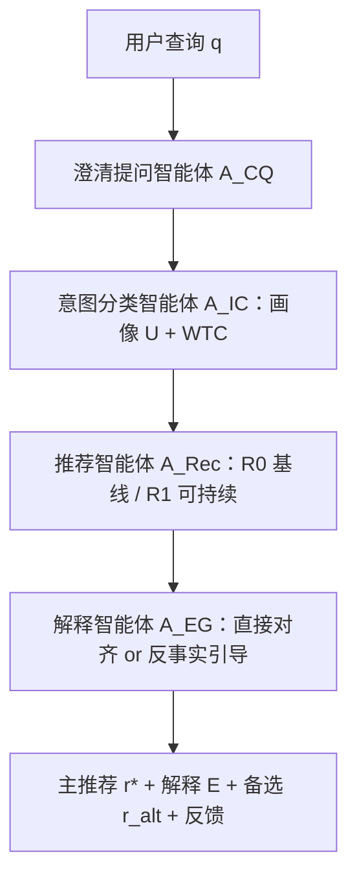

# TRACE: A Conversational Framework for Sustainable Tourism Recommendation with Agentic Counterfactual Explanations (面向可持续旅游推荐与智能体反事实解释的对话框架)

- **会议/期刊**: SIGIR 2026 (Demo Paper, 6 pages)
- **作者与机构**: Ashmi Banerjee, Adithi Satish, Wolfgang Wörndl (慕尼黑工业大学 TUM); Yashar Deldjoo (巴里理工大学)
- **推荐链路定位**: 重排 / 端到端生成式（对话式候选生成 + 解释驱动选择）
- **研究方向**: 对话推荐与智能体仿真 / 去偏公平与可信推荐
- **论文原文**: [https://arxiv.org/abs/2604.14223v1](https://arxiv.org/abs/2604.14223v1)
- **开源代码**: 暂未开源（论文声明代码、Docker、Prompt 与 Demo 视频见项目页 https://ashmibanerjee.github.io/trace-chatbot，但未检测到公开仓库）

## TL;DR (1分钟核心速览)

传统对话式旅游推荐只优化相关性与便利性，系统性放大热门拥挤目的地与高碳出行选择，可持续性仅作为事后约束。TRACE 提出编排器-工作者（Orchestrator-Worker）多智能体 LLM 框架：澄清提问智能体间接诱导潜在可持续偏好，意图分类智能体构建结构化用户画像与"妥协意愿"（WTC）向量，推荐智能体并行生成基线集 $R_0$与可持续集$R_1$，解释智能体依据 WTC 在"直接对齐"与"反事实引导"两种修辞策略间切换。24 人用户研究（107 段有效会话）显示 79.1% 用户采纳主推荐、约 60% 产生选择再考虑，语义对齐相似度 0.70–0.79，端到端延迟均值 23 秒。

## Background & Motivation (背景与核心矛盾)

- **主流范式**: LLM 驱动的对话式旅游助手以自然语言灵活响应查询，但目标函数几乎只含相关性/便利性，可持续性（碳排放、拥挤度、季节性）被当作次要约束甚至完全忽略。
- **前人局限**: 其一，现有多智能体推荐框架（如文献 [6] 的可持续旅游多智能体）不含对话交互，也不利用解释与反事实来引导行为；其二，可持续推荐工作多为单智能体、非对话式，依赖静态可持续性编码，无法随对话动态推断用户真实意愿。
- **核心洞察 (Key Insight)**: 可持续引导的失败往往不是"没有绿色选项"，而是"用户未被问出是否愿意妥协"。若把"妥协意愿 WTC"显式建模为会话状态，就能在不违背用户明示约束的前提下，用条件式反事实话术完成"非强制助推 (nudging)"。
- **本文切入点**: 用多智能体流水线把"偏好诱导 → 画像结构化 → 双候选生成 → 解释决策"解耦，让可持续性成为对话中逐步浮现的目标而非硬编码默认值。

## Method (核心方法设计)

### 1. 整体框架 (Overall Architecture)

系统分三层：前端（Chainlit 对话与反馈采集）、中间件（FastAPI 编排器 + Firestore 持久化会话状态，含查询、画像向量与 WTC）、后端（Google ADK on Vertex AI，gemini-2.5-flash 驱动四个专职智能体）。一次会话中，用户查询 $q$先进入澄清提问智能体$A_{CQ}$生成至多 5 个问题逐一呈现；用户回答$\Gamma$与$q$一起送入意图分类智能体$A_{IC}$，输出结构化用户画像$U$与跨排放/拥挤/季节维度的妥协意愿向量 WTC；推荐智能体$A_{Rec}$以 few-shot 提示并行产出仅对齐原始查询的基线集$R_0$与融合画像及可持续信号$S$的可持续集$R_1$；最后由解释智能体$A_{EG}$依据 WTC 决定主推荐$r^*$、解释$E$与反事实备选$r_{alt}$，并收集会话级反馈。

<figure class="paper-figure" markdown="span">
  <figcaption>图1：CRS聊天机器人系统架构。该图展示了编排器-工作者范式，详细说明了用户交互层（前端）、编排层（中间件）和智能体推理层（后端）之间的流程。</figcaption>
</figure>

### 2. 关键设计拆解 (Key Designs)

1. **澄清提问 + 画像/WTC 结构化（把隐性可持续偏好问出来）**：痛点是用户初始查询（如"我想去欧洲旅行"）极度模糊，直接推荐必然退化为热门目的地复读。$A_{CQ}$被指令化地生成两类问题——通用旅行维度（预算、兴趣）与可持续维度（"是否愿意为更独特、更少人的体验选择小众湖畔/海滨目的地？"），并设 few-shot 护栏限定"欧洲单城市旅行"范围。随后$A_{IC}$ 将回答映射为画像与妥协意愿：
$$(U, \mathrm{WTC}) = A_{IC}(\Gamma, q)$$
直觉在于：WTC 是一个**可被对话更新的标量/向量状态**，它把"要不要推绿色选项"从模型猜测变成显式条件，避免对不愿妥协的用户强行说教。

2. **双候选生成 + 反事实解释决策（非强制助推的核心算子）**：痛点是以往系统只有单一推荐列表，无法量化"绿色替代方案到底改善了多少"。TRACE 让 $A_{Rec}$同时生成$R_0$（仅相关性）与$R_1$（融合$U,\Gamma,S$），再由$A_{EG}$ 做条件化决策：
$$(r^*, E, r_{alt}) = A_{EG}(R_0, R_1, U, \mathrm{WTC})$$
若 WTC 显示开放妥协，则 $r^* \in R_1$，解释强调可持续增益$\Delta S = M(R_1) - M(R_0)$（$M(\cdot)$为 CO₂ 排放、访客压力、步行友好度等指标向量）；若 WTC 显示抗拒，则保留$r^* \in R_0$以维护信任，仅对$r_{alt} \in R_1$生成条件式反事实话术（"若您表达过更低环境影响的意愿，则会推荐$r_{alt}$，因为……"）。这一"主推荐不动、备选旁敲"的设计是本文最具迁移价值的算子：它把反事实解释从"事后说明"升级为"决策逻辑本身"。

3. **训练目标、负采样与推理效率**：本文为 Demo 系统，**无监督训练、无负采样、无 BPR/InfoNCE 类损失**，全部能力来自 few-shot 提示工程与智能体编排。推理开销集中在澄清问答结束后的单次流水线：生成画像、双候选与解释平均 23 秒、峰值 38 秒，作者称优于常见多智能体框架（常超 40 秒）。

## Experimental Setup & Evaluation Protocol (实验设置与评估协议)

- **数据集与预处理**: 本文不使用离线交互数据集，评测基于**用户研究 + 语义对齐分析**。初始查询灵感取自 SynthTRIPS 合成旅游查询库；系统范围限定为欧洲单城市旅行。

| 评测对象 | 规模 | 构成 | 说明 |
| :--- | :---: | :---: | :--- |
| 招募参与者 | 24 人 | 58.3% 男 / 41.7% 女 | 79% 为 18–34 岁，54% 常用聊天机器人 |
| 有效会话 | 107 段 | 每人 1–2 次查询 | 已过滤不完整与越界（非欧洲）响应 |
| 语义对齐语料 | 107 段会话 | 查询+澄清问答、画像输出、解释文本 | 编码器 all-MiniLM-L6-v2 |

- **数据划分与防穿越 (Splitting Strategy)**: 不适用（无训练/测试划分，属在线用户研究）。
- **排名评测协议 (Ranking Protocol)**: 不适用 Full-Ranking / Sampled Ranking；替代协议为 **5 点 Likert 主观评分**（澄清问题质量、解释说服力、选择再考虑程度）+ **主推荐采纳率** + **余弦语义相似度对齐**。
- **对比基线与超参设置**: **无外部基线对比**（Demo 论文定位，作者明言目标不是 SOTA 精度）；内部对照为 $R_0$（基线推荐）vs.$R_1$（可持续推荐）的双候选设置；LLM 固定为 gemini-2.5-flash，澄清问题上限 5 个。

## Key Experimental Results (实验关键数据)

### 1. 主实验对比 (Main Results)

由于无基线模型，主结果以"双候选采纳行为 + 主观评分分布"呈现（$N=107$）：

| 评测维度 | 指标 | 数值 | 说明 |
| :--- | :--- | :---: | :--- |
| 主推荐采纳 | 选择 $r^*$比例 | **79.1%** | 其中 75.5% 会话的$r^*$为$R_1$（更可持续） |
| 反向引导 | $r^*=R_0$时选$R_1$ 备选 | 16.7% | 体现温和助推效应 |
| 澄清问题质量 | 评 4–5 分比例 | **55.2%** | 5 点 Likert |
| 解释质量 | 评 4–5 分比例 | **65.4%** | 解释说服力优于提问质量 |
| 选择再考虑 | 至少"中度"再考虑 | **约 60%** | 含 22.2% 强烈再考虑 |
| 语义对齐 | 解释 vs. 完整对话 | 0.7033 | all-MiniLM-L6-v2 余弦相似度 |
| 语义对齐 | 画像输出 vs. 完整对话 | **0.7883** | 意图捕获最紧 |
| 语义对齐 | 画像输出 vs. 解释 | 0.7437 | 解释确实条件化于用户模型 |
| 延迟 | 均值 / 峰值 | 23s / 38s | 澄清阶段之后 |

<figure class="paper-figure" markdown="span">
  <figcaption>图2：一个TRACE会话示例。会话从用户的初始查询开始，随后是澄清问题。最后生成旅行画像和一组推荐，每个推荐都附有解释。会话还收集会话特定的反馈，包括偏好哪些推荐、解释有多大帮助、澄清问题的有效性，以及提供定性反馈的选项。</figcaption>
</figure>

### 2. 消融实验 (Ablation Study)

本文**未提供组件消融**（Demo 性质，无 w/o 变体）。可视为"隐式消融"的证据来自双候选对照与对齐分析：

| 对照设置 | 观察指标 | 结果 | 含义 |
| :--- | :--- | :---: | :--- |
| $R_1$ 作为主推荐（WTC 开放） | 采纳率 | 高（占 75.5% 会话） | 可持续候选在画像对齐时不被排斥 |
| $R_0$作为主推荐（WTC 抗拒） | 转向$R_1$ 备选 | 16.7% | 反事实话术有边际引导力但非强制 |
| 移除画像条件（解释 vs. 对话 0.7033 vs. 画像 vs. 对话 0.7883） | 对齐差距 | 0.085 | 画像层是解释落地的关键中介 |

### 3. 关键实验发现 (Key Findings)

1. **可持续候选并不牺牲采纳率**：75.5% 的会话中更可持续的 $R_1$ 被作为主推荐且整体采纳率达 79.1%，说明"绿色"与"相关"在画像对齐后并不冲突，冲突主要发生在 WTC 未被问出的场景。
2. **反事实引导是"边际而非主导"效应**：当基线 $R_0$ 占据主位时仅 16.7% 用户转向绿色备选，但约 60% 用户报告了某种程度的再考虑——行为改变弱于认知改变，这与"非强制助推"的设计目标一致，也提示单纯话术的天花板。
3. **解释质量高于提问质量，且解释强绑定画像**：解释获 65.4% 高分而提问仅 55.2%，同时画像-解释相似度 0.7437 显著高于解释-对话 0.7033 的组合基线，证明 $A_{EG}$的推理确实条件化于$U$ 与 WTC，而非泛泛复述对话。

## Highlights & Limitations (亮点、对比与审稿批判)

- **与代表作对比 (vs. Prior Work)**: 相比文献 [6] 的可持续旅游多智能体，TRACE 引入了真实对话交互与反事实解释闭环；相比传统澄清提问工作（如 [9,28–30] 的偏好诱导分类学），它把澄清结果压缩为可执行的 WTC 状态并直接驱动解释策略切换；相比既有可持续推荐（数字助推 [3–5,21,26]），它摆脱了静态可持续编码，改为会话内动态推断。
- **可迁移亮点**: ①"双候选 + 条件化反事实"范式可平移到任何需要软性引导的场景（健康内容、能耗建议、多样性曝光）；②把用户意愿建模为显式 WTC 状态再决定"推 or 不推"，是避免说教式推荐、保护信任的通用工程技巧。
- **审稿级局限批判**: ①**评估薄弱**：仅 24 人、107 段会话，无对照组、无统计显著性检验、无外部基线，主观 Likert 与自建语义相似度难以支撑强结论；②**延迟与规模**：23 秒均值对真实对话体验偏慢，且系统仅支持欧洲单城市，多城市多日行程未验证；③作者自承"可持续悖论"——持续把用户推向"隐藏宝地"可能制造新热点，只是转移而非减少过度旅游，且 live 应用因 Chainlit 漏洞已下线。

## Rating (四维评分)

- **方法创新性 (Novelty)**: ⭐⭐⭐⭐ （将 WTC 显式状态与反事实解释耦合为决策算子，思路新颖，但本质是提示工程编排而非新学习范式）
- **评估协议与实验扎实度 (Protocol & Experiments)**: ⭐⭐ （无基线、无消融、无显著性检验，24 人小样本主观研究，仅够 Demo 级别）
- **写作与数学规范度 (Clarity & Rigor)**: ⭐⭐⭐⭐ （形式化四阶段流水线清晰、公式简洁、系统架构与实现栈交代完整，但缺复杂度与失败案例分析）
- **工业落地与复现价值 (Industrial & Practical Value)**: ⭐⭐⭐⭐ （ADK + FastAPI + Firestore + Docker 全栈可复现、延迟可接受，但无公开仓库链接与多智能体成本核算）
