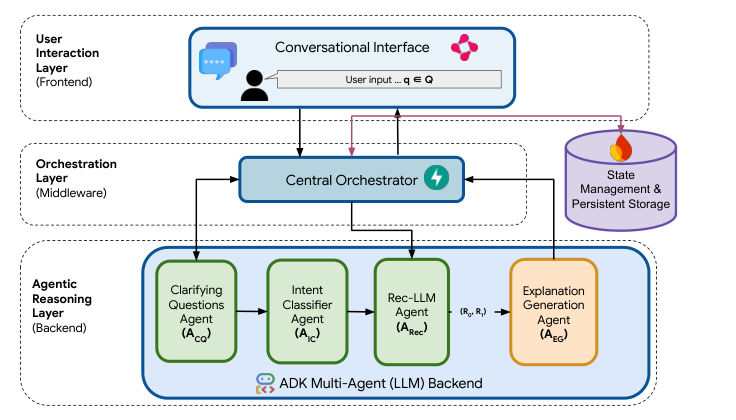
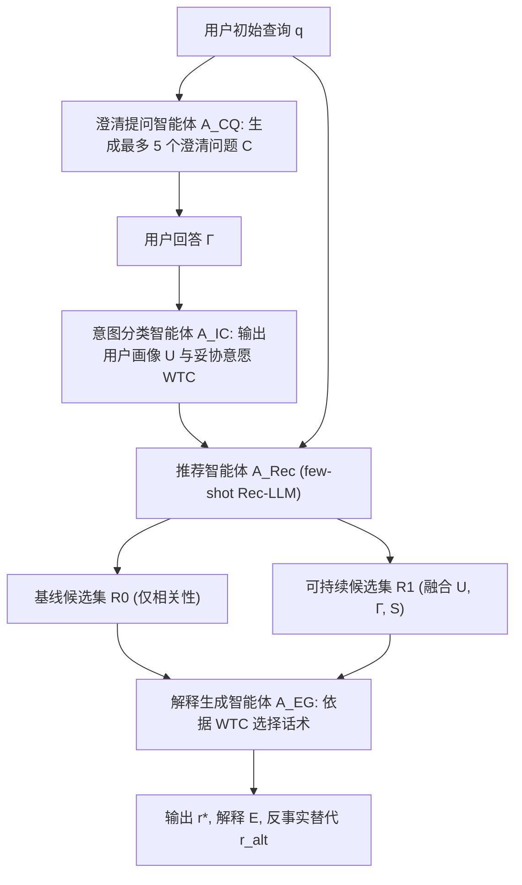
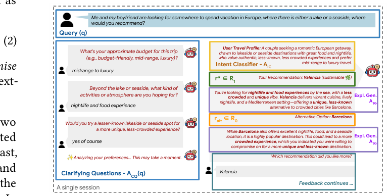
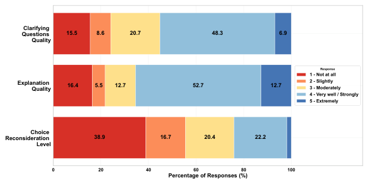

# TRACE: A Conversational Framework for Sustainable Tourism Recommendation with Agentic Counterfactual Explanations (面向可持续旅游推荐的多智能体反事实解释对话框架)

- **会议/期刊**: SIGIR 2026 (Demo Track, 6 pages)
- **推荐链路定位**: 端到端生成式 (End-to-End Generative) / 对话交互式推荐 (Conversational Recommendation)
- **研究方向**: 对话推荐与智能体仿真 (Agentic & Conversational Rec) / 大语言模型推荐 (LLM4Rec)
- **论文原文**: [https://arxiv.org/abs/2604.14223v1](https://arxiv.org/abs/2604.14223v1)
- **开源代码**: 暂未开源（论文声明代码、Docker、prompts 与 demo 视频通过项目主页 [https://ashmibanerjee.github.io/trace-chatbot](https://ashmibanerjee.github.io/trace-chatbot) 提供，但未检测到独立 GitHub 仓库 URL；demo 视频 https://youtu.be/BdtEFSp42fw）

## TL;DR (核心速览)

TRACE 针对传统旅游对话推荐系统一味优化相关性、反而强化热门拥挤目的地与高碳出行的问题，提出基于 Google ADK 的多智能体 LLM 框架：澄清提问智能体 (A_CQ) 间接挖掘用户潜在可持续偏好，意图分类智能体 (A_IC) 构建结构化用户画像与"妥协意愿" (WTC) 向量，推荐智能体 (A_Rec) 并行生成基线集 R0 与可持续集 R1，解释智能体 (A_EG) 依据 WTC 在"直接对齐"与"反事实助推"两种话术间切换。24 人用户研究（107 段有效会话）显示 79.1% 用户选择主推荐、约 60% 出现选择再考量，语义对齐相似度 0.70–0.79，端到端延迟均值 23 秒。注意：本文为 Demo 论文，**不做排序精度对比**。

## Background & Motivation (背景与动机)

- **领域背景与主流范式**: LLM 驱动的对话式旅行助手已能灵活响应自然语言查询并生成个性化推荐，主流范式是单智能体 LLM 直接生成推荐列表，优化目标为相关性 (relevance) 与便利性 (convenience)。
- **现有方法局限 (Limitations of Prior Work)**:
  1. **目标单一化**：可持续性（碳排放、拥挤度、季节性）通常被当作次要约束甚至完全忽略，系统会系统性强化热门、拥挤、高碳的旅行选择；
  2. **静态可持续编码**：已有的可持续感知推荐器多为单智能体、非对话式，依赖静态的可持续性标签，无法通过交互推断用户真实的可持续意愿；
  3. **缺乏行为改变机制**：已有工作 [6] 虽探索了多智能体平衡相关性与可持续性，但未显式引入对话交互，也未利用解释与反事实来软性助推用户行为。
- **核心挑战 (Key Challenge)**: 如何在**不违背用户显式偏好、不损害用户信任**的前提下，把可持续目标注入对话推荐流程？硬性过滤高碳选项会牺牲相关性并引发反感，而简单在 prompt 里加"请推荐环保目的地"又无法处理用户对可持续性的差异化接受度。
- **核心洞察与切入点 (Key Insight)**: 作者的关键洞察是——**可持续偏好是隐式的、且用户对可持续性的"妥协意愿" (Willingness to Compromise, WTC) 存在个体差异**。因此系统应先通过澄清提问间接探测 WTC，再据此决定助推策略：WTC 高则直接推荐绿色选项并强调其可持续收益；WTC 低则保留用户原始偏好作为主推荐，仅以**反事实解释**（"若您表达过对低环境影响的兴趣，r_alt 会被推荐，因为……"）温和地暴露更绿色的替代方案。这构成了"不强制、可反思"的助推设计。

## Problem Formulation & Method (问题定义与方法架构)

### 1. 符号定义与输入表征 (Notations & Input Representations)

- 用户初始自然语言查询 $q \in \mathcal{Q}$；
- 澄清问题集合 $C = \{c_1, c_2, \dots, c_n\}$，其中 $n \le 5$（A_CQ 最多生成 5 个问题，逐个展示）；
- 用户对澄清问题的回答集合 $\Gamma$；
- 结构化用户旅行画像 $\mathcal{U}$ 与妥协意愿向量 $\mathrm{WTC}$（覆盖 emissions、congestion、seasonality 等可持续维度）；
- 可持续信号 $S$（由 $\Gamma$ 派生）；
- 候选推荐集 $R_0$（仅基于 $q$ 的相关性基线集）与 $R_1$（融合 $\mathcal{U}, \Gamma, S$ 的可持续集）；
- 可持续性度量向量 $M(\cdot)$（如 CO$_2$ 排放、访客压力、步行友好度）；
- 输出：主推荐 $r^*$、说服性解释 $E$、反事实替代 $r_{\text{alt}}$。

### 2. 整体流水线 (Overall Architecture)

系统采用 **Orchestrator-Worker** 范式，分三层：前端用户交互层（Chainlit，负责对话与反馈收集）、中间编排层（FastAPI + Google Firestore 管理会话状态与控制流）、后端智能体推理层（Google ADK on Vertex AI，gemini-2.5-flash 驱动全部智能体）。四个专用智能体串成顺序流水线：A_CQ → A_IC → A_Rec → A_EG。

<figure class="paper-figure" markdown="span">
  <figcaption>图 1</figcaption>
</figure>

### 3. 核心模块设计与数学原理 (Key Designs & Formulations)

**(1) 澄清提问与画像建模（隐式偏好探测）**

$$C = A_{CQ}(q), \qquad (\mathcal{U}, \mathrm{WTC}) = A_{IC}(\Gamma, q)$$

A_CQ 的设计要点是**间接探测**：不直接问"你在意环保吗"，而是问"你是否愿意去一个更小众、更不拥挤的湖畔/海滨目的地以获得更独特的体验？"——把可持续性包装为"独特性/不拥挤"的体验诉求，降低社会期望偏差。若初始查询过于模糊（如"I want to travel in Europe"），A_CQ 还会补充预算、兴趣等通用旅行维度。A_IC 则把回答 $\Gamma$ 与 $q$ 一起映射为结构化画像 $\mathcal{U}$ 与跨可持续维度的 WTC 向量，这是后续决策逻辑的唯一条件变量。

**(2) 双候选集生成（相关性与可持续性的解耦）**

$$R_1 = A_{Rec}(\mathcal{U}, \Gamma, S)$$

关键设计是**同时生成两个候选集**而非一个折中集：$R_0$ 只对齐原始查询 $q$（纯相关性），$R_1$ 在保持与画像 $\mathcal{U}$ 对齐的同时优先可持续信号 $S$。这种"双轨生成"让后续解释智能体可以在两个集合间做显式对比，从而天然支撑反事实解释的构造（$r^* \in R_0$ 而 $r_{\text{alt}} \in R_1$ 或反之）。

**(3) 基于 WTC 的双策略决策逻辑（本文核心创新）**

$$(r^*, E, r_{\text{alt}}) = A_{EG}(R_0, R_1, \mathcal{U}, \mathrm{WTC})$$

- **直接对齐 (Direct Alignment)**：若 WTC 显示用户愿意做可持续权衡，则 $r^* \in R_1$，解释强调可持续改进量 $\Delta S = M(R_1) - M(R_0)$；
- **反事实助推 (Counterfactual Nudging)**：若 WTC 显示用户抗拒权衡，则 $r^* \in R_0$ 以保住信任，同时对 $r_{\text{alt}} \in R_1$ 生成条件式反事实解释（"Had you expressed interest in lower environmental impact, $r_{\text{alt}}$ would have been recommended because…"）。

物理直觉：把"是否助推"的控制权交给用户自己表达的 WTC，使助推强度与用户接受度自适应匹配，避免一刀切的强制绿色推荐导致的信任崩塌。

<figure class="paper-figure" markdown="span">
  <figcaption>图 2</figcaption>
</figure>

### 4. 训练目标、负采样与推理复杂度 (Optimization, Negative Sampling & Complexity)

- **损失函数**: **原文未报告**。本文为 Demo 系统论文，全部智能体通过 few-shot prompting 驱动（gemini-2.5-flash），**无任何模型训练、无梯度更新、无损失函数**。
- **训练负采样策略**: 不适用（无训练阶段）。
- **时间与空间复杂度**: 澄清提问阶段之后，生成用户画像、推荐与解释的平均延迟为 **23 秒，最大 38 秒**（原文 RQ3）。作者称该延迟与当代多智能体框架（常超过 40 秒）相比具有竞争力。离线预处理/构图耗时、峰值显存：**原文未报告**。系统通过 Docker 容器化部署于 Google Cloud Run 实现无服务器异步执行。

## Experimental Setup & Evaluation Protocol (实验设置与评估协议)

- **数据集统计与预处理**: 本文**不使用任何离线推荐数据集**，无 5-core 过滤、无交互矩阵。初始查询灵感来自 SynthTRIPS [7] 的合成旅行查询。评估完全基于**在线用户研究**。

| 评估对象 | 规模 | 说明 |
| :--- | :---: | :--- |
| 招募参与者 | 24 人 | 58.3% 男性 / 41.7% 女性；79% 年龄 18–34；54% 经常使用聊天机器人 |
| 有效会话数 | $N = 107$ | 过滤掉不完整与超范围（如非欧洲目的地）响应后 |
| 每人交互 | 1–2 个旅行查询 | 鼓励提交挑战性/超范围请求以测试鲁棒性 |

- **数据划分方式 (Splitting Strategy)**: 不适用（无监督学习、无训练/测试划分）。
- **排名评测协议 (Ranking Protocol)**: 不适用。**本文明确声明不以预测精度或排序性能为目标**，因此无 Full-Ranking / Sampled Ranking 评测，无 Recall@K / NDCG@K。
- **评价指标与显著性检验**:
  - 5 点 Likert 量表（1 = Not at all, 5 = Extremely）评三个维度：澄清问题质量、解释说服力、选择再考量程度；
  - 语义对齐指标：用 `all-MiniLM-L6-v2` 计算解释与完整对话、意图分类输出与对话、意图分类输出与解释之间的余弦相似度；
  - 延迟指标：端到端平均/最大响应时间；
  - **显著性检验：原文未报告**（无配对 t-test / Wilcoxon / Bootstrap，无多随机种子方差，因 LLM 输出非确定性但未做重复采样统计）。

## Key Experimental Results (核心实验结果)

### 1. 主实验对比 (Main Results)

本文无基线对比实验。核心量化结果为用户研究与语义对齐分析：

| 评估维度 | 指标 | 结果 |
| :--- | :--- | :---: |
| 主推荐接受率 | 选择 $r^*$ 的用户比例 | 79.1% |
| 可持续推荐作为主推荐的比例 | $r^* = R_1$ 的会话占比 | 75.5% |
| 助推效应 | $r^* = R_0$ 时改选 $R_1$ 的比例 | 16.7% |
| 澄清问题质量 | 评 4 或 5 分的比例 | 55.2% |
| 解释质量 | 评 4 或 5 分的比例 | 65.4% |
| 选择再考量 | 报告存在某种程度再考量的比例 | 约 60% |
| 语义对齐 | 解释 vs. 完整对话（$q$ + 澄清问题） | 0.7033 |
| 语义对齐 | 意图分类输出 vs. 完整对话 | 0.7883 |
| 语义对齐 | 意图分类输出 vs. 生成解释 | 0.7437 |
| 延迟 | 平均 / 最大（澄清阶段之后） | 23 s / 38 s |

<figure class="paper-figure" markdown="span">
  <figcaption>图 3</figcaption>
</figure>

图 3 给出三类反馈的完整分布：解释质量维度 52.7% 落在 4 分、12.7% 落在 5 分；澄清问题质量维度 48.3% 落在 4 分、6.9% 落在 5 分；选择再考量维度 38.9% 落在 3 分（Moderately），说明"温和反思"而非"强说服"是主要效果形态。

### 2. 消融实验与控制变量分析 (Ablation Study)

**原文未做消融实验**。作为 Demo 论文，未移除 A_CQ / A_IC / A_EG 等模块做对照，也未控制 LLM 参数量或 prompt 长度等变量。这是本文实验扎实度的主要短板。

### 3. 稀疏度/冷启动分桶与超参敏感度 (Sparsity Buckets & Hyperparameters)

- **分桶分析**: 原文未报告（无用户/物品交互频次概念）。
- **超参敏感度**: 原文未报告。澄清问题数量上限固定为 5，但未做该超参的敏感性分析；gemini-2.5-flash 为唯一模型选择，未对比其他 LLM。
- **线上 A/B 测试**: 无。系统于 2026 年 1 月 16–31 日实际运行，但因 2026 年 1 月 21 日发现的 Chainlit 漏洞 [1] 已下线，当前仅支持本地部署。**原文未报告任何 CTR/CVR/GMV/留存率等业务指标**。

## Highlights, Limitations & Critiques (亮点、局限与审稿级批判)

- **核心亮点与可迁移性**:
  1. **WTC 条件化的双策略助推**是本文最有价值的设计——把"助推强度"参数化为用户自表达的妥协意愿，这一"自适应助推"思想可直接迁移到任何需要平衡商业目标与用户长期福祉的推荐场景（如健康饮食推荐、内容多样性推荐、能耗感知的云资源调度推荐）；
  2. **双候选集解耦生成**（$R_0$ 纯相关性 vs. $R_1$ 可持续）为反事实解释提供了天然的对比结构，比事后扰动生成反事实更简洁、更可控；
  3. **澄清提问的间接探测技巧**（把环保诉求包装为"小众/不拥挤"体验）对缓解社会期望偏差有实践参考价值；
  4. 工程侧基于 Google ADK + FastAPI + Firestore + Cloud Run 的 Orchestrator-Worker 落地范式，对多智能体推荐系统的生产化有借鉴意义。
- **局限性与审稿视角批判 (Critical Limitations)**:
  1. **评估规模与统计严谨性不足**：仅 24 名参与者、107 段会话，样本量小且以 18–34 岁、高聊天机器人使用频率人群为主，外部效度存疑；**完全缺失显著性检验与置信区间**，79.1% / 16.7% 等比例数字无法判断是否显著异于随机；
  2. **无基线对比**：未与单智能体 LLM 旅行助手、无解释版本、无澄清问题版本做任何对照，因此无法归因性能提升究竟来自多智能体架构、澄清提问还是反事实解释；
  3. **语义相似度作为对齐指标的效度问题**：用 `all-MiniLM-L6-v2` 余弦相似度衡量"智能体间对齐"只能反映词汇/语义表面接近，无法证明推理链条的逻辑一致性；0.70 左右的相似度是否算"高"缺乏参照基准；
  4. **延迟对交互体验的实际影响被淡化**：23 秒均值、38 秒最大值的等待对对话式交互而言相当长，作者仅与"其他多智能体框架"横向比较，未做用户耐心/流失率分析；
  5. **可持续性度量 $M(\cdot)$ 未具体化**：论文提到 CO$_2$、访客压力、步行友好度等，但未说明这些指标的数据来源、量化方式与在 prompt 中的具体注入形式，可复现性存疑；
  6. **作者自陈的"可持续性悖论"**：持续把用户推向"隐藏宝地"可能制造新的热点，本质上是把过度旅游问题在空间上转移而非消解——这是该范式最根本的未解难题，作者也承认需引入目的地容量等实时信号才能缓解；
  7. **场景极窄**：仅支持单欧洲城市旅行，多城市多日行程尚未支持；且 live app 已因安全漏洞下线，实际可用性受限。

## Rating (四维评分)

- **方法创新性 (Novelty)**: ⭐⭐⭐⭐（WTC 条件化的反事实助推与双候选集解耦设计有新意，但多智能体编排本身已属常见范式）
- **评估协议与实验扎实度 (Protocol & Experiments)**: ⭐⭐（无基线、无消融、无显著性检验、样本仅 24 人，作为 Demo 可接受但作为研究论文偏弱）
- **写作与数学规范度 (Clarity & Rigor)**: ⭐⭐⭐⭐（形式化清晰、架构图与流程图完整、局限自陈坦诚，但可持续度量与 prompt 细节披露不足）
- **工业落地与复现价值 (Industrial & Practical Value)**: ⭐⭐⭐⭐（ADK + Cloud Run 的工程栈完整、代码与 Docker 承诺开源、助推范式可迁移性强，扣分项为 live demo 下线与延迟偏高）
