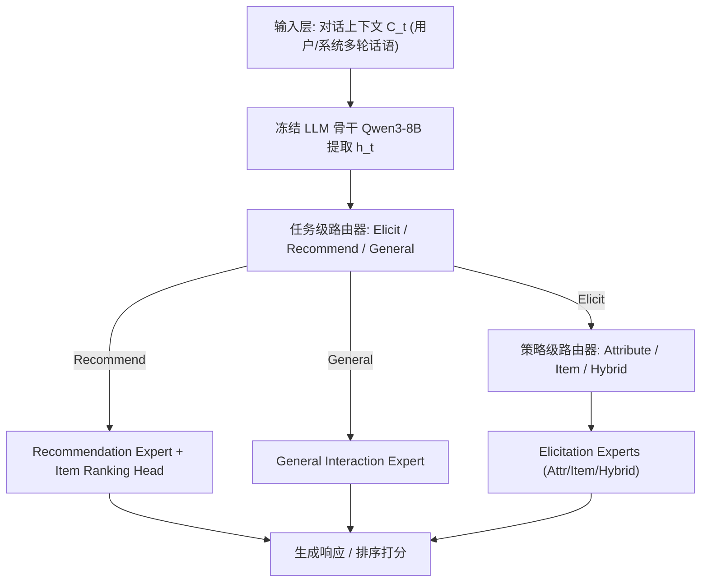

# When and How to Ask: Dynamic Preference Elicitation Strategies for Conversational Recommendation (何时与如何提问：对话推荐中的动态偏好诱导策略)

- **会议/期刊**: SIGIR 2026
- **推荐链路定位**: 对话策略层 (Dialogue Policy) / 端到端生成式 (End-to-End Generative) — 系统在每一轮决定"是否诱导偏好、用何种策略诱导、是否推荐"
- **研究方向**: 对话推荐与智能体仿真 (agent_conversational_rec) / 大语言模型推荐 (llm_rec)
- **论文原文**: [https://arxiv.org/abs/2607.06765v1](https://arxiv.org/abs/2607.06765v1)
- **开源代码**: [https://github.com/juanfacabian/InPE](https://github.com/juanfacabian/InPE) （数据集与代码仓库）

## TL;DR (核心速览)

针对对话推荐系统 (CRS) 中"何时提问、如何提问"这一被忽视的问题，作者通过 328 人用户研究实证发现偏好诱导策略具有**阶段依赖性**（早期属性型提问有效、后期物品型对比更优），据此构建了带细粒度策略标注的 **InPE** 数据集（基于 INSPIRED，6,719 条 turn 级样本），并提出 **COPE**——以冻结 Qwen3-8B 为骨干、LoRA 专家 + 两级硬路由的混合专家架构。在 InPE 上 Recall@10 达 0.314（较最强基线 ReFICR 的 0.274 提升约 14.6%），成对胜率 0.604。

## Background & Motivation (背景与动机)

- **领域背景与主流范式**: 对话推荐系统 (CRS) 通过多轮自然语言交互主动收集用户偏好。现有偏好诱导方法按 Gao et al. 综述分为两大类：**属性型 (attribute-based)**——询问"你喜欢什么类型电影"等属性问题；**物品型 (item-based)**——呈现具体物品让用户比较/选择（如成对比较、多选一）。
- **现有方法局限 (Limitations of Prior Work)**:
  1. **单一静态策略**：绝大多数 CRS 在整个对话中固定使用一种诱导策略（属性型常被当作默认），缺乏跨对话阶段的动态切换机制。
  2. **物品型诱导被低估**：现有工作大量聚焦属性问题的生成与排序（Priyogi、Zou et al.、Lei et al.、Ren et al.），物品型策略仅在有限或 ad hoc 场景使用。
  3. **主动式策略缺乏细粒度上下文感知**：已有主动式 CRS（如基于 RL 的图策略、MCMIPL 多选问题）依赖固定阶段启发式或单一主动行为，缺少细粒度、上下文感知的策略切换。
- **核心挑战 (Key Challenge)**: 用户偏好随对话推进从"抽象"自然演化到"具体"，因此不存在普适最优的单一策略；但现有 CRS 数据集**缺乏策略级标注**，无法支撑阶段感知的建模与学习。
- **核心洞察与切入点 (Key Insight)**: 作者先做**用户研究 (Pilot Study)**：328 名众包参与者、8 个对话场景（覆盖偏好探索/精化/推荐后调整三阶段）。结果（Figure 1）显示：早期阶段属性型选择占比高达 63%，随偏好具体化物品型稳步上升并在后期反超（后期约 65%）。同时 54%/59% 用户认为单一属性型/物品型策略"多数情况有效"，但仅 21%/25% 认为"所有情况都够用"。这直接引出三个 RQ 与"结构化动作空间 + 序贯决策"的建模思路。

## Problem Formulation & Method (问题定义与方法架构)

### 1. 符号定义与输入表征 (Notations & Input Representations)

- 用户集 $\mathcal{U}$、物品集 $\mathcal{V}$。
- 第 $t$ 轮对话上下文 $C_t = \{u_1, s_1, \dots, u_{t-1}, s_{t-1}, u_t\}$，其中 $u_i, s_i$ 分别为用户与系统话语。
- 策略 $\pi: C_t \to A_t$，动作 $A_t = \langle a_t, \sigma_t, \phi_t \rangle$ 为三元组：
  - $a_t \in \mathcal{A}_{act}$：高层意图 ∈ {Preference Elicitation, Item Recommendation, General Chat}；
  - $\sigma_t \in \mathcal{A}_{pe}$：诱导策略 ∈ {Attribute, Item, Hybrid}；
  - $\phi_t \in \mathcal{A}_{rec}$：推荐目标（排序逻辑/优先级）。
- 骨干：Qwen3-8B（冻结），LoRA rank $r=8$、$\alpha=16$，最大序列长度 2048 tokens。

### 2. 整体流水线 (Overall Architecture)

数据流：对话上下文 $C_t$ → 冻结 LLM 提取末位隐状态 $h_t$ → 两级路由器（任务级 → 策略级）预测专家索引 → 激活对应 LoRA 专家生成响应/推荐。训练时用 ground-truth 标签做 teacher-forced 路由，推理时用路由器预测。

### 3. 核心模块设计与数学原理 (Key Designs & Formulations)

**(1) 显式决策分解的概率建模**。传统 LLM-based CRS 直接最大化 $P(s_t|C_t)$ 的 token 似然（式 1），决策逻辑隐式嵌入序列。COPE 引入中间监督信号 $A_t$，将响应生成分解为：

$$P(s_t|C_t) = \sum_{A_t \in \mathcal{A}} P(s_t|C_t, A_t)\, P(A_t|C_t)$$

物理直觉：把"说什么"与"做什么决策"解耦，使策略选择成为可监督、可解释的显式变量。

**(2) 层级硬路由的 MoE 输出**。所有专家共享冻结骨干 $\Phi$，仅各自持有轻量 LoRA 参数 $\Delta\Psi_k$：

$$y_t = \Phi(C_t) + \sum_{k \in \mathcal{E}} \mathbb{I}(\gamma_t = k)\cdot \Delta\Psi_k(C_t)$$

其中 $\gamma_t$ 为激活专家索引。与常规 MoE（追求容量扩展）不同，COPE 的 MoE 目的是**分离决策执行通路**、学习策略专属行为模式；硬路由（单专家激活）避免梯度干扰。

**(3) 两级路由器**。取骨干末位隐状态 $h_t = \text{LLM}(C_t;\Theta_{frozen})[-1]$，先做任务级 softmax：

$$P(a_t|C_t) = \text{Softmax}(W_{task} h_t + b_{task})$$

当 $a_t = \text{Elicit}$ 时再做策略级 softmax：

$$P(\sigma_t|C_t, a_t=\text{Elicit}) = \text{Softmax}(W_{str} h_t + b_{str})$$

### 4. 训练目标、负采样与推理复杂度 (Optimization, Negative Sampling & Complexity)

- **总损失**（多目标加权和）：
  - 路由损失 $\mathcal{L}_{route} = -\lambda_\alpha \sum_t \log P(\alpha_t^*|C_t) - \lambda_\sigma \sum_t \mathbb{I}(\alpha_t^*=\text{Elicit})\log P(\sigma_t^*|C_t,\alpha_t^*)$；
  - 专家 SFT 损失 $\mathcal{L}_{sft} = -\sum_i \log P(x_i|x_{<i}, C_t;\Delta\Psi_{\gamma_t})$；
  - 推荐对比损失（InfoNCE，温度 $\tau$）：
    $$\mathcal{L}_{rec} = -\log \frac{\exp(\text{sim}(e_u,e_{i^+})/\tau)}{\exp(\text{sim}(e_u,e_{i^+})/\tau) + \sum_{j=1}^{N}\exp(\text{sim}(e_u,e_{i^-}^{(j)})/\tau)}$$
  - 权重（Table 5）：$w_{sft}=0.5$，$w_{task}=1.0$，$w_{eli}=1.0$，$w_{rec}=1.0$，LoRA dropout $P_{drop}=0.05$。
- **负采样策略**：推荐专家使用 InfoNCE 对比损失，物品嵌入由预训练 LLM 文本表征初始化；原文未明确报告负例采样方式（Uniform / In-batch / Hard Negative 均未说明），**原文未报告**具体负例构造细节。
- **训练/推理机制**：训练阶段 teacher-forced 路由（仅更新被激活专家 + 路由器），推理阶段由路由器预测 $\hat\gamma_t = \arg\max P(\alpha_t,\sigma_t|C_t)$ 动态选专家。优化器 AdamW，峰值学习率 $2\times10^{-5}$，warmup 0.03，batch size 8 × 4 梯度累积 = 有效 32，1 epoch，单卡 A100 80GB、BF16。
- **复杂度**：由于骨干冻结、仅训练 LoRA 与路由器，可训练参数量极小；推理时每轮需一次 LLM 前向 + 两次轻量线性路由，无需 Beam Search 展开（响应由单专家生成）。原文未报告具体 ms/request 延迟与峰值显存数值。

## Experimental Setup & Evaluation Protocol (实验设置与评估协议)

- **数据集统计与预处理**: 基于 INSPIRED 语料构建 InPE，原始 INSPIRED 含 999 段多轮对话、平均 21.15 轮/对话、共 10,576 个对话 turn。LLM（Qwen3-32B）初筛出 3,437 个候选 turn（32.5%），人工验证确认 60.07% 需要偏好诱导。最终 InPE 含 **6,719 个 turn 级样本**。

| 数据集 (Dataset) | 用户数 (#Users) | 物品数 (#Items) | 交互数 (#Interactions) | 稀疏度/密度 (Sparsity) | 模态/辅助特征说明 |
| :--- | :---: | :---: | :---: | :---: | :--- |
| INSPIRED (原始) | 原文未报告 | 原文未报告 | 10,576 turns / 999 dialogues | 原文未报告 | 电影领域多轮对话 |
| InPE (本文) | 原文未报告 | 原文未报告 | 6,719 turn-level samples | 原文未报告 | 任务标签 + 策略标签 + 目标物品 + 成对响应偏好 |

- **标注统计 (Table 1)**: Q1 偏好诱导需求 Yes 2,063 (60.02%) / No 1,374 (39.97%)；Q2 策略类型 Attribute 497 (24.09%) / Item 595 (28.84%) / Hybrid 969 (46.97%)。对话行为分布：General 46.3%、Elicitation 19.8%、Recommendation 33.9%。
- **标注质量**: 三人独立标注 + 多数投票，Krippendorff's $\alpha$：Q1 = 0.244（较低，反映"是否需要诱导"的主观性），Q2 = 0.531（中等，策略类型可区分度较好）。人工偏好评估（Table 3）：策略感知响应优于原始响应，Item 89.34%、Attribute 95.50%、Hybrid 89.85%。
- **数据划分方式 (Splitting Strategy)**: **Ratio Split 6:2:2**（train/val/test），按 turn 级样本划分。**注意**：按 turn 随机划分存在同一对话的相邻 turn 跨集合的潜在信息泄露风险，原文未讨论此问题。
- **排名评测协议 (Ranking Protocol)**: 推荐质量用 **Recall@1/10/50**，但原文**未明确说明是 Full-Ranking 还是 Sampled Ranking**（未报告候选集规模与负例比例），这是评估协议上的重要缺口。
- **评价指标**: (i) 推荐质量 Recall@k；(ii) 决策质量 Task Accuracy、Strategy Accuracy；(iii) 响应质量 Pairwise Win Rate、Log-likelihood Margin $\Delta LL = \mathbb{E}[\frac{\log P(y_w)}{|y_w|} - \frac{\log P(y_l)}{|y_l|}]$。原文**未报告**多随机种子方差或配对显著性检验。

## Key Experimental Results (核心实验结果)

### 1. 主实验对比 (Main Results)

**推荐性能 (Table 6)**：

| 数据集 | 指标 | 邻域/KG 基线 (NBCRS/KBRD/KGSF/TREA) | LLM 最强基线 (ReFICR) | 本文 COPE | 相对提升 (vs ReFICR) |
| :--- | :--- | :---: | :---: | :---: | :---: |
| InPE | Recall@1 | 0.023–0.057 | 0.135 | **0.144** | +6.67% |
| InPE | Recall@10 | 0.145–0.165 | 0.274 | **0.314** | +14.60% |
| InPE | Recall@50 | 0.210–0.346 | 0.396 | **0.442** | +11.62% |

提示型 LLM 基线（Qwen3-8B R@10=0.094、Llama3-8B-Instruct R@10=0.086）显著落后，说明无任务微调与主动决策引导时 LLM 推荐能力有限。

**响应质量成对评估 (Table 7)**：

| 方法 | Win Rate↑ | Margin↑ |
| :--- | :---: | :---: |
| LLaMA-3.1-8B | 0.503 | -0.018 |
| Qwen3-8B | 0.452 | -0.044 |
| ReFICR | 0.551 | 0.236 |
| **COPE (Ours)** | **0.604** | **0.314** |

### 2. 消融实验与控制变量分析 (Ablation Study)

**Table 8 专家消融**：

| 变体 | Task Acc | Eli Acc | Recall@10 | Win Rate |
| :--- | :---: | :---: | :---: | :---: |
| (1) Full | 0.618 | 0.711 | 0.314 | **0.604** |
| (2) w/o Rec | 0.566 | 0.623 | 0.303 | 0.598 |
| (3) w/o Eli | 0.602 | 0.586 | 0.315 | 0.628 |
| (4) w/o all | **0.639** | **0.756** | **0.335** | 0.525 |

**关键反直觉发现**：移除全部专家的统一变体 (w/o all) 在 Task Acc、Eli Acc、Recall@10 上反而最高，但成对胜率最差 (0.525)。作者解释：单一 adapter 能学到稳定的决策与检索信号，但生成的是缺乏策略感知细节的通用响应。这暴露了**准确率指标与生成质量指标之间的张力**——也说明 COPE 的收益主要来自"响应质量/策略感知"而非纯排序精度。消融未严格控制参数量对齐（w/o all 可训练参数更少），存在混淆因素。

**路由干预分析 (Table 9)**：

| Router 设置 | Task Acc | ELI@1 | R@10 |
| :--- | :---: | :---: | :---: |
| Ground Truth | 1.0 | 1.0 | **0.342** |
| Prediction | 0.617 | 0.711 | 0.314 |
| Random | 0.333 | 0.333 | 0.051 |

Ground Truth 路由下 R@10 升至 0.342，说明**专家本身有效，瓶颈在路由准确率**（Prediction 仅 0.617 Task Acc）；随机路由则崩溃至 0.051，证明专家选择至关重要。

### 3. 稀疏度/冷启动分桶与超参敏感度 (Sparsity Buckets & Hyperparameters)

- **阶段分桶分析 (Figure 5)**：路由激活呈现清晰的阶段模式——属性型策略集中于早期 turn，物品型在后期增多，Hybrid 全程稳定；子策略层面 `select` 在中后期主导（多关联 item/hybrid），`filling` 偏早期（关联 attribute，高效缩小候选空间），`confirm` 较少且集中于中间 turn。策略转移矩阵显示 GEN 是最常见的下一策略，REC 与 GEN 有显著自转移，ELI 自转移低、更多转向 GEN。
- **超参敏感度**：原文仅报告 Table 5 的固定权重配置，**未报告** $\tau$、$\lambda_\alpha/\lambda_\sigma$、LoRA rank 或专家数量的敏感度曲线。
- **线上 A/B 测试**：**原文仅包含离线实验**，无线上 A/B 结果。

## Highlights, Limitations & Critiques (亮点、局限与审稿级批判)

- **核心亮点与可迁移性**:
  1. **"阶段感知策略切换"的问题洞察**有实证支撑（328 人用户研究 + 标注数据分布双重印证），可迁移到客服对话、教育辅导、电商导购等所有需要主动信息获取的交互系统。
  2. **结构化动作空间 + 显式决策分解**（式 2）将隐式策略选择变为可监督变量，比纯 prompt 或纯 RL 更可控、可解释。
  3. **冻结骨干 + LoRA 专家 + 硬路由**的参数高效范式，工程上易落地，且路由干预实验清晰定位了"瓶颈在路由而非专家"。
  4. InPE 数据集填补了策略级细粒度标注的空白，具备独立基准价值。

- **局限性与审稿视角批判 (Critical Limitations)**:
  1. **评估协议不透明**：Recall@k 未说明 Full-Ranking 还是 Sampled Ranking、候选集规模与负例构造；6:2:2 按 turn 随机划分可能造成同对话相邻 turn 跨集合泄露，削弱结论可信度。
  2. **消融结论自相矛盾**：w/o all 在三个准确率/召回指标上均最优，却仅凭成对胜率判定 Full 模型"最鲁棒"，且未做参数量对齐控制，说服力不足。
  3. **路由准确率是硬瓶颈**（Task Acc 0.617），而 Q1 标注的 Krippendorff's $\alpha$ 仅 0.244，标注噪声可能直接限制路由上限；作者未讨论标注噪声对路由学习的影响。
  4. **单数据集、单领域（电影）**：仅在 InPE 上评估，缺乏跨领域（电商/音乐）与跨数据集泛化验证；基线中 KG 方法未针对 LLM 时代重训，比较公平性存疑。
  5. **统计严谨性缺失**：无多随机种子方差、无显著性检验；无推理延迟/显存报告，工业落地价值难以量化。
  6. **"Hybrid 占比最高 (46.97%)"** 与二分类用户研究（仅 attribute vs item）之间的张力未被充分解释。

## Rating (四维评分)

- **方法创新性 (Novelty)**: ⭐⭐⭐⭐ （阶段感知策略切换的问题定义 + 结构化动作空间 MoE 有新颖性，但 MoE/LoRA 组件本身较常规）
- **评估协议与实验扎实度 (Protocol & Experiments)**: ⭐⭐⭐ （用户研究与标注扎实，但排名协议不透明、划分有泄露风险、缺显著性检验、单数据集）
- **写作与数学规范度 (Clarity & Rigor)**: ⭐⭐⭐⭐ （问题形式化清晰、公式完整、图表丰富；但消融解读与部分统计口径不够严谨）
- **工业落地与复现价值 (Industrial & Practical Value)**: ⭐⭐⭐⭐ （参数高效、数据集开源、路由机制可解释，落地门槛低；但缺延迟数据与线上验证）
