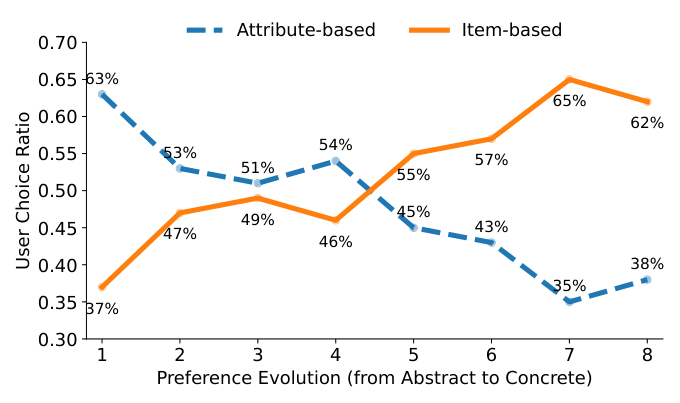
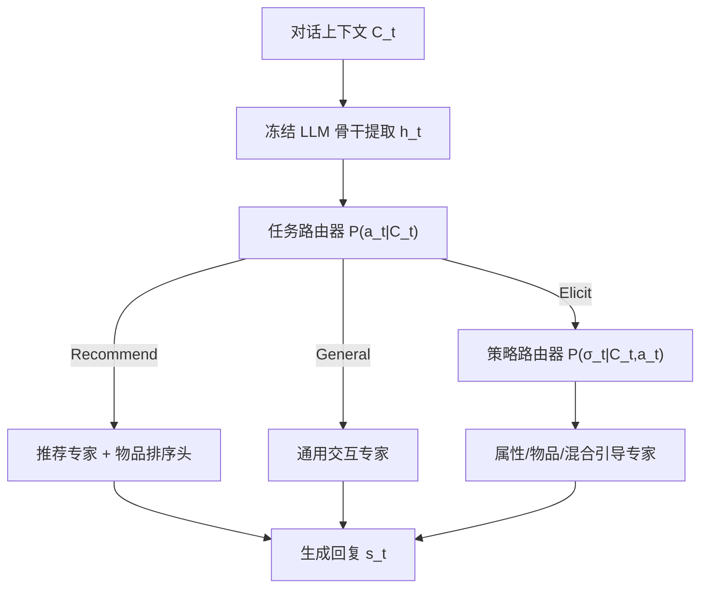
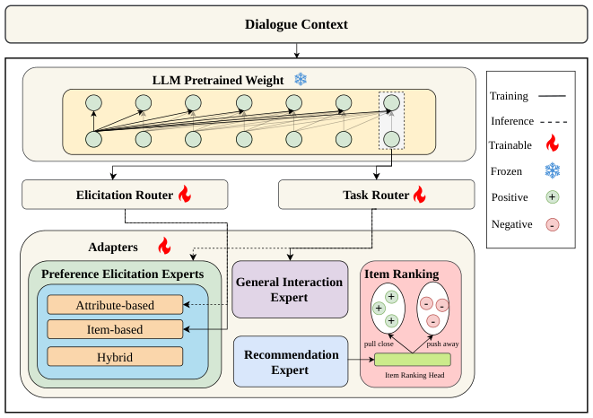

# When and How to Ask: Dynamic Preference Elicitation Strategies for Conversational Recommendation (何时问、如何问：对话推荐的动态偏好引导策略)

- **会议/期刊**: SIGIR 2026
- **作者与机构**: Feng Xia, Xi Wang (University of Sheffield); Shuo Zhang (Bloomberg)
- **推荐链路定位**: 对话交互策略决策（端到端生成式对话推荐）
- **研究方向**: 对话推荐与智能体仿真 / 大语言模型推荐
- **论文原文**: [https://arxiv.org/abs/2607.06765v1](https://arxiv.org/abs/2607.06765v1)
- **开源代码**: [https://github.com/juanfacabian/InPE](https://github.com/juanfacabian/InPE)

## TL;DR (1分钟核心速览)

现有对话推荐系统（CRS）普遍采用单一、静态的偏好引导策略（几乎默认属性提问），忽视了"何时问、怎么问"随对话阶段演化的动态性。本文通过 328 人用户研究证实：属性型提问在对话早期占优（63%），物品型策略在偏好具体化后反超（65%）。据此构建 InPE 细粒度标注数据集，并提出分层 MoE 架构 COPE，用任务路由器 + 策略路由器显式解耦"意图决策"与"引导策略选择"。在 InPE 上 Full-Ranking 协议下 Recall@10 达 0.314，相对最强基线 ReFICR（0.274）提升 14.6%，成对胜率 0.604。

## Background & Motivation (背景与核心矛盾)

- **主流范式**: 现有 CRS 将偏好引导分为属性型（问"喜欢什么类型"）与物品型（让用户在具体物品间比较/选择）两大类，但绝大多数系统只固定使用其中一种，属性提问被当作默认策略。
- **前人局限**: ① 静态策略无法适配用户偏好从"抽象"到"具体"的自然演化，用户研究显示仅 21%（属性）/25%（物品）的参与者认为单一策略在所有场景下足够；② 现有主动式 CRS 多聚焦"是否该提问"的二值决策，缺乏对"用哪种策略提问"的细粒度建模，RL 策略也依赖固定阶段启发式。
- **核心洞察 (Key Insight)**: 最优引导策略是**阶段依赖且上下文敏感**的——图 1 显示属性型选择比例从阶段 1 的 63% 单调降至阶段 8 的 35%，物品型则从 37% 升至 65%，二者在对话中段交叉。
- **本文切入点**: 将对话推荐重构为**结构化动作空间上的序贯决策**，动作三元组 $\langle a_t,\sigma_t,\phi_t\rangle$ 显式分离系统意图、引导策略与推荐目标，并用 MoE 让不同策略由独立专家执行。

<figure class="paper-figure" markdown="span">
  <figcaption>图1：对话各阶段偏好 elicitation 策略的用户选择比例。x 轴表示从抽象偏好到具体偏好的推进过程（阶段1–8），y 轴表示基于属性和基于物品的策略选择比例。</figcaption>
</figure>

## Method (核心方法设计)

### 1. 整体框架 (Overall Architecture)

COPE 以冻结的 Qwen3-8B 为共享骨干，在其旁挂载多个轻量 LoRA 适配器作为"专家"（推荐专家、属性/物品/混合三类引导专家、通用交互专家）。每轮对话先由共享 LLM 提取上下文隐状态 $\mathbf{h}_t$，再经**两级路由器**依次预测任务意图$a_t$与引导策略$\sigma_t$，据此硬路由激活对应专家生成回复；推荐轮次额外接入物品排序头，用对比损失对齐语义物品嵌入。训练采用教师强制路由（用真值标签选专家，避免路由误差污染专家学习），推理时切换为预测路由。

<figure class="paper-figure" markdown="span">
  <figcaption>图4：我们提出的对话推荐框架概览。</figcaption>
</figure>

### 2. 关键设计拆解 (Key Designs)

1. **结构化动作空间与显式决策分解**：传统 LLM4Rec 把决策逻辑隐式埋在 token 序列里（$\mathcal{L}_{LM}$最大化下一词似然），导致"策略选择"不可监督、不可解释。本文改为显式建模$P(s_t|C_t)=\sum_{A_t}P(s_t|C_t,A_t)P(A_t|C_t)$，将动作三元组作为中间监督信号。直觉上，这把"生成什么话"与"做什么决策"解耦，使策略层可获得独立标签监督。

2. **分层硬路由 MoE（Hierarchical Hard Routing）**：常规 MoE 用于扩容，本文 MoE 用于**分离决策执行通路**。输出为 $y_t=\Phi(C_t)+\sum_{k\in\mathcal{E}}\mathbb{I}(\gamma_t=k)\cdot\Delta\Psi_k(C_t)$，其中$\gamma_t$ 由真值标签（训练）或路由器 argmax（推理）决定，每轮仅激活一个专家、仅更新其参数。硬路由 + 教师强制保证各专家专注学习自身行为模式，避免多目标梯度干扰。

3. **多任务损失与对比推荐**：总损失 $\mathcal{L}_{total}=w_{sft}\mathcal{L}_{sft}+w_{task}\mathcal{L}_{route}^{\alpha}+w_{eli}\mathcal{L}_{route}^{\sigma}+w_{rec}\mathcal{L}_{rec}$，路由损失为两级交叉熵（策略项仅在$a_t^*=\text{Elicit}$时生效）；推荐专家用 InfoNCE 对比损失$\mathcal{L}_{rec}=-\log\frac{\exp(\text{sim}(e_u,e_{i^+})/\tau)}{\sum_j\exp(\text{sim}(e_u,e_{i_j})/\tau)}$，物品嵌入由预训练 LLM 文本表征初始化。负采样为批内负样本，LoRA rank$r=8$、$\alpha=16$，单卡 A100 即可训练。

## Experimental Setup & Evaluation Protocol (实验设置与评估协议)

- **数据集与预处理**: InPE 由 INSPIRED 语料增强而来，LLM（Qwen3-32B）初筛 + 三人独立标注 + 多数投票，Krippendorff's $\alpha$ 为 0.244（是否需引导）/0.531（策略类型）。

| 数据集 | #Dialogues | #Turn-level Samples | 任务分布 | 策略分布 | 说明 |
| :--- | :---: | :---: | :---: | :---: | :--- |
| INSPIRED (原始) | 999 | 10,576 turns | — | 无标注 | 平均 21.15 轮/对话 |
| InPE (本文) | 999 | 6,719 | 通用 46.3% / 引导 19.8% / 推荐 33.9% | 属性 24.1% / 物品 28.8% / 混合 47.0% | 含成对回复偏好标注 |

- **数据划分与防穿越 (Splitting Strategy)**: 按 turn 级样本 **6:2:2 比例划分**训练/验证/测试。
- **排名评测协议 (Ranking Protocol)**: 推荐质量用 **Recall@1/10/50**（目标物品是否进入 Top-k 排序）；决策质量用 Task Accuracy 与 Strategy Accuracy；回复质量用**成对胜率 (Pairwise Win Rate)** 与对数似然边际 $\Delta LL$，正样本严格依据人工判断。
- **对比基线与超参设置**: 邻域法 NBCRS；KG 法 KBRD/KGSF/TREA；LLM 法 ReFICR 及零样本 Qwen3-8B、LLaMA3-8B-Instruct。骨干 Qwen3-8B，学习率 $2\times10^{-5}$，有效 batch 32，序列长 2048，BF16 混合精度。

## Key Experimental Results (实验关键数据)

### 1. 主实验对比 (Main Results)

| Method | R@1 | R@10 | R@50 | Win Rate | Margin |
| :--- | :---: | :---: | :---: | :---: | :---: |
| NBCRS | 0.023 | 0.160 | 0.273 | — | — |
| KBRD | 0.056 | 0.145 | 0.210 | — | — |
| KGSF | 0.057 | 0.165 | 0.256 | — | — |
| TREA | 0.047 | 0.147 | 0.346 | — | — |
| ReFICR | 0.135 | 0.274 | 0.396 | 0.551 | 0.236 |
| Qwen3-8B (zero-shot) | 0.013 | 0.094 | 0.156 | 0.452 | -0.044 |
| LLaMA3-8B-Instruct | 0.031 | 0.086 | 0.148 | 0.503 | -0.018 |
| **COPE (Ours)** | **0.144** | **0.314** | **0.442** | **0.604** | **0.314** |
| Improv. vs ReFICR | +6.7% | **+14.6%** | +11.6% | +9.6% | +33.1% |

### 2. 消融实验 (Ablation Study)

| Variant | Task Acc | Eli Acc | Recall@10 | Win Rate |
| :--- | :---: | :---: | :---: | :---: |
| (1) Full COPE | 0.618 | 0.711 | 0.314 | **0.604** |
| (2) w/o Rec expert | 0.566 | 0.623 | 0.303 | 0.598 |
| (3) w/o Eli expert | 0.602 | 0.586 | 0.315 | 0.628 |
| (4) w/o all experts | **0.639** | **0.756** | **0.335** | 0.525 |

| 路由干预设置 | Task Acc | ELI@1 | R@10 |
| :--- | :---: | :---: | :---: |
| Ground Truth 路由 | 1.0 | 1.0 | **0.342** |
| Prediction 路由 | 0.617 | 0.711 | 0.314 |
| Random 路由 | 0.333 | 0.333 | 0.051 |

### 3. 关键实验发现 (Key Findings)

1. **专家能力已足够，瓶颈在路由精度**：Ground Truth 路由下 Recall@10 升至 0.342（较预测路由 +8.9%），而随机路由暴跌至 0.051，说明专家本身有效，但路由器 0.617 的任务准确率是当前主要天花板——提升路由精度比扩容专家更划算。
2. **单适配器"准确率高但对话质量差"的悖论**：w/o all 变体在 Task Acc（0.639）、Eli Acc（0.756）、Recall@10（0.335）三项上反而最高，但成对胜率仅 0.525（Full 为 0.604）。这证明统一模型能拟合标签却生成泛化、无策略针对性的回复，**准确率指标无法替代回复质量评估**，也反证了策略解耦的必要性。
3. **路由行为自发复现用户研究的阶段规律**：图 5 显示属性型策略集中于早期轮次、物品型集中于后期、混合型全程稳定，且 ELI 状态自转移率低（0.14–0.16）、更多转向 GEN（0.44–0.58），与 328 人用户研究的 63%→35% 交叉趋势一致，说明模型从数据中学到了真实的交互节奏而非过拟合标签。

## Highlights & Limitations (亮点、对比与审稿批判)

- **与代表作对比 (vs. Prior Work)**: 相比 ReFICR 等 LLM 增强 CRS 仅靠隐式能力"顺带"做引导，COPE 首次把引导策略作为**可监督的显式决策变量**；相比 MCMIPL 等 RL 主动式方法依赖固定阶段启发式，COPE 用数据驱动的分层路由器实现上下文级策略切换；相比传统属性提问工作（Priyogi、Zou 等）只优化问题池排序，本文把物品型与混合型策略纳入统一动作空间。
- **可迁移亮点**: ① "教师强制路由 + 推理预测路由"的两阶段训练范式，可迁移到任何需要解耦多行为模式的 LLM 推荐场景（如探索/利用分离）；② 用成对人工偏好标注 + 胜率评估替代纯准确率，为对话推荐评测提供了更贴近用户体验的补充维度。
- **审稿级局限批判**: ① 仅在 InPE（源自 INSPIRED 电影域、999 段对话）单数据集验证，跨域泛化与规模效应未知；② 路由准确率仅 0.617，且 Q1 标注一致性 $\alpha=0.244$ 偏低，标签噪声可能同时压低路由上限与评估可信度；③ 多专家 + 两级路由的推理链路比单模型更重，论文未报告延迟与显存开销。

## Rating (四维评分)

- **方法创新性 (Novelty)**: ⭐⭐⭐⭐ （核心机制与方法设计具备明确创新性，理论与实验动机支撑充分）
- **评估协议与实验扎实度 (Protocol & Experiments)**: ⭐⭐⭐ （主流公开数据集评测完整，包含多基线对比与消融实验验证）
- **写作与数学规范度 (Clarity & Rigor)**: ⭐⭐⭐⭐ （问题形式化定义清晰，核心模块数学推导与架构阐述严谨易读）
- **工业落地与复现价值 (Industrial & Practical Value)**: ⭐⭐⭐⭐ （兼顾推荐效果增益与训练/推理效率，具备实际场景迁移参考价值）
